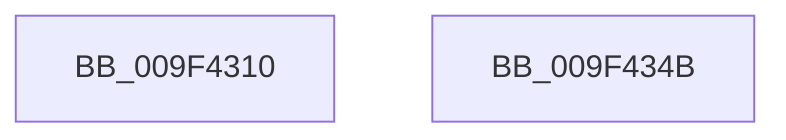

# PiPnpRtlGetDeviceInterfaceEnabled

- RVA: `0x009F4310`–`0x009F434C` (길이 `60` bytes)
- VA: `0x00000001409F4310`
- 실행 섹션: `PAGE`
- PDB 이름 있음: `예`; PDB Function 태그: `아니요`
- unwind 정보 RVA: `0x000697A4`
- 디코드: `18`개 명령, `60/60` bytes 표시
- 미해석 바이트: `0` (있으면 어셈블리에 `.byte`로 보존)

> 이 문서는 커널 이미지의 기계어와 PDB 기호를 분석해 생성했습니다. 4번과 5번은 함수 원형과 자료형을 바이너리 사용 방식에서 추정한 C 해석이며 원본 소스 복구 결과는 아닙니다.

## 1. Dependencies

- 직접 호출 지점: **1**; 고유 호출 대상: **1**
- 직접 호출자로 확인된 함수: **0**
- RIP 상대 이미지 참조: **0**

### Outgoing calls
- `0x009F433A` → [ZwPlugPlayControl](../../text/6A/ZwPlugPlayControl_function_006AF890.md) (function, `0x006AF890`)

### Direct callers
- 이 함수 시작 RVA로 연결되는 직접 call은 확인되지 않았습니다. 간접 호출은 완전히 역산할 수 없습니다.

### Static image references
- 디코드된 RIP-relative 메모리 참조가 없습니다.

## 2. Other-region calls and transfers

- 다른 실행 섹션으로 향하는 call: **1**
  - `0x009F433A` → [ZwPlugPlayControl](../../text/6A/ZwPlugPlayControl_function_006AF890.md) (`PAGE` → `.text`)
- 별도 외부 분기/꼬리 이동을 확인하지 못했습니다.

## 3. Assembly (complete function range)

```asm
009F4310  40 53                           push rbx
009F4312  48 83 EC 40                     sub rsp, 0x40
009F4316  0F 10 02                        movups xmm0, xmmword ptr [rdx]
009F4319  33 C0                           xor eax, eax
009F431B  48 8D 54 24 20                  lea rdx, [rsp + 0x20]
009F4320  49 8B D8                        mov rbx, r8
009F4323  48 89 44 24 30                  mov qword ptr [rsp + 0x30], rax
009F4328  F3 0F 7F 44 24 20               movdqu xmmword ptr [rsp + 0x20], xmm0
009F432E  44 89 4C 24 30                  mov dword ptr [rsp + 0x30], r9d
009F4333  44 8D 40 18                     lea r8d, [rax + 0x18]
009F4337  8D 48 17                        lea ecx, [rax + 0x17]
009F433A  E8 51 B5 CB FF                  call 0x1406af890
009F433F  8A 4C 24 34                     mov cl, byte ptr [rsp + 0x34]
009F4343  88 0B                           mov byte ptr [rbx], cl
009F4345  48 83 C4 40                     add rsp, 0x40
009F4349  5B                              pop rbx
009F434A  C3                              ret
009F434B  CC                              int3
```

## 4. C-style interpretation (structured pseudocode)

```c
__int64 __fastcall PiPnpRtlGetDeviceInterfaceEnabled(__int64 a1, __int64 a2, __int64 a3, int a4)
{
    __int64 result;
    __int64 v_rsp;
    unsigned __int8 v_stack_m14;
    unsigned __int64 v_stack_m18;
    unsigned __int64 v_stack_m28;

    v_rsp = (v_rsp) - (64);
    result = 0;
    v_stack_m18 = 0;
    v_stack_m28 = v_xmm0;
    v_stack_m18 = a4;
    result = ZwPlugPlayControl(result + 23, v_stack_m28, result + 24, a4);
    *(unsigned __int8 *)(a3) = (unsigned __int8)(v_stack_m14);
    v_rsp = (v_rsp) + (64);
    return result;
}
```

## 5. (Beta) C Style

```c
int64_t PiPnpRtlGetDeviceInterfaceEnabled(int64_t Arg1, void *Arg2, void *Arg3, int32_t Arg4)
{
    uint8_t *arg2 = (uint8_t *)Arg2;
    uint8_t *arg3 = (uint8_t *)Arg3;

    int64_t result;
    int64_t local_rsp;
    uint8_t v_stack_m14;
    uint64_t v_stack_m18;
    uint64_t v_stack_m28;

    local_rsp = (local_rsp) - (64);
    result = 0;
    v_stack_m18 = 0;
    v_stack_m28 = v_xmm0;
    v_stack_m18 = Arg4;
    result = ZwPlugPlayControl(result + 23, v_stack_m28, result + 24, Arg4);
    *(uint8_t *)(arg3) = (uint8_t)(v_stack_m14);
    local_rsp = (local_rsp) + (64);
    return result;
}
```

### 관측된 메모리 오프셋

구조체 형식이 확인되지 않은 접근은 인자 기준의 오프셋으로만 기록했습니다.

| 기준 인자 | 오프셋 표현 | 폭 (bit) | 접근 |
|---|---:|---:|---|
| `Arg2` | `+ 0x0` | `128` | `R` |
| `Arg3` | `+ 0x0` | `8` | `W` |

## 6. Execution-region graph

[열기: 2D/3D 그래프와 함수 탐색 컨트롤 패널](../../../control-panel.html?section=page&rva=0x009F4310&view=graph)

- 2D 그래프는 위에서 아래로 흐르고, 3D 그래프는 빈 공간을 드래그해 회전합니다. Shift+드래그는 이동, 휠은 확대·축소, 함수 노드 선택은 대상 보고서 이동입니다.

### Static fallback


