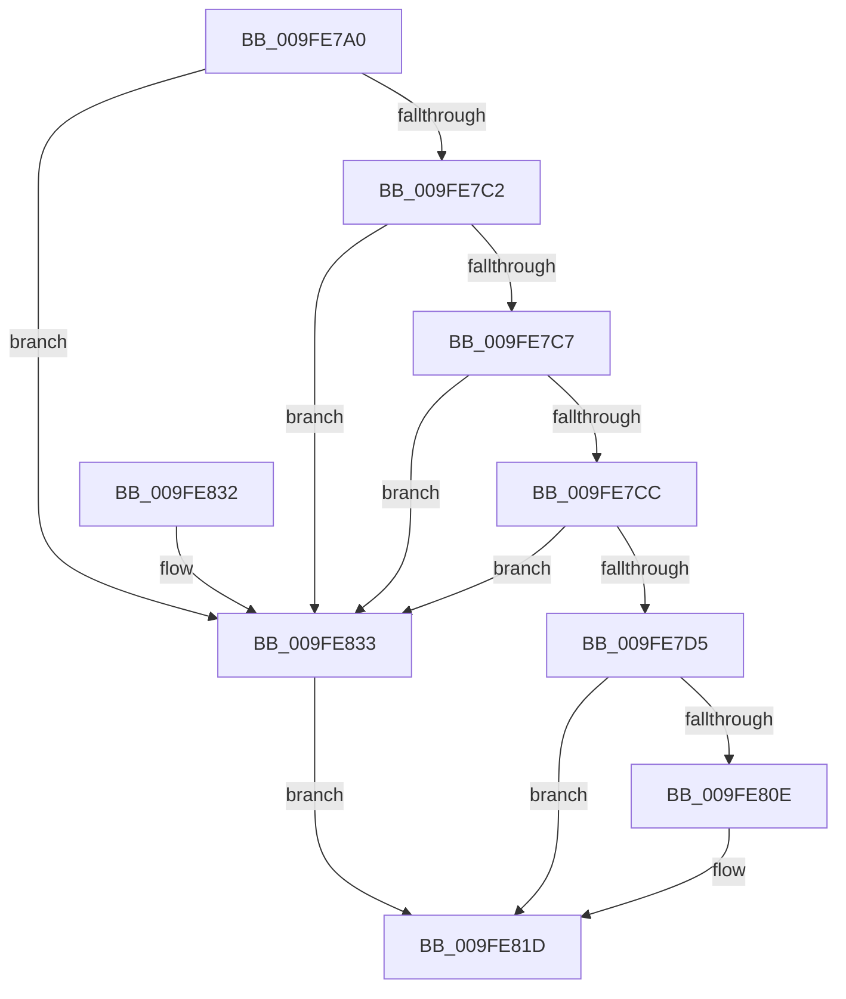

# PiPnpRtlGetDeviceStatus

- RVA: `0x009FE7A0`–`0x009FE83A` (길이 `154` bytes)
- VA: `0x00000001409FE7A0`
- 실행 섹션: `PAGE`
- PDB 이름 있음: `예`; PDB Function 태그: `아니요`
- unwind 정보 RVA: `0x000A75FC`
- 디코드: `47`개 명령, `154/154` bytes 표시
- 미해석 바이트: `0` (있으면 어셈블리에 `.byte`로 보존)

> 이 문서는 커널 이미지의 기계어와 PDB 기호를 분석해 생성했습니다. 4번과 5번은 함수 원형과 자료형을 바이너리 사용 방식에서 추정한 C 해석이며 원본 소스 복구 결과는 아닙니다.

## 1. Dependencies

- 직접 호출 지점: **1**; 고유 호출 대상: **1**
- 직접 호출자로 확인된 함수: **0**
- RIP 상대 이미지 참조: **0**

### Outgoing calls
- `0x009FE805` → [ZwPlugPlayControl](../../text/6A/ZwPlugPlayControl_function_006AF890.md) (function, `0x006AF890`)

### Direct callers
- 이 함수 시작 RVA로 연결되는 직접 call은 확인되지 않았습니다. 간접 호출은 완전히 역산할 수 없습니다.

### Static image references
- 디코드된 RIP-relative 메모리 참조가 없습니다.

## 2. Other-region calls and transfers

- 다른 실행 섹션으로 향하는 call: **1**
  - `0x009FE805` → [ZwPlugPlayControl](../../text/6A/ZwPlugPlayControl_function_006AF890.md) (`PAGE` → `.text`)
- 별도 외부 분기/꼬리 이동을 확인하지 못했습니다.

## 3. Assembly (complete function range)

```asm
009FE7A0  48 89 5C 24 08                  mov qword ptr [rsp + 8], rbx
009FE7A5  48 89 74 24 10                  mov qword ptr [rsp + 0x10], rsi
009FE7AA  48 89 7C 24 18                  mov qword ptr [rsp + 0x18], rdi
009FE7AF  55                              push rbp
009FE7B0  48 8B EC                        mov rbp, rsp
009FE7B3  48 83 EC 50                     sub rsp, 0x50
009FE7B7  49 8B F9                        mov rdi, r9
009FE7BA  49 8B F0                        mov rsi, r8
009FE7BD  48 85 D2                        test rdx, rdx
009FE7C0  74 71                           je 0x1409fe833
009FE7C2  4D 85 C0                        test r8, r8
009FE7C5  74 6C                           je 0x1409fe833
009FE7C7  4D 85 C9                        test r9, r9
009FE7CA  74 67                           je 0x1409fe833
009FE7CC  48 8B 5D 30                     mov rbx, qword ptr [rbp + 0x30]
009FE7D0  48 85 DB                        test rbx, rbx
009FE7D3  74 5E                           je 0x1409fe833
009FE7D5  0F 10 02                        movups xmm0, xmmword ptr [rdx]
009FE7D8  8B 45 38                        mov eax, dword ptr [rbp + 0x38]
009FE7DB  48 8D 55 D0                     lea rdx, [rbp - 0x30]
009FE7DF  83 65 F4 00                     and dword ptr [rbp - 0xc], 0
009FE7E3  41 B8 28 00 00 00               mov r8d, 0x28
009FE7E9  83 65 E0 00                     and dword ptr [rbp - 0x20], 0
009FE7ED  83 65 E4 00                     and dword ptr [rbp - 0x1c], 0
009FE7F1  83 65 E8 00                     and dword ptr [rbp - 0x18], 0
009FE7F5  83 65 F0 00                     and dword ptr [rbp - 0x10], 0
009FE7F9  41 8D 48 E6                     lea ecx, [r8 - 0x1a]
009FE7FD  F3 0F 7F 45 D0                  movdqu xmmword ptr [rbp - 0x30], xmm0
009FE802  89 45 EC                        mov dword ptr [rbp - 0x14], eax
009FE805  E8 86 10 CB FF                  call 0x1406af890
009FE80A  85 C0                           test eax, eax
009FE80C  78 0F                           js 0x1409fe81d
009FE80E  8B 4D E4                        mov ecx, dword ptr [rbp - 0x1c]
009FE811  89 0E                           mov dword ptr [rsi], ecx
009FE813  8B 4D E8                        mov ecx, dword ptr [rbp - 0x18]
009FE816  89 0F                           mov dword ptr [rdi], ecx
009FE818  8B 4D F0                        mov ecx, dword ptr [rbp - 0x10]
009FE81B  89 0B                           mov dword ptr [rbx], ecx
009FE81D  48 8B 5C 24 60                  mov rbx, qword ptr [rsp + 0x60]
009FE822  48 8B 74 24 68                  mov rsi, qword ptr [rsp + 0x68]
009FE827  48 8B 7C 24 70                  mov rdi, qword ptr [rsp + 0x70]
009FE82C  48 83 C4 50                     add rsp, 0x50
009FE830  5D                              pop rbp
009FE831  C3                              ret
009FE832  CC                              int3
009FE833  B8 0D 00 00 C0                  mov eax, 0xc000000d
009FE838  EB E3                           jmp 0x1409fe81d
```

## 4. C-style interpretation (structured pseudocode)

```c
__int64 __fastcall PiPnpRtlGetDeviceStatus(__int64 a1, __int64 a2, __int64 a3, __int64 a4, __int64 a5, unsigned int a6)
{
    __int64 result;
    __int64 v_rsp;
    unsigned int v_stack_m14;
    unsigned int v_stack_m18;
    unsigned int v_stack_m1C;
    unsigned int v_stack_m20;
    unsigned int v_stack_m24;
    unsigned int v_stack_m28;
    unsigned __int64 v_stack_m38;
    unsigned __int64 v_stack_p10;
    unsigned __int64 v_stack_p18;
    unsigned __int64 v_stack_p8;

    v_stack_p8 = v_rbx;
    v_stack_p10 = v_rsi;
    v_stack_p18 = v_rdi;
    v_rsp = (v_rsp) - (80);
    if (a2 == 0) goto loc_009FE833;
    if (a3 == 0) goto loc_009FE833;
    if (a4 == 0) goto loc_009FE833;
    if (a5 == 0) goto loc_009FE833;
    v_stack_m38 = v_xmm0;
    v_stack_m1C = (unsigned int)((unsigned int)(a6));
    result = ZwPlugPlayControl(40 - 26, v_stack_m38, 40, a4);
    if (!(sign_flag)) {
        a1 = v_stack_m24;
        *(unsigned int *)(a3) = (unsigned int)(a1);
        a1 = v_stack_m20;
        *(unsigned int *)(a4) = (unsigned int)(a1);
        a1 = v_stack_m18;
        *(unsigned int *)(a5) = (unsigned int)(a1);
    }
    v_rsp = (v_rsp) + (80);
    return result;
loc_009FE833:
    goto loc_009FE81D;
}
```

## 5. (Beta) C Style

```c
int64_t PiPnpRtlGetDeviceStatus(int64_t Arg1, int64_t Arg2, void *Arg3, void *Arg4, int64_t Arg5, uint32_t Arg6)
{
    uint8_t *arg3 = (uint8_t *)Arg3;
    uint8_t *arg4 = (uint8_t *)Arg4;

    int64_t result;
    int64_t local_rsp;
    uint32_t v_stack_m14;
    uint32_t v_stack_m18;
    uint32_t v_stack_m1C;
    uint32_t v_stack_m20;
    uint32_t v_stack_m24;
    uint32_t v_stack_m28;
    uint64_t v_stack_m38;
    uint64_t v_stack_p10;
    uint64_t v_stack_p18;
    uint64_t v_stack_p8;

    v_stack_p8 = local_rbx;
    v_stack_p10 = local_rsi;
    v_stack_p18 = local_rdi;
    local_rsp = (local_rsp) - (80);
    if (Arg2 == 0) goto loc_009FE833;
    if (Arg3 == NULL) goto loc_009FE833;
    if (Arg4 == NULL) goto loc_009FE833;
    if (Arg5 == 0) goto loc_009FE833;
    v_stack_m38 = v_xmm0;
    v_stack_m1C = (uint32_t)((uint32_t)(Arg6));
    result = ZwPlugPlayControl(40 - 26, v_stack_m38, 40, Arg4);
    if (!(sign_flag)) {
        Arg1 = v_stack_m24;
        *(uint32_t *)(arg3) = (uint32_t)(Arg1);
        Arg1 = v_stack_m20;
        *(uint32_t *)(arg4) = (uint32_t)(Arg1);
        Arg1 = v_stack_m18;
        *(uint32_t *)(Arg5) = (uint32_t)(Arg1);
    }
    local_rsp = (local_rsp) + (80);
    return result;
loc_009FE833:
    goto loc_009FE81D;
}
```

### 관측된 메모리 오프셋

구조체 형식이 확인되지 않은 접근은 인자 기준의 오프셋으로만 기록했습니다.

| 기준 인자 | 오프셋 표현 | 폭 (bit) | 접근 |
|---|---:|---:|---|
| `Arg3` | `+ 0x0` | `32` | `W` |
| `Arg4` | `+ 0x0` | `32` | `W` |

## 6. Execution-region graph

[열기: 2D/3D 그래프와 함수 탐색 컨트롤 패널](../../../control-panel.html?section=page&rva=0x009FE7A0&view=graph)

- 2D 그래프는 위에서 아래로 흐르고, 3D 그래프는 빈 공간을 드래그해 회전합니다. Shift+드래그는 이동, 휠은 확대·축소, 함수 노드 선택은 대상 보고서 이동입니다.

### Static fallback


