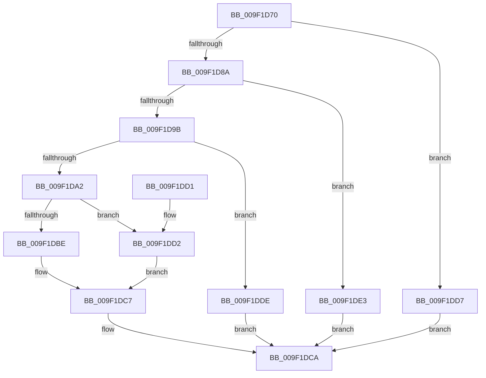

# PsTlsGetValue

- RVA: `0x009F1D70`–`0x009F1DEA` (길이 `122` bytes)
- VA: `0x00000001409F1D70`
- 실행 섹션: `PAGE`
- PDB 이름 있음: `예`; PDB Function 태그: `아니요`
- unwind 정보 RVA: `0x00065F4C`
- 디코드: `37`개 명령, `122/122` bytes 표시
- 미해석 바이트: `0` (있으면 어셈블리에 `.byte`로 보존)

> 이 문서는 커널 이미지의 기계어와 PDB 기호를 분석해 생성했습니다. 4번과 5번은 함수 원형과 자료형을 바이너리 사용 방식에서 추정한 C 해석이며 원본 소스 복구 결과는 아닙니다.

## 1. Dependencies

- 직접 호출 지점: **0**; 고유 호출 대상: **0**
- 직접 호출자로 확인된 함수: **0**
- RIP 상대 이미지 참조: **0**

### Outgoing calls
- 직접 디코드된 call 명령이 없습니다.

### Direct callers
- 이 함수 시작 RVA로 연결되는 직접 call은 확인되지 않았습니다. 간접 호출은 완전히 역산할 수 없습니다.

### Static image references
- 디코드된 RIP-relative 메모리 참조가 없습니다.

## 2. Other-region calls and transfers

- 다른 실행 섹션으로 향하는 call: **0**
- 별도 외부 분기/꼬리 이동을 확인하지 못했습니다.

## 3. Assembly (complete function range)

```asm
009F1D70  48 83 EC 28                     sub rsp, 0x28
009F1D74  4C 8B C2                        mov r8, rdx
009F1D77  65 48 8B 14 25 88 01 00 00      mov rdx, qword ptr gs:[0x188]
009F1D80  8B 82 F0 06 00 00               mov eax, dword ptr [rdx + 0x6f0]
009F1D86  A8 03                           test al, 3
009F1D88  75 4D                           jne 0x1409f1dd7
009F1D8A  4C 8B 8A F0 06 00 00            mov r9, qword ptr [rdx + 0x6f0]
009F1D91  8D 41 FF                        lea eax, [rcx - 1]
009F1D94  3D EE 00 00 00                  cmp eax, 0xee
009F1D99  77 48                           ja 0x1409f1de3
009F1D9B  33 D2                           xor edx, edx
009F1D9D  4D 85 C9                        test r9, r9
009F1DA0  74 3C                           je 0x1409f1dde
009F1DA2  8D 41 10                        lea eax, [rcx + 0x10]
009F1DA5  0F BD C8                        bsr ecx, eax
009F1DA8  44 8D 52 01                     lea r10d, [rdx + 1]
009F1DAC  41 D3 E2                        shl r10d, cl
009F1DAF  44 33 D0                        xor r10d, eax
009F1DB2  8D 41 FC                        lea eax, [rcx - 4]
009F1DB5  4D 8B 1C C1                     mov r11, qword ptr [r9 + rax*8]
009F1DB9  4D 85 DB                        test r11, r11
009F1DBC  74 14                           je 0x1409f1dd2
009F1DBE  4B 8D 0C 52                     lea rcx, [r10 + r10*2]
009F1DC2  49 8B 44 CB 08                  mov rax, qword ptr [r11 + rcx*8 + 8]
009F1DC7  49 89 00                        mov qword ptr [r8], rax
009F1DCA  8B C2                           mov eax, edx
009F1DCC  48 83 C4 28                     add rsp, 0x28
009F1DD0  C3                              ret
009F1DD1  CC                              int3
009F1DD2  48 8B C2                        mov rax, rdx
009F1DD5  EB F0                           jmp 0x1409f1dc7
009F1DD7  BA 4B 00 00 C0                  mov edx, 0xc000004b
009F1DDC  EB EC                           jmp 0x1409f1dca
009F1DDE  49 89 10                        mov qword ptr [r8], rdx
009F1DE1  EB E7                           jmp 0x1409f1dca
009F1DE3  BA 0D 00 00 C0                  mov edx, 0xc000000d
009F1DE8  EB E0                           jmp 0x1409f1dca
```

## 4. C-style interpretation (structured pseudocode)

```c
__int64 __fastcall PsTlsGetValue(__int64 a1, __int64 a2)
{
    __int64 v_r10;
    __int64 v_rsp;

    v_rsp = (v_rsp) - (40);
    if ((((unsigned __int8)((unsigned int)(*(unsigned int *)(*(unsigned __int64 *)(gs_base + (0 + 392)) + 1776)))) & (3)) != 0) goto loc_009F1DD7;
    if (((unsigned int)(a1 - 1)) > 238) goto loc_009F1DE3;
    a2 = 0;
    if (*(unsigned __int64 *)(*(unsigned __int64 *)(gs_base + (0 + 392)) + 1776) == 0) goto loc_009F1DDE;
    v_r10 = (unsigned int)((a2 + 1) << ((unsigned __int8)(a1)));
    v_r10 = (unsigned int)((v_r10) ^ ((unsigned int)(a1 + 16)));
    if (*(unsigned __int64 *)(*(unsigned __int64 *)(*(unsigned __int64 *)(gs_base + (0 + 392)) + 1776) + a1 - 4 * 8) == 0) goto loc_009F1DD2;
loc_009F1DC7:
    *(unsigned __int64 *)(a2) = *(unsigned __int64 *)(*(unsigned __int64 *)(*(unsigned __int64 *)(*(unsigned __int64 *)(gs_base + (0 + 392)) + 1776) + a1 - 4 * 8) + v_r10 + v_r10 * 2 * 8 + 8);
loc_009F1DCA:
    v_rsp = (v_rsp) + (40);
    return 0;
loc_009F1DD2:
    goto loc_009F1DC7;
loc_009F1DD7:
    goto loc_009F1DCA;
loc_009F1DDE:
    *(unsigned __int64 *)(a2) = (unsigned int)(0xC000004BULL);
    goto loc_009F1DCA;
loc_009F1DE3:
    goto loc_009F1DCA;
}
```

## 5. (Beta) C Style

```c
int64_t PsTlsGetValue(void *Arg1, void *Arg2)
{
    uint8_t *arg1 = (uint8_t *)Arg1;
    uint8_t *arg2 = (uint8_t *)Arg2;

    int64_t local_r10;
    int64_t local_rsp;

    local_rsp = (local_rsp) - (40);
    if ((((uint8_t)((uint32_t)(*(uint32_t *)(*(uint64_t *)(gs_base + (0 + 0x188)) + 0x6F0)))) & (3)) != 0) goto loc_009F1DD7;
    if (((uint32_t)(Arg1 - 1)) > 238) goto loc_009F1DE3;
    Arg2 = 0;
    if (*(uint64_t *)(*(uint64_t *)(gs_base + (0 + 0x188)) + 0x6F0) == 0) goto loc_009F1DDE;
    local_r10 = (uint32_t)((Arg2 + 1) << ((uint8_t)(Arg1)));
    local_r10 = (uint32_t)((local_r10) ^ ((uint32_t)(Arg1 + 16)));
    if (*(uint64_t *)(*(uint64_t *)(*(uint64_t *)(gs_base + (0 + 0x188)) + 0x6F0) + arg1 - 0x4 * 8) == 0) goto loc_009F1DD2;
loc_009F1DC7:
    *(uint64_t *)(arg2) = *(uint64_t *)(*(uint64_t *)(*(uint64_t *)(*(uint64_t *)(gs_base + (0 + 0x188)) + 0x6F0) + arg1 - 0x4 * 8) + local_r10 + local_r10 * 2 * 8 + 0x8);
loc_009F1DCA:
    local_rsp = (local_rsp) + (40);
    return 0;
loc_009F1DD2:
    goto loc_009F1DC7;
loc_009F1DD7:
    goto loc_009F1DCA;
loc_009F1DDE:
    *(uint64_t *)(arg2) = (uint32_t)(0xC000004BULL);
    goto loc_009F1DCA;
loc_009F1DE3:
    goto loc_009F1DCA;
}
```

### 관측된 메모리 오프셋

구조체 형식이 확인되지 않은 접근은 인자 기준의 오프셋으로만 기록했습니다.

| 기준 인자 | 오프셋 표현 | 폭 (bit) | 접근 |
|---|---:|---:|---|
| `Arg1` | `- 0x1` | `32` | `R` |
| `Arg1` | `+ 0x10` | `32` | `R` |
| `Arg2` | `+ 0x0` | `64` | `W` |

## 6. Execution-region graph

[열기: 2D/3D 그래프와 함수 탐색 컨트롤 패널](../../../control-panel.html?section=page&rva=0x009F1D70&view=graph)

- 2D 그래프는 위에서 아래로 흐르고, 3D 그래프는 빈 공간을 드래그해 회전합니다. Shift+드래그는 이동, 휠은 확대·축소, 함수 노드 선택은 대상 보고서 이동입니다.

### Static fallback


