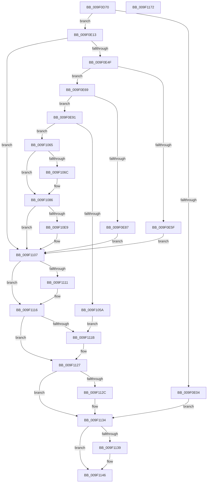

# PspCreatePicoThread

- RVA: `0x009F0D70`–`0x009F1173` (길이 `1,027` bytes)
- VA: `0x00000001409F0D70`
- 실행 섹션: `PAGE`
- PDB 이름 있음: `예`; PDB Function 태그: `아니요`
- unwind 정보 RVA: `0x000A5DB4`
- 디코드: `220`개 명령, `1,027/1,027` bytes 표시
- 미해석 바이트: `0` (있으면 어셈블리에 `.byte`로 보존)

> 이 문서는 커널 이미지의 기계어와 PDB 기호를 분석해 생성했습니다. 4번과 5번은 함수 원형과 자료형을 바이너리 사용 방식에서 추정한 C 해석이며 원본 소스 복구 결과는 아닙니다.

## 1. Dependencies

- 직접 호출 지점: **14**; 고유 호출 대상: **11**
- 직접 호출자로 확인된 함수: **0**
- RIP 상대 이미지 참조: **2**

### Outgoing calls
- `0x009F0DB5` → [memset](../../text/6C/memset_function_006C6C40.md) (function, `0x006C6C40`)
- `0x009F0DD4` → [memset](../../text/6C/memset_function_006C6C40.md) (function, `0x006C6C40`)
- `0x009F0E40` → [ObpReferenceObjectByHandleWithTag](../86/ObpReferenceObjectByHandleWithTag_function_00869650.md) (function, `0x00869650`)
- `0x009F0E7E` → [ExAcquireRundownProtection](../../text/21/ExAcquireRundownProtection_function_00216620.md) (function, `0x00216620`)
- `0x009F0E9E` → [ObfReferenceObjectWithTag](../../text/21/ObfReferenceObjectWithTag_function_00210710.md) (function, `0x00210710`)
- `0x009F0EB2` → [memset](../../text/6C/memset_function_006C6C40.md) (function, `0x006C6C40`)
- `0x009F104F` → [PspAllocateThread](../9E/PspAllocateThread_function_009EF72C.md) (function, `0x009EF72C`)
- `0x009F1076` → [memset](../../text/6C/memset_function_006C6C40.md) (function, `0x006C6C40`)
- `0x009F10DE` → [PspInsertThread](PspInsertThread_function_009F0314.md) (function, `0x009F0314`)
- `0x009F1111` → [ObfDereferenceObject](../../text/2F/ObfDereferenceObject_function_002F9350.md) (function, `0x002F9350`)
- `0x009F1122` → [ExReleaseRundownProtection](../../text/34/ExReleaseRundownProtection_function_00349E80.md) (function, `0x00349E80`)
- `0x009F112F` → [KiLeaveCriticalRegionUnsafe](../../text/25/KiLeaveCriticalRegionUnsafe_function_0025F010.md) (function, `0x0025F010`)
- `0x009F1141` → [ObfDereferenceObjectWithTag](../../text/2F/ObfDereferenceObjectWithTag_function_002F78E0.md) (function, `0x002F78E0`)
- `0x009F1152` → [_security_check_cookie](../../text/6A/_security_check_cookie_function_006AC640.md) (function, `0x006AC640`)

### Direct callers
- 이 함수 시작 RVA로 연결되는 직접 call은 확인되지 않았습니다. 간접 호출은 완전히 역산할 수 없습니다.

### Static image references
- `0x009F0D8F` → RVA `0x00E0A740` (`.data`; read)
- `0x009F0E13` → RVA `0x00FC6A98` (`ALMOSTRO`; read)

## 2. Other-region calls and transfers

- 다른 실행 섹션으로 향하는 call: **11**
  - `0x009F0DB5` → [memset](../../text/6C/memset_function_006C6C40.md) (`PAGE` → `.text`)
  - `0x009F0DD4` → [memset](../../text/6C/memset_function_006C6C40.md) (`PAGE` → `.text`)
  - `0x009F0E7E` → [ExAcquireRundownProtection](../../text/21/ExAcquireRundownProtection_function_00216620.md) (`PAGE` → `.text`)
  - `0x009F0E9E` → [ObfReferenceObjectWithTag](../../text/21/ObfReferenceObjectWithTag_function_00210710.md) (`PAGE` → `.text`)
  - `0x009F0EB2` → [memset](../../text/6C/memset_function_006C6C40.md) (`PAGE` → `.text`)
  - `0x009F1076` → [memset](../../text/6C/memset_function_006C6C40.md) (`PAGE` → `.text`)
  - `0x009F1111` → [ObfDereferenceObject](../../text/2F/ObfDereferenceObject_function_002F9350.md) (`PAGE` → `.text`)
  - `0x009F1122` → [ExReleaseRundownProtection](../../text/34/ExReleaseRundownProtection_function_00349E80.md) (`PAGE` → `.text`)
  - `0x009F112F` → [KiLeaveCriticalRegionUnsafe](../../text/25/KiLeaveCriticalRegionUnsafe_function_0025F010.md) (`PAGE` → `.text`)
  - `0x009F1141` → [ObfDereferenceObjectWithTag](../../text/2F/ObfDereferenceObjectWithTag_function_002F78E0.md) (`PAGE` → `.text`)
  - `0x009F1152` → [_security_check_cookie](../../text/6A/_security_check_cookie_function_006AC640.md) (`PAGE` → `.text`)
- 별도 외부 분기/꼬리 이동을 확인하지 못했습니다.

## 3. Assembly (complete function range)

```asm
009F0D70  48 89 5C 24 20                  mov qword ptr [rsp + 0x20], rbx
009F0D75  55                              push rbp
009F0D76  56                              push rsi
009F0D77  57                              push rdi
009F0D78  41 54                           push r12
009F0D7A  41 55                           push r13
009F0D7C  41 56                           push r14
009F0D7E  41 57                           push r15
009F0D80  48 8D AC 24 90 F7 FF FF         lea rbp, [rsp - 0x870]
009F0D88  48 81 EC 70 09 00 00            sub rsp, 0x970
009F0D8F  48 8B 05 AA 99 41 00            mov rax, qword ptr [rip + 0x4199aa]
009F0D96  48 33 C4                        xor rax, rsp
009F0D99  48 89 85 60 08 00 00            mov qword ptr [rbp + 0x860], rax
009F0DA0  4D 8B E8                        mov r13, r8
009F0DA3  4C 8B E2                        mov r12, rdx
009F0DA6  4C 8B F1                        mov r14, rcx
009F0DA9  33 D2                           xor edx, edx
009F0DAB  41 B8 60 02 00 00               mov r8d, 0x260
009F0DB1  48 8D 4D 98                     lea rcx, [rbp - 0x68]
009F0DB5  E8 86 5E CD FF                  call 0x1406c6c40
009F0DBA  33 FF                           xor edi, edi
009F0DBC  48 8D 8D D0 06 00 00            lea rcx, [rbp + 0x6d0]
009F0DC3  33 D2                           xor edx, edx
009F0DC5  89 7C 24 60                     mov dword ptr [rsp + 0x60], edi
009F0DC9  41 B8 90 01 00 00               mov r8d, 0x190
009F0DCF  48 89 7C 24 78                  mov qword ptr [rsp + 0x78], rdi
009F0DD4  E8 67 5E CD FF                  call 0x1406c6c40
009F0DD9  33 C0                           xor eax, eax
009F0DDB  48 89 7C 24 68                  mov qword ptr [rsp + 0x68], rdi
009F0DE0  0F 57 C0                        xorps xmm0, xmm0
009F0DE3  48 89 45 90                     mov qword ptr [rbp - 0x70], rax
009F0DE7  0F 11 45 80                     movups xmmword ptr [rbp - 0x80], xmm0
009F0DEB  65 4C 8B 3C 25 88 01 00 00      mov r15, qword ptr gs:[0x188]
009F0DF4  8B DF                           mov ebx, edi
009F0DF6  48 89 7C 24 70                  mov qword ptr [rsp + 0x70], rdi
009F0DFB  49 39 BE B8 00 00 00            cmp qword ptr [r14 + 0xb8], rdi
009F0E02  75 0F                           jne 0x1409f0e13
009F0E04  48 8B 7C 24 70                  mov rdi, qword ptr [rsp + 0x70]
009F0E09  BE 0D 00 00 C0                  mov esi, 0xc000000d
009F0E0E  E9 21 03 00 00                  jmp 0x1409f1134
009F0E13  4C 8B 05 7E 5C 5D 00            mov r8, qword ptr [rip + 0x5d5c7e]
009F0E1A  48 8D 44 24 70                  lea rax, [rsp + 0x70]
009F0E1F  49 8B 0E                        mov rcx, qword ptr [r14]
009F0E22  45 33 C9                        xor r9d, r9d
009F0E25  48 89 7C 24 38                  mov qword ptr [rsp + 0x38], rdi
009F0E2A  48 89 7C 24 30                  mov qword ptr [rsp + 0x30], rdi
009F0E2F  48 89 44 24 28                  mov qword ptr [rsp + 0x28], rax
009F0E34  41 8D 51 02                     lea edx, [r9 + 2]
009F0E38  C7 44 24 20 50 73 43 72         mov dword ptr [rsp + 0x20], 0x72437350
009F0E40  E8 0B 88 E7 FF                  call 0x140869650
009F0E45  8B F0                           mov esi, eax
009F0E47  85 C0                           test eax, eax
009F0E49  0F 88 B8 02 00 00               js 0x1409f1107
009F0E4F  48 8B 7C 24 70                  mov rdi, qword ptr [rsp + 0x70]
009F0E54  33 F6                           xor esi, esi
009F0E56  48 39 B7 40 06 00 00            cmp qword ptr [rdi + 0x640], rsi
009F0E5D  75 0A                           jne 0x1409f0e69
009F0E5F  BE 08 00 00 C0                  mov esi, 0xc0000008
009F0E64  E9 9E 02 00 00                  jmp 0x1409f1107
009F0E69  66 41 FF 8F E4 01 00 00         dec word ptr [r15 + 0x1e4]
009F0E71  48 8D 8F E8 01 00 00            lea rcx, [rdi + 0x1e8]
009F0E78  90                              nop
009F0E79  BB 01 00 00 00                  mov ebx, 1
009F0E7E  E8 9D 57 82 FF                  call 0x140216620
009F0E83  84 C0                           test al, al
009F0E85  75 0A                           jne 0x1409f0e91
009F0E87  BE 0A 01 00 C0                  mov esi, 0xc000010a
009F0E8C  E9 76 02 00 00                  jmp 0x1409f1107
009F0E91  BA 50 73 43 72                  mov edx, 0x72437350
009F0E96  48 8B CF                        mov rcx, rdi
009F0E99  BB 03 00 00 00                  mov ebx, 3
009F0E9E  E8 6D F8 81 FF                  call 0x140210710
009F0EA3  33 D2                           xor edx, edx
009F0EA5  48 8D 8D 00 02 00 00            lea rcx, [rbp + 0x200]
009F0EAC  41 B8 D0 04 00 00               mov r8d, 0x4d0
009F0EB2  E8 89 5D CD FF                  call 0x1406c6c40
009F0EB7  49 8B 46 10                     mov rax, qword ptr [r14 + 0x10]
009F0EBB  45 33 C9                        xor r9d, r9d
009F0EBE  49 8B 4E 18                     mov rcx, qword ptr [r14 + 0x18]
009F0EC2  45 33 C0                        xor r8d, r8d
009F0EC5  49 8B 56 20                     mov rdx, qword ptr [r14 + 0x20]
009F0EC9  48 89 85 F8 02 00 00            mov qword ptr [rbp + 0x2f8], rax
009F0ED0  8D 43 28                        lea eax, [rbx + 0x28]
009F0ED3  66 89 85 42 02 00 00            mov word ptr [rbp + 0x242], ax
009F0EDA  8D 43 30                        lea eax, [rbx + 0x30]
009F0EDD  66 89 85 38 02 00 00            mov word ptr [rbp + 0x238], ax
009F0EE4  B8 7F 02 00 00                  mov eax, 0x27f
009F0EE9  66 89 85 00 03 00 00            mov word ptr [rbp + 0x300], ax
009F0EF0  49 8B 46 08                     mov rax, qword ptr [r14 + 8]
009F0EF4  48 89 85 98 02 00 00            mov qword ptr [rbp + 0x298], rax
009F0EFB  41 0F B7 46 38                  movzx eax, word ptr [r14 + 0x38]
009F0F00  66 89 85 3E 02 00 00            mov word ptr [rbp + 0x23e], ax
009F0F07  41 0F B7 46 3A                  movzx eax, word ptr [r14 + 0x3a]
009F0F0C  66 89 85 40 02 00 00            mov word ptr [rbp + 0x240], ax
009F0F13  49 8B 46 28                     mov rax, qword ptr [r14 + 0x28]
009F0F17  48 89 45 88                     mov qword ptr [rbp - 0x78], rax
009F0F1B  49 8B 46 30                     mov rax, qword ptr [r14 + 0x30]
009F0F1F  48 89 45 90                     mov qword ptr [rbp - 0x70], rax
009F0F23  49 8B 46 40                     mov rax, qword ptr [r14 + 0x40]
009F0F27  48 89 85 78 02 00 00            mov qword ptr [rbp + 0x278], rax
009F0F2E  49 8B 46 48                     mov rax, qword ptr [r14 + 0x48]
009F0F32  48 89 85 90 02 00 00            mov qword ptr [rbp + 0x290], rax
009F0F39  49 8B 46 60                     mov rax, qword ptr [r14 + 0x60]
009F0F3D  48 89 85 B0 02 00 00            mov qword ptr [rbp + 0x2b0], rax
009F0F44  49 8B 46 68                     mov rax, qword ptr [r14 + 0x68]
009F0F48  48 89 85 A8 02 00 00            mov qword ptr [rbp + 0x2a8], rax
009F0F4F  49 8B 46 70                     mov rax, qword ptr [r14 + 0x70]
009F0F53  48 89 85 A0 02 00 00            mov qword ptr [rbp + 0x2a0], rax
009F0F5A  49 8B 46 78                     mov rax, qword ptr [r14 + 0x78]
009F0F5E  48 89 85 B8 02 00 00            mov qword ptr [rbp + 0x2b8], rax
009F0F65  49 8B 86 80 00 00 00            mov rax, qword ptr [r14 + 0x80]
009F0F6C  48 89 85 C0 02 00 00            mov qword ptr [rbp + 0x2c0], rax
009F0F73  49 8B 86 88 00 00 00            mov rax, qword ptr [r14 + 0x88]
009F0F7A  48 89 85 C8 02 00 00            mov qword ptr [rbp + 0x2c8], rax
009F0F81  49 8B 86 90 00 00 00            mov rax, qword ptr [r14 + 0x90]
009F0F88  48 89 85 D0 02 00 00            mov qword ptr [rbp + 0x2d0], rax
009F0F8F  49 8B 86 98 00 00 00            mov rax, qword ptr [r14 + 0x98]
009F0F96  48 89 85 D8 02 00 00            mov qword ptr [rbp + 0x2d8], rax
009F0F9D  49 8B 86 A0 00 00 00            mov rax, qword ptr [r14 + 0xa0]
009F0FA4  48 89 85 E0 02 00 00            mov qword ptr [rbp + 0x2e0], rax
009F0FAB  49 8B 86 A8 00 00 00            mov rax, qword ptr [r14 + 0xa8]
009F0FB2  48 89 85 E8 02 00 00            mov qword ptr [rbp + 0x2e8], rax
009F0FB9  49 8B 86 B0 00 00 00            mov rax, qword ptr [r14 + 0xb0]
009F0FC0  48 89 85 F0 02 00 00            mov qword ptr [rbp + 0x2f0], rax
009F0FC7  48 8D 85 D0 06 00 00            lea rax, [rbp + 0x6d0]
009F0FCE  48 89 44 24 58                  mov qword ptr [rsp + 0x58], rax
009F0FD3  48 8D 44 24 68                  lea rax, [rsp + 0x68]
009F0FD8  48 89 74 24 50                  mov qword ptr [rsp + 0x50], rsi
009F0FDD  48 89 44 24 48                  mov qword ptr [rsp + 0x48], rax
009F0FE2  48 8D 44 24 60                  lea rax, [rsp + 0x60]
009F0FE7  48 89 44 24 40                  mov qword ptr [rsp + 0x40], rax
009F0FEC  48 8D 45 80                     lea rax, [rbp - 0x80]
009F0FF0  48 89 74 24 38                  mov qword ptr [rsp + 0x38], rsi
009F0FF5  48 89 8D 80 02 00 00            mov qword ptr [rbp + 0x280], rcx
009F0FFC  B9 80 1F 00 00                  mov ecx, 0x1f80
009F1001  48 89 74 24 30                  mov qword ptr [rsp + 0x30], rsi
009F1006  48 89 44 24 28                  mov qword ptr [rsp + 0x28], rax
009F100B  48 8D 85 00 02 00 00            lea rax, [rbp + 0x200]
009F1012  48 89 95 88 02 00 00            mov qword ptr [rbp + 0x288], rdx
009F1019  33 D2                           xor edx, edx
009F101B  89 8D 34 02 00 00               mov dword ptr [rbp + 0x234], ecx
009F1021  89 8D 18 03 00 00               mov dword ptr [rbp + 0x318], ecx
009F1027  48 8B CF                        mov rcx, rdi
009F102A  48 89 44 24 20                  mov qword ptr [rsp + 0x20], rax
009F102F  C7 85 30 02 00 00 0B 00 10 00   mov dword ptr [rbp + 0x230], 0x10000b
009F1039  C7 85 3A 02 00 00 2B 00 2B 00   mov dword ptr [rbp + 0x23a], 0x2b002b
009F1043  C7 44 24 60 01 00 00 00         mov dword ptr [rsp + 0x60], 1
009F104B  48 89 75 80                     mov qword ptr [rbp - 0x80], rsi
009F104F  E8 D8 E6 FF FF                  call 0x1409ef72c
009F1054  8B F0                           mov esi, eax
009F1056  85 C0                           test eax, eax
009F1058  79 0B                           jns 0x1409f1065
009F105A  48 83 64 24 68 00               and qword ptr [rsp + 0x68], 0
009F1060  E9 B6 00 00 00                  jmp 0x1409f111b
009F1065  33 D2                           xor edx, edx
009F1067  4D 85 E4                        test r12, r12
009F106A  74 1A                           je 0x1409f1086
009F106C  41 B8 60 02 00 00               mov r8d, 0x260
009F1072  48 8D 4D 98                     lea rcx, [rbp - 0x68]
009F1076  E8 C5 5B CD FF                  call 0x1406c6c40
009F107B  48 8D 55 98                     lea rdx, [rbp - 0x68]
009F107F  4C 89 A5 38 01 00 00            mov qword ptr [rbp + 0x138], r12
009F1086  48 83 64 24 50 00               and qword ptr [rsp + 0x50], 0
009F108C  4C 8D 4C 24 60                  lea r9, [rsp + 0x60]
009F1091  48 8B 44 24 68                  mov rax, qword ptr [rsp + 0x68]
009F1096  45 33 C0                        xor r8d, r8d
009F1099  49 8B 8E B8 00 00 00            mov rcx, qword ptr [r14 + 0xb8]
009F10A0  48 89 88 70 06 00 00            mov qword ptr [rax + 0x670], rcx
009F10A7  48 8D 44 24 78                  lea rax, [rsp + 0x78]
009F10AC  48 8B 4C 24 68                  mov rcx, qword ptr [rsp + 0x68]
009F10B1  48 89 44 24 48                  mov qword ptr [rsp + 0x48], rax
009F10B6  48 8D 85 D0 06 00 00            lea rax, [rbp + 0x6d0]
009F10BD  48 89 44 24 40                  mov qword ptr [rsp + 0x40], rax
009F10C2  48 83 64 24 38 00               and qword ptr [rsp + 0x38], 0
009F10C8  48 89 54 24 30                  mov qword ptr [rsp + 0x30], rdx
009F10CD  48 8B D7                        mov rdx, rdi
009F10D0  48 83 64 24 28 00               and qword ptr [rsp + 0x28], 0
009F10D6  C7 44 24 20 FF FF 1F 00         mov dword ptr [rsp + 0x20], 0x1fffff
009F10DE  E8 31 F2 FF FF                  call 0x1409f0314
009F10E3  8B F0                           mov esi, eax
009F10E5  85 C0                           test eax, eax
009F10E7  78 1E                           js 0x1409f1107
009F10E9  48 8B 44 24 68                  mov rax, qword ptr [rsp + 0x68]
009F10EE  F0 0F BA A8 A0 05 00 00 14      lock bts dword ptr [rax + 0x5a0], 0x14
009F10F7  48 8B 44 24 78                  mov rax, qword ptr [rsp + 0x78]
009F10FC  33 F6                           xor esi, esi
009F10FE  48 8B 7C 24 70                  mov rdi, qword ptr [rsp + 0x70]
009F1103  49 89 45 00                     mov qword ptr [r13], rax
009F1107  48 8B 4C 24 68                  mov rcx, qword ptr [rsp + 0x68]
009F110C  48 85 C9                        test rcx, rcx
009F110F  74 05                           je 0x1409f1116
009F1111  E8 3A 82 90 FF                  call 0x1402f9350
009F1116  83 FB 02                        cmp ebx, 2
009F1119  72 0C                           jb 0x1409f1127
009F111B  48 8D 8F E8 01 00 00            lea rcx, [rdi + 0x1e8]
009F1122  E8 59 8D 95 FF                  call 0x140349e80
009F1127  F6 C3 01                        test bl, 1
009F112A  74 08                           je 0x1409f1134
009F112C  49 8B CF                        mov rcx, r15
009F112F  E8 DC DE 86 FF                  call 0x14025f010
009F1134  48 85 FF                        test rdi, rdi
009F1137  74 0D                           je 0x1409f1146
009F1139  BA 50 73 43 72                  mov edx, 0x72437350
009F113E  48 8B CF                        mov rcx, rdi
009F1141  E8 9A 67 90 FF                  call 0x1402f78e0
009F1146  8B C6                           mov eax, esi
009F1148  48 8B 8D 60 08 00 00            mov rcx, qword ptr [rbp + 0x860]
009F114F  48 33 CC                        xor rcx, rsp
009F1152  E8 E9 B4 CB FF                  call 0x1406ac640
009F1157  48 8B 9C 24 C8 09 00 00         mov rbx, qword ptr [rsp + 0x9c8]
009F115F  48 81 C4 70 09 00 00            add rsp, 0x970
009F1166  41 5F                           pop r15
009F1168  41 5E                           pop r14
009F116A  41 5D                           pop r13
009F116C  41 5C                           pop r12
009F116E  5F                              pop rdi
009F116F  5E                              pop rsi
009F1170  5D                              pop rbp
009F1171  C3                              ret
009F1172  CC                              int3
```

## 4. C-style interpretation (structured pseudocode)

```c
__int64 __fastcall PspCreatePicoThread(__int64 a1, __int64 a2, __int64 a3, int a4)
{
    __int64 result;
    __int64 v_rdi;
    __int64 v_rsi;
    __int64 v_rsp;
    unsigned __int64 v_stack_m1D8;
    unsigned __int64 v_stack_m48;
    unsigned int v_stack_m590;
    unsigned __int16 v_stack_m5A8;
    unsigned __int64 v_stack_m5B0;
    unsigned __int64 v_stack_m5B8;
    unsigned __int64 v_stack_m5C0;
    unsigned __int64 v_stack_m5C8;
    unsigned __int64 v_stack_m5D0;
    unsigned __int64 v_stack_m5D8;
    unsigned __int64 v_stack_m5E0;
    unsigned __int64 v_stack_m5E8;
    unsigned __int64 v_stack_m5F0;
    unsigned __int64 v_stack_m5F8;
    unsigned __int64 v_stack_m600;
    unsigned __int64 v_stack_m608;
    unsigned __int64 v_stack_m610;
    unsigned __int64 v_stack_m618;
    unsigned __int64 v_stack_m620;
    unsigned __int64 v_stack_m628;
    unsigned __int64 v_stack_m630;
    unsigned __int16 v_stack_m666;
    unsigned __int16 v_stack_m668;
    unsigned __int16 v_stack_m66A;
    unsigned int v_stack_m66E;
    unsigned __int16 v_stack_m670;
    unsigned int v_stack_m674;
    unsigned int v_stack_m678;
    unsigned __int64 v_stack_m6A8;
    unsigned __int64 v_stack_m770;
    unsigned __int64 v_stack_m8A8;
    unsigned __int64 v_stack_m910;
    unsigned __int64 v_stack_m918;
    unsigned __int64 v_stack_m920;
    unsigned __int64 v_stack_m928;
    unsigned __int64 v_stack_m930;
    unsigned __int64 v_stack_m938;
    unsigned __int64 v_stack_m940;
    unsigned int v_stack_m948;
    unsigned __int64 v_stack_m950;
    unsigned __int64 v_stack_m958;
    unsigned __int64 v_stack_m960;
    unsigned __int64 v_stack_m968;
    unsigned __int64 v_stack_m970;
    unsigned __int64 v_stack_m978;
    unsigned __int64 v_stack_m980;
    unsigned int v_stack_m988;
    unsigned __int64 v_stack_p20;

    v_stack_p20 = v_rbx;
    v_rsp = (v_rsp) - (0x970ULL);
    result = (*(unsigned __int64 *)(v_rip + 4299178)) ^ (v_rsp);
    v_stack_m48 = result;
    a2 = 0;
    result = memset(v_stack_m910, a2, 608, a4);
    v_rdi = 0;
    a2 = 0;
    v_stack_m948 = 0;
    v_stack_m930 = 0;
    result = memset(v_stack_m1D8, a2, 400, a4);
    result = 0;
    v_stack_m940 = 0;
    v_stack_m918 = 0;
    v_stack_m928 = v_xmm0;
    v_stack_m938 = 0;
    if ((*(unsigned __int64 *)(a1 + 184)) != 0) goto loc_009F0E13;
    goto loc_009F1134;
loc_009F0E13:
    a4 = 0;
    v_stack_m970 = v_stack_m938;
    v_stack_m978 = v_stack_m938;
    v_stack_m980 = v_stack_m938;
    v_stack_m988 = 0x72437350ULL;
    result = ObpReferenceObjectByHandleWithTag(*(unsigned __int64 *)(a1), a4 + 2, *(unsigned __int64 *)(v_rip + 6118526), a4);
    if (sign_flag) goto loc_009F1107;
    v_rsi = 0;
    if ((*(unsigned __int64 *)(v_stack_m938 + 1600)) != 0) goto loc_009F0E69;
    goto loc_009F1107;
loc_009F0E69:
    result = ExAcquireRundownProtection(v_stack_m938 + 488, a4 + 2, *(unsigned __int64 *)(v_rip + 6118526), a4);
    if ((unsigned __int8)(result) != 0) goto loc_009F0E91;
    goto loc_009F1107;
loc_009F0E91:
    result = ObfReferenceObjectWithTag(v_stack_m938, (unsigned int)(0x72437350ULL), *(unsigned __int64 *)(v_rip + 6118526), a4);
    a2 = 0;
    result = memset(v_stack_m6A8, a2, (unsigned int)(0x4D0ULL), a4);
    a4 = 0;
    a3 = 0;
    v_stack_m5B0 = *(unsigned __int64 *)(a1 + 16);
    v_stack_m666 = (unsigned __int16)(3 + 40);
    v_stack_m670 = (unsigned __int16)(3 + 48);
    v_stack_m5A8 = 639;
    v_stack_m610 = *(unsigned __int64 *)(a1 + 8);
    v_stack_m66A = (unsigned __int16)(*(unsigned __int16 *)(a1 + 56));
    v_stack_m668 = (unsigned __int16)(*(unsigned __int16 *)(a1 + 58));
    v_stack_m920 = *(unsigned __int64 *)(a1 + 40);
    v_stack_m918 = *(unsigned __int64 *)(a1 + 48);
    v_stack_m630 = *(unsigned __int64 *)(a1 + 64);
    v_stack_m618 = *(unsigned __int64 *)(a1 + 72);
    v_stack_m5F8 = *(unsigned __int64 *)(a1 + 96);
    v_stack_m600 = *(unsigned __int64 *)(a1 + 104);
    v_stack_m608 = *(unsigned __int64 *)(a1 + 112);
    v_stack_m5F0 = *(unsigned __int64 *)(a1 + 120);
    v_stack_m5E8 = *(unsigned __int64 *)(a1 + 128);
    v_stack_m5E0 = *(unsigned __int64 *)(a1 + 136);
    v_stack_m5D8 = *(unsigned __int64 *)(a1 + 144);
    v_stack_m5D0 = *(unsigned __int64 *)(a1 + 152);
    v_stack_m5C8 = *(unsigned __int64 *)(a1 + 160);
    v_stack_m5C0 = *(unsigned __int64 *)(a1 + 168);
    v_stack_m5B8 = *(unsigned __int64 *)(a1 + 176);
    v_stack_m950 = v_stack_m1D8;
    v_stack_m958 = (unsigned int)(0xC000010AULL);
    v_stack_m960 = v_stack_m940;
    v_stack_m968 = v_stack_m948;
    v_stack_m970 = (unsigned int)(0xC000010AULL);
    v_stack_m628 = *(unsigned __int64 *)(a1 + 24);
    v_stack_m978 = (unsigned int)(0xC000010AULL);
    v_stack_m980 = v_stack_m928;
    v_stack_m620 = *(unsigned __int64 *)(a1 + 32);
    a2 = 0;
    v_stack_m674 = (unsigned int)((unsigned int)(0x1F80ULL));
    v_stack_m590 = (unsigned int)((unsigned int)(0x1F80ULL));
    v_stack_m988 = v_stack_m6A8;
    v_stack_m678 = 0x10000BULL;
    v_stack_m66E = 0x2B002BULL;
    v_stack_m948 = 1;
    v_stack_m928 = (unsigned int)(0xC000010AULL);
    result = PspAllocateThread(v_stack_m938, a2, a3, a4);
    if (!sign_flag) goto loc_009F1065;
    goto loc_009F111B;
loc_009F1065:
    a2 = 0;
    if (0 != 0) {
        a3 = 608;
        a1 = v_stack_m910;
        result = memset(a1, a2, a3, a4);
        a2 = v_stack_m910;
        v_stack_m770 = a2;
    }
    a3 = 0;
    *(unsigned __int64 *)(v_stack_m940 + 1648) = *(unsigned __int64 *)(a1 + 184);
    v_stack_m960 = v_stack_m930;
    v_stack_m968 = v_stack_m1D8;
    v_stack_m978 = a2;
    v_stack_m988 = 0x1FFFFFULL;
    result = PspInsertThread(v_stack_m940, v_stack_m938, a3, v_stack_m948);
    v_rsi = (unsigned int)((unsigned int)(result));
    v_rdi = v_stack_m938;
    if (!(sign_flag)) {
        result = v_stack_m940;
        result = v_stack_m930;
        v_rsi = 0;
        v_rdi = v_stack_m938;
        *(unsigned __int64 *)(a3) = result;
    }
    if (v_stack_m940 != 0) {
        result = ObfDereferenceObject(v_stack_m940, v_stack_m938, a3, v_stack_m948);
    }
    if (3 >= 2) {
        a1 = v_rdi + 488;
        result = ExReleaseRundownProtection(a1, v_stack_m938, a3, v_stack_m948);
    }
    if (((3) & (1)) != 0) {
        a1 = *(unsigned __int64 *)(gs_base + (0 + 392));
        result = KiLeaveCriticalRegionUnsafe(a1, v_stack_m938, a3, v_stack_m948);
    }
    if (v_rdi != 0) {
        a2 = 0x72437350ULL;
        a1 = v_rdi;
        result = ObfDereferenceObjectWithTag(a1, a2, a3, v_stack_m948);
    }
    a1 = (v_stack_m48) ^ (v_rsp);
    result = _security_check_cookie(a1, a2, a3, v_stack_m948);
    v_rsp = (v_rsp) + (0x970ULL);
    return result;
}
```

## 5. (Beta) C Style

```c
int64_t PspCreatePicoThread(void *Arg1, int64_t Arg2, void *Arg3, int32_t Arg4)
{
    uint8_t *arg1 = (uint8_t *)Arg1;
    uint8_t *arg3 = (uint8_t *)Arg3;

    int64_t result;
    int64_t local_rdi;
    int64_t local_rsi;
    int64_t local_rsp;
    uint64_t v_stack_m1D8;
    uint64_t v_stack_m48;
    uint32_t v_stack_m590;
    uint16_t v_stack_m5A8;
    uint64_t v_stack_m5B0;
    uint64_t v_stack_m5B8;
    uint64_t v_stack_m5C0;
    uint64_t v_stack_m5C8;
    uint64_t v_stack_m5D0;
    uint64_t v_stack_m5D8;
    uint64_t v_stack_m5E0;
    uint64_t v_stack_m5E8;
    uint64_t v_stack_m5F0;
    uint64_t v_stack_m5F8;
    uint64_t v_stack_m600;
    uint64_t v_stack_m608;
    uint64_t v_stack_m610;
    uint64_t v_stack_m618;
    uint64_t v_stack_m620;
    uint64_t v_stack_m628;
    uint64_t v_stack_m630;
    uint16_t v_stack_m666;
    uint16_t v_stack_m668;
    uint16_t v_stack_m66A;
    uint32_t v_stack_m66E;
    uint16_t v_stack_m670;
    uint32_t v_stack_m674;
    uint32_t v_stack_m678;
    uint64_t v_stack_m6A8;
    uint64_t v_stack_m770;
    uint64_t v_stack_m8A8;
    uint64_t v_stack_m910;
    uint64_t v_stack_m918;
    uint64_t v_stack_m920;
    uint64_t v_stack_m928;
    uint64_t v_stack_m930;
    uint64_t v_stack_m938;
    uint64_t v_stack_m940;
    uint32_t v_stack_m948;
    uint64_t v_stack_m950;
    uint64_t v_stack_m958;
    uint64_t v_stack_m960;
    uint64_t v_stack_m968;
    uint64_t v_stack_m970;
    uint64_t v_stack_m978;
    uint64_t v_stack_m980;
    uint32_t v_stack_m988;
    uint64_t v_stack_p20;

    v_stack_p20 = local_rbx;
    local_rsp = (local_rsp) - (0x970ULL);
    result = (*(uint64_t *)(v_rip + 0x4199AA)) ^ (local_rsp);
    v_stack_m48 = result;
    Arg2 = 0;
    result = memset(v_stack_m910, Arg2, 608, Arg4);
    local_rdi = 0;
    Arg2 = 0;
    v_stack_m948 = 0;
    v_stack_m930 = 0;
    result = memset(v_stack_m1D8, Arg2, 400, Arg4);
    result = 0;
    v_stack_m940 = 0;
    v_stack_m918 = 0;
    v_stack_m928 = v_xmm0;
    v_stack_m938 = 0;
    if ((*(uint64_t *)(arg1 + 0xB8)) != 0) goto loc_009F0E13;
    goto loc_009F1134;
loc_009F0E13:
    Arg4 = 0;
    v_stack_m970 = v_stack_m938;
    v_stack_m978 = v_stack_m938;
    v_stack_m980 = v_stack_m938;
    v_stack_m988 = 0x72437350ULL;
    result = ObpReferenceObjectByHandleWithTag(*(uint64_t *)(arg1), Arg4 + 2, *(uint64_t *)(v_rip + 0x5D5C7E), Arg4);
    if (sign_flag) goto loc_009F1107;
    local_rsi = 0;
    if ((*(uint64_t *)(v_stack_m938 + 0x640)) != 0) goto loc_009F0E69;
    goto loc_009F1107;
loc_009F0E69:
    result = ExAcquireRundownProtection(v_stack_m938 + 488, Arg4 + 2, *(uint64_t *)(v_rip + 0x5D5C7E), Arg4);
    if ((uint8_t)(result) != 0) goto loc_009F0E91;
    goto loc_009F1107;
loc_009F0E91:
    result = ObfReferenceObjectWithTag(v_stack_m938, (uint32_t)(0x72437350ULL), *(uint64_t *)(v_rip + 0x5D5C7E), Arg4);
    Arg2 = 0;
    result = memset(v_stack_m6A8, Arg2, (uint32_t)(0x4D0ULL), Arg4);
    Arg4 = 0;
    Arg3 = 0;
    v_stack_m5B0 = *(uint64_t *)(arg1 + 0x10);
    v_stack_m666 = (uint16_t)(3 + 40);
    v_stack_m670 = (uint16_t)(3 + 48);
    v_stack_m5A8 = 639;
    v_stack_m610 = *(uint64_t *)(arg1 + 0x8);
    v_stack_m66A = (uint16_t)(*(uint16_t *)(arg1 + 0x38));
    v_stack_m668 = (uint16_t)(*(uint16_t *)(arg1 + 0x3A));
    v_stack_m920 = *(uint64_t *)(arg1 + 0x28);
    v_stack_m918 = *(uint64_t *)(arg1 + 0x30);
    v_stack_m630 = *(uint64_t *)(arg1 + 0x40);
    v_stack_m618 = *(uint64_t *)(arg1 + 0x48);
    v_stack_m5F8 = *(uint64_t *)(arg1 + 0x60);
    v_stack_m600 = *(uint64_t *)(arg1 + 0x68);
    v_stack_m608 = *(uint64_t *)(arg1 + 0x70);
    v_stack_m5F0 = *(uint64_t *)(arg1 + 0x78);
    v_stack_m5E8 = *(uint64_t *)(arg1 + 0x80);
    v_stack_m5E0 = *(uint64_t *)(arg1 + 0x88);
    v_stack_m5D8 = *(uint64_t *)(arg1 + 0x90);
    v_stack_m5D0 = *(uint64_t *)(arg1 + 0x98);
    v_stack_m5C8 = *(uint64_t *)(arg1 + 0xA0);
    v_stack_m5C0 = *(uint64_t *)(arg1 + 0xA8);
    v_stack_m5B8 = *(uint64_t *)(arg1 + 0xB0);
    v_stack_m950 = v_stack_m1D8;
    v_stack_m958 = (uint32_t)(0xC000010AULL);
    v_stack_m960 = v_stack_m940;
    v_stack_m968 = v_stack_m948;
    v_stack_m970 = (uint32_t)(0xC000010AULL);
    v_stack_m628 = *(uint64_t *)(arg1 + 0x18);
    v_stack_m978 = (uint32_t)(0xC000010AULL);
    v_stack_m980 = v_stack_m928;
    v_stack_m620 = *(uint64_t *)(arg1 + 0x20);
    Arg2 = 0;
    v_stack_m674 = (uint32_t)((uint32_t)(0x1F80ULL));
    v_stack_m590 = (uint32_t)((uint32_t)(0x1F80ULL));
    v_stack_m988 = v_stack_m6A8;
    v_stack_m678 = 0x10000BULL;
    v_stack_m66E = 0x2B002BULL;
    v_stack_m948 = 1;
    v_stack_m928 = (uint32_t)(0xC000010AULL);
    result = PspAllocateThread(v_stack_m938, Arg2, Arg3, Arg4);
    if (!sign_flag) goto loc_009F1065;
    goto loc_009F111B;
loc_009F1065:
    Arg2 = 0;
    if (0 != 0) {
        Arg3 = 608;
        Arg1 = v_stack_m910;
        result = memset(Arg1, Arg2, Arg3, Arg4);
        Arg2 = v_stack_m910;
        v_stack_m770 = Arg2;
    }
    Arg3 = 0;
    *(uint64_t *)(v_stack_m940 + 0x670) = *(uint64_t *)(arg1 + 0xB8);
    v_stack_m960 = v_stack_m930;
    v_stack_m968 = v_stack_m1D8;
    v_stack_m978 = Arg2;
    v_stack_m988 = 0x1FFFFFULL;
    result = PspInsertThread(v_stack_m940, v_stack_m938, Arg3, v_stack_m948);
    local_rsi = (uint32_t)((uint32_t)(result));
    local_rdi = v_stack_m938;
    if (!(sign_flag)) {
        result = v_stack_m940;
        result = v_stack_m930;
        local_rsi = 0;
        local_rdi = v_stack_m938;
        *(uint64_t *)(arg3) = result;
    }
    if (v_stack_m940 != 0) {
        result = ObfDereferenceObject(v_stack_m940, v_stack_m938, Arg3, v_stack_m948);
    }
    if (3 >= 2) {
        Arg1 = local_rdi + 488;
        result = ExReleaseRundownProtection(Arg1, v_stack_m938, Arg3, v_stack_m948);
    }
    if (((3) & (1)) != 0) {
        Arg1 = *(uint64_t *)(gs_base + (0 + 0x188));
        result = KiLeaveCriticalRegionUnsafe(Arg1, v_stack_m938, Arg3, v_stack_m948);
    }
    if (local_rdi != 0) {
        Arg2 = 0x72437350ULL;
        Arg1 = local_rdi;
        result = ObfDereferenceObjectWithTag(Arg1, Arg2, Arg3, v_stack_m948);
    }
    Arg1 = (v_stack_m48) ^ (local_rsp);
    result = _security_check_cookie(Arg1, Arg2, Arg3, v_stack_m948);
    local_rsp = (local_rsp) + (0x970ULL);
    return result;
}
```

### 관측된 메모리 오프셋

구조체 형식이 확인되지 않은 접근은 인자 기준의 오프셋으로만 기록했습니다.

| 기준 인자 | 오프셋 표현 | 폭 (bit) | 접근 |
|---|---:|---:|---|
| `Arg1` | `+ 0x0` | `64` | `R` |
| `Arg1` | `+ 0x8` | `64` | `R` |
| `Arg1` | `+ 0x10` | `64` | `R` |
| `Arg1` | `+ 0x18` | `64` | `R` |
| `Arg1` | `+ 0x20` | `64` | `R` |
| `Arg1` | `+ 0x28` | `64` | `R` |
| `Arg1` | `+ 0x30` | `64` | `R` |
| `Arg1` | `+ 0x38` | `16` | `R` |
| `Arg1` | `+ 0x3A` | `16` | `R` |
| `Arg1` | `+ 0x40` | `64` | `R` |
| `Arg1` | `+ 0x48` | `64` | `R` |
| `Arg1` | `+ 0x60` | `64` | `R` |
| `Arg1` | `+ 0x68` | `64` | `R` |
| `Arg1` | `+ 0x70` | `64` | `R` |
| `Arg1` | `+ 0x78` | `64` | `R` |
| `Arg1` | `+ 0x80` | `64` | `R` |
| `Arg1` | `+ 0x88` | `64` | `R` |
| `Arg1` | `+ 0x90` | `64` | `R` |
| `Arg1` | `+ 0x98` | `64` | `R` |
| `Arg1` | `+ 0xA0` | `64` | `R` |
| `Arg1` | `+ 0xA8` | `64` | `R` |
| `Arg1` | `+ 0xB0` | `64` | `R` |
| `Arg1` | `+ 0xB8` | `64` | `R` |
| `Arg3` | `+ 0x0` | `64` | `W` |

## 6. Execution-region graph

[열기: 2D/3D 그래프와 함수 탐색 컨트롤 패널](../../../control-panel.html?section=page&rva=0x009F0D70&view=graph)

- 2D 그래프는 위에서 아래로 흐르고, 3D 그래프는 빈 공간을 드래그해 회전합니다. Shift+드래그는 이동, 휠은 확대·축소, 함수 노드 선택은 대상 보고서 이동입니다.

### Static fallback


