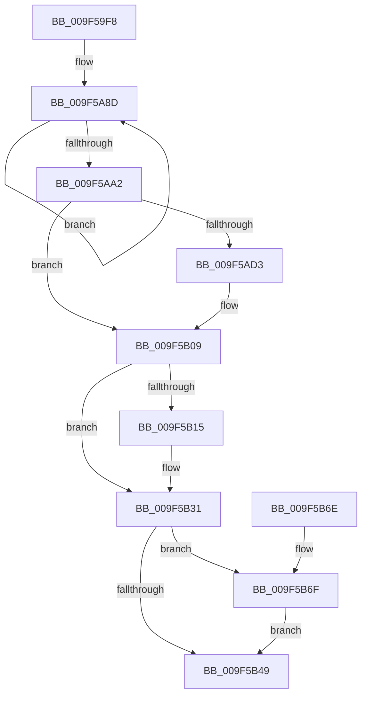

# PspFoldProcessAccountingIntoJob

- RVA: `0x009F59F8`–`0x009F5B8F` (길이 `407` bytes)
- VA: `0x00000001409F59F8`
- 실행 섹션: `PAGE`
- PDB 이름 있음: `예`; PDB Function 태그: `아니요`
- unwind 정보 RVA: `0x000A6988`
- 디코드: `85`개 명령, `407/407` bytes 표시
- 미해석 바이트: `0` (있으면 어셈블리에 `.byte`로 보존)

> 이 문서는 커널 이미지의 기계어와 PDB 기호를 분석해 생성했습니다. 4번과 5번은 함수 원형과 자료형을 바이너리 사용 방식에서 추정한 C 해석이며 원본 소스 복구 결과는 아닙니다.

## 1. Dependencies

- 직접 호출 지점: **6**; 고유 호출 대상: **6**
- 직접 호출자로 확인된 함수: **1**
- RIP 상대 이미지 참조: **1**

### Outgoing calls
- `0x009F5A32` → [memset](../../text/6C/memset_function_006C6C40.md) (function, `0x006C6C40`)
- `0x009F5B3B` → [PspUpdateJobPeakProcessMemory](PspUpdateJobPeakProcessMemory_function_009F5BA0.md) (function, `0x009F5BA0`)
- `0x009F5B40` → [PoEnergyEstimationEnabled](../../text/45/PoEnergyEstimationEnabled_function_00450000.md) (function, `0x00450000`)
- `0x009F5B54` → [_security_check_cookie](../../text/6A/_security_check_cookie_function_006AC640.md) (function, `0x006AC640`)
- `0x009F5B77` → [PsQueryProcessEnergyValues](../91/PsQueryProcessEnergyValues_function_0091A4E0.md) (function, `0x0091A4E0`)
- `0x009F5B88` → [PsAddProcessEnergyValues](../../text/41/PsAddProcessEnergyValues_function_00416F58.md) (function, `0x00416F58`)

### Direct callers
- [PspRemoveProcessFromJobChain](../90/PspRemoveProcessFromJobChain_function_00907288.md) at `0x00907437`

### Static image references
- `0x009F5A0A` → RVA `0x00E0A740` (`.data`; read)

## 2. Other-region calls and transfers

- 다른 실행 섹션으로 향하는 call: **4**
  - `0x009F5A32` → [memset](../../text/6C/memset_function_006C6C40.md) (`PAGE` → `.text`)
  - `0x009F5B40` → [PoEnergyEstimationEnabled](../../text/45/PoEnergyEstimationEnabled_function_00450000.md) (`PAGE` → `.text`)
  - `0x009F5B54` → [_security_check_cookie](../../text/6A/_security_check_cookie_function_006AC640.md) (`PAGE` → `.text`)
  - `0x009F5B88` → [PsAddProcessEnergyValues](../../text/41/PsAddProcessEnergyValues_function_00416F58.md) (`PAGE` → `.text`)
- 별도 외부 분기/꼬리 이동을 확인하지 못했습니다.

## 3. Assembly (complete function range)

```asm
009F59F8  48 89 5C 24 18                  mov qword ptr [rsp + 0x18], rbx
009F59FD  48 89 74 24 20                  mov qword ptr [rsp + 0x20], rsi
009F5A02  57                              push rdi
009F5A03  48 81 EC F0 01 00 00            sub rsp, 0x1f0
009F5A0A  48 8B 05 2F 4D 41 00            mov rax, qword ptr [rip + 0x414d2f]
009F5A11  48 33 C4                        xor rax, rsp
009F5A14  48 89 84 24 E0 01 00 00         mov qword ptr [rsp + 0x1e0], rax
009F5A1C  49 8B F0                        mov rsi, r8
009F5A1F  48 8B FA                        mov rdi, rdx
009F5A22  48 8B D9                        mov rbx, rcx
009F5A25  33 D2                           xor edx, edx
009F5A27  41 B8 B8 01 00 00               mov r8d, 0x1b8
009F5A2D  48 8D 4C 24 20                  lea rcx, [rsp + 0x20]
009F5A32  E8 09 12 CD FF                  call 0x1406c6c40
009F5A37  48 8B 56 08                     mov rdx, qword ptr [rsi + 8]
009F5A3B  4C 8B C6                        mov r8, rsi
009F5A3E  48 8B 0E                        mov rcx, qword ptr [rsi]
009F5A41  48 8B 46 10                     mov rax, qword ptr [rsi + 0x10]
009F5A45  48 01 83 E8 04 00 00            add qword ptr [rbx + 0x4e8], rax
009F5A4C  48 8B 46 18                     mov rax, qword ptr [rsi + 0x18]
009F5A50  48 01 83 B0 00 00 00            add qword ptr [rbx + 0xb0], rax
009F5A57  48 01 93 A0 00 00 00            add qword ptr [rbx + 0xa0], rdx
009F5A5E  48 01 8B A8 00 00 00            add qword ptr [rbx + 0xa8], rcx
009F5A65  48 01 93 B8 00 00 00            add qword ptr [rbx + 0xb8], rdx
009F5A6C  BA 06 00 00 00                  mov edx, 6
009F5A71  48 01 8B C0 00 00 00            add qword ptr [rbx + 0xc0], rcx
009F5A78  48 8D 8B 48 02 00 00            lea rcx, [rbx + 0x248]
009F5A7F  48 8B 46 20                     mov rax, qword ptr [rsi + 0x20]
009F5A83  48 01 83 C8 00 00 00            add qword ptr [rbx + 0xc8], rax
009F5A8A  4C 2B C3                        sub r8, rbx
009F5A8D  49 8B 84 08 E0 FD FF FF         mov rax, qword ptr [r8 + rcx - 0x220]
009F5A95  48 01 01                        add qword ptr [rcx], rax
009F5A98  48 8D 49 08                     lea rcx, [rcx + 8]
009F5A9C  48 83 EA 01                     sub rdx, 1
009F5AA0  75 EB                           jne 0x1409f5a8d
009F5AA2  8B 87 04 04 00 00               mov eax, dword ptr [rdi + 0x404]
009F5AA8  F3 0F 6F 83 18 07 00 00         movdqu xmm0, xmmword ptr [rbx + 0x718]
009F5AB0  01 83 D0 00 00 00               add dword ptr [rbx + 0xd0], eax
009F5AB6  F3 0F 6F 4E 58                  movdqu xmm1, xmmword ptr [rsi + 0x58]
009F5ABB  66 0F D4 C8                     paddq xmm1, xmm0
009F5ABF  F3 0F 7F 8B 18 07 00 00         movdqu xmmword ptr [rbx + 0x718], xmm1
009F5AC7  48 8B 8F 38 06 00 00            mov rcx, qword ptr [rdi + 0x638]
009F5ACE  48 85 C9                        test rcx, rcx
009F5AD1  74 36                           je 0x1409f5b09
009F5AD3  48 8B 01                        mov rax, qword ptr [rcx]
009F5AD6  48 01 83 78 02 00 00            add qword ptr [rbx + 0x278], rax
009F5ADD  48 8B 41 08                     mov rax, qword ptr [rcx + 8]
009F5AE1  48 01 83 80 02 00 00            add qword ptr [rbx + 0x280], rax
009F5AE8  48 8B 41 10                     mov rax, qword ptr [rcx + 0x10]
009F5AEC  48 01 83 88 02 00 00            add qword ptr [rbx + 0x288], rax
009F5AF3  48 8B 41 18                     mov rax, qword ptr [rcx + 0x18]
009F5AF7  48 01 83 90 02 00 00            add qword ptr [rbx + 0x290], rax
009F5AFE  48 8B 41 20                     mov rax, qword ptr [rcx + 0x20]
009F5B02  48 01 83 98 02 00 00            add qword ptr [rbx + 0x298], rax
009F5B09  48 8B 87 F0 07 00 00            mov rax, qword ptr [rdi + 0x7f0]
009F5B10  48 85 C0                        test rax, rax
009F5B13  74 1C                           je 0x1409f5b31
009F5B15  48 8B 00                        mov rax, qword ptr [rax]
009F5B18  48 01 83 A0 02 00 00            add qword ptr [rbx + 0x2a0], rax
009F5B1F  48 8B 87 F0 07 00 00            mov rax, qword ptr [rdi + 0x7f0]
009F5B26  48 8B 48 08                     mov rcx, qword ptr [rax + 8]
009F5B2A  48 01 8B A8 02 00 00            add qword ptr [rbx + 0x2a8], rcx
009F5B31  48 8B 97 E0 03 00 00            mov rdx, qword ptr [rdi + 0x3e0]
009F5B38  48 8B CB                        mov rcx, rbx
009F5B3B  E8 60 00 00 00                  call 0x1409f5ba0
009F5B40  E8 BB A4 A5 FF                  call 0x140450000
009F5B45  84 C0                           test al, al
009F5B47  75 26                           jne 0x1409f5b6f
009F5B49  48 8B 8C 24 E0 01 00 00         mov rcx, qword ptr [rsp + 0x1e0]
009F5B51  48 33 CC                        xor rcx, rsp
009F5B54  E8 E7 6A CB FF                  call 0x1406ac640
009F5B59  4C 8D 9C 24 F0 01 00 00         lea r11, [rsp + 0x1f0]
009F5B61  49 8B 5B 20                     mov rbx, qword ptr [r11 + 0x20]
009F5B65  49 8B 73 28                     mov rsi, qword ptr [r11 + 0x28]
009F5B69  49 8B E3                        mov rsp, r11
009F5B6C  5F                              pop rdi
009F5B6D  C3                              ret
009F5B6E  CC                              int3
009F5B6F  48 8D 54 24 20                  lea rdx, [rsp + 0x20]
009F5B74  48 8B CF                        mov rcx, rdi
009F5B77  E8 64 49 F2 FF                  call 0x14091a4e0
009F5B7C  48 8B 8B 18 06 00 00            mov rcx, qword ptr [rbx + 0x618]
009F5B83  48 8D 54 24 20                  lea rdx, [rsp + 0x20]
009F5B88  E8 CB 13 A2 FF                  call 0x140416f58
009F5B8D  EB BA                           jmp 0x1409f5b49
```

## 4. C-style interpretation (structured pseudocode)

```c
__int64 __fastcall PspFoldProcessAccountingIntoJob(__int64 a1, __int64 a2, __int64 a3)
{
    __int64 result;
    __int64 v_rsp;
    unsigned __int64 v_stack_m18;
    unsigned __int64 v_stack_m1D0;
    unsigned __int64 v_stack_m1D8;
    unsigned __int64 v_stack_m8;
    unsigned __int64 v_stack_p18;
    unsigned __int64 v_stack_p20;

    v_stack_p18 = v_rbx;
    v_stack_p20 = v_rsi;
    v_rsp = (v_rsp) - (496);
    result = (*(unsigned __int64 *)(v_rip + 4279599)) ^ (v_rsp);
    v_stack_m18 = result;
    a2 = 0;
    result = memset(v_stack_m1D8, a2, 440, a4);
    a3 = (a3) - (a1);
loc_009F5A8D:
    a2 = (6) - (1);
    if (condition_is_not_equal) goto loc_009F5A8D;
    *(unsigned __int64 *)(a1 + 1816) = v_xmm1;
    result = (unsigned int)(*(unsigned int *)(a2 + 1028));
    if (*(unsigned __int64 *)(a2 + 1592) != 0) {
        result = *(unsigned __int64 *)(*(unsigned __int64 *)(a2 + 1592));
        result = *(unsigned __int64 *)(*(unsigned __int64 *)(a2 + 1592) + 8);
        result = *(unsigned __int64 *)(*(unsigned __int64 *)(a2 + 1592) + 16);
        result = *(unsigned __int64 *)(*(unsigned __int64 *)(a2 + 1592) + 24);
        result = *(unsigned __int64 *)(*(unsigned __int64 *)(a2 + 1592) + 32);
    }
    result = *(unsigned __int64 *)(a2 + 2032);
    if (*(unsigned __int64 *)(a2 + 2032) != 0) {
        result = *(unsigned __int64 *)(*(unsigned __int64 *)(a2 + 2032));
        result = *(unsigned __int64 *)(a2 + 2032);
        a1 = *(unsigned __int64 *)(result + 8);
    }
    result = PspUpdateJobPeakProcessMemory(a1, *(unsigned __int64 *)(a2 + 992), a3, a4);
    result = PoEnergyEstimationEnabled(a1, *(unsigned __int64 *)(a2 + 992), a3, a4);
    if ((unsigned __int8)(result) != 0) goto loc_009F5B6F;
loc_009F5B49:
    a1 = (v_stack_m18) ^ (v_rsp);
    result = _security_check_cookie(a1, *(unsigned __int64 *)(a2 + 992), a3, a4);
    return result;
loc_009F5B6F:
    result = PsQueryProcessEnergyValues(a2, v_stack_m1D0, a3, a4);
    result = PsAddProcessEnergyValues(*(unsigned __int64 *)(*(unsigned __int64 *)(v_stack_m8 + 32) + 1560), v_stack_m1D0, a3, a4);
    goto loc_009F5B49;
}
```

## 5. (Beta) C Style

```c
int64_t PspFoldProcessAccountingIntoJob(void *Arg1, void *Arg2, void *Arg3)
{
    uint8_t *arg1 = (uint8_t *)Arg1;
    uint8_t *arg2 = (uint8_t *)Arg2;
    uint8_t *arg3 = (uint8_t *)Arg3;

    int64_t result;
    int64_t local_rsp;
    uint64_t v_stack_m18;
    uint64_t v_stack_m1D0;
    uint64_t v_stack_m1D8;
    uint64_t v_stack_m8;
    uint64_t v_stack_p18;
    uint64_t v_stack_p20;

    v_stack_p18 = local_rbx;
    v_stack_p20 = local_rsi;
    local_rsp = (local_rsp) - (496);
    result = (*(uint64_t *)(v_rip + 0x414D2F)) ^ (local_rsp);
    v_stack_m18 = result;
    Arg2 = 0;
    result = memset(v_stack_m1D8, Arg2, 440, a4);
    Arg3 = (Arg3) - (Arg1);
loc_009F5A8D:
    Arg2 = (6) - (1);
    if (condition_is_not_equal) goto loc_009F5A8D;
    *(uint64_t *)(arg1 + 0x718) = v_xmm1;
    result = (uint32_t)(*(uint32_t *)(arg2 + 0x404));
    if (*(uint64_t *)(arg2 + 0x638) != 0) {
        result = *(uint64_t *)(*(uint64_t *)(arg2 + 0x638));
        result = *(uint64_t *)(*(uint64_t *)(arg2 + 0x638) + 0x8);
        result = *(uint64_t *)(*(uint64_t *)(arg2 + 0x638) + 0x10);
        result = *(uint64_t *)(*(uint64_t *)(arg2 + 0x638) + 0x18);
        result = *(uint64_t *)(*(uint64_t *)(arg2 + 0x638) + 0x20);
    }
    result = *(uint64_t *)(arg2 + 0x7F0);
    if (*(uint64_t *)(arg2 + 0x7F0) != 0) {
        result = *(uint64_t *)(*(uint64_t *)(arg2 + 0x7F0));
        result = *(uint64_t *)(arg2 + 0x7F0);
        Arg1 = *(uint64_t *)(result + 0x8);
    }
    result = PspUpdateJobPeakProcessMemory(Arg1, *(uint64_t *)(arg2 + 0x3E0), Arg3, a4);
    result = PoEnergyEstimationEnabled(Arg1, *(uint64_t *)(arg2 + 0x3E0), Arg3, a4);
    if ((uint8_t)(result) != 0) goto loc_009F5B6F;
loc_009F5B49:
    Arg1 = (v_stack_m18) ^ (local_rsp);
    result = _security_check_cookie(Arg1, *(uint64_t *)(arg2 + 0x3E0), Arg3, a4);
    return result;
loc_009F5B6F:
    result = PsQueryProcessEnergyValues(Arg2, v_stack_m1D0, Arg3, a4);
    result = PsAddProcessEnergyValues(*(uint64_t *)(*(uint64_t *)(v_stack_m8 + 0x20) + 0x618), v_stack_m1D0, Arg3, a4);
    goto loc_009F5B49;
}
```

### 관측된 메모리 오프셋

구조체 형식이 확인되지 않은 접근은 인자 기준의 오프셋으로만 기록했습니다.

| 기준 인자 | 오프셋 표현 | 폭 (bit) | 접근 |
|---|---:|---:|---|
| `Arg1` | `+ 0x0` | `64` | `R/W` |
| `Arg1` | `+ 0x8` | `64` | `R` |
| `Arg1` | `+ 0xA0` | `64` | `R/W` |
| `Arg1` | `+ 0xA8` | `64` | `R/W` |
| `Arg1` | `+ 0xB0` | `64` | `R/W` |
| `Arg1` | `+ 0xB8` | `64` | `R/W` |
| `Arg1` | `+ 0xC0` | `64` | `R/W` |
| `Arg1` | `+ 0xC8` | `64` | `R/W` |
| `Arg1` | `+ 0xD0` | `32` | `R/W` |
| `Arg1` | `+ 0x248` | `64` | `R` |
| `Arg1` | `+ 0x278` | `64` | `R/W` |
| `Arg1` | `+ 0x280` | `64` | `R/W` |
| `Arg1` | `+ 0x288` | `64` | `R/W` |
| `Arg1` | `+ 0x290` | `64` | `R/W` |
| `Arg1` | `+ 0x298` | `64` | `R/W` |
| `Arg1` | `+ 0x2A0` | `64` | `R/W` |
| `Arg1` | `+ 0x2A8` | `64` | `R/W` |
| `Arg1` | `+ 0x4E8` | `64` | `R/W` |
| `Arg1` | `+ 0x618` | `64` | `R` |
| `Arg1` | `+ 0x718` | `128` | `R` |
| `Arg1` | `+ 0x718` | `128` | `W` |
| `Arg2` | `+ 0x3E0` | `64` | `R` |
| `Arg2` | `+ 0x404` | `32` | `R` |
| `Arg2` | `+ 0x638` | `64` | `R` |
| `Arg2` | `+ 0x7F0` | `64` | `R` |
| `Arg3` | `- 0x220 + rcx*1` | `64` | `R` |
| `Arg3` | `+ 0x0` | `64` | `R` |
| `Arg3` | `+ 0x8` | `64` | `R` |
| `Arg3` | `+ 0x10` | `64` | `R` |
| `Arg3` | `+ 0x18` | `64` | `R` |
| `Arg3` | `+ 0x20` | `64` | `R` |
| `Arg3` | `+ 0x58` | `128` | `R` |

## 6. Execution-region graph

[열기: 2D/3D 그래프와 함수 탐색 컨트롤 패널](../../../control-panel.html?section=page&rva=0x009F59F8&view=graph)

- 2D 그래프는 위에서 아래로 흐르고, 3D 그래프는 빈 공간을 드래그해 회전합니다. Shift+드래그는 이동, 휠은 확대·축소, 함수 노드 선택은 대상 보고서 이동입니다.

### Static fallback


