# PspFreezeJobTree

- RVA: `0x009FB074`–`0x009FB38D` (길이 `793` bytes)
- VA: `0x00000001409FB074`
- 실행 섹션: `PAGE`
- PDB 이름 있음: `예`; PDB Function 태그: `아니요`
- unwind 정보 RVA: `0x000A7050`
- 디코드: `190`개 명령, `793/793` bytes 표시
- 미해석 바이트: `0` (있으면 어셈블리에 `.byte`로 보존)

> 이 문서는 커널 이미지의 기계어와 PDB 기호를 분석해 생성했습니다. 4번과 5번은 함수 원형과 자료형을 바이너리 사용 방식에서 추정한 C 해석이며 원본 소스 복구 결과는 아닙니다.

## 1. Dependencies

- 직접 호출 지점: **9**; 고유 호출 대상: **7**
- 직접 호출자로 확인된 함수: **2**
- RIP 상대 이미지 참조: **4**

### Outgoing calls
- `0x009FB0BD` → [memset](../../text/6C/memset_function_006C6C40.md) (function, `0x006C6C40`)
- `0x009FB0D3` → [ExAcquireResourceExclusiveLite](../../text/21/ExAcquireResourceExclusiveLite_function_00214E20.md) (function, `0x00214E20`)
- `0x009FB162` → [PspEnumJobsAndProcessesInJobHierarchy](../91/PspEnumJobsAndProcessesInJobHierarchy_function_0091A1EC.md) (function, `0x0091A1EC`)
- `0x009FB16B` → [ExReleaseResourceLite](../../text/25/ExReleaseResourceLite_function_0025FA10.md) (function, `0x0025FA10`)
- `0x009FB18A` → [_security_check_cookie](../../text/6A/_security_check_cookie_function_006AC640.md) (function, `0x006AC640`)
- `0x009FB1F5` → [PspEnumJobsAndProcessesInJobHierarchy](../91/PspEnumJobsAndProcessesInJobHierarchy_function_0091A1EC.md) (function, `0x0091A1EC`)
- `0x009FB219` → [PspFreezeJobTree](PspFreezeJobTree_function_009FB074.md) (function, `0x009FB074`)
- `0x009FB2BC` → [ExReleaseResourceLite](../../text/25/ExReleaseResourceLite_function_0025FA10.md) (function, `0x0025FA10`)
- `0x009FB323` → [PspSendWakeNotification](PspSendWakeNotification_function_009FB394.md) (function, `0x009FB394`)

### Direct callers
- [NtSetInformationJobObject](NtSetInformationJobObject_function_009F84C0.md) at `0x009F9CFA`
- [PspFreezeJobTree](PspFreezeJobTree_function_009FB074.md) at `0x009FB219`

### Static image references
- `0x009FB08E` → RVA `0x00E0A740` (`.data`; read)
- `0x009FB149` → RVA `0x004E98E0` (`PspSetProcessFreezeStateCallback`; read)
- `0x009FB158` → RVA `0x004B3EC0` (`PspSetJobFreezeCountCallback`; read)
- `0x009FB1E9` → RVA `0x004E9850` (`PspExecuteJobFreezeThawCallback`; read)

## 2. Other-region calls and transfers

- 다른 실행 섹션으로 향하는 call: **5**
  - `0x009FB0BD` → [memset](../../text/6C/memset_function_006C6C40.md) (`PAGE` → `.text`)
  - `0x009FB0D3` → [ExAcquireResourceExclusiveLite](../../text/21/ExAcquireResourceExclusiveLite_function_00214E20.md) (`PAGE` → `.text`)
  - `0x009FB16B` → [ExReleaseResourceLite](../../text/25/ExReleaseResourceLite_function_0025FA10.md) (`PAGE` → `.text`)
  - `0x009FB18A` → [_security_check_cookie](../../text/6A/_security_check_cookie_function_006AC640.md) (`PAGE` → `.text`)
  - `0x009FB2BC` → [ExReleaseResourceLite](../../text/25/ExReleaseResourceLite_function_0025FA10.md) (`PAGE` → `.text`)
- 별도 외부 분기/꼬리 이동을 확인하지 못했습니다.

## 3. Assembly (complete function range)

```asm
009FB074  48 89 5C 24 18                  mov qword ptr [rsp + 0x18], rbx
009FB079  48 89 74 24 20                  mov qword ptr [rsp + 0x20], rsi
009FB07E  55                              push rbp
009FB07F  57                              push rdi
009FB080  41 56                           push r14
009FB082  48 8D 6C 24 B9                  lea rbp, [rsp - 0x47]
009FB087  48 81 EC C0 00 00 00            sub rsp, 0xc0
009FB08E  48 8B 05 AB F6 40 00            mov rax, qword ptr [rip + 0x40f6ab]
009FB095  48 33 C4                        xor rax, rsp
009FB098  48 89 45 37                     mov qword ptr [rbp + 0x37], rax
009FB09C  48 83 65 D7 00                  and qword ptr [rbp - 0x29], 0
009FB0A1  48 8B FA                        mov rdi, rdx
009FB0A4  48 83 65 BF 00                  and qword ptr [rbp - 0x41], 0
009FB0A9  33 D2                           xor edx, edx
009FB0AB  48 8B D9                        mov rbx, rcx
009FB0AE  0F 57 C0                        xorps xmm0, xmm0
009FB0B1  48 8D 4D F7                     lea rcx, [rbp - 9]
009FB0B5  0F 11 45 DF                     movups xmmword ptr [rbp - 0x21], xmm0
009FB0B9  44 8D 42 40                     lea r8d, [rdx + 0x40]
009FB0BD  E8 7E BB CC FF                  call 0x1406c6c40
009FB0C2  45 33 F6                        xor r14d, r14d
009FB0C5  48 89 7D CF                     mov qword ptr [rbp - 0x31], rdi
009FB0C9  44 21 75 B7                     and dword ptr [rbp - 0x49], r14d
009FB0CD  48 8D 4B 38                     lea rcx, [rbx + 0x38]
009FB0D1  B2 01                           mov dl, 1
009FB0D3  E8 48 9D 81 FF                  call 0x140214e20
009FB0D8  8B 0F                           mov ecx, dword ptr [rdi]
009FB0DA  F6 C1 01                        test cl, 1
009FB0DD  0F 85 C5 00 00 00               jne 0x1409fb1a8
009FB0E3  F6 C1 04                        test cl, 4
009FB0E6  0F 85 A8 01 00 00               jne 0x1409fb294
009FB0EC  F6 C1 02                        test cl, 2
009FB0EF  0F 85 35 01 00 00               jne 0x1409fb22a
009FB0F5  8B 07                           mov eax, dword ptr [rdi]
009FB0F7  BE 05 00 00 00                  mov esi, 5
009FB0FC  A8 01                           test al, 1
009FB0FE  74 2F                           je 0x1409fb12f
009FB100  44 38 77 04                     cmp byte ptr [rdi + 4], r14b
009FB104  0F 85 C0 00 00 00               jne 0x1409fb1ca
009FB10A  F0 0F BA B3 10 06 00 00 09      lock btr dword ptr [rbx + 0x610], 9
009FB113  8B 07                           mov eax, dword ptr [rdi]
009FB115  A8 08                           test al, 8
009FB117  75 13                           jne 0x1409fb12c
009FB119  44 38 77 04                     cmp byte ptr [rdi + 4], r14b
009FB11D  0F 85 A3 01 00 00               jne 0x1409fb2c6
009FB123  F0 0F BA B3 14 06 00 00 03      lock btr dword ptr [rbx + 0x614], 3
009FB12C  44 8B F6                        mov r14d, esi
009FB12F  8B 07                           mov eax, dword ptr [rdi]
009FB131  A8 04                           test al, 4
009FB133  0F 85 9B 01 00 00               jne 0x1409fb2d4
009FB139  41 8B F6                        mov esi, r14d
009FB13C  45 85 F6                        test r14d, r14d
009FB13F  74 26                           je 0x1409fb167
009FB141  48 8D 45 CF                     lea rax, [rbp - 0x31]
009FB145  89 74 24 28                     mov dword ptr [rsp + 0x28], esi
009FB149  4C 8D 0D 90 E7 AE FF            lea r9, [rip - 0x511870]
009FB150  48 89 44 24 20                  mov qword ptr [rsp + 0x20], rax
009FB155  45 33 C0                        xor r8d, r8d
009FB158  48 8D 15 61 8D AB FF            lea rdx, [rip - 0x54729f]
009FB15F  48 8B CB                        mov rcx, rbx
009FB162  E8 85 F0 F1 FF                  call 0x14091a1ec
009FB167  48 8D 4B 38                     lea rcx, [rbx + 0x38]
009FB16B  E8 A0 48 86 FF                  call 0x14025fa10
009FB170  85 F6                           test esi, esi
009FB172  75 64                           jne 0x1409fb1d8
009FB174  8B 45 C3                        mov eax, dword ptr [rbp - 0x3d]
009FB177  0B 45 BF                        or eax, dword ptr [rbp - 0x41]
009FB17A  0F 85 82 01 00 00               jne 0x1409fb302
009FB180  8B 45 B7                        mov eax, dword ptr [rbp - 0x49]
009FB183  48 8B 4D 37                     mov rcx, qword ptr [rbp + 0x37]
009FB187  48 33 CC                        xor rcx, rsp
009FB18A  E8 B1 14 CB FF                  call 0x1406ac640
009FB18F  4C 8D 9C 24 C0 00 00 00         lea r11, [rsp + 0xc0]
009FB197  49 8B 5B 30                     mov rbx, qword ptr [r11 + 0x30]
009FB19B  49 8B 73 38                     mov rsi, qword ptr [r11 + 0x38]
009FB19F  49 8B E3                        mov rsp, r11
009FB1A2  41 5E                           pop r14
009FB1A4  5F                              pop rdi
009FB1A5  5D                              pop rbp
009FB1A6  C3                              ret
009FB1A7  CC                              int3
009FB1A8  8B 83 10 06 00 00               mov eax, dword ptr [rbx + 0x610]
009FB1AE  25 00 02 00 00                  and eax, 0x200
009FB1B3  44 38 77 04                     cmp byte ptr [rdi + 4], r14b
009FB1B7  0F 84 2F 01 00 00               je 0x1409fb2ec
009FB1BD  85 C0                           test eax, eax
009FB1BF  0F 84 1E FF FF FF               je 0x1409fb0e3
009FB1C5  E9 E7 00 00 00                  jmp 0x1409fb2b1
009FB1CA  F0 0F BA AB 10 06 00 00 09      lock bts dword ptr [rbx + 0x610], 9
009FB1D3  E9 3B FF FF FF                  jmp 0x1409fb113
009FB1D8  83 64 24 28 00                  and dword ptr [rsp + 0x28], 0
009FB1DD  48 8D 45 B7                     lea rax, [rbp - 0x49]
009FB1E1  45 33 C9                        xor r9d, r9d
009FB1E4  48 89 44 24 20                  mov qword ptr [rsp + 0x20], rax
009FB1E9  4C 8D 05 60 E6 AE FF            lea r8, [rip - 0x5119a0]
009FB1F0  33 D2                           xor edx, edx
009FB1F2  48 8B CB                        mov rcx, rbx
009FB1F5  E8 F2 EF F1 FF                  call 0x14091a1ec
009FB1FA  83 7D B7 00                     cmp dword ptr [rbp - 0x49], 0
009FB1FE  0F 8D 70 FF FF FF               jge 0x1409fb174
009FB204  83 27 FB                        and dword ptr [rdi], 0xfffffffb
009FB207  48 8D 55 DF                     lea rdx, [rbp - 0x21]
009FB20B  48 8B CB                        mov rcx, rbx
009FB20E  C7 45 DF 04 00 00 00            mov dword ptr [rbp - 0x21], 4
009FB215  C6 45 E4 00                     mov byte ptr [rbp - 0x1c], 0
009FB219  E8 56 FE FF FF                  call 0x1409fb074
009FB21E  C7 45 B7 06 01 00 00            mov dword ptr [rbp - 0x49], 0x106
009FB225  E9 4A FF FF FF                  jmp 0x1409fb174
009FB22A  F7 83 10 06 00 00 00 08 00 00   test dword ptr [rbx + 0x610], 0x800
009FB234  74 4E                           je 0x1409fb284
009FB236  48 8B 47 08                     mov rax, qword ptr [rdi + 8]
009FB23A  8B 93 A8 04 00 00               mov edx, dword ptr [rbx + 0x4a8]
009FB240  44 8B C2                        mov r8d, edx
009FB243  48 89 45 BF                     mov qword ptr [rbp - 0x41], rax
009FB247  44 8B 4D BF                     mov r9d, dword ptr [rbp - 0x41]
009FB24B  8B 4D C3                        mov ecx, dword ptr [rbp - 0x3d]
009FB24E  8B 83 A0 04 00 00               mov eax, dword ptr [rbx + 0x4a0]
009FB254  F7 D0                           not eax
009FB256  44 23 C8                        and r9d, eax
009FB259  8B 83 A4 04 00 00               mov eax, dword ptr [rbx + 0x4a4]
009FB25F  F7 D0                           not eax
009FB261  44 89 4D BF                     mov dword ptr [rbp - 0x41], r9d
009FB265  23 C8                           and ecx, eax
009FB267  44 23 C1                        and r8d, ecx
009FB26A  41 8B C0                        mov eax, r8d
009FB26D  44 89 45 C3                     mov dword ptr [rbp - 0x3d], r8d
009FB271  F7 D0                           not eax
009FB273  23 C2                           and eax, edx
009FB275  45 0B C8                        or r9d, r8d
009FB278  89 83 A8 04 00 00               mov dword ptr [rbx + 0x4a8], eax
009FB27E  0F 85 BD 00 00 00               jne 0x1409fb341
009FB284  48 8B 47 08                     mov rax, qword ptr [rdi + 8]
009FB288  48 89 83 A0 04 00 00            mov qword ptr [rbx + 0x4a0], rax
009FB28F  E9 61 FE FF FF                  jmp 0x1409fb0f5
009FB294  8B 83 10 06 00 00               mov eax, dword ptr [rbx + 0x610]
009FB29A  25 00 00 08 00                  and eax, 0x80000
009FB29F  44 38 77 05                     cmp byte ptr [rdi + 5], r14b
009FB2A3  0F 85 C9 00 00 00               jne 0x1409fb372
009FB2A9  85 C0                           test eax, eax
009FB2AB  0F 85 3B FE FF FF               jne 0x1409fb0ec
009FB2B1  48 8D 4B 38                     lea rcx, [rbx + 0x38]
009FB2B5  C7 45 B7 0D 00 00 C0            mov dword ptr [rbp - 0x49], 0xc000000d
009FB2BC  E8 4F 47 86 FF                  call 0x14025fa10
009FB2C1  E9 BA FE FF FF                  jmp 0x1409fb180
009FB2C6  F0 0F BA AB 14 06 00 00 03      lock bts dword ptr [rbx + 0x614], 3
009FB2CF  E9 58 FE FF FF                  jmp 0x1409fb12c
009FB2D4  80 7F 05 00                     cmp byte ptr [rdi + 5], 0
009FB2D8  0F 85 A1 00 00 00               jne 0x1409fb37f
009FB2DE  F0 0F BA B3 10 06 00 00 13      lock btr dword ptr [rbx + 0x610], 0x13
009FB2E7  E9 55 FE FF FF                  jmp 0x1409fb141
009FB2EC  85 C0                           test eax, eax
009FB2EE  74 C1                           je 0x1409fb2b1
009FB2F0  8B C1                           mov eax, ecx
009FB2F2  33 83 14 06 00 00               xor eax, dword ptr [rbx + 0x614]
009FB2F8  A8 08                           test al, 8
009FB2FA  0F 85 E3 FD FF FF               jne 0x1409fb0e3
009FB300  EB AF                           jmp 0x1409fb2b1
009FB302  33 FF                           xor edi, edi
009FB304  48 8D 75 FF                     lea rsi, [rbp - 1]
009FB308  4C 8B 0E                        mov r9, qword ptr [rsi]
009FB30B  4C 8D 45 BF                     lea r8, [rbp - 0x41]
009FB30F  49 8B C1                        mov rax, r9
009FB312  8B D7                           mov edx, edi
009FB314  48 F7 D8                        neg rax
009FB317  1B C9                           sbb ecx, ecx
009FB319  83 E1 03                        and ecx, 3
009FB31C  89 4C 24 20                     mov dword ptr [rsp + 0x20], ecx
009FB320  48 8B CB                        mov rcx, rbx
009FB323  E8 6C 00 00 00                  call 0x1409fb394
009FB328  84 C0                           test al, al
009FB32A  0F 85 50 FE FF FF               jne 0x1409fb180
009FB330  FF C7                           inc edi
009FB332  48 83 C6 08                     add rsi, 8
009FB336  83 FF 07                        cmp edi, 7
009FB339  0F 83 41 FE FF FF               jae 0x1409fb180
009FB33F  EB C7                           jmp 0x1409fb308
009FB341  0F 10 83 58 04 00 00            movups xmm0, xmmword ptr [rbx + 0x458]
009FB348  0F 10 8B 68 04 00 00            movups xmm1, xmmword ptr [rbx + 0x468]
009FB34F  0F 29 45 F7                     movaps xmmword ptr [rbp - 9], xmm0
009FB353  0F 10 83 78 04 00 00            movups xmm0, xmmword ptr [rbx + 0x478]
009FB35A  0F 29 4D 07                     movaps xmmword ptr [rbp + 7], xmm1
009FB35E  0F 10 8B 88 04 00 00            movups xmm1, xmmword ptr [rbx + 0x488]
009FB365  0F 29 45 17                     movaps xmmword ptr [rbp + 0x17], xmm0
009FB369  0F 29 4D 27                     movaps xmmword ptr [rbp + 0x27], xmm1
009FB36D  E9 12 FF FF FF                  jmp 0x1409fb284
009FB372  85 C0                           test eax, eax
009FB374  0F 85 37 FF FF FF               jne 0x1409fb2b1
009FB37A  E9 6D FD FF FF                  jmp 0x1409fb0ec
009FB37F  F0 0F BA AB 10 06 00 00 13      lock bts dword ptr [rbx + 0x610], 0x13
009FB388  E9 B4 FD FF FF                  jmp 0x1409fb141
```

## 4. C-style interpretation (structured pseudocode)

```c
__int64 __fastcall PspFreezeJobTree(__int64 a1, __int64 a2)
{
    __int64 result;
    __int64 v_r14;
    __int64 v_rdi;
    __int64 v_rsi;
    __int64 v_rsp;
    unsigned __int64 v_stack_m18;
    unsigned __int64 v_stack_m28;
    unsigned __int64 v_stack_m38;
    unsigned __int64 v_stack_m48;
    unsigned __int64 v_stack_m58;
    unsigned __int64 v_stack_m5F;
    unsigned __int64 v_stack_m60;
    unsigned __int64 v_stack_m68;
    unsigned __int8 v_stack_m7B;
    unsigned __int64 v_stack_m80;
    unsigned __int64 v_stack_m88;
    unsigned __int64 v_stack_m90;
    unsigned int v_stack_m98;
    unsigned int v_stack_m9C;
    unsigned __int64 v_stack_mA0;
    unsigned int v_stack_mA8;
    unsigned int v_stack_mB0;
    unsigned __int64 v_stack_mB8;
    unsigned __int64 v_stack_p18;
    unsigned __int64 v_stack_p20;

    v_stack_p18 = v_rbx;
    v_stack_p20 = v_rsi;
    v_rsp = (v_rsp) - (192);
    result = (*(unsigned __int64 *)(v_rip + 4257451)) ^ (v_rsp);
    v_stack_m28 = result;
    a2 = 0;
    v_stack_m80 = v_xmm0;
    result = memset(v_stack_m68, a2, a2 + 64, a4);
    v_r14 = 0;
    v_stack_m90 = 0;
    result = ExAcquireResourceExclusiveLite(a1 + 56, 1, a2 + 64, a4);
    if ((((unsigned __int8)((unsigned int)(*(unsigned int *)(a2)))) & (1)) != 0) goto loc_009FB1A8;
loc_009FB0E3:
    if ((((unsigned __int8)((unsigned int)(*(unsigned int *)(a2)))) & (4)) != 0) goto loc_009FB294;
loc_009FB0EC:
    if ((((unsigned __int8)((unsigned int)(*(unsigned int *)(a2)))) & (2)) != 0) goto loc_009FB22A;
loc_009FB0F5:
    if ((((unsigned __int8)((unsigned int)(*(unsigned int *)(a2)))) & (1)) == 0) goto loc_009FB12F;
    if ((*(unsigned __int8 *)(a2 + 4)) != 0) goto loc_009FB1CA;
loc_009FB113:
    if ((((unsigned __int8)((unsigned int)(*(unsigned int *)(a2)))) & (8)) != 0) goto loc_009FB12C;
    if ((*(unsigned __int8 *)(a2 + 4)) != 0) goto loc_009FB2C6;
loc_009FB12C:
loc_009FB12F:
    if ((((unsigned __int8)((unsigned int)(*(unsigned int *)(a2)))) & (4)) != 0) goto loc_009FB2D4;
    result = (unsigned int)(*(unsigned int *)(a2));
    if (5 != 0) {
        result = v_stack_m90;
        v_stack_mB0 = 5;
        a4 = v_rip - 5314672;
        v_stack_mB8 = result;
        a3 = 0;
        a2 = v_rip - 5534367;
        a1 = a1;
        result = PspEnumJobsAndProcessesInJobHierarchy(a1, a2, a3, a4);
    }
    result = ExReleaseResourceLite(a1 + 56, a2, a3, a4);
    if (5 != 0) goto loc_009FB1D8;
loc_009FB174:
    result = (unsigned int)(((unsigned int)(v_stack_m9C)) | (v_stack_mA0));
    if (condition_is_not_equal) goto loc_009FB302;
loc_009FB180:
    a1 = (v_stack_m28) ^ (v_rsp);
    result = _security_check_cookie(a1, a2, a3, a4);
    return result;
loc_009FB1A8:
    result = (unsigned int)(((unsigned int)(*(unsigned int *)(*(unsigned __int64 *)(v_stack_m18 + 48) + 1552))) & (512));
    if ((*(unsigned __int8 *)(a2 + 4)) == 5) goto loc_009FB2EC;
    if ((unsigned int)(result) == 0) goto loc_009FB0E3;
    goto loc_009FB2B1;
loc_009FB1CA:
    goto loc_009FB113;
loc_009FB1D8:
    a4 = 0;
    v_stack_mA0 = v_stack_mA8;
    a2 = 0;
    result = PspEnumJobsAndProcessesInJobHierarchy(*(unsigned __int64 *)(v_stack_m18 + 48), a2, v_rip - 5314976, a4);
    if (v_stack_mA8 >= 0) goto loc_009FB174;
    v_stack_m80 = 4;
    v_stack_m7B = 0;
    result = PspFreezeJobTree(*(unsigned __int64 *)(v_stack_m18 + 48), v_stack_m80, v_rip - 5314976, a4);
    v_stack_mA8 = 262;
    goto loc_009FB174;
loc_009FB22A:
    if (((*(unsigned int *)(*(unsigned __int64 *)(v_stack_m18 + 48) + 1552)) & (0x800ULL)) == 0) goto loc_009FB284;
    v_stack_mA0 = *(unsigned __int64 *)(a2 + 8);
    result = (unsigned int)(~((unsigned int)(*(unsigned int *)(*(unsigned __int64 *)(v_stack_m18 + 48) + 1184))));
    a4 = (unsigned int)(((unsigned int)(v_stack_mA0)) & ((unsigned int)(result)));
    result = (unsigned int)(~((unsigned int)(*(unsigned int *)(*(unsigned __int64 *)(v_stack_m18 + 48) + 1188))));
    v_stack_mA0 = (unsigned int)(a4);
    a1 = (unsigned int)(((unsigned int)(v_stack_m9C)) & ((unsigned int)(result)));
    a3 = (unsigned int)(((unsigned int)((unsigned int)((unsigned int)(*(unsigned int *)(*(unsigned __int64 *)(v_stack_m18 + 48) + 1192))))) & ((unsigned int)(a1)));
    v_stack_m9C = (unsigned int)(a3);
    result = (unsigned int)(~((unsigned int)((unsigned int)(a3))));
    result = (unsigned int)((result) & ((unsigned int)((unsigned int)(*(unsigned int *)(*(unsigned __int64 *)(v_stack_m18 + 48) + 1192)))));
    a4 = (unsigned int)((a4) | ((unsigned int)(a3)));
    *(unsigned int *)(*(unsigned __int64 *)(v_stack_m18 + 48) + 1192) = (unsigned int)(result);
    if (condition_is_not_equal) goto loc_009FB341;
loc_009FB284:
    *(unsigned __int64 *)(*(unsigned __int64 *)(v_stack_m18 + 48) + 1184) = *(unsigned __int64 *)(a2 + 8);
    goto loc_009FB0F5;
loc_009FB294:
    result = (unsigned int)(((unsigned int)(*(unsigned int *)(*(unsigned __int64 *)(v_stack_m18 + 48) + 1552))) & (0x80000ULL));
    if ((*(unsigned __int8 *)(a2 + 5)) != 5) goto loc_009FB372;
    if ((unsigned int)(result) != 0) goto loc_009FB0EC;
loc_009FB2B1:
    v_stack_mA8 = 0xC000000DULL;
    result = ExReleaseResourceLite(*(unsigned __int64 *)(v_stack_m18 + 48) + 56, (unsigned int)(*(unsigned int *)(*(unsigned __int64 *)(v_stack_m18 + 48) + 1192)), a3, a4);
    goto loc_009FB180;
loc_009FB2C6:
    goto loc_009FB12C;
loc_009FB2D4:
    if ((*(unsigned __int8 *)(a2 + 5)) != 0) goto loc_009FB37F;
    goto loc_009FB141;
loc_009FB2EC:
    if ((unsigned int)(result) == 0) goto loc_009FB2B1;
    result = (unsigned int)(((unsigned int)((unsigned int)(*(unsigned __int64 *)(v_stack_m18 + 48) + 56))) ^ (*(unsigned int *)(*(unsigned __int64 *)(v_stack_m18 + 48) + 1556)));
    if ((((unsigned __int8)(result)) & (8)) != 0) goto loc_009FB0E3;
    goto loc_009FB2B1;
loc_009FB302:
    v_rdi = 0;
loc_009FB308:
    result = -(*(unsigned __int64 *)(v_stack_m60));
    a1 = (unsigned int)((*(unsigned __int64 *)(v_stack_m18 + 48) + 56) & (3));
    v_stack_mA0 = (unsigned int)(a1);
    result = PspSendWakeNotification(*(unsigned __int64 *)(v_stack_m18 + 48), 0, v_stack_mA0, *(unsigned __int64 *)(v_stack_m60));
    if ((unsigned __int8)(result) != 0) goto loc_009FB180;
    v_rdi = (unsigned int)((v_rdi) + 1);
    v_rsi = (v_stack_m60) + (8);
    if (((unsigned int)(v_rdi)) >= 7) goto loc_009FB180;
    goto loc_009FB308;
loc_009FB341:
    v_stack_m68 = v_xmm0;
    v_stack_m58 = v_xmm1;
    v_stack_m48 = v_xmm0;
    v_stack_m38 = v_xmm1;
    goto loc_009FB284;
loc_009FB372:
    if ((unsigned int)(result) != 0) goto loc_009FB2B1;
    goto loc_009FB0EC;
loc_009FB37F:
    goto loc_009FB141;
}
```

## 5. (Beta) C Style

```c
int64_t PspFreezeJobTree(void *Arg1, void *Arg2)
{
    uint8_t *arg1 = (uint8_t *)Arg1;
    uint8_t *arg2 = (uint8_t *)Arg2;

    int64_t result;
    int64_t local_r14;
    int64_t local_rdi;
    int64_t local_rsi;
    int64_t local_rsp;
    uint64_t v_stack_m18;
    uint64_t v_stack_m28;
    uint64_t v_stack_m38;
    uint64_t v_stack_m48;
    uint64_t v_stack_m58;
    uint64_t v_stack_m5F;
    uint64_t v_stack_m60;
    uint64_t v_stack_m68;
    uint8_t v_stack_m7B;
    uint64_t v_stack_m80;
    uint64_t v_stack_m88;
    uint64_t v_stack_m90;
    uint32_t v_stack_m98;
    uint32_t v_stack_m9C;
    uint64_t v_stack_mA0;
    uint32_t v_stack_mA8;
    uint32_t v_stack_mB0;
    uint64_t v_stack_mB8;
    uint64_t v_stack_p18;
    uint64_t v_stack_p20;

    v_stack_p18 = local_rbx;
    v_stack_p20 = local_rsi;
    local_rsp = (local_rsp) - (192);
    result = (*(uint64_t *)(v_rip + 0x40F6AB)) ^ (local_rsp);
    v_stack_m28 = result;
    Arg2 = 0;
    v_stack_m80 = v_xmm0;
    result = memset(v_stack_m68, Arg2, Arg2 + 64, a4);
    local_r14 = 0;
    v_stack_m90 = 0;
    result = ExAcquireResourceExclusiveLite(Arg1 + 56, 1, Arg2 + 64, a4);
    if ((((uint8_t)((uint32_t)(*(uint32_t *)(arg2)))) & (1)) != 0) goto loc_009FB1A8;
loc_009FB0E3:
    if ((((uint8_t)((uint32_t)(*(uint32_t *)(arg2)))) & (4)) != 0) goto loc_009FB294;
loc_009FB0EC:
    if ((((uint8_t)((uint32_t)(*(uint32_t *)(arg2)))) & (2)) != 0) goto loc_009FB22A;
loc_009FB0F5:
    if ((((uint8_t)((uint32_t)(*(uint32_t *)(arg2)))) & (1)) == 0) goto loc_009FB12F;
    if ((*(uint8_t *)(arg2 + 0x4)) != 0) goto loc_009FB1CA;
loc_009FB113:
    if ((((uint8_t)((uint32_t)(*(uint32_t *)(arg2)))) & (8)) != 0) goto loc_009FB12C;
    if ((*(uint8_t *)(arg2 + 0x4)) != 0) goto loc_009FB2C6;
loc_009FB12C:
loc_009FB12F:
    if ((((uint8_t)((uint32_t)(*(uint32_t *)(arg2)))) & (4)) != 0) goto loc_009FB2D4;
    result = (uint32_t)(*(uint32_t *)(arg2));
    if (5 != 0) {
        result = v_stack_m90;
        v_stack_mB0 = 5;
        a4 = v_rip - 5314672;
        v_stack_mB8 = result;
        a3 = 0;
        Arg2 = v_rip - 5534367;
        Arg1 = Arg1;
        result = PspEnumJobsAndProcessesInJobHierarchy(Arg1, Arg2, a3, a4);
    }
    result = ExReleaseResourceLite(Arg1 + 56, Arg2, a3, a4);
    if (5 != 0) goto loc_009FB1D8;
loc_009FB174:
    result = (uint32_t)(((uint32_t)(v_stack_m9C)) | (v_stack_mA0));
    if (condition_is_not_equal) goto loc_009FB302;
loc_009FB180:
    Arg1 = (v_stack_m28) ^ (local_rsp);
    result = _security_check_cookie(Arg1, Arg2, a3, a4);
    return result;
loc_009FB1A8:
    result = (uint32_t)(((uint32_t)(*(uint32_t *)(*(uint64_t *)(v_stack_m18 + 0x30) + 0x610))) & (512));
    if ((*(uint8_t *)(arg2 + 0x4)) == 5) goto loc_009FB2EC;
    if ((uint32_t)(result) == 0) goto loc_009FB0E3;
    goto loc_009FB2B1;
loc_009FB1CA:
    goto loc_009FB113;
loc_009FB1D8:
    a4 = 0;
    v_stack_mA0 = v_stack_mA8;
    Arg2 = 0;
    result = PspEnumJobsAndProcessesInJobHierarchy(*(uint64_t *)(v_stack_m18 + 0x30), Arg2, v_rip - 5314976, a4);
    if (v_stack_mA8 >= 0) goto loc_009FB174;
    v_stack_m80 = 4;
    v_stack_m7B = 0;
    result = PspFreezeJobTree(*(uint64_t *)(v_stack_m18 + 0x30), v_stack_m80, v_rip - 5314976, a4);
    v_stack_mA8 = 262;
    goto loc_009FB174;
loc_009FB22A:
    if (((*(uint32_t *)(*(uint64_t *)(v_stack_m18 + 0x30) + 0x610)) & (0x800ULL)) == 0) goto loc_009FB284;
    v_stack_mA0 = *(uint64_t *)(arg2 + 0x8);
    result = (uint32_t)(~((uint32_t)(*(uint32_t *)(*(uint64_t *)(v_stack_m18 + 0x30) + 0x4A0))));
    a4 = (uint32_t)(((uint32_t)(v_stack_mA0)) & ((uint32_t)(result)));
    result = (uint32_t)(~((uint32_t)(*(uint32_t *)(*(uint64_t *)(v_stack_m18 + 0x30) + 0x4A4))));
    v_stack_mA0 = (uint32_t)(a4);
    Arg1 = (uint32_t)(((uint32_t)(v_stack_m9C)) & ((uint32_t)(result)));
    a3 = (uint32_t)(((uint32_t)((uint32_t)((uint32_t)(*(uint32_t *)(*(uint64_t *)(v_stack_m18 + 0x30) + 0x4A8))))) & ((uint32_t)(Arg1)));
    v_stack_m9C = (uint32_t)(a3);
    result = (uint32_t)(~((uint32_t)((uint32_t)(a3))));
    result = (uint32_t)((result) & ((uint32_t)((uint32_t)(*(uint32_t *)(*(uint64_t *)(v_stack_m18 + 0x30) + 0x4A8)))));
    a4 = (uint32_t)((a4) | ((uint32_t)(a3)));
    *(uint32_t *)(*(uint64_t *)(v_stack_m18 + 0x30) + 0x4A8) = (uint32_t)(result);
    if (condition_is_not_equal) goto loc_009FB341;
loc_009FB284:
    *(uint64_t *)(*(uint64_t *)(v_stack_m18 + 0x30) + 0x4A0) = *(uint64_t *)(arg2 + 0x8);
    goto loc_009FB0F5;
loc_009FB294:
    result = (uint32_t)(((uint32_t)(*(uint32_t *)(*(uint64_t *)(v_stack_m18 + 0x30) + 0x610))) & (0x80000ULL));
    if ((*(uint8_t *)(arg2 + 0x5)) != 5) goto loc_009FB372;
    if ((uint32_t)(result) != 0) goto loc_009FB0EC;
loc_009FB2B1:
    v_stack_mA8 = 0xC000000DULL;
    result = ExReleaseResourceLite(*(uint64_t *)(v_stack_m18 + 0x30) + 56, (uint32_t)(*(uint32_t *)(*(uint64_t *)(v_stack_m18 + 0x30) + 0x4A8)), a3, a4);
    goto loc_009FB180;
loc_009FB2C6:
    goto loc_009FB12C;
loc_009FB2D4:
    if ((*(uint8_t *)(arg2 + 0x5)) != 0) goto loc_009FB37F;
    goto loc_009FB141;
loc_009FB2EC:
    if ((uint32_t)(result) == 0) goto loc_009FB2B1;
    result = (uint32_t)(((uint32_t)((uint32_t)(*(uint64_t *)(v_stack_m18 + 0x30) + 56))) ^ (*(uint32_t *)(*(uint64_t *)(v_stack_m18 + 0x30) + 0x614)));
    if ((((uint8_t)(result)) & (8)) != 0) goto loc_009FB0E3;
    goto loc_009FB2B1;
loc_009FB302:
    local_rdi = 0;
loc_009FB308:
    result = -(*(uint64_t *)(v_stack_m60));
    Arg1 = (uint32_t)((*(uint64_t *)(v_stack_m18 + 0x30) + 56) & (3));
    v_stack_mA0 = (uint32_t)(Arg1);
    result = PspSendWakeNotification(*(uint64_t *)(v_stack_m18 + 0x30), 0, v_stack_mA0, *(uint64_t *)(v_stack_m60));
    if ((uint8_t)(result) != 0) goto loc_009FB180;
    local_rdi = (uint32_t)((local_rdi) + 1);
    local_rsi = (v_stack_m60) + (8);
    if (((uint32_t)(local_rdi)) >= 7) goto loc_009FB180;
    goto loc_009FB308;
loc_009FB341:
    v_stack_m68 = v_xmm0;
    v_stack_m58 = v_xmm1;
    v_stack_m48 = v_xmm0;
    v_stack_m38 = v_xmm1;
    goto loc_009FB284;
loc_009FB372:
    if ((uint32_t)(result) != 0) goto loc_009FB2B1;
    goto loc_009FB0EC;
loc_009FB37F:
    goto loc_009FB141;
}
```

### 관측된 메모리 오프셋

구조체 형식이 확인되지 않은 접근은 인자 기준의 오프셋으로만 기록했습니다.

| 기준 인자 | 오프셋 표현 | 폭 (bit) | 접근 |
|---|---:|---:|---|
| `Arg1` | `+ 0x38` | `64` | `R` |
| `Arg1` | `+ 0x458` | `128` | `R` |
| `Arg1` | `+ 0x468` | `128` | `R` |
| `Arg1` | `+ 0x478` | `128` | `R` |
| `Arg1` | `+ 0x488` | `128` | `R` |
| `Arg1` | `+ 0x4A0` | `32` | `R` |
| `Arg1` | `+ 0x4A0` | `64` | `W` |
| `Arg1` | `+ 0x4A4` | `32` | `R` |
| `Arg1` | `+ 0x4A8` | `32` | `R` |
| `Arg1` | `+ 0x4A8` | `32` | `W` |
| `Arg1` | `+ 0x610` | `32` | `R` |
| `Arg1` | `+ 0x610` | `32` | `R/W` |
| `Arg1` | `+ 0x614` | `32` | `R` |
| `Arg1` | `+ 0x614` | `32` | `R/W` |
| `Arg2` | `+ 0x0` | `32` | `R` |
| `Arg2` | `+ 0x0` | `32` | `R/W` |
| `Arg2` | `+ 0x4` | `8` | `R` |
| `Arg2` | `+ 0x5` | `8` | `R` |
| `Arg2` | `+ 0x8` | `64` | `R` |

## 6. Execution-region graph

[열기: 2D/3D 그래프와 함수 탐색 컨트롤 패널](../../../control-panel.html?section=page&rva=0x009FB074&view=graph)

- 2D 그래프는 위에서 아래로 흐르고, 3D 그래프는 빈 공간을 드래그해 회전합니다. Shift+드래그는 이동, 휠은 확대·축소, 함수 노드 선택은 대상 보고서 이동입니다.

### Static fallback

```mermaid
flowchart TD
  bb_009FB074[BB_009FB074]
  bb_009FB0E3[BB_009FB0E3]
  bb_009FB0EC[BB_009FB0EC]
  bb_009FB0F5[BB_009FB0F5]
  bb_009FB100[BB_009FB100]
  bb_009FB10A[BB_009FB10A]
  bb_009FB113[BB_009FB113]
  bb_009FB119[BB_009FB119]
  bb_009FB123[BB_009FB123]
  bb_009FB12C[BB_009FB12C]
  bb_009FB12F[BB_009FB12F]
  bb_009FB139[BB_009FB139]
  bb_009FB141[BB_009FB141]
  bb_009FB167[BB_009FB167]
  bb_009FB174[BB_009FB174]
  bb_009FB180[BB_009FB180]
  bb_009FB1A7[BB_009FB1A7]
  bb_009FB1A8[BB_009FB1A8]
  bb_009FB1BD[BB_009FB1BD]
  bb_009FB1C5[BB_009FB1C5]
  bb_009FB1CA[BB_009FB1CA]
  bb_009FB1D8[BB_009FB1D8]
  bb_009FB204[BB_009FB204]
  bb_009FB22A[BB_009FB22A]
  bb_009FB236[BB_009FB236]
  bb_009FB284[BB_009FB284]
  bb_009FB294[BB_009FB294]
  bb_009FB2A9[BB_009FB2A9]
  bb_009FB2B1[BB_009FB2B1]
  bb_009FB2C6[BB_009FB2C6]
  bb_009FB2D4[BB_009FB2D4]
  bb_009FB2DE[BB_009FB2DE]
  bb_009FB2EC[BB_009FB2EC]
  bb_009FB2F0[BB_009FB2F0]
  bb_009FB300[BB_009FB300]
  bb_009FB302[BB_009FB302]
  bb_009FB308[BB_009FB308]
  bb_009FB330[BB_009FB330]
  bb_009FB33F[BB_009FB33F]
  bb_009FB341[BB_009FB341]
  bb_009FB372[BB_009FB372]
  bb_009FB37A[BB_009FB37A]
  bb_009FB37F[BB_009FB37F]
  bb_009FB074 -->|branch| bb_009FB1A8
  bb_009FB074 -->|fallthrough| bb_009FB0E3
  bb_009FB0E3 -->|branch| bb_009FB294
  bb_009FB0E3 -->|fallthrough| bb_009FB0EC
  bb_009FB0EC -->|branch| bb_009FB22A
  bb_009FB0EC -->|fallthrough| bb_009FB0F5
  bb_009FB0F5 -->|branch| bb_009FB12F
  bb_009FB0F5 -->|fallthrough| bb_009FB100
  bb_009FB100 -->|branch| bb_009FB1CA
  bb_009FB100 -->|fallthrough| bb_009FB10A
  bb_009FB10A -->|flow| bb_009FB113
  bb_009FB113 -->|branch| bb_009FB12C
  bb_009FB113 -->|fallthrough| bb_009FB119
  bb_009FB119 -->|branch| bb_009FB2C6
  bb_009FB119 -->|fallthrough| bb_009FB123
  bb_009FB123 -->|flow| bb_009FB12C
  bb_009FB12C -->|flow| bb_009FB12F
  bb_009FB12F -->|branch| bb_009FB2D4
  bb_009FB12F -->|fallthrough| bb_009FB139
  bb_009FB139 -->|branch| bb_009FB167
  bb_009FB139 -->|fallthrough| bb_009FB141
  bb_009FB141 -->|flow| bb_009FB167
  bb_009FB167 -->|branch| bb_009FB1D8
  bb_009FB167 -->|fallthrough| bb_009FB174
  bb_009FB174 -->|branch| bb_009FB302
  bb_009FB174 -->|fallthrough| bb_009FB180
  bb_009FB1A7 -->|flow| bb_009FB1A8
  bb_009FB1A8 -->|branch| bb_009FB2EC
  bb_009FB1A8 -->|fallthrough| bb_009FB1BD
  bb_009FB1BD -->|branch| bb_009FB0E3
  bb_009FB1BD -->|fallthrough| bb_009FB1C5
  bb_009FB1C5 -->|branch| bb_009FB2B1
  bb_009FB1CA -->|branch| bb_009FB113
  bb_009FB1D8 -->|branch| bb_009FB174
  bb_009FB1D8 -->|fallthrough| bb_009FB204
  bb_009FB204 -->|branch| bb_009FB174
  bb_009FB22A -->|branch| bb_009FB284
  bb_009FB22A -->|fallthrough| bb_009FB236
  bb_009FB236 -->|branch| bb_009FB341
  bb_009FB236 -->|fallthrough| bb_009FB284
  bb_009FB284 -->|branch| bb_009FB0F5
  bb_009FB294 -->|branch| bb_009FB372
  bb_009FB294 -->|fallthrough| bb_009FB2A9
  bb_009FB2A9 -->|branch| bb_009FB0EC
  bb_009FB2A9 -->|fallthrough| bb_009FB2B1
  bb_009FB2B1 -->|branch| bb_009FB180
  bb_009FB2C6 -->|branch| bb_009FB12C
  bb_009FB2D4 -->|branch| bb_009FB37F
  bb_009FB2D4 -->|fallthrough| bb_009FB2DE
  bb_009FB2DE -->|branch| bb_009FB141
  bb_009FB2EC -->|branch| bb_009FB2B1
  bb_009FB2EC -->|fallthrough| bb_009FB2F0
  bb_009FB2F0 -->|branch| bb_009FB0E3
  bb_009FB2F0 -->|fallthrough| bb_009FB300
  bb_009FB300 -->|branch| bb_009FB2B1
  bb_009FB302 -->|flow| bb_009FB308
  bb_009FB308 -->|branch| bb_009FB180
  bb_009FB308 -->|fallthrough| bb_009FB330
  bb_009FB330 -->|branch| bb_009FB180
  bb_009FB330 -->|fallthrough| bb_009FB33F
  bb_009FB33F -->|branch| bb_009FB308
  bb_009FB341 -->|branch| bb_009FB284
  bb_009FB372 -->|branch| bb_009FB2B1
  bb_009FB372 -->|fallthrough| bb_009FB37A
  bb_009FB37A -->|branch| bb_009FB0EC
  bb_009FB37F -->|branch| bb_009FB141
```


