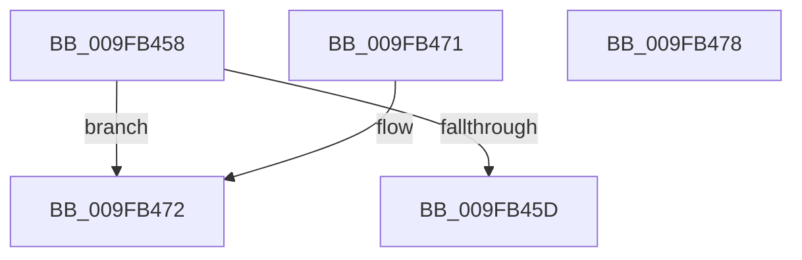

# PspGetJobLimitInformationValidFlags

- RVA: `0x009FB458`–`0x009FB479` (길이 `33` bytes)
- VA: `0x00000001409FB458`
- 실행 섹션: `PAGE`
- PDB 이름 있음: `예`; PDB Function 태그: `아니요`
- unwind 정보 RVA: `0x000DB714`
- 디코드: `11`개 명령, `33/33` bytes 표시
- 미해석 바이트: `0` (있으면 어셈블리에 `.byte`로 보존)

> 이 문서는 커널 이미지의 기계어와 PDB 기호를 분석해 생성했습니다. 4번과 5번은 함수 원형과 자료형을 바이너리 사용 방식에서 추정한 C 해석이며 원본 소스 복구 결과는 아닙니다.

## 1. Dependencies

- 직접 호출 지점: **0**; 고유 호출 대상: **0**
- 직접 호출자로 확인된 함수: **2**
- RIP 상대 이미지 참조: **0**

### Outgoing calls
- 직접 디코드된 call 명령이 없습니다.

### Direct callers
- [NtSetInformationJobObject](NtSetInformationJobObject_function_009F84C0.md) at `0x009F8BA7`
- [NtQueryInformationJobObject](NtQueryInformationJobObject_function_009FB860.md) at `0x009FC1B7`

### Static image references
- 디코드된 RIP-relative 메모리 참조가 없습니다.

## 2. Other-region calls and transfers

- 다른 실행 섹션으로 향하는 call: **0**
- 별도 외부 분기/꼬리 이동을 확인하지 못했습니다.

## 3. Assembly (complete function range)

```asm
009FB458  83 F9 02                        cmp ecx, 2
009FB45B  74 15                           je 0x1409fb472
009FB45D  81 FA 90 00 00 00               cmp edx, 0x90
009FB463  B8 FF 7F 60 00                  mov eax, 0x607fff
009FB468  B9 FF 7F 00 00                  mov ecx, 0x7fff
009FB46D  0F 44 C1                        cmove eax, ecx
009FB470  C3                              ret
009FB471  CC                              int3
009FB472  B8 FF 00 00 00                  mov eax, 0xff
009FB477  C3                              ret
009FB478  CC                              int3
```

## 4. C-style interpretation (structured pseudocode)

```c
__int64 __fastcall PspGetJobLimitInformationValidFlags(int a1, int a2)
{
    __int64 result;

    if (a1 == 2) goto loc_009FB472;
    result = (unsigned int)(0x607FFFULL);
    if (a2 == 144) { result = (unsigned int)((unsigned int)(0x7FFFULL)); }
    return result;
loc_009FB472:
    return 255;
}
```

## 5. (Beta) C Style

```c
int64_t PspGetJobLimitInformationValidFlags(int32_t Arg1, int32_t Arg2)
{
    int64_t result;

    if (Arg1 == 2) goto loc_009FB472;
    result = (uint32_t)(0x607FFFULL);
    if (Arg2 == 144) { result = (uint32_t)((uint32_t)(0x7FFFULL)); }
    return result;
loc_009FB472:
    return 255;
}
```

## 6. Execution-region graph

[열기: 2D/3D 그래프와 함수 탐색 컨트롤 패널](../../../control-panel.html?section=page&rva=0x009FB458&view=graph)

- 2D 그래프는 위에서 아래로 흐르고, 3D 그래프는 빈 공간을 드래그해 회전합니다. Shift+드래그는 이동, 휠은 확대·축소, 함수 노드 선택은 대상 보고서 이동입니다.

### Static fallback


