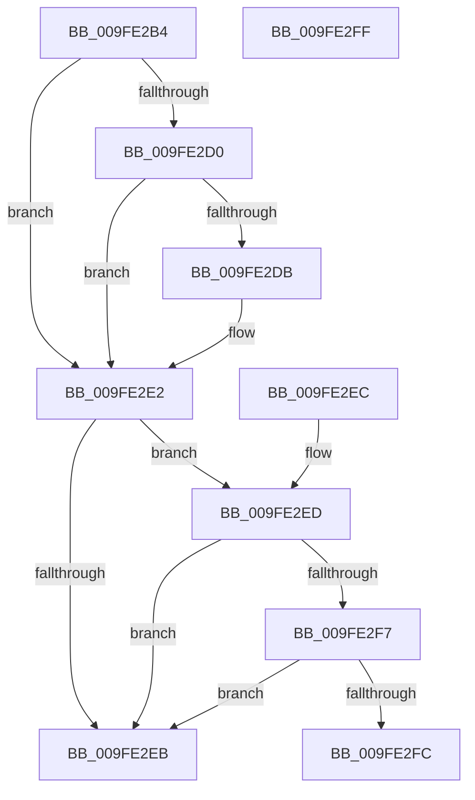

# PspGetJobMemoryUsageNotificationViolations

- RVA: `0x009FE2B4`–`0x009FE300` (길이 `76` bytes)
- VA: `0x00000001409FE2B4`
- 실행 섹션: `PAGE`
- PDB 이름 있음: `예`; PDB Function 태그: `아니요`
- unwind 정보 RVA: `0x000DB714`
- 디코드: `25`개 명령, `76/76` bytes 표시
- 미해석 바이트: `0` (있으면 어셈블리에 `.byte`로 보존)

> 이 문서는 커널 이미지의 기계어와 PDB 기호를 분석해 생성했습니다. 4번과 5번은 함수 원형과 자료형을 바이너리 사용 방식에서 추정한 C 해석이며 원본 소스 복구 결과는 아닙니다.

## 1. Dependencies

- 직접 호출 지점: **0**; 고유 호출 대상: **0**
- 직접 호출자로 확인된 함수: **1**
- RIP 상대 이미지 참조: **0**

### Outgoing calls
- 직접 디코드된 call 명령이 없습니다.

### Direct callers
- [NtSetInformationJobObject](NtSetInformationJobObject_function_009F84C0.md) at `0x009FA813`

### Static image references
- 디코드된 RIP-relative 메모리 참조가 없습니다.

## 2. Other-region calls and transfers

- 다른 실행 섹션으로 향하는 call: **0**
- 별도 외부 분기/꼬리 이동을 확인하지 못했습니다.

## 3. Assembly (complete function range)

```asm
009FE2B4  48 8B 89 C0 04 00 00            mov rcx, qword ptr [rcx + 0x4c0]
009FE2BB  F7 01 00 00 20 00               test dword ptr [rcx], 0x200000
009FE2C1  4C 0F 44 C2                     cmove r8, rdx
009FE2C5  48 8B 51 28                     mov rdx, qword ptr [rcx + 0x28]
009FE2C9  33 C0                           xor eax, eax
009FE2CB  48 85 D2                        test rdx, rdx
009FE2CE  74 12                           je 0x1409fe2e2
009FE2D0  41 BA 00 02 00 00               mov r10d, 0x200
009FE2D6  45 85 CA                        test r10d, r9d
009FE2D9  74 07                           je 0x1409fe2e2
009FE2DB  4C 3B C2                        cmp r8, rdx
009FE2DE  41 0F 47 C2                     cmova eax, r10d
009FE2E2  48 8B 49 20                     mov rcx, qword ptr [rcx + 0x20]
009FE2E6  48 85 C9                        test rcx, rcx
009FE2E9  75 02                           jne 0x1409fe2ed
009FE2EB  C3                              ret
009FE2EC  CC                              int3
009FE2ED  BA 00 80 00 00                  mov edx, 0x8000
009FE2F2  44 85 CA                        test edx, r9d
009FE2F5  74 F4                           je 0x1409fe2eb
009FE2F7  4C 3B C1                        cmp r8, rcx
009FE2FA  73 EF                           jae 0x1409fe2eb
009FE2FC  0B C2                           or eax, edx
009FE2FE  C3                              ret
009FE2FF  CC                              int3
```

## 4. C-style interpretation (structured pseudocode)

```c
__int64 __fastcall PspGetJobMemoryUsageNotificationViolations(__int64 a1, __int64 a2, __int64 a3, int a4)
{
    __int64 result;

    if (((*(unsigned int *)(*(unsigned __int64 *)(a1 + 1216))) & (0x200000ULL)) == 0) { a3 = a2; }
    result = 0;
    if (*(unsigned __int64 *)(*(unsigned __int64 *)(a1 + 1216) + 40) == 0) goto loc_009FE2E2;
    if (((512) & (a4)) != 0) {
        if (a3 > (*(unsigned __int64 *)(*(unsigned __int64 *)(a1 + 1216) + 40))) { result = 512; }
    }
    if (*(unsigned __int64 *)(*(unsigned __int64 *)(a1 + 1216) + 32) != 0) goto loc_009FE2ED;
loc_009FE2EB:
    return result;
loc_009FE2ED:
    if ((((unsigned int)((unsigned int)(0x8000ULL))) & (a4)) == 0) goto loc_009FE2EB;
    if (a3 >= (*(unsigned __int64 *)(*(unsigned __int64 *)(a1 + 1216) + 32))) goto loc_009FE2EB;
    result = (unsigned int)((result) | ((unsigned int)((unsigned int)(0x8000ULL))));
    return result;
}
```

## 5. (Beta) C Style

```c
int64_t PspGetJobMemoryUsageNotificationViolations(void *Arg1, int64_t Arg2, int64_t Arg3, int32_t Arg4)
{
    uint8_t *arg1 = (uint8_t *)Arg1;

    int64_t result;

    if (((*(uint32_t *)(*(uint64_t *)(arg1 + 0x4C0))) & (0x200000ULL)) == 0) { Arg3 = Arg2; }
    result = 0;
    if (*(uint64_t *)(*(uint64_t *)(arg1 + 0x4C0) + 0x28) == 0) goto loc_009FE2E2;
    if (((512) & (Arg4)) != 0) {
        if (Arg3 > (*(uint64_t *)(*(uint64_t *)(arg1 + 0x4C0) + 0x28))) { result = 512; }
    }
    if (*(uint64_t *)(*(uint64_t *)(arg1 + 0x4C0) + 0x20) != 0) goto loc_009FE2ED;
loc_009FE2EB:
    return result;
loc_009FE2ED:
    if ((((uint32_t)((uint32_t)(0x8000ULL))) & (Arg4)) == 0) goto loc_009FE2EB;
    if (Arg3 >= (*(uint64_t *)(*(uint64_t *)(arg1 + 0x4C0) + 0x20))) goto loc_009FE2EB;
    result = (uint32_t)((result) | ((uint32_t)((uint32_t)(0x8000ULL))));
    return result;
}
```

### 관측된 메모리 오프셋

구조체 형식이 확인되지 않은 접근은 인자 기준의 오프셋으로만 기록했습니다.

| 기준 인자 | 오프셋 표현 | 폭 (bit) | 접근 |
|---|---:|---:|---|
| `Arg1` | `+ 0x4C0` | `64` | `R` |

## 6. Execution-region graph

[열기: 2D/3D 그래프와 함수 탐색 컨트롤 패널](../../../control-panel.html?section=page&rva=0x009FE2B4&view=graph)

- 2D 그래프는 위에서 아래로 흐르고, 3D 그래프는 빈 공간을 드래그해 회전합니다. Shift+드래그는 이동, 휠은 확대·축소, 함수 노드 선택은 대상 보고서 이동입니다.

### Static fallback


