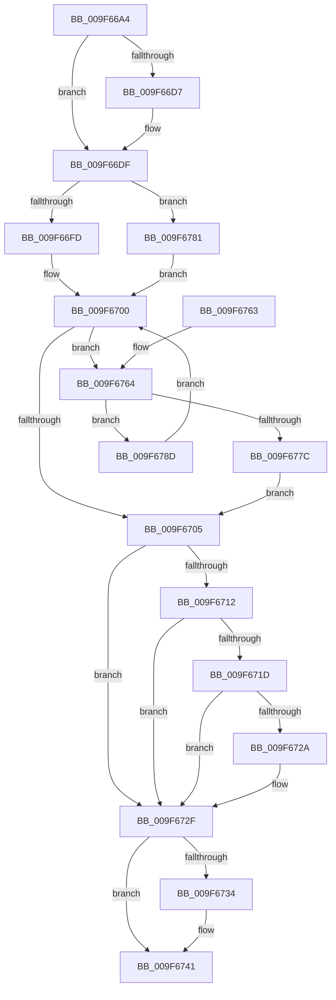

# PspGetNextChildJob

- RVA: `0x009F66A4`–`0x009F6795` (길이 `241` bytes)
- VA: `0x00000001409F66A4`
- 실행 섹션: `PAGE`
- PDB 이름 있음: `예`; PDB Function 태그: `아니요`
- unwind 정보 RVA: `0x000956F8`
- 디코드: `67`개 명령, `241/241` bytes 표시
- 미해석 바이트: `0` (있으면 어셈블리에 `.byte`로 보존)

> 이 문서는 커널 이미지의 기계어와 PDB 기호를 분석해 생성했습니다. 4번과 5번은 함수 원형과 자료형을 바이너리 사용 방식에서 추정한 C 해석이며 원본 소스 복구 결과는 아닙니다.

## 1. Dependencies

- 직접 호출 지점: **5**; 고유 호출 대상: **5**
- 직접 호출자로 확인된 함수: **1**
- RIP 상대 이미지 참조: **0**

### Outgoing calls
- `0x009F66E8` → [ExAcquireResourceSharedLite](../../text/21/ExAcquireResourceSharedLite_function_00211BC0.md) (function, `0x00211BC0`)
- `0x009F6708` → [ExReleaseResourceLite](../../text/25/ExReleaseResourceLite_function_0025FA10.md) (function, `0x0025FA10`)
- `0x009F672A` → [KiCheckForKernelApcDelivery](../../text/2E/KiCheckForKernelApcDelivery_function_002E2C80.md) (function, `0x002E2C80`)
- `0x009F673C` → [ObfDereferenceObjectWithTag](../../text/2F/ObfDereferenceObjectWithTag_function_002F78E0.md) (function, `0x002F78E0`)
- `0x009F6773` → [ObReferenceObjectSafeWithTag](../../text/21/ObReferenceObjectSafeWithTag_function_00210EE0.md) (function, `0x00210EE0`)

### Direct callers
- [PspEnumJobsAndProcessesInJobHierarchy](../91/PspEnumJobsAndProcessesInJobHierarchy_function_0091A1EC.md) at `0x0091A276`
- [PspEnumJobsAndProcessesInJobHierarchy](../91/PspEnumJobsAndProcessesInJobHierarchy_function_0091A1EC.md) at `0x0091A2CE`

### Static image references
- 디코드된 RIP-relative 메모리 참조가 없습니다.

## 2. Other-region calls and transfers

- 다른 실행 섹션으로 향하는 call: **5**
  - `0x009F66E8` → [ExAcquireResourceSharedLite](../../text/21/ExAcquireResourceSharedLite_function_00211BC0.md) (`PAGE` → `.text`)
  - `0x009F6708` → [ExReleaseResourceLite](../../text/25/ExReleaseResourceLite_function_0025FA10.md) (`PAGE` → `.text`)
  - `0x009F672A` → [KiCheckForKernelApcDelivery](../../text/2E/KiCheckForKernelApcDelivery_function_002E2C80.md) (`PAGE` → `.text`)
  - `0x009F673C` → [ObfDereferenceObjectWithTag](../../text/2F/ObfDereferenceObjectWithTag_function_002F78E0.md) (`PAGE` → `.text`)
  - `0x009F6773` → [ObReferenceObjectSafeWithTag](../../text/21/ObReferenceObjectSafeWithTag_function_00210EE0.md) (`PAGE` → `.text`)
- 별도 외부 분기/꼬리 이동을 확인하지 못했습니다.

## 3. Assembly (complete function range)

```asm
009F66A4  48 8B C4                        mov rax, rsp
009F66A7  48 89 58 08                     mov qword ptr [rax + 8], rbx
009F66AB  48 89 68 10                     mov qword ptr [rax + 0x10], rbp
009F66AF  48 89 70 18                     mov qword ptr [rax + 0x18], rsi
009F66B3  48 89 78 20                     mov qword ptr [rax + 0x20], rdi
009F66B7  41 54                           push r12
009F66B9  41 56                           push r14
009F66BB  41 57                           push r15
009F66BD  48 83 EC 20                     sub rsp, 0x20
009F66C1  65 48 8B 1C 25 88 01 00 00      mov rbx, qword ptr gs:[0x188]
009F66CA  33 ED                           xor ebp, ebp
009F66CC  48 8B F2                        mov rsi, rdx
009F66CF  48 8B F9                        mov rdi, rcx
009F66D2  48 85 DB                        test rbx, rbx
009F66D5  74 08                           je 0x1409f66df
009F66D7  66 FF 8B E6 01 00 00            dec word ptr [rbx + 0x1e6]
009F66DE  90                              nop
009F66DF  4C 8D 61 38                     lea r12, [rcx + 0x38]
009F66E3  B2 01                           mov dl, 1
009F66E5  49 8B CC                        mov rcx, r12
009F66E8  E8 D3 B4 81 FF                  call 0x140211bc0
009F66ED  4C 8D B7 08 05 00 00            lea r14, [rdi + 0x508]
009F66F4  48 85 F6                        test rsi, rsi
009F66F7  0F 85 84 00 00 00               jne 0x1409f6781
009F66FD  49 8B 3E                        mov rdi, qword ptr [r14]
009F6700  49 3B FE                        cmp rdi, r14
009F6703  75 5F                           jne 0x1409f6764
009F6705  49 8B CC                        mov rcx, r12
009F6708  E8 03 93 86 FF                  call 0x14025fa10
009F670D  48 85 DB                        test rbx, rbx
009F6710  74 1D                           je 0x1409f672f
009F6712  90                              nop
009F6713  66 83 83 E6 01 00 00 01         add word ptr [rbx + 0x1e6], 1
009F671B  75 12                           jne 0x1409f672f
009F671D  48 8D 8B 98 00 00 00            lea rcx, [rbx + 0x98]
009F6724  90                              nop
009F6725  48 39 09                        cmp qword ptr [rcx], rcx
009F6728  74 05                           je 0x1409f672f
009F672A  E8 51 C5 8E FF                  call 0x1402e2c80
009F672F  48 85 F6                        test rsi, rsi
009F6732  74 0D                           je 0x1409f6741
009F6734  BA 50 73 45 6E                  mov edx, 0x6e457350
009F6739  48 8B CE                        mov rcx, rsi
009F673C  E8 9F 11 90 FF                  call 0x1402f78e0
009F6741  48 8B 5C 24 40                  mov rbx, qword ptr [rsp + 0x40]
009F6746  48 8B C5                        mov rax, rbp
009F6749  48 8B 6C 24 48                  mov rbp, qword ptr [rsp + 0x48]
009F674E  48 8B 74 24 50                  mov rsi, qword ptr [rsp + 0x50]
009F6753  48 8B 7C 24 58                  mov rdi, qword ptr [rsp + 0x58]
009F6758  48 83 C4 20                     add rsp, 0x20
009F675C  41 5F                           pop r15
009F675E  41 5E                           pop r14
009F6760  41 5C                           pop r12
009F6762  C3                              ret
009F6763  CC                              int3
009F6764  4C 8D BF 08 FB FF FF            lea r15, [rdi - 0x4f8]
009F676B  BA 50 73 45 6E                  mov edx, 0x6e457350
009F6770  49 8B CF                        mov rcx, r15
009F6773  E8 68 A7 81 FF                  call 0x140210ee0
009F6778  84 C0                           test al, al
009F677A  74 11                           je 0x1409f678d
009F677C  49 8B EF                        mov rbp, r15
009F677F  EB 84                           jmp 0x1409f6705
009F6781  48 8B BE F8 04 00 00            mov rdi, qword ptr [rsi + 0x4f8]
009F6788  E9 73 FF FF FF                  jmp 0x1409f6700
009F678D  48 8B 3F                        mov rdi, qword ptr [rdi]
009F6790  E9 6B FF FF FF                  jmp 0x1409f6700
```

## 4. C-style interpretation (structured pseudocode)

```c
__int64 __fastcall PspGetNextChildJob(__int64 a1, __int64 a2)
{
    __int64 result;
    __int64 v_rbp;
    __int64 v_rsp;
    unsigned __int64 v_stack_p10;
    unsigned __int64 v_stack_p18;
    unsigned __int64 v_stack_p20;
    unsigned __int64 v_stack_p8;

    *(unsigned __int64 *)(v_rsp + 8) = v_rbx;
    *(unsigned __int64 *)(v_rsp + 16) = v_rbp;
    *(unsigned __int64 *)(v_rsp + 24) = v_rsi;
    *(unsigned __int64 *)(v_rsp + 32) = v_rdi;
    v_rsp = (v_rsp) - (32);
    v_rbp = 0;
    if (*(unsigned __int64 *)(gs_base + (0 + 392)) != 0) {
    }
    result = ExAcquireResourceSharedLite(a1 + 56, 1, a3, a4);
    if (a2 != 0) goto loc_009F6781;
loc_009F6700:
    if ((*(unsigned __int64 *)(a1 + 1288)) != (a1 + 1288)) goto loc_009F6764;
loc_009F6705:
    result = ExReleaseResourceLite(a1 + 56, 1, a3, a4);
    if (*(unsigned __int64 *)(gs_base + (0 + 392)) == 0) goto loc_009F672F;
    if (*(unsigned __int64 *)(gs_base + (0 + 392)) != 0) goto loc_009F672F;
    if ((*(unsigned __int64 *)(*(unsigned __int64 *)(gs_base + (0 + 392)) + 152)) != (*(unsigned __int64 *)(gs_base + (0 + 392)) + 152)) {
        result = KiCheckForKernelApcDelivery(*(unsigned __int64 *)(gs_base + (0 + 392)) + 152, 1, a3, a4);
    }
    if (a2 != 0) {
        a2 = 0x6E457350ULL;
        a1 = a2;
        result = ObfDereferenceObjectWithTag(a1, a2, a3, a4);
    }
    v_rsp = (v_rsp) + (32);
    return 0;
loc_009F6764:
    result = ObReferenceObjectSafeWithTag(v_stack_p20 - 1272, (unsigned int)(0x6E457350ULL), a3, a4);
    if ((unsigned __int8)(result) == 0) goto loc_009F678D;
    goto loc_009F6705;
loc_009F6781:
    goto loc_009F6700;
loc_009F678D:
    goto loc_009F6700;
}
```

## 5. (Beta) C Style

```c
int64_t PspGetNextChildJob(void *Arg1, int64_t Arg2)
{
    uint8_t *arg1 = (uint8_t *)Arg1;

    int64_t result;
    int64_t local_rbp;
    int64_t local_rsp;
    uint64_t v_stack_p10;
    uint64_t v_stack_p18;
    uint64_t v_stack_p20;
    uint64_t v_stack_p8;

    *(uint64_t *)(local_rsp + 0x8) = local_rbx;
    *(uint64_t *)(local_rsp + 0x10) = local_rbp;
    *(uint64_t *)(local_rsp + 0x18) = local_rsi;
    *(uint64_t *)(local_rsp + 0x20) = local_rdi;
    local_rsp = (local_rsp) - (32);
    local_rbp = 0;
    if (*(uint64_t *)(gs_base + (0 + 0x188)) != 0) {
    }
    result = ExAcquireResourceSharedLite(Arg1 + 56, 1, a3, a4);
    if (Arg2 != 0) goto loc_009F6781;
loc_009F6700:
    if ((*(uint64_t *)(arg1 + 0x508)) != (Arg1 + 1288)) goto loc_009F6764;
loc_009F6705:
    result = ExReleaseResourceLite(Arg1 + 56, 1, a3, a4);
    if (*(uint64_t *)(gs_base + (0 + 0x188)) == 0) goto loc_009F672F;
    if (*(uint64_t *)(gs_base + (0 + 0x188)) != 0) goto loc_009F672F;
    if ((*(uint64_t *)(*(uint64_t *)(gs_base + (0 + 0x188)) + 0x98)) != (*(uint64_t *)(gs_base + (0 + 0x188)) + 152)) {
        result = KiCheckForKernelApcDelivery(*(uint64_t *)(gs_base + (0 + 0x188)) + 152, 1, a3, a4);
    }
    if (Arg2 != 0) {
        Arg2 = 0x6E457350ULL;
        Arg1 = Arg2;
        result = ObfDereferenceObjectWithTag(Arg1, Arg2, a3, a4);
    }
    local_rsp = (local_rsp) + (32);
    return 0;
loc_009F6764:
    result = ObReferenceObjectSafeWithTag(v_stack_p20 - 1272, (uint32_t)(0x6E457350ULL), a3, a4);
    if ((uint8_t)(result) == 0) goto loc_009F678D;
    goto loc_009F6705;
loc_009F6781:
    goto loc_009F6700;
loc_009F678D:
    goto loc_009F6700;
}
```

### 관측된 메모리 오프셋

구조체 형식이 확인되지 않은 접근은 인자 기준의 오프셋으로만 기록했습니다.

| 기준 인자 | 오프셋 표현 | 폭 (bit) | 접근 |
|---|---:|---:|---|
| `Arg1` | `+ 0x0` | `64` | `R` |
| `Arg1` | `+ 0x38` | `64` | `R` |
| `Arg1` | `+ 0x508` | `64` | `R` |

## 6. Execution-region graph

[열기: 2D/3D 그래프와 함수 탐색 컨트롤 패널](../../../control-panel.html?section=page&rva=0x009F66A4&view=graph)

- 2D 그래프는 위에서 아래로 흐르고, 3D 그래프는 빈 공간을 드래그해 회전합니다. Shift+드래그는 이동, 휠은 확대·축소, 함수 노드 선택은 대상 보고서 이동입니다.

### Static fallback


