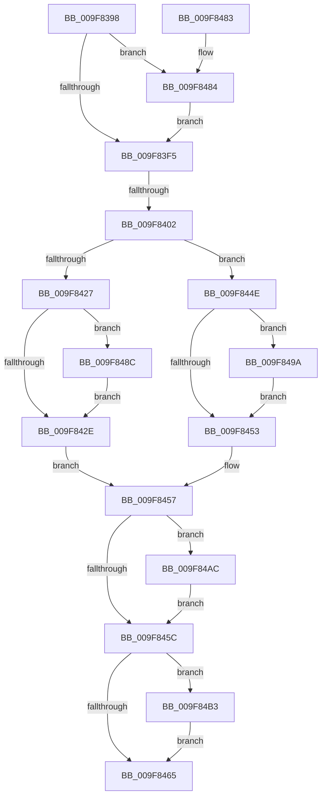

# PspIoRateEntryActivate

- RVA: `0x009F8398`–`0x009F84BA` (길이 `290` bytes)
- VA: `0x00000001409F8398`
- 실행 섹션: `PAGE`
- PDB 이름 있음: `예`; PDB Function 태그: `예`
- unwind 정보 RVA: `0x000A6E08`
- 디코드: `87`개 명령, `290/290` bytes 표시
- 미해석 바이트: `0` (있으면 어셈블리에 `.byte`로 보존)

> 이 문서는 커널 이미지의 기계어와 PDB 기호를 분석해 생성했습니다. 4번과 5번은 함수 원형과 자료형을 바이너리 사용 방식에서 추정한 C 해석이며 원본 소스 복구 결과는 아닙니다.

## 1. Dependencies

- 직접 호출 지점: **6**; 고유 호출 대상: **6**
- 직접 호출자로 확인된 함수: **2**
- RIP 상대 이미지 참조: **0**

### Outgoing calls
- `0x009F841C` → [IoStartIoRateControl](../../text/42/IoStartIoRateControl_function_00428574.md) (function, `0x00428574`)
- `0x009F848F` → [PspIoRateEntryDeactivate](PspIoRateEntryDeactivate_function_009F7BD4.md) (function, `0x009F7BD4`)
- `0x009F849D` → [IoStopDiskIoAttributionForContext](../../text/2A/IoStopDiskIoAttributionForContext_function_002A5614.md) (function, `0x002A5614`)
- `0x009F84A5` → [IoDiskIoAttributionDereference](../../text/34/IoDiskIoAttributionDereference_function_00349978.md) (function, `0x00349978`)
- `0x009F84AC` → [IoStopIoRateControl](../../text/42/IoStopIoRateControl_function_0042867C.md) (function, `0x0042867C`)
- `0x009F84B3` → [ZwClose](../../text/6A/ZwClose_function_006AD2B0.md) (function, `0x006AD2B0`)

### Direct callers
- [PspSetJobIoRateControl](PspSetJobIoRateControl_function_009F78EC.md) at `0x009F7B66`
- [PspSetJobIoRateControlForVolume](PspSetJobIoRateControlForVolume_function_009F80A0.md) at `0x009F8114`

### Static image references
- 디코드된 RIP-relative 메모리 참조가 없습니다.

## 2. Other-region calls and transfers

- 다른 실행 섹션으로 향하는 call: **5**
  - `0x009F841C` → [IoStartIoRateControl](../../text/42/IoStartIoRateControl_function_00428574.md) (`PAGE` → `.text`)
  - `0x009F849D` → [IoStopDiskIoAttributionForContext](../../text/2A/IoStopDiskIoAttributionForContext_function_002A5614.md) (`PAGE` → `.text`)
  - `0x009F84A5` → [IoDiskIoAttributionDereference](../../text/34/IoDiskIoAttributionDereference_function_00349978.md) (`PAGE` → `.text`)
  - `0x009F84AC` → [IoStopIoRateControl](../../text/42/IoStopIoRateControl_function_0042867C.md) (`PAGE` → `.text`)
  - `0x009F84B3` → [ZwClose](../../text/6A/ZwClose_function_006AD2B0.md) (`PAGE` → `.text`)
- call이 아닌 외부 분기/꼬리 이동: **1**
  - `0x009F83FC` → [sub_00B31590](../B3/Unknown_function_00B31590.md) (`tail-transfer`)

## 3. Assembly (complete function range)

```asm
009F8398  48 89 5C 24 08                  mov qword ptr [rsp + 8], rbx
009F839D  48 89 74 24 10                  mov qword ptr [rsp + 0x10], rsi
009F83A2  55                              push rbp
009F83A3  57                              push rdi
009F83A4  41 55                           push r13
009F83A6  41 56                           push r14
009F83A8  41 57                           push r15
009F83AA  48 8D 6C 24 C9                  lea rbp, [rsp - 0x37]
009F83AF  48 81 EC C0 00 00 00            sub rsp, 0xc0
009F83B6  33 C0                           xor eax, eax
009F83B8  0F 57 C0                        xorps xmm0, xmm0
009F83BB  48 21 45 D7                     and qword ptr [rbp - 0x29], rax
009F83BF  33 DB                           xor ebx, ebx
009F83C1  48 21 45 77                     and qword ptr [rbp + 0x77], rax
009F83C5  4D 8B F9                        mov r15, r9
009F83C8  48 89 45 1F                     mov qword ptr [rbp + 0x1f], rax
009F83CC  4D 8B E8                        mov r13, r8
009F83CF  89 45 27                        mov dword ptr [rbp + 0x27], eax
009F83D2  4C 8B F2                        mov r14, rdx
009F83D5  48 89 45 7F                     mov qword ptr [rbp + 0x7f], rax
009F83D9  48 8B F1                        mov rsi, rcx
009F83DC  0F 11 45 EF                     movups xmmword ptr [rbp - 0x11], xmm0
009F83E0  0F 11 45 FF                     movups xmmword ptr [rbp - 1], xmm0
009F83E4  0F 11 45 0F                     movups xmmword ptr [rbp + 0xf], xmm0
009F83E8  0F 11 45 DF                     movups xmmword ptr [rbp - 0x21], xmm0
009F83EC  4D 85 C9                        test r9, r9
009F83EF  0F 85 8F 00 00 00               jne 0x1409f8484
009F83F5  49 8B 50 18                     mov rdx, qword ptr [r8 + 0x18]
009F83F9  48 85 D2                        test rdx, rdx
009F83FC  0F 85 8E 91 13 00               jne 0x140b31590
009F8402  4D 8B 86 30 06 00 00            mov r8, qword ptr [r14 + 0x630]
009F8409  48 8D 4D D7                     lea rcx, [rbp - 0x29]
009F840D  48 8B D0                        mov rdx, rax
009F8410  48 89 4C 24 20                  mov qword ptr [rsp + 0x20], rcx
009F8415  4C 8D 4D 77                     lea r9, [rbp + 0x77]
009F8419  49 8B CD                        mov rcx, r13
009F841C  E8 53 01 A3 FF                  call 0x140428574
009F8421  8B F8                           mov edi, eax
009F8423  85 C0                           test eax, eax
009F8425  78 27                           js 0x1409f844e
009F8427  48 83 7E 28 00                  cmp qword ptr [rsi + 0x28], 0
009F842C  75 5E                           jne 0x1409f848c
009F842E  48 8B 45 77                     mov rax, qword ptr [rbp + 0x77]
009F8432  33 C9                           xor ecx, ecx
009F8434  48 89 46 28                     mov qword ptr [rsi + 0x28], rax
009F8438  48 8B 45 D7                     mov rax, qword ptr [rbp - 0x29]
009F843C  48 89 46 18                     mov qword ptr [rsi + 0x18], rax
009F8440  33 C0                           xor eax, eax
009F8442  48 89 5E 30                     mov qword ptr [rsi + 0x30], rbx
009F8446  33 FF                           xor edi, edi
009F8448  48 87 46 20                     xchg qword ptr [rsi + 0x20], rax
009F844C  EB 09                           jmp 0x1409f8457
009F844E  48 85 DB                        test rbx, rbx
009F8451  75 47                           jne 0x1409f849a
009F8453  48 8B 4D 77                     mov rcx, qword ptr [rbp + 0x77]
009F8457  48 85 C9                        test rcx, rcx
009F845A  75 50                           jne 0x1409f84ac
009F845C  48 8B 4D 7F                     mov rcx, qword ptr [rbp + 0x7f]
009F8460  48 85 C9                        test rcx, rcx
009F8463  75 4E                           jne 0x1409f84b3
009F8465  4C 8D 9C 24 C0 00 00 00         lea r11, [rsp + 0xc0]
009F846D  8B C7                           mov eax, edi
009F846F  49 8B 5B 30                     mov rbx, qword ptr [r11 + 0x30]
009F8473  49 8B 73 38                     mov rsi, qword ptr [r11 + 0x38]
009F8477  49 8B E3                        mov rsp, r11
009F847A  41 5F                           pop r15
009F847C  41 5E                           pop r14
009F847E  41 5D                           pop r13
009F8480  5F                              pop rdi
009F8481  5D                              pop rbp
009F8482  C3                              ret
009F8483  CC                              int3
009F8484  41 88 01                        mov byte ptr [r9], al
009F8487  E9 69 FF FF FF                  jmp 0x1409f83f5
009F848C  48 8B CE                        mov rcx, rsi
009F848F  E8 40 F7 FF FF                  call 0x1409f7bd4
009F8494  41 C6 07 01                     mov byte ptr [r15], 1
009F8498  EB 94                           jmp 0x1409f842e
009F849A  48 8B CB                        mov rcx, rbx
009F849D  E8 72 D1 8A FF                  call 0x1402a5614
009F84A2  48 8B CB                        mov rcx, rbx
009F84A5  E8 CE 14 95 FF                  call 0x140349978
009F84AA  EB A7                           jmp 0x1409f8453
009F84AC  E8 CB 01 A3 FF                  call 0x14042867c
009F84B1  EB A9                           jmp 0x1409f845c
009F84B3  E8 F8 4D CB FF                  call 0x1406ad2b0
009F84B8  EB AB                           jmp 0x1409f8465
```

## 4. C-style interpretation (structured pseudocode)

```c
__int64 __fastcall PspIoRateEntryActivate(__int64 a1, __int64 a2, __int64 a3, __int64 a4)
{
    __int64 result;
    __int64 v_rbx;
    __int64 v_rdi;
    __int64 v_rsp;
    unsigned __int64 v_stack_m28;
    unsigned int v_stack_m38;
    unsigned __int64 v_stack_m40;
    unsigned __int64 v_stack_m50;
    unsigned __int64 v_stack_m5F;
    unsigned __int64 v_stack_m60;
    unsigned __int64 v_stack_m70;
    unsigned __int64 v_stack_m80;
    unsigned __int64 v_stack_m88;
    unsigned __int64 v_stack_mC8;
    unsigned __int64 v_stack_p10;
    unsigned __int64 v_stack_p18;
    unsigned __int64 v_stack_p20;
    unsigned __int64 v_stack_p8;

    v_stack_p8 = v_rbx;
    v_stack_p10 = v_rsi;
    v_rsp = (v_rsp) - (192);
    result = 0;
    v_rbx = 0;
    v_stack_m40 = 0;
    v_stack_m38 = 0;
    v_stack_p20 = 0;
    v_stack_m70 = v_xmm0;
    v_stack_m60 = v_xmm0;
    v_stack_m50 = v_xmm0;
    v_stack_m80 = v_xmm0;
    if (a4 != 0) goto loc_009F8484;
loc_009F83F5:
    v_stack_mC8 = v_stack_m88;
    result = IoStartIoRateControl(a3, 0, *(unsigned __int64 *)(a2 + 1584), v_stack_p18);
    if (sign_flag) goto loc_009F844E;
    if ((*(unsigned __int64 *)(a1 + 40)) != 0) goto loc_009F848C;
loc_009F842E:
    a1 = 0;
    *(unsigned __int64 *)(a1 + 40) = v_stack_p18;
    *(unsigned __int64 *)(a1 + 24) = v_stack_m88;
    result = 0;
    *(unsigned __int64 *)(a1 + 48) = 0;
    v_rdi = 0;
    goto loc_009F8457;
loc_009F844E:
    if (0 != 0) goto loc_009F849A;
loc_009F8453:
loc_009F8457:
    if (v_stack_p18 != 0) goto loc_009F84AC;
loc_009F845C:
    if (v_stack_p20 != 0) goto loc_009F84B3;
loc_009F8465:
    return 0;
loc_009F8484:
    *(unsigned __int8 *)(v_stack_p18) = 0;
    goto loc_009F83F5;
loc_009F848C:
    result = PspIoRateEntryDeactivate(*(unsigned __int64 *)(v_stack_m28 + 56), 0, *(unsigned __int64 *)(a2 + 1584), v_stack_p18);
    *(unsigned __int8 *)(a4) = 1;
    goto loc_009F842E;
loc_009F849A:
    result = IoStopDiskIoAttributionForContext(*(unsigned __int64 *)(v_stack_m28 + 48), 0, *(unsigned __int64 *)(a2 + 1584), v_stack_p18);
    result = IoDiskIoAttributionDereference(*(unsigned __int64 *)(v_stack_m28 + 48), 0, *(unsigned __int64 *)(a2 + 1584), v_stack_p18);
    goto loc_009F8453;
loc_009F84AC:
    result = IoStopIoRateControl(*(unsigned __int64 *)(v_stack_m28 + 48), 0, *(unsigned __int64 *)(a2 + 1584), v_stack_p18);
    goto loc_009F845C;
loc_009F84B3:
    result = ZwClose(*(unsigned __int64 *)(v_stack_m28 + 48), 0, *(unsigned __int64 *)(a2 + 1584), v_stack_p18);
    goto loc_009F8465;
}
```

## 5. (Beta) C Style

```c
int64_t PspIoRateEntryActivate(void *Arg1, void *Arg2, void *Arg3, void *Arg4)
{
    uint8_t *arg1 = (uint8_t *)Arg1;
    uint8_t *arg2 = (uint8_t *)Arg2;
    uint8_t *arg3 = (uint8_t *)Arg3;
    uint8_t *arg4 = (uint8_t *)Arg4;

    int64_t result;
    int64_t local_rbx;
    int64_t local_rdi;
    int64_t local_rsp;
    uint64_t v_stack_m28;
    uint32_t v_stack_m38;
    uint64_t v_stack_m40;
    uint64_t v_stack_m50;
    uint64_t v_stack_m5F;
    uint64_t v_stack_m60;
    uint64_t v_stack_m70;
    uint64_t v_stack_m80;
    uint64_t v_stack_m88;
    uint64_t v_stack_mC8;
    uint64_t v_stack_p10;
    uint64_t v_stack_p18;
    uint64_t v_stack_p20;
    uint64_t v_stack_p8;

    v_stack_p8 = local_rbx;
    v_stack_p10 = local_rsi;
    local_rsp = (local_rsp) - (192);
    result = 0;
    local_rbx = 0;
    v_stack_m40 = 0;
    v_stack_m38 = 0;
    v_stack_p20 = 0;
    v_stack_m70 = v_xmm0;
    v_stack_m60 = v_xmm0;
    v_stack_m50 = v_xmm0;
    v_stack_m80 = v_xmm0;
    if (Arg4 != NULL) goto loc_009F8484;
loc_009F83F5:
    v_stack_mC8 = v_stack_m88;
    result = IoStartIoRateControl(Arg3, 0, *(uint64_t *)(arg2 + 0x630), v_stack_p18);
    if (sign_flag) goto loc_009F844E;
    if ((*(uint64_t *)(arg1 + 0x28)) != 0) goto loc_009F848C;
loc_009F842E:
    Arg1 = 0;
    *(uint64_t *)(arg1 + 0x28) = v_stack_p18;
    *(uint64_t *)(arg1 + 0x18) = v_stack_m88;
    result = 0;
    *(uint64_t *)(arg1 + 0x30) = 0;
    local_rdi = 0;
    goto loc_009F8457;
loc_009F844E:
    if (0 != 0) goto loc_009F849A;
loc_009F8453:
loc_009F8457:
    if (v_stack_p18 != 0) goto loc_009F84AC;
loc_009F845C:
    if (v_stack_p20 != 0) goto loc_009F84B3;
loc_009F8465:
    return 0;
loc_009F8484:
    *(uint8_t *)(v_stack_p18) = 0;
    goto loc_009F83F5;
loc_009F848C:
    result = PspIoRateEntryDeactivate(*(uint64_t *)(v_stack_m28 + 0x38), 0, *(uint64_t *)(arg2 + 0x630), v_stack_p18);
    *(uint8_t *)(arg4) = 1;
    goto loc_009F842E;
loc_009F849A:
    result = IoStopDiskIoAttributionForContext(*(uint64_t *)(v_stack_m28 + 0x30), 0, *(uint64_t *)(arg2 + 0x630), v_stack_p18);
    result = IoDiskIoAttributionDereference(*(uint64_t *)(v_stack_m28 + 0x30), 0, *(uint64_t *)(arg2 + 0x630), v_stack_p18);
    goto loc_009F8453;
loc_009F84AC:
    result = IoStopIoRateControl(*(uint64_t *)(v_stack_m28 + 0x30), 0, *(uint64_t *)(arg2 + 0x630), v_stack_p18);
    goto loc_009F845C;
loc_009F84B3:
    result = ZwClose(*(uint64_t *)(v_stack_m28 + 0x30), 0, *(uint64_t *)(arg2 + 0x630), v_stack_p18);
    goto loc_009F8465;
}
```

### 관측된 메모리 오프셋

구조체 형식이 확인되지 않은 접근은 인자 기준의 오프셋으로만 기록했습니다.

| 기준 인자 | 오프셋 표현 | 폭 (bit) | 접근 |
|---|---:|---:|---|
| `Arg1` | `+ 0x18` | `64` | `W` |
| `Arg1` | `+ 0x20` | `64` | `R/W` |
| `Arg1` | `+ 0x28` | `64` | `R` |
| `Arg1` | `+ 0x28` | `64` | `W` |
| `Arg1` | `+ 0x30` | `64` | `W` |
| `Arg2` | `+ 0x630` | `64` | `R` |
| `Arg3` | `+ 0x18` | `64` | `R` |
| `Arg4` | `+ 0x0` | `8` | `W` |

## 6. Execution-region graph

[열기: 2D/3D 그래프와 함수 탐색 컨트롤 패널](../../../control-panel.html?section=page&rva=0x009F8398&view=graph)

- 2D 그래프는 위에서 아래로 흐르고, 3D 그래프는 빈 공간을 드래그해 회전합니다. Shift+드래그는 이동, 휠은 확대·축소, 함수 노드 선택은 대상 보고서 이동입니다.

### Static fallback


