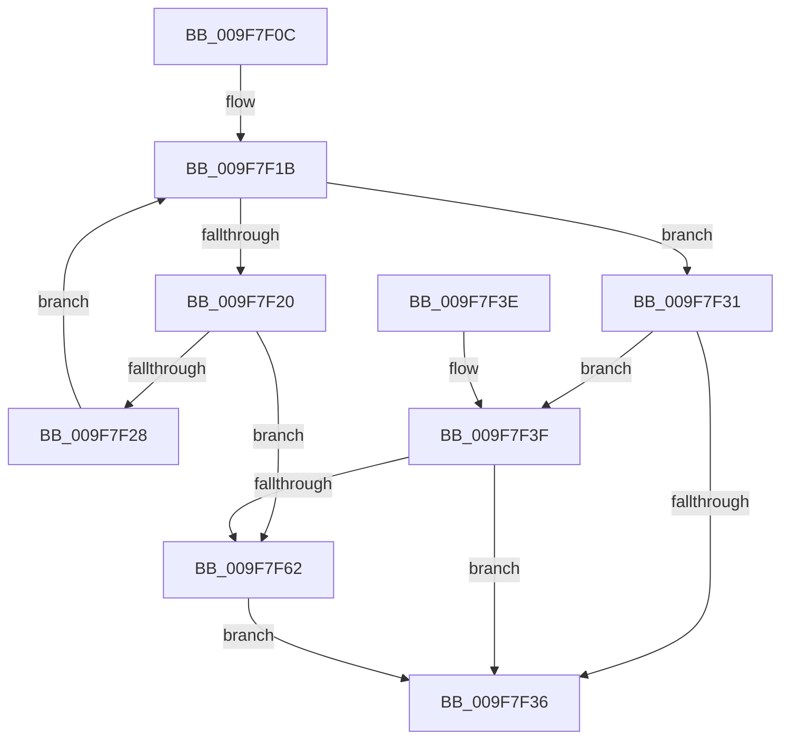

# PspIsSetJobIoAttribution

- RVA: `0x009F7F0C`–`0x009F7F66` (길이 `90` bytes)
- VA: `0x00000001409F7F0C`
- 실행 섹션: `PAGE`
- PDB 이름 있음: `예`; PDB Function 태그: `아니요`
- unwind 정보 RVA: `0x000A6DDC`
- 디코드: `27`개 명령, `90/90` bytes 표시
- 미해석 바이트: `0` (있으면 어셈블리에 `.byte`로 보존)

> 이 문서는 커널 이미지의 기계어와 PDB 기호를 분석해 생성했습니다. 4번과 5번은 함수 원형과 자료형을 바이너리 사용 방식에서 추정한 C 해석이며 원본 소스 복구 결과는 아닙니다.

## 1. Dependencies

- 직접 호출 지점: **1**; 고유 호출 대상: **1**
- 직접 호출자로 확인된 함수: **2**
- RIP 상대 이미지 참조: **1**

### Outgoing calls
- `0x009F7F59` → [PspEnumJobsAndProcessesInJobHierarchy](../91/PspEnumJobsAndProcessesInJobHierarchy_function_0091A1EC.md) (function, `0x0091A1EC`)

### Direct callers
- [PspSetJobIoAttribution](PspSetJobIoAttribution_function_009F7C50.md) at `0x009F7C90`
- [PspValidateJobAssignmentDiskIoAttribution](../A8/PspValidateJobAssignmentDiskIoAttribution_function_00A86444.md) at `0x00A86498`

### Static image references
- `0x009F7F47` → RVA `0x00A775F0` (`PspIsSetJobIoAttributionJobPreCallback`; read)

## 2. Other-region calls and transfers

- 다른 실행 섹션으로 향하는 call: **0**
- 별도 외부 분기/꼬리 이동을 확인하지 못했습니다.

## 3. Assembly (complete function range)

```asm
009F7F0C  40 53                           push rbx
009F7F0E  48 83 EC 30                     sub rsp, 0x30
009F7F12  48 8B 81 18 05 00 00            mov rax, qword ptr [rcx + 0x518]
009F7F19  33 DB                           xor ebx, ebx
009F7F1B  48 85 C0                        test rax, rax
009F7F1E  74 11                           je 0x1409f7f31
009F7F20  39 98 2C 06 00 00               cmp dword ptr [rax + 0x62c], ebx
009F7F26  75 3A                           jne 0x1409f7f62
009F7F28  48 8B 80 18 05 00 00            mov rax, qword ptr [rax + 0x518]
009F7F2F  EB EA                           jmp 0x1409f7f1b
009F7F31  45 84 C0                        test r8b, r8b
009F7F34  74 09                           je 0x1409f7f3f
009F7F36  8A C3                           mov al, bl
009F7F38  48 83 C4 30                     add rsp, 0x30
009F7F3C  5B                              pop rbx
009F7F3D  C3                              ret
009F7F3E  CC                              int3
009F7F3F  C7 44 24 28 05 00 00 00         mov dword ptr [rsp + 0x28], 5
009F7F47  48 8D 15 A2 F6 07 00            lea rdx, [rip + 0x7f6a2]
009F7F4E  45 33 C9                        xor r9d, r9d
009F7F51  48 89 4C 24 20                  mov qword ptr [rsp + 0x20], rcx
009F7F56  45 33 C0                        xor r8d, r8d
009F7F59  E8 8E 22 F2 FF                  call 0x14091a1ec
009F7F5E  85 C0                           test eax, eax
009F7F60  79 D4                           jns 0x1409f7f36
009F7F62  B3 01                           mov bl, 1
009F7F64  EB D0                           jmp 0x1409f7f36
```

## 4. C-style interpretation (structured pseudocode)

```c
__int64 __fastcall PspIsSetJobIoAttribution(__int64 a1, __int64 a2, int a3, int a4)
{
    __int64 result;
    __int64 v_rbx;
    __int64 v_rsp;
    unsigned __int64 v_stack_p20;
    unsigned int v_stack_p28;

    v_rsp = (v_rsp) - (48);
    v_rbx = 0;
loc_009F7F1B:
    if (*(unsigned __int64 *)(a1 + 1304) == 0) goto loc_009F7F31;
    if ((*(unsigned int *)(*(unsigned __int64 *)(a1 + 1304) + 1580)) != 0) goto loc_009F7F62;
    goto loc_009F7F1B;
loc_009F7F31:
    if ((unsigned __int8)(a3) == 0) goto loc_009F7F3F;
loc_009F7F36:
    v_rsp = (v_rsp) + (48);
    return 0;
loc_009F7F3F:
    v_stack_p28 = 5;
    a4 = 0;
    v_stack_p20 = a1;
    a3 = 0;
    result = PspEnumJobsAndProcessesInJobHierarchy(a1, v_rip + 521890, a3, a4);
    if (!sign_flag) goto loc_009F7F36;
loc_009F7F62:
    goto loc_009F7F36;
}
```

## 5. (Beta) C Style

```c
int64_t PspIsSetJobIoAttribution(void *Arg1, int64_t Arg2, int32_t Arg3, int32_t Arg4)
{
    uint8_t *arg1 = (uint8_t *)Arg1;

    int64_t result;
    int64_t local_rbx;
    int64_t local_rsp;
    uint64_t v_stack_p20;
    uint32_t v_stack_p28;

    local_rsp = (local_rsp) - (48);
    local_rbx = 0;
loc_009F7F1B:
    if (*(uint64_t *)(arg1 + 0x518) == 0) goto loc_009F7F31;
    if ((*(uint32_t *)(*(uint64_t *)(arg1 + 0x518) + 0x62C)) != 0) goto loc_009F7F62;
    goto loc_009F7F1B;
loc_009F7F31:
    if ((uint8_t)(Arg3) == 0) goto loc_009F7F3F;
loc_009F7F36:
    local_rsp = (local_rsp) + (48);
    return 0;
loc_009F7F3F:
    v_stack_p28 = 5;
    Arg4 = 0;
    v_stack_p20 = Arg1;
    Arg3 = 0;
    result = PspEnumJobsAndProcessesInJobHierarchy(Arg1, v_rip + 521890, Arg3, Arg4);
    if (!sign_flag) goto loc_009F7F36;
loc_009F7F62:
    goto loc_009F7F36;
}
```

### 관측된 메모리 오프셋

구조체 형식이 확인되지 않은 접근은 인자 기준의 오프셋으로만 기록했습니다.

| 기준 인자 | 오프셋 표현 | 폭 (bit) | 접근 |
|---|---:|---:|---|
| `Arg1` | `+ 0x518` | `64` | `R` |

## 6. Execution-region graph

[열기: 2D/3D 그래프와 함수 탐색 컨트롤 패널](../../../control-panel.html?section=page&rva=0x009F7F0C&view=graph)

- 2D 그래프는 위에서 아래로 흐르고, 3D 그래프는 빈 공간을 드래그해 회전합니다. Shift+드래그는 이동, 휠은 확대·축소, 함수 노드 선택은 대상 보고서 이동입니다.

### Static fallback


