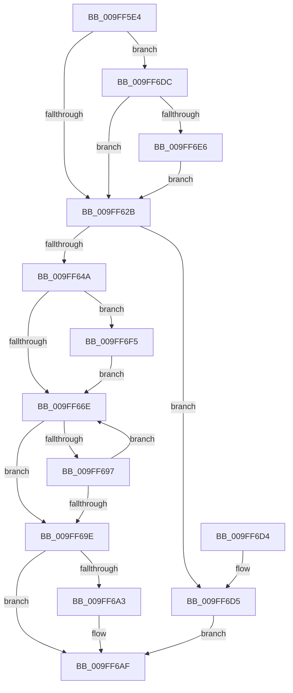

# PspIumResolveVirtualFault

- RVA: `0x009FF5E4`–`0x009FF709` (길이 `293` bytes)
- VA: `0x00000001409FF5E4`
- 실행 섹션: `PAGE`
- PDB 이름 있음: `예`; PDB Function 태그: `아니요`
- unwind 정보 RVA: `0x000A7900`
- 디코드: `75`개 명령, `293/293` bytes 표시
- 미해석 바이트: `0` (있으면 어셈블리에 `.byte`로 보존)

> 이 문서는 커널 이미지의 기계어와 PDB 기호를 분석해 생성했습니다. 4번과 5번은 함수 원형과 자료형을 바이너리 사용 방식에서 추정한 C 해석이며 원본 소스 복구 결과는 아닙니다.

## 1. Dependencies

- 직접 호출 지점: **6**; 고유 호출 대상: **6**
- 직접 호출자로 확인된 함수: **1**
- RIP 상대 이미지 참조: **1**

### Outgoing calls
- `0x009FF67B` → [memset](../../text/6C/memset_function_006C6C40.md) (function, `0x006C6C40`)
- `0x009FF68C` → [MmVirtualAccessFault](MmVirtualAccessFault_function_009FF98C.md) (function, `0x009FF98C`)
- `0x009FF6AA` → [KiUnstackDetachProcess](../../text/21/KiUnstackDetachProcess_function_00217D30.md) (function, `0x00217D30`)
- `0x009FF6BA` → [_security_check_cookie](../../text/6A/_security_check_cookie_function_006AC640.md) (function, `0x006AC640`)
- `0x009FF6EB` → [PspIumReplenishPartitionPages](../../text/2C/PspIumReplenishPartitionPages_function_002C8710.md) (function, `0x002C8710`)
- `0x009FF6FF` → [KiStackAttachProcess](../../text/21/KiStackAttachProcess_function_00216820.md) (function, `0x00216820`)

### Direct callers
- [PsDispatchIumService](../../text/4A/PsDispatchIumService_function_004A2F0C.md) at `0x004A2FD6`

### Static image references
- `0x009FF5F6` → RVA `0x00E0A740` (`.data`; read)

## 2. Other-region calls and transfers

- 다른 실행 섹션으로 향하는 call: **5**
  - `0x009FF67B` → [memset](../../text/6C/memset_function_006C6C40.md) (`PAGE` → `.text`)
  - `0x009FF6AA` → [KiUnstackDetachProcess](../../text/21/KiUnstackDetachProcess_function_00217D30.md) (`PAGE` → `.text`)
  - `0x009FF6BA` → [_security_check_cookie](../../text/6A/_security_check_cookie_function_006AC640.md) (`PAGE` → `.text`)
  - `0x009FF6EB` → [PspIumReplenishPartitionPages](../../text/2C/PspIumReplenishPartitionPages_function_002C8710.md) (`PAGE` → `.text`)
  - `0x009FF6FF` → [KiStackAttachProcess](../../text/21/KiStackAttachProcess_function_00216820.md) (`PAGE` → `.text`)
- 별도 외부 분기/꼬리 이동을 확인하지 못했습니다.

## 3. Assembly (complete function range)

```asm
009FF5E4  48 89 5C 24 10                  mov qword ptr [rsp + 0x10], rbx
009FF5E9  48 89 6C 24 18                  mov qword ptr [rsp + 0x18], rbp
009FF5EE  56                              push rsi
009FF5EF  57                              push rdi
009FF5F0  41 56                           push r14
009FF5F2  48 83 EC 70                     sub rsp, 0x70
009FF5F6  48 8B 05 43 B1 40 00            mov rax, qword ptr [rip + 0x40b143]
009FF5FD  48 33 C4                        xor rax, rsp
009FF600  48 89 44 24 60                  mov qword ptr [rsp + 0x60], rax
009FF605  48 8B 79 18                     mov rdi, qword ptr [rcx + 0x18]
009FF609  0F 57 C0                        xorps xmm0, xmm0
009FF60C  48 8B D9                        mov rbx, rcx
009FF60F  48 8B 49 20                     mov rcx, qword ptr [rcx + 0x20]
009FF613  0F 11 44 24 30                  movups xmmword ptr [rsp + 0x30], xmm0
009FF618  0F 11 44 24 40                  movups xmmword ptr [rsp + 0x40], xmm0
009FF61D  0F 11 44 24 50                  movups xmmword ptr [rsp + 0x50], xmm0
009FF622  48 85 C9                        test rcx, rcx
009FF625  0F 85 B1 00 00 00               jne 0x1409ff6dc
009FF62B  4C 8D 73 10                     lea r14, [rbx + 0x10]
009FF62F  48 B9 FF FF FE FF FF 7F 00 00   movabs rcx, 0x7ffffffeffff
009FF639  49 8B 06                        mov rax, qword ptr [r14]
009FF63C  48 89 44 24 20                  mov qword ptr [rsp + 0x20], rax
009FF641  48 3B C1                        cmp rax, rcx
009FF644  0F 87 8B 00 00 00               ja 0x1409ff6d5
009FF64A  8B 43 0C                        mov eax, dword ptr [rbx + 0xc]
009FF64D  C1 E0 0C                        shl eax, 0xc
009FF650  48 89 44 24 28                  mov qword ptr [rsp + 0x28], rax
009FF655  65 48 8B 04 25 88 01 00 00      mov rax, qword ptr gs:[0x188]
009FF65E  48 8B A8 B8 00 00 00            mov rbp, qword ptr [rax + 0xb8]
009FF665  48 3B EF                        cmp rbp, rdi
009FF668  0F 85 87 00 00 00               jne 0x1409ff6f5
009FF66E  44 8B 43 0C                     mov r8d, dword ptr [rbx + 0xc]
009FF672  33 D2                           xor edx, edx
009FF674  49 C1 E0 03                     shl r8, 3
009FF678  49 8B CE                        mov rcx, r14
009FF67B  E8 C0 75 CC FF                  call 0x1406c6c40
009FF680  44 8B 43 08                     mov r8d, dword ptr [rbx + 8]
009FF684  48 8D 4C 24 20                  lea rcx, [rsp + 0x20]
009FF689  49 8B D6                        mov rdx, r14
009FF68C  E8 FB 02 00 00                  call 0x1409ff98c
009FF691  8B F0                           mov esi, eax
009FF693  85 C0                           test eax, eax
009FF695  78 07                           js 0x1409ff69e
009FF697  49 0F BA 26 34                  bt qword ptr [r14], 0x34
009FF69C  73 D0                           jae 0x1409ff66e
009FF69E  48 3B EF                        cmp rbp, rdi
009FF6A1  74 0C                           je 0x1409ff6af
009FF6A3  33 D2                           xor edx, edx
009FF6A5  48 8D 4C 24 30                  lea rcx, [rsp + 0x30]
009FF6AA  E8 81 86 81 FF                  call 0x140217d30
009FF6AF  89 73 08                        mov dword ptr [rbx + 8], esi
009FF6B2  48 8B 4C 24 60                  mov rcx, qword ptr [rsp + 0x60]
009FF6B7  48 33 CC                        xor rcx, rsp
009FF6BA  E8 81 CF CA FF                  call 0x1406ac640
009FF6BF  4C 8D 5C 24 70                  lea r11, [rsp + 0x70]
009FF6C4  49 8B 5B 28                     mov rbx, qword ptr [r11 + 0x28]
009FF6C8  49 8B 6B 30                     mov rbp, qword ptr [r11 + 0x30]
009FF6CC  49 8B E3                        mov rsp, r11
009FF6CF  41 5E                           pop r14
009FF6D1  5F                              pop rdi
009FF6D2  5E                              pop rsi
009FF6D3  C3                              ret
009FF6D4  CC                              int3
009FF6D5  BE 05 00 00 C0                  mov esi, 0xc0000005
009FF6DA  EB D3                           jmp 0x1409ff6af
009FF6DC  83 79 04 08                     cmp dword ptr [rcx + 4], 8
009FF6E0  0F 83 45 FF FF FF               jae 0x1409ff62b
009FF6E6  BA 03 00 00 00                  mov edx, 3
009FF6EB  E8 20 90 8C FF                  call 0x1402c8710
009FF6F0  E9 36 FF FF FF                  jmp 0x1409ff62b
009FF6F5  4C 8D 44 24 30                  lea r8, [rsp + 0x30]
009FF6FA  33 D2                           xor edx, edx
009FF6FC  48 8B CF                        mov rcx, rdi
009FF6FF  E8 1C 71 81 FF                  call 0x140216820
009FF704  E9 65 FF FF FF                  jmp 0x1409ff66e
```

## 4. C-style interpretation (structured pseudocode)

```c
__int64 __fastcall PspIumResolveVirtualFault(__int64 a1, int a2)
{
    __int64 result;
    __int64 v_rsp;
    unsigned __int64 v_stack_m18;
    unsigned __int64 v_stack_m28;
    unsigned __int64 v_stack_m38;
    unsigned __int64 v_stack_m40;
    unsigned __int64 v_stack_m48;
    unsigned __int64 v_stack_m58;
    unsigned __int64 v_stack_m60;
    unsigned __int64 v_stack_m68;
    unsigned __int64 v_stack_p10;
    unsigned __int64 v_stack_p18;

    v_stack_p10 = v_rbx;
    v_stack_p18 = v_rbp;
    v_rsp = (v_rsp) - (112);
    result = (*(unsigned __int64 *)(v_rip + 4239683)) ^ (v_rsp);
    v_stack_m28 = result;
    v_stack_m58 = v_xmm0;
    v_stack_m48 = v_xmm0;
    v_stack_m38 = v_xmm0;
    if (*(unsigned __int64 *)(a1 + 32) != 0) goto loc_009FF6DC;
loc_009FF62B:
    v_stack_m68 = *(unsigned __int64 *)(a1 + 16);
    if ((*(unsigned __int64 *)(a1 + 16)) > (*(unsigned __int64 *)(a1 + 32))) goto loc_009FF6D5;
    result = (unsigned int)(((unsigned int)(*(unsigned int *)(a1 + 12))) << (12));
    v_stack_m60 = result;
    if ((*(unsigned __int64 *)(*(unsigned __int64 *)(gs_base + (0 + 392)) + 184)) != (*(unsigned __int64 *)(a1 + 24))) goto loc_009FF6F5;
loc_009FF66E:
    a2 = 0;
    a3 = ((unsigned int)(*(unsigned int *)(a1 + 12))) << (3);
    result = memset(a1 + 16, a2, a3, a4);
    result = MmVirtualAccessFault(v_stack_m68, a1 + 16, (unsigned int)(*(unsigned int *)(a1 + 8)), a4);
    if (sign_flag) goto loc_009FF69E;
    if (condition_is_above_or_equal) goto loc_009FF66E;
loc_009FF69E:
    if ((*(unsigned __int64 *)(*(unsigned __int64 *)(gs_base + (0 + 392)) + 184)) != (*(unsigned __int64 *)(a1 + 24))) {
        a2 = 0;
        a1 = v_stack_m58;
        result = KiUnstackDetachProcess(a1, a2, (unsigned int)(*(unsigned int *)(a1 + 8)), a4);
    }
    *(unsigned int *)(a1 + 8) = (unsigned int)((unsigned int)((unsigned int)(result)));
    a1 = (v_stack_m28) ^ (v_rsp);
    result = _security_check_cookie(a1, a2, (unsigned int)(*(unsigned int *)(a1 + 8)), a4);
    return result;
loc_009FF6D5:
    goto loc_009FF6AF;
loc_009FF6DC:
    if ((*(unsigned int *)(a1 + 4)) >= 8) goto loc_009FF62B;
    result = PspIumReplenishPartitionPages(a1, 3, (unsigned int)(*(unsigned int *)(a1 + 8)), a4);
    goto loc_009FF62B;
loc_009FF6F5:
    a2 = 0;
    result = KiStackAttachProcess(*(unsigned __int64 *)(a1 + 24), a2, v_stack_m40, a4);
    goto loc_009FF66E;
}
```

## 5. (Beta) C Style

```c
int64_t PspIumResolveVirtualFault(void *Arg1, int32_t Arg2)
{
    uint8_t *arg1 = (uint8_t *)Arg1;

    int64_t result;
    int64_t local_rsp;
    uint64_t v_stack_m18;
    uint64_t v_stack_m28;
    uint64_t v_stack_m38;
    uint64_t v_stack_m40;
    uint64_t v_stack_m48;
    uint64_t v_stack_m58;
    uint64_t v_stack_m60;
    uint64_t v_stack_m68;
    uint64_t v_stack_p10;
    uint64_t v_stack_p18;

    v_stack_p10 = local_rbx;
    v_stack_p18 = local_rbp;
    local_rsp = (local_rsp) - (112);
    result = (*(uint64_t *)(v_rip + 0x40B143)) ^ (local_rsp);
    v_stack_m28 = result;
    v_stack_m58 = v_xmm0;
    v_stack_m48 = v_xmm0;
    v_stack_m38 = v_xmm0;
    if (*(uint64_t *)(arg1 + 0x20) != 0) goto loc_009FF6DC;
loc_009FF62B:
    v_stack_m68 = *(uint64_t *)(arg1 + 0x10);
    if ((*(uint64_t *)(arg1 + 0x10)) > (*(uint64_t *)(arg1 + 0x20))) goto loc_009FF6D5;
    result = (uint32_t)(((uint32_t)(*(uint32_t *)(arg1 + 0xC))) << (12));
    v_stack_m60 = result;
    if ((*(uint64_t *)(*(uint64_t *)(gs_base + (0 + 0x188)) + 0xB8)) != (*(uint64_t *)(arg1 + 0x18))) goto loc_009FF6F5;
loc_009FF66E:
    Arg2 = 0;
    a3 = ((uint32_t)(*(uint32_t *)(arg1 + 0xC))) << (3);
    result = memset(Arg1 + 16, Arg2, a3, a4);
    result = MmVirtualAccessFault(v_stack_m68, Arg1 + 16, (uint32_t)(*(uint32_t *)(arg1 + 0x8)), a4);
    if (sign_flag) goto loc_009FF69E;
    if (condition_is_above_or_equal) goto loc_009FF66E;
loc_009FF69E:
    if ((*(uint64_t *)(*(uint64_t *)(gs_base + (0 + 0x188)) + 0xB8)) != (*(uint64_t *)(arg1 + 0x18))) {
        Arg2 = 0;
        Arg1 = v_stack_m58;
        result = KiUnstackDetachProcess(Arg1, Arg2, (uint32_t)(*(uint32_t *)(arg1 + 0x8)), a4);
    }
    *(uint32_t *)(arg1 + 0x8) = (uint32_t)((uint32_t)((uint32_t)(result)));
    Arg1 = (v_stack_m28) ^ (local_rsp);
    result = _security_check_cookie(Arg1, Arg2, (uint32_t)(*(uint32_t *)(arg1 + 0x8)), a4);
    return result;
loc_009FF6D5:
    goto loc_009FF6AF;
loc_009FF6DC:
    if ((*(uint32_t *)(arg1 + 0x4)) >= 8) goto loc_009FF62B;
    result = PspIumReplenishPartitionPages(Arg1, 3, (uint32_t)(*(uint32_t *)(arg1 + 0x8)), a4);
    goto loc_009FF62B;
loc_009FF6F5:
    Arg2 = 0;
    result = KiStackAttachProcess(*(uint64_t *)(arg1 + 0x18), Arg2, v_stack_m40, a4);
    goto loc_009FF66E;
}
```

### 관측된 메모리 오프셋

구조체 형식이 확인되지 않은 접근은 인자 기준의 오프셋으로만 기록했습니다.

| 기준 인자 | 오프셋 표현 | 폭 (bit) | 접근 |
|---|---:|---:|---|
| `Arg1` | `+ 0x0` | `64` | `R` |
| `Arg1` | `+ 0x8` | `32` | `R` |
| `Arg1` | `+ 0x8` | `32` | `W` |
| `Arg1` | `+ 0xC` | `32` | `R` |
| `Arg1` | `+ 0x10` | `64` | `R` |
| `Arg1` | `+ 0x18` | `64` | `R` |
| `Arg1` | `+ 0x20` | `64` | `R` |

## 6. Execution-region graph

[열기: 2D/3D 그래프와 함수 탐색 컨트롤 패널](../../../control-panel.html?section=page&rva=0x009FF5E4&view=graph)

- 2D 그래프는 위에서 아래로 흐르고, 3D 그래프는 빈 공간을 드래그해 회전합니다. Shift+드래그는 이동, 휠은 확대·축소, 함수 노드 선택은 대상 보고서 이동입니다.

### Static fallback


