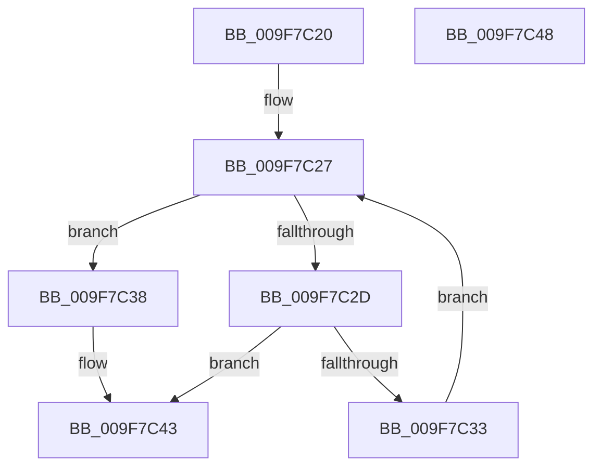

# PspLockJobConditionally

- RVA: `0x009F7C20`–`0x009F7C49` (길이 `41` bytes)
- VA: `0x00000001409F7C20`
- 실행 섹션: `PAGE`
- PDB 이름 있음: `예`; PDB Function 태그: `아니요`
- unwind 정보 RVA: `0x0005C788`
- 디코드: `14`개 명령, `41/41` bytes 표시
- 미해석 바이트: `0` (있으면 어셈블리에 `.byte`로 보존)

> 이 문서는 커널 이미지의 기계어와 PDB 기호를 분석해 생성했습니다. 4번과 5번은 함수 원형과 자료형을 바이너리 사용 방식에서 추정한 C 해석이며 원본 소스 복구 결과는 아닙니다.

## 1. Dependencies

- 직접 호출 지점: **1**; 고유 호출 대상: **1**
- 직접 호출자로 확인된 함수: **4**
- RIP 상대 이미지 참조: **0**

### Outgoing calls
- `0x009F7C3E` → [ExAcquireResourceExclusiveLite](../../text/21/ExAcquireResourceExclusiveLite_function_00214E20.md) (function, `0x00214E20`)

### Direct callers
- [PspJobDelete](../../text/4B/PspJobDelete_function_004BF8F0.md) at `0x004BF989`
- [PspJobDelete](../../text/4B/PspJobDelete_function_004BF8F0.md) at `0x004BFA13`
- [PspSetNetRateControl](../78/PspSetNetRateControl_function_00785944.md) at `0x00785A3C`
- [PspRemoveProcessFromJobChain](../90/PspRemoveProcessFromJobChain_function_00907288.md) at `0x009073B3`
- [PspRemoveProcessFromJobChain](../90/PspRemoveProcessFromJobChain_function_00907288.md) at `0x009074CA`
- [PspSetJobIoRateControl](PspSetJobIoRateControl_function_009F78EC.md) at `0x009F7B1B`

### Static image references
- 디코드된 RIP-relative 메모리 참조가 없습니다.

## 2. Other-region calls and transfers

- 다른 실행 섹션으로 향하는 call: **1**
  - `0x009F7C3E` → [ExAcquireResourceExclusiveLite](../../text/21/ExAcquireResourceExclusiveLite_function_00214E20.md) (`PAGE` → `.text`)
- 별도 외부 분기/꼬리 이동을 확인하지 못했습니다.

## 3. Assembly (complete function range)

```asm
009F7C20  48 83 EC 28                     sub rsp, 0x28
009F7C24  45 33 C0                        xor r8d, r8d
009F7C27  41 83 F8 01                     cmp r8d, 1
009F7C2B  73 0B                           jae 0x1409f7c38
009F7C2D  4A 3B 0C C2                     cmp rcx, qword ptr [rdx + r8*8]
009F7C31  74 10                           je 0x1409f7c43
009F7C33  41 FF C0                        inc r8d
009F7C36  EB EF                           jmp 0x1409f7c27
009F7C38  48 83 C1 38                     add rcx, 0x38
009F7C3C  B2 01                           mov dl, 1
009F7C3E  E8 DD D1 81 FF                  call 0x140214e20
009F7C43  48 83 C4 28                     add rsp, 0x28
009F7C47  C3                              ret
009F7C48  CC                              int3
```

## 4. C-style interpretation (structured pseudocode)

```c
__int64 __fastcall PspLockJobConditionally(__int64 a1, __int64 a2, int a3)
{
    __int64 result;
    __int64 v_rsp;

    v_rsp = (v_rsp) - (40);
    a3 = 0;
loc_009F7C27:
    if (0 >= 1) goto loc_009F7C38;
    if (a1 == (*(unsigned __int64 *)(a2 + a3 * 8))) goto loc_009F7C43;
    a3 = (unsigned int)((a3) + 1);
    goto loc_009F7C27;
loc_009F7C38:
    a1 = (a1) + (56);
    result = ExAcquireResourceExclusiveLite(a1, 1, a3, a4);
loc_009F7C43:
    v_rsp = (v_rsp) + (40);
    return result;
}
```

## 5. (Beta) C Style

```c
int64_t PspLockJobConditionally(int64_t Arg1, void *Arg2, int32_t Arg3)
{
    uint8_t *arg2 = (uint8_t *)Arg2;

    int64_t result;
    int64_t local_rsp;

    local_rsp = (local_rsp) - (40);
    Arg3 = 0;
loc_009F7C27:
    if (0 >= 1) goto loc_009F7C38;
    if (Arg1 == (*(uint64_t *)(arg2 + Arg3 * 8))) goto loc_009F7C43;
    Arg3 = (uint32_t)((Arg3) + 1);
    goto loc_009F7C27;
loc_009F7C38:
    Arg1 = (Arg1) + (56);
    result = ExAcquireResourceExclusiveLite(Arg1, 1, Arg3, a4);
loc_009F7C43:
    local_rsp = (local_rsp) + (40);
    return result;
}
```

### 관측된 메모리 오프셋

구조체 형식이 확인되지 않은 접근은 인자 기준의 오프셋으로만 기록했습니다.

| 기준 인자 | 오프셋 표현 | 폭 (bit) | 접근 |
|---|---:|---:|---|
| `Arg2` | `+ 0x0 + r8*8` | `64` | `R` |

## 6. Execution-region graph

[열기: 2D/3D 그래프와 함수 탐색 컨트롤 패널](../../../control-panel.html?section=page&rva=0x009F7C20&view=graph)

- 2D 그래프는 위에서 아래로 흐르고, 3D 그래프는 빈 공간을 드래그해 회전합니다. Shift+드래그는 이동, 휠은 확대·축소, 함수 노드 선택은 대상 보고서 이동입니다.

### Static fallback


