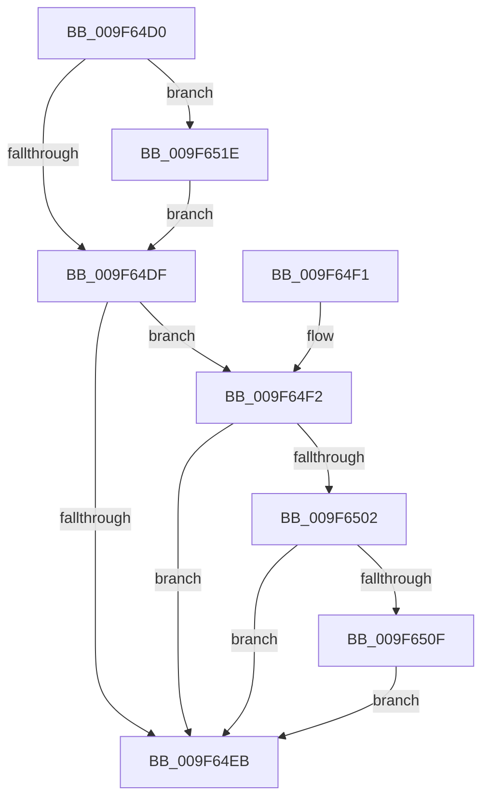

# PspProcessClose

- RVA: `0x009F64D0`–`0x009F6528` (길이 `88` bytes)
- VA: `0x00000001409F64D0`
- 실행 섹션: `PAGE`
- PDB 이름 있음: `예`; PDB Function 태그: `아니요`
- unwind 정보 RVA: `0x000A6BAC`
- 디코드: `24`개 명령, `88/88` bytes 표시
- 미해석 바이트: `0` (있으면 어셈블리에 `.byte`로 보존)

> 이 문서는 커널 이미지의 기계어와 PDB 기호를 분석해 생성했습니다. 4번과 5번은 함수 원형과 자료형을 바이너리 사용 방식에서 추정한 C 해석이며 원본 소스 복구 결과는 아닙니다.

## 1. Dependencies

- 직접 호출 지점: **1**; 고유 호출 대상: **1**
- 직접 호출자로 확인된 함수: **0**
- RIP 상대 이미지 참조: **0**

### Outgoing calls
- `0x009F6517` → [PsTerminateProcess](../90/PsTerminateProcess_function_00904C64.md) (function, `0x00904C64`)

### Direct callers
- 이 함수 시작 RVA로 연결되는 직접 call은 확인되지 않았습니다. 간접 호출은 완전히 역산할 수 없습니다.

### Static image references
- 디코드된 RIP-relative 메모리 참조가 없습니다.

## 2. Other-region calls and transfers

- 다른 실행 섹션으로 향하는 call: **0**
- 별도 외부 분기/꼬리 이동을 확인하지 못했습니다.

## 3. Assembly (complete function range)

```asm
009F64D0  40 53                           push rbx
009F64D2  48 83 EC 20                     sub rsp, 0x20
009F64D6  48 8B DA                        mov rbx, rdx
009F64D9  49 83 F9 01                     cmp r9, 1
009F64DD  76 3F                           jbe 0x1409f651e
009F64DF  F7 82 FC 05 00 00 00 80 00 00   test dword ptr [rdx + 0x5fc], 0x8000
009F64E9  74 07                           je 0x1409f64f2
009F64EB  48 83 C4 20                     add rsp, 0x20
009F64EF  5B                              pop rbx
009F64F0  C3                              ret
009F64F1  CC                              int3
009F64F2  48 8B 82 D8 02 00 00            mov rax, qword ptr [rdx + 0x2d8]
009F64F9  48 39 81 D0 01 00 00            cmp qword ptr [rcx + 0x1d0], rax
009F6500  75 E9                           jne 0x1409f64eb
009F6502  8B 81 F4 01 00 00               mov eax, dword ptr [rcx + 0x1f4]
009F6508  A9 08 00 00 40                  test eax, 0x40000008
009F650D  74 DC                           je 0x1409f64eb
009F650F  BA 0A 01 00 C0                  mov edx, 0xc000010a
009F6514  48 8B CB                        mov rcx, rbx
009F6517  E8 48 E7 F0 FF                  call 0x140904c64
009F651C  EB CD                           jmp 0x1409f64eb
009F651E  8B 82 80 03 00 00               mov eax, dword ptr [rdx + 0x380]
009F6524  85 C0                           test eax, eax
009F6526  75 B7                           jne 0x1409f64df
```

## 4. C-style interpretation (structured pseudocode)

```c
__int64 __fastcall PspProcessClose(__int64 a1, __int64 a2, __int64 a3, __int64 a4)
{
    __int64 result;
    __int64 v_rsp;

    v_rsp = (v_rsp) - (32);
    if (a4 <= 1) goto loc_009F651E;
loc_009F64DF:
    if (((*(unsigned int *)(a2 + 1532)) & (0x8000ULL)) == 0) goto loc_009F64F2;
loc_009F64EB:
    v_rsp = (v_rsp) + (32);
    return result;
loc_009F64F2:
    if ((*(unsigned __int64 *)(a1 + 464)) != (*(unsigned __int64 *)(a2 + 728))) goto loc_009F64EB;
    if ((((unsigned int)((unsigned int)(*(unsigned int *)(a1 + 500)))) & (0x40000008ULL)) == 0) goto loc_009F64EB;
    result = PsTerminateProcess(a2, (unsigned int)(0xC000010AULL), a3, a4);
    goto loc_009F64EB;
loc_009F651E:
    if ((unsigned int)((unsigned int)(*(unsigned int *)((unsigned int)(0xC000010AULL) + 896))) != 0) goto loc_009F64DF;
}
```

## 5. (Beta) C Style

```c
int64_t PspProcessClose(void *Arg1, void *Arg2, int64_t Arg3, int64_t Arg4)
{
    uint8_t *arg1 = (uint8_t *)Arg1;
    uint8_t *arg2 = (uint8_t *)Arg2;

    int64_t result;
    int64_t local_rsp;

    local_rsp = (local_rsp) - (32);
    if (Arg4 <= 1) goto loc_009F651E;
loc_009F64DF:
    if (((*(uint32_t *)(arg2 + 0x5FC)) & (0x8000ULL)) == 0) goto loc_009F64F2;
loc_009F64EB:
    local_rsp = (local_rsp) + (32);
    return result;
loc_009F64F2:
    if ((*(uint64_t *)(arg1 + 0x1D0)) != (*(uint64_t *)(arg2 + 0x2D8))) goto loc_009F64EB;
    if ((((uint32_t)((uint32_t)(*(uint32_t *)(arg1 + 0x1F4)))) & (0x40000008ULL)) == 0) goto loc_009F64EB;
    result = PsTerminateProcess(Arg2, (uint32_t)(0xC000010AULL), Arg3, Arg4);
    goto loc_009F64EB;
loc_009F651E:
    if ((uint32_t)((uint32_t)(*(uint32_t *)((uint32_t)(0xC000010AULL) + 0x380))) != 0) goto loc_009F64DF;
}
```

### 관측된 메모리 오프셋

구조체 형식이 확인되지 않은 접근은 인자 기준의 오프셋으로만 기록했습니다.

| 기준 인자 | 오프셋 표현 | 폭 (bit) | 접근 |
|---|---:|---:|---|
| `Arg1` | `+ 0x1D0` | `64` | `R` |
| `Arg1` | `+ 0x1F4` | `32` | `R` |
| `Arg2` | `+ 0x2D8` | `64` | `R` |
| `Arg2` | `+ 0x380` | `32` | `R` |
| `Arg2` | `+ 0x5FC` | `32` | `R` |

## 6. Execution-region graph

[열기: 2D/3D 그래프와 함수 탐색 컨트롤 패널](../../../control-panel.html?section=page&rva=0x009F64D0&view=graph)

- 2D 그래프는 위에서 아래로 흐르고, 3D 그래프는 빈 공간을 드래그해 회전합니다. Shift+드래그는 이동, 휠은 확대·축소, 함수 노드 선택은 대상 보고서 이동입니다.

### Static fallback


