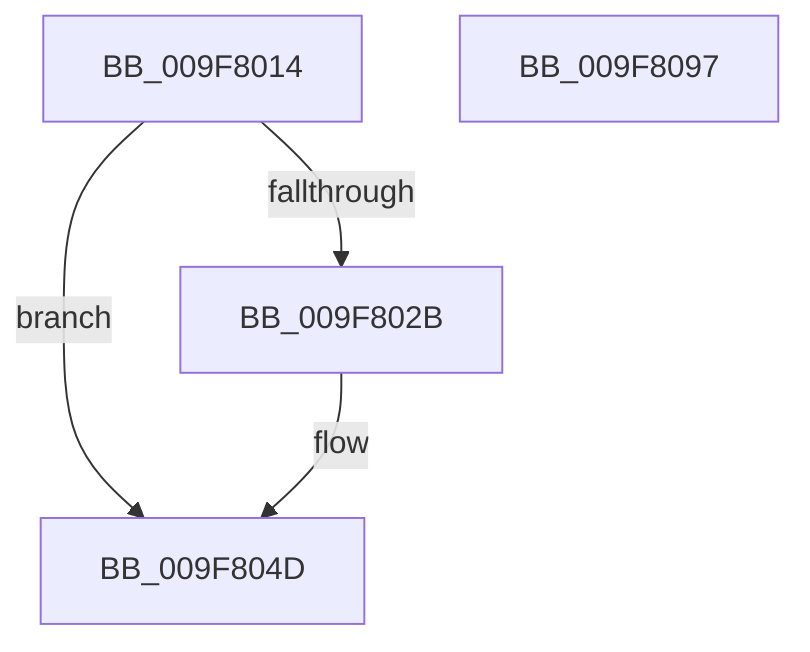

# PspRemoveIoAttribution

- RVA: `0x009F8014`–`0x009F8098` (길이 `132` bytes)
- VA: `0x00000001409F8014`
- 실행 섹션: `PAGE`
- PDB 이름 있음: `예`; PDB Function 태그: `아니요`
- unwind 정보 RVA: `0x0008A2AC`
- 디코드: `31`개 명령, `132/132` bytes 표시
- 미해석 바이트: `0` (있으면 어셈블리에 `.byte`로 보존)

> 이 문서는 커널 이미지의 기계어와 PDB 기호를 분석해 생성했습니다. 4번과 5번은 함수 원형과 자료형을 바이너리 사용 방식에서 추정한 C 해석이며 원본 소스 복구 결과는 아닙니다.

## 1. Dependencies

- 직접 호출 지점: **3**; 고유 호출 대상: **3**
- 직접 호출자로 확인된 함수: **2**
- RIP 상대 이미지 참조: **2**

### Outgoing calls
- `0x009F8032` → [IoStopDiskIoAttributionForContext](../../text/2A/IoStopDiskIoAttributionForContext_function_002A5614.md) (function, `0x002A5614`)
- `0x009F803E` → [IoDiskIoAttributionDereference](../../text/34/IoDiskIoAttributionDereference_function_00349978.md) (function, `0x00349978`)
- `0x009F8087` → [PspEnumJobsAndProcessesInJobHierarchy](../91/PspEnumJobsAndProcessesInJobHierarchy_function_0091A1EC.md) (function, `0x0091A1EC`)

### Direct callers
- [PspJobDelete](../../text/4B/PspJobDelete_function_004BF8F0.md) at `0x004BFA24`
- [PspSetJobIoAttribution](PspSetJobIoAttribution_function_009F7C50.md) at `0x009F7DF5`

### Static image references
- `0x009F805C` → RVA `0x00A81DA0` (`PspSetJobIoAttributionProcessCallback`; read)
- `0x009F8078` → RVA `0x00A7E540` (`PspSetJobIoAttributionJobPreCallback`; read)

## 2. Other-region calls and transfers

- 다른 실행 섹션으로 향하는 call: **2**
  - `0x009F8032` → [IoStopDiskIoAttributionForContext](../../text/2A/IoStopDiskIoAttributionForContext_function_002A5614.md) (`PAGE` → `.text`)
  - `0x009F803E` → [IoDiskIoAttributionDereference](../../text/34/IoDiskIoAttributionDereference_function_00349978.md) (`PAGE` → `.text`)
- 별도 외부 분기/꼬리 이동을 확인하지 못했습니다.

## 3. Assembly (complete function range)

```asm
009F8014  48 89 5C 24 08                  mov qword ptr [rsp + 8], rbx
009F8019  57                              push rdi
009F801A  48 83 EC 50                     sub rsp, 0x50
009F801E  33 FF                           xor edi, edi
009F8020  48 8B D9                        mov rbx, rcx
009F8023  39 B9 2C 06 00 00               cmp dword ptr [rcx + 0x62c], edi
009F8029  74 22                           je 0x1409f804d
009F802B  48 8B 89 30 06 00 00            mov rcx, qword ptr [rcx + 0x630]
009F8032  E8 DD D5 8A FF                  call 0x1402a5614
009F8037  48 8B 8B 30 06 00 00            mov rcx, qword ptr [rbx + 0x630]
009F803E  E8 35 19 95 FF                  call 0x140349978
009F8043  48 89 BB 30 06 00 00            mov qword ptr [rbx + 0x630], rdi
009F804A  48 8B FB                        mov rdi, rbx
009F804D  33 C0                           xor eax, eax
009F804F  C7 44 24 28 05 00 00 00         mov dword ptr [rsp + 0x28], 5
009F8057  48 89 44 24 40                  mov qword ptr [rsp + 0x40], rax
009F805C  4C 8D 0D 3D 9D 08 00            lea r9, [rip + 0x89d3d]
009F8063  0F 57 C0                        xorps xmm0, xmm0
009F8066  48 8D 44 24 30                  lea rax, [rsp + 0x30]
009F806B  0F 11 44 24 30                  movups xmmword ptr [rsp + 0x30], xmm0
009F8070  45 33 C0                        xor r8d, r8d
009F8073  48 89 44 24 20                  mov qword ptr [rsp + 0x20], rax
009F8078  48 8D 15 C1 64 08 00            lea rdx, [rip + 0x864c1]
009F807F  48 89 7C 24 38                  mov qword ptr [rsp + 0x38], rdi
009F8084  48 8B CB                        mov rcx, rbx
009F8087  E8 60 21 F2 FF                  call 0x14091a1ec
009F808C  48 8B 5C 24 60                  mov rbx, qword ptr [rsp + 0x60]
009F8091  48 83 C4 50                     add rsp, 0x50
009F8095  5F                              pop rdi
009F8096  C3                              ret
009F8097  CC                              int3
```

## 4. C-style interpretation (structured pseudocode)

```c
__int64 __fastcall PspRemoveIoAttribution(__int64 a1, __int64 a2, int a3)
{
    __int64 result;
    __int64 v_rdi;
    __int64 v_rsp;
    unsigned __int64 v_stack_m18;
    unsigned __int64 v_stack_m20;
    unsigned __int64 v_stack_m28;
    unsigned int v_stack_m30;
    unsigned __int64 v_stack_m38;
    unsigned __int64 v_stack_p8;

    v_stack_p8 = v_rbx;
    v_rsp = (v_rsp) - (80);
    v_rdi = 0;
    if ((*(unsigned int *)(a1 + 1580)) != 0) {
        a1 = *(unsigned __int64 *)(a1 + 1584);
        result = IoStopDiskIoAttributionForContext(a1, a2, a3, a4);
        a1 = *(unsigned __int64 *)(a1 + 1584);
        result = IoDiskIoAttributionDereference(a1, a2, a3, a4);
        *(unsigned __int64 *)(a1 + 1584) = 0;
        v_rdi = a1;
    }
    result = 0;
    v_stack_m30 = 5;
    v_stack_m18 = 0;
    v_stack_m28 = v_xmm0;
    a3 = 0;
    v_stack_m38 = v_stack_m28;
    v_stack_m20 = v_rdi;
    result = PspEnumJobsAndProcessesInJobHierarchy(a1, v_rip + 550081, a3, v_rip + 564541);
    v_rsp = (v_rsp) + (80);
    return result;
}
```

## 5. (Beta) C Style

```c
int64_t PspRemoveIoAttribution(void *Arg1, int64_t Arg2, int32_t Arg3)
{
    uint8_t *arg1 = (uint8_t *)Arg1;

    int64_t result;
    int64_t local_rdi;
    int64_t local_rsp;
    uint64_t v_stack_m18;
    uint64_t v_stack_m20;
    uint64_t v_stack_m28;
    uint32_t v_stack_m30;
    uint64_t v_stack_m38;
    uint64_t v_stack_p8;

    v_stack_p8 = local_rbx;
    local_rsp = (local_rsp) - (80);
    local_rdi = 0;
    if ((*(uint32_t *)(arg1 + 0x62C)) != 0) {
        Arg1 = *(uint64_t *)(arg1 + 0x630);
        result = IoStopDiskIoAttributionForContext(Arg1, Arg2, Arg3, a4);
        Arg1 = *(uint64_t *)(arg1 + 0x630);
        result = IoDiskIoAttributionDereference(Arg1, Arg2, Arg3, a4);
        *(uint64_t *)(arg1 + 0x630) = 0;
        local_rdi = Arg1;
    }
    result = 0;
    v_stack_m30 = 5;
    v_stack_m18 = 0;
    v_stack_m28 = v_xmm0;
    Arg3 = 0;
    v_stack_m38 = v_stack_m28;
    v_stack_m20 = local_rdi;
    result = PspEnumJobsAndProcessesInJobHierarchy(Arg1, v_rip + 550081, Arg3, v_rip + 564541);
    local_rsp = (local_rsp) + (80);
    return result;
}
```

### 관측된 메모리 오프셋

구조체 형식이 확인되지 않은 접근은 인자 기준의 오프셋으로만 기록했습니다.

| 기준 인자 | 오프셋 표현 | 폭 (bit) | 접근 |
|---|---:|---:|---|
| `Arg1` | `+ 0x62C` | `32` | `R` |
| `Arg1` | `+ 0x630` | `64` | `R` |
| `Arg1` | `+ 0x630` | `64` | `W` |

## 6. Execution-region graph

[열기: 2D/3D 그래프와 함수 탐색 컨트롤 패널](../../../control-panel.html?section=page&rva=0x009F8014&view=graph)

- 2D 그래프는 위에서 아래로 흐르고, 3D 그래프는 빈 공간을 드래그해 회전합니다. Shift+드래그는 이동, 휠은 확대·축소, 함수 노드 선택은 대상 보고서 이동입니다.

### Static fallback


