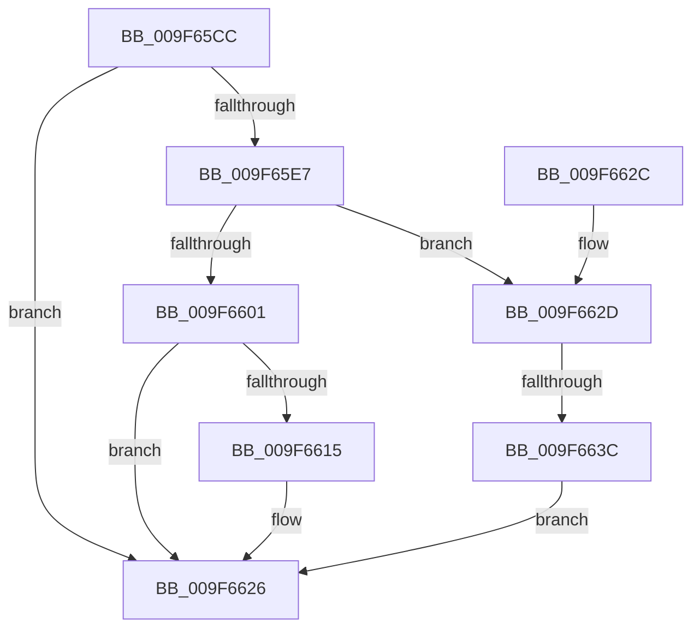

# PspRundownProcess

- RVA: `0x009F65CC`–`0x009F664B` (길이 `127` bytes)
- VA: `0x00000001409F65CC`
- 실행 섹션: `PAGE`
- PDB 이름 있음: `예`; PDB Function 태그: `예`
- unwind 정보 RVA: `0x000783D8`
- 디코드: `32`개 명령, `127/127` bytes 표시
- 미해석 바이트: `0` (있으면 어셈블리에 `.byte`로 보존)

> 이 문서는 커널 이미지의 기계어와 PDB 기호를 분석해 생성했습니다. 4번과 5번은 함수 원형과 자료형을 바이너리 사용 방식에서 추정한 C 해석이며 원본 소스 복구 결과는 아닙니다.

## 1. Dependencies

- 직접 호출 지점: **4**; 고유 호출 대상: **4**
- 직접 호출자로 확인된 함수: **1**
- RIP 상대 이미지 참조: **3**

### Outgoing calls
- `0x009F65DE` → [ExAcquireRundownProtectionEx](../../text/41/ExAcquireRundownProtectionEx_function_0041BEE0.md) (function, `0x0041BEE0`)
- `0x009F65EF` → [ObfReferenceObjectWithTag](../../text/21/ObfReferenceObjectWithTag_function_00210710.md) (function, `0x00210710`)
- `0x009F6621` → [ExQueueWorkItem](../../text/2F/ExQueueWorkItem_function_002F9520.md) (function, `0x002F9520`)
- `0x009F6644` → [ObfDereferenceObjectWithTag](../../text/2F/ObfDereferenceObjectWithTag_function_002F78E0.md) (function, `0x002F78E0`)

### Direct callers
- [sub_009F6592](Unknown_function_009F6592.md) at `0x009F659F`

### Static image references
- `0x009F65F6` → RVA `0x00FD9D98` (`PAGEDATA`; read)
- `0x009F6606` → RVA `0x00FD9C68` (`PAGEDATA`; read/write)
- `0x009F6615` → RVA `0x00F06700` (`.data`; read)

## 2. Other-region calls and transfers

- 다른 실행 섹션으로 향하는 call: **4**
  - `0x009F65DE` → [ExAcquireRundownProtectionEx](../../text/41/ExAcquireRundownProtectionEx_function_0041BEE0.md) (`PAGE` → `.text`)
  - `0x009F65EF` → [ObfReferenceObjectWithTag](../../text/21/ObfReferenceObjectWithTag_function_00210710.md) (`PAGE` → `.text`)
  - `0x009F6621` → [ExQueueWorkItem](../../text/2F/ExQueueWorkItem_function_002F9520.md) (`PAGE` → `.text`)
  - `0x009F6644` → [ObfDereferenceObjectWithTag](../../text/2F/ObfDereferenceObjectWithTag_function_002F78E0.md) (`PAGE` → `.text`)
- call이 아닌 외부 분기/꼬리 이동: **1**
  - `0x009F6636` → [sub_00B3156C](../B3/Unknown_function_00B3156C.md) (`tail-transfer`)

## 3. Assembly (complete function range)

```asm
009F65CC  40 53                           push rbx
009F65CE  48 83 EC 20                     sub rsp, 0x20
009F65D2  48 8B D9                        mov rbx, rcx
009F65D5  33 D2                           xor edx, edx
009F65D7  48 81 C1 E8 01 00 00            add rcx, 0x1e8
009F65DE  E8 FD 58 A2 FF                  call 0x14041bee0
009F65E3  84 C0                           test al, al
009F65E5  74 3F                           je 0x1409f6626
009F65E7  BA 50 73 53 77                  mov edx, 0x77537350
009F65EC  48 8B CB                        mov rcx, rbx
009F65EF  E8 1C A1 81 FF                  call 0x140210710
009F65F4  33 C0                           xor eax, eax
009F65F6  F0 48 0F B1 1D 99 37 5E 00      lock cmpxchg qword ptr [rip + 0x5e3799], rbx
009F65FF  75 2C                           jne 0x1409f662d
009F6601  B8 01 00 00 00                  mov eax, 1
009F6606  F0 0F C1 05 5A 36 5E 00         lock xadd dword ptr [rip + 0x5e365a], eax
009F660E  FF C0                           inc eax
009F6610  83 F8 01                        cmp eax, 1
009F6613  75 11                           jne 0x1409f6626
009F6615  48 8D 0D E4 00 51 00            lea rcx, [rip + 0x5100e4]
009F661C  BA 03 00 00 00                  mov edx, 3
009F6621  E8 FA 2E 90 FF                  call 0x1402f9520
009F6626  48 83 C4 20                     add rsp, 0x20
009F662A  5B                              pop rbx
009F662B  C3                              ret
009F662C  CC                              int3
009F662D  F0 0F BA AB F0 01 00 00 08      lock bts dword ptr [rbx + 0x1f0], 8
009F6636  0F 83 30 AF 13 00               jae 0x140b3156c
009F663C  BA 50 73 53 77                  mov edx, 0x77537350
009F6641  48 8B CB                        mov rcx, rbx
009F6644  E8 97 12 90 FF                  call 0x1402f78e0
009F6649  EB DB                           jmp 0x1409f6626
```

## 4. C-style interpretation (structured pseudocode)

```c
__int64 __fastcall PspRundownProcess(__int64 a1, int a2)
{
    __int64 result;
    __int64 v_rsp;

    v_rsp = (v_rsp) - (32);
    a2 = 0;
    a1 = (a1) + (488);
    result = ExAcquireRundownProtectionEx(a1, a2, a3, a4);
    if ((unsigned __int8)(result) == 0) goto loc_009F6626;
    result = ObfReferenceObjectWithTag(a1, (unsigned int)(0x77537350ULL), a3, a4);
    result = 0;
    if (condition_is_not_equal) goto loc_009F662D;
    result = (unsigned int)((1) + 1);
    if (((unsigned int)(result)) == 1) {
        a1 = v_rip + 5308644;
        a2 = 3;
        result = ExQueueWorkItem(a1, a2, a3, a4);
    }
    v_rsp = (v_rsp) + (32);
    return result;
loc_009F662D:
    result = ObfDereferenceObjectWithTag(a1, (unsigned int)(0x77537350ULL), a3, a4);
    goto loc_009F6626;
}
```

## 5. (Beta) C Style

```c
int64_t PspRundownProcess(void *Arg1, int32_t Arg2)
{
    uint8_t *arg1 = (uint8_t *)Arg1;

    int64_t result;
    int64_t local_rsp;

    local_rsp = (local_rsp) - (32);
    Arg2 = 0;
    Arg1 = (Arg1) + (488);
    result = ExAcquireRundownProtectionEx(Arg1, Arg2, a3, a4);
    if ((uint8_t)(result) == 0) goto loc_009F6626;
    result = ObfReferenceObjectWithTag(Arg1, (uint32_t)(0x77537350ULL), a3, a4);
    result = 0;
    if (condition_is_not_equal) goto loc_009F662D;
    result = (uint32_t)((1) + 1);
    if (((uint32_t)(result)) == 1) {
        Arg1 = v_rip + 5308644;
        Arg2 = 3;
        result = ExQueueWorkItem(Arg1, Arg2, a3, a4);
    }
    local_rsp = (local_rsp) + (32);
    return result;
loc_009F662D:
    result = ObfDereferenceObjectWithTag(Arg1, (uint32_t)(0x77537350ULL), a3, a4);
    goto loc_009F6626;
}
```

### 관측된 메모리 오프셋

구조체 형식이 확인되지 않은 접근은 인자 기준의 오프셋으로만 기록했습니다.

| 기준 인자 | 오프셋 표현 | 폭 (bit) | 접근 |
|---|---:|---:|---|
| `Arg1` | `+ 0x1F0` | `32` | `R/W` |

## 6. Execution-region graph

[열기: 2D/3D 그래프와 함수 탐색 컨트롤 패널](../../../control-panel.html?section=page&rva=0x009F65CC&view=graph)

- 2D 그래프는 위에서 아래로 흐르고, 3D 그래프는 빈 공간을 드래그해 회전합니다. Shift+드래그는 이동, 휠은 확대·축소, 함수 노드 선택은 대상 보고서 이동입니다.

### Static fallback


