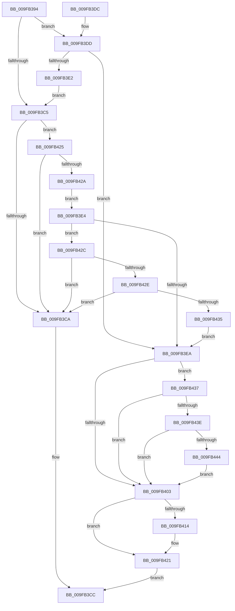

# PspSendWakeNotification

- RVA: `0x009FB394`–`0x009FB450` (길이 `188` bytes)
- VA: `0x00000001409FB394`
- 실행 섹션: `PAGE`
- PDB 이름 있음: `예`; PDB Function 태그: `아니요`
- unwind 정보 RVA: `0x000A7074`
- 디코드: `58`개 명령, `188/188` bytes 표시
- 미해석 바이트: `0` (있으면 어셈블리에 `.byte`로 보존)

> 이 문서는 커널 이미지의 기계어와 PDB 기호를 분석해 생성했습니다. 4번과 5번은 함수 원형과 자료형을 바이너리 사용 방식에서 추정한 C 해석이며 원본 소스 복구 결과는 아닙니다.

## 1. Dependencies

- 직접 호출 지점: **4**; 고유 호출 대상: **4**
- 직접 호출자로 확인된 함수: **2**
- RIP 상대 이미지 참조: **1**

### Outgoing calls
- `0x009FB3F2` → [ObfReferenceObjectWithTag](../../text/21/ObfReferenceObjectWithTag_function_00210710.md) (function, `0x00210710`)
- `0x009FB40B` → [PspRequestDeferredJobNotification](../../text/49/PspRequestDeferredJobNotification_function_004938F8.md) (function, `0x004938F8`)
- `0x009FB41C` → [ObfDereferenceObjectWithTag](../../text/2F/ObfDereferenceObjectWithTag_function_002F78E0.md) (function, `0x002F78E0`)
- `0x009FB449` → [EtwTraceWakeEvent](../70/EtwTraceWakeEvent_function_007042C8.md) (function, `0x007042C8`)

### Direct callers
- [PspDispatchWakeNotification](../91/PspDispatchWakeNotification_function_00917E70.md) at `0x00917EC7`
- [PspFreezeJobTree](PspFreezeJobTree_function_009FB074.md) at `0x009FB323`

### Static image references
- `0x009FB3F7` → RVA `0x00FC6B10` (`ALMOSTRO`; read)

## 2. Other-region calls and transfers

- 다른 실행 섹션으로 향하는 call: **3**
  - `0x009FB3F2` → [ObfReferenceObjectWithTag](../../text/21/ObfReferenceObjectWithTag_function_00210710.md) (`PAGE` → `.text`)
  - `0x009FB40B` → [PspRequestDeferredJobNotification](../../text/49/PspRequestDeferredJobNotification_function_004938F8.md) (`PAGE` → `.text`)
  - `0x009FB41C` → [ObfDereferenceObjectWithTag](../../text/2F/ObfDereferenceObjectWithTag_function_002F78E0.md) (`PAGE` → `.text`)
- 별도 외부 분기/꼬리 이동을 확인하지 못했습니다.

## 3. Assembly (complete function range)

```asm
009FB394  48 89 5C 24 08                  mov qword ptr [rsp + 8], rbx
009FB399  48 89 6C 24 10                  mov qword ptr [rsp + 0x10], rbp
009FB39E  57                              push rdi
009FB39F  48 83 EC 20                     sub rsp, 0x20
009FB3A3  44 8B 54 24 50                  mov r10d, dword ptr [rsp + 0x50]
009FB3A8  49 8B D9                        mov rbx, r9
009FB3AB  48 8B F9                        mov rdi, rcx
009FB3AE  41 B9 01 00 00 00               mov r9d, 1
009FB3B4  8B CA                           mov ecx, edx
009FB3B6  41 83 E2 02                     and r10d, 2
009FB3BA  41 D3 E1                        shl r9d, cl
009FB3BD  8B EA                           mov ebp, edx
009FB3BF  45 85 48 04                     test dword ptr [r8 + 4], r9d
009FB3C3  75 18                           jne 0x1409fb3dd
009FB3C5  45 85 08                        test dword ptr [r8], r9d
009FB3C8  75 5B                           jne 0x1409fb425
009FB3CA  32 C0                           xor al, al
009FB3CC  48 8B 5C 24 30                  mov rbx, qword ptr [rsp + 0x30]
009FB3D1  48 8B 6C 24 38                  mov rbp, qword ptr [rsp + 0x38]
009FB3D6  48 83 C4 20                     add rsp, 0x20
009FB3DA  5F                              pop rdi
009FB3DB  C3                              ret
009FB3DC  CC                              int3
009FB3DD  48 85 DB                        test rbx, rbx
009FB3E0  74 08                           je 0x1409fb3ea
009FB3E2  EB E1                           jmp 0x1409fb3c5
009FB3E4  48 83 FB 01                     cmp rbx, 1
009FB3E8  75 42                           jne 0x1409fb42c
009FB3EA  BA 50 73 4E 6F                  mov edx, 0x6f4e7350
009FB3EF  48 8B CF                        mov rcx, rdi
009FB3F2  E8 19 53 81 FF                  call 0x140210710
009FB3F7  F7 05 0F B7 5C 00 00 04 00 00   test dword ptr [rip + 0x5cb70f], 0x400
009FB401  75 34                           jne 0x1409fb437
009FB403  BA 00 20 00 00                  mov edx, 0x2000
009FB408  48 8B CF                        mov rcx, rdi
009FB40B  E8 E8 84 A9 FF                  call 0x1404938f8
009FB410  84 C0                           test al, al
009FB412  75 0D                           jne 0x1409fb421
009FB414  BA 50 73 4E 6F                  mov edx, 0x6f4e7350
009FB419  48 8B CF                        mov rcx, rdi
009FB41C  E8 BF C4 8F FF                  call 0x1402f78e0
009FB421  B0 01                           mov al, 1
009FB423  EB A7                           jmp 0x1409fb3cc
009FB425  45 85 D2                        test r10d, r10d
009FB428  74 A0                           je 0x1409fb3ca
009FB42A  EB B8                           jmp 0x1409fb3e4
009FB42C  76 9C                           jbe 0x1409fb3ca
009FB42E  F6 44 24 50 01                  test byte ptr [rsp + 0x50], 1
009FB433  74 95                           je 0x1409fb3ca
009FB435  EB B3                           jmp 0x1409fb3ea
009FB437  F6 44 24 50 04                  test byte ptr [rsp + 0x50], 4
009FB43C  74 C5                           je 0x1409fb403
009FB43E  48 83 FB 01                     cmp rbx, 1
009FB442  75 BF                           jne 0x1409fb403
009FB444  8B D5                           mov edx, ebp
009FB446  48 8B CF                        mov rcx, rdi
009FB449  E8 7A 8E D0 FF                  call 0x1407042c8
009FB44E  EB B3                           jmp 0x1409fb403
```

## 4. C-style interpretation (structured pseudocode)

```c
__int64 __fastcall PspSendWakeNotification(__int64 a1, int a2, __int64 a3, __int64 a4, unsigned __int8 a5)
{
    __int64 result;
    __int64 v_r10;
    __int64 v_rsp;
    unsigned __int64 v_stack_p10;
    unsigned __int64 v_stack_p8;

    v_stack_p8 = v_rbx;
    v_stack_p10 = v_rbp;
    v_rsp = (v_rsp) - (32);
    v_r10 = (unsigned int)(((unsigned int)(a5)) & (2));
    a4 = (unsigned int)((1) << ((unsigned __int8)((unsigned int)(a2))));
    if (((*(unsigned int *)(a3 + 4)) & ((unsigned int)(a4))) != 0) goto loc_009FB3DD;
loc_009FB3C5:
    if (((*(unsigned int *)(a3)) & ((unsigned int)(a4))) != 0) goto loc_009FB425;
loc_009FB3CA:
    result = 0;
loc_009FB3CC:
    v_rsp = (v_rsp) + (32);
    return result;
loc_009FB3DD:
    if (v_stack_p8 == 0) goto loc_009FB3EA;
    goto loc_009FB3C5;
loc_009FB3E4:
    if (v_stack_p8 != 1) goto loc_009FB42C;
loc_009FB3EA:
    result = ObfReferenceObjectWithTag(a1, (unsigned int)(0x6F4E7350ULL), a3, a4);
    if (((*(unsigned int *)(v_rip + 6076175)) & (0x400ULL)) != 0) goto loc_009FB437;
loc_009FB403:
    result = PspRequestDeferredJobNotification(a1, (unsigned int)(0x2000ULL), a3, a4);
    if ((unsigned __int8)(result) == 0) {
        a2 = 0x6F4E7350ULL;
        a1 = a1;
        result = ObfDereferenceObjectWithTag(a1, a2, a3, a4);
    }
    goto loc_009FB3CC;
loc_009FB425:
    if ((unsigned int)(v_r10) == 0) goto loc_009FB3CA;
    goto loc_009FB3E4;
loc_009FB42C:
    if (condition_is_below_or_equal) goto loc_009FB3CA;
    if (((a5) & (1)) == 0) goto loc_009FB3CA;
    goto loc_009FB3EA;
loc_009FB437:
    if (((a5) & (4)) == 0) goto loc_009FB403;
    if (v_stack_p8 != 1) goto loc_009FB403;
    result = EtwTraceWakeEvent(a1, (unsigned int)((unsigned int)(v_stack_p10)), a3, a4);
    goto loc_009FB403;
}
```

## 5. (Beta) C Style

```c
int64_t PspSendWakeNotification(int64_t Arg1, int32_t Arg2, void *Arg3, int64_t Arg4, uint8_t Arg5)
{
    uint8_t *arg3 = (uint8_t *)Arg3;

    int64_t result;
    int64_t local_r10;
    int64_t local_rsp;
    uint64_t v_stack_p10;
    uint64_t v_stack_p8;

    v_stack_p8 = local_rbx;
    v_stack_p10 = local_rbp;
    local_rsp = (local_rsp) - (32);
    local_r10 = (uint32_t)(((uint32_t)(Arg5)) & (2));
    Arg4 = (uint32_t)((1) << ((uint8_t)((uint32_t)(Arg2))));
    if (((*(uint32_t *)(arg3 + 0x4)) & ((uint32_t)(Arg4))) != 0) goto loc_009FB3DD;
loc_009FB3C5:
    if (((*(uint32_t *)(arg3)) & ((uint32_t)(Arg4))) != 0) goto loc_009FB425;
loc_009FB3CA:
    result = 0;
loc_009FB3CC:
    local_rsp = (local_rsp) + (32);
    return result;
loc_009FB3DD:
    if (v_stack_p8 == 0) goto loc_009FB3EA;
    goto loc_009FB3C5;
loc_009FB3E4:
    if (v_stack_p8 != 1) goto loc_009FB42C;
loc_009FB3EA:
    result = ObfReferenceObjectWithTag(Arg1, (uint32_t)(0x6F4E7350ULL), Arg3, Arg4);
    if (((*(uint32_t *)(v_rip + 0x5CB70F)) & (0x400ULL)) != 0) goto loc_009FB437;
loc_009FB403:
    result = PspRequestDeferredJobNotification(Arg1, (uint32_t)(0x2000ULL), Arg3, Arg4);
    if ((uint8_t)(result) == 0) {
        Arg2 = 0x6F4E7350ULL;
        Arg1 = Arg1;
        result = ObfDereferenceObjectWithTag(Arg1, Arg2, Arg3, Arg4);
    }
    goto loc_009FB3CC;
loc_009FB425:
    if ((uint32_t)(local_r10) == 0) goto loc_009FB3CA;
    goto loc_009FB3E4;
loc_009FB42C:
    if (condition_is_below_or_equal) goto loc_009FB3CA;
    if (((Arg5) & (1)) == 0) goto loc_009FB3CA;
    goto loc_009FB3EA;
loc_009FB437:
    if (((Arg5) & (4)) == 0) goto loc_009FB403;
    if (v_stack_p8 != 1) goto loc_009FB403;
    result = EtwTraceWakeEvent(Arg1, (uint32_t)((uint32_t)(v_stack_p10)), Arg3, Arg4);
    goto loc_009FB403;
}
```

### 관측된 메모리 오프셋

구조체 형식이 확인되지 않은 접근은 인자 기준의 오프셋으로만 기록했습니다.

| 기준 인자 | 오프셋 표현 | 폭 (bit) | 접근 |
|---|---:|---:|---|
| `Arg3` | `+ 0x0` | `32` | `R` |
| `Arg3` | `+ 0x4` | `32` | `R` |

## 6. Execution-region graph

[열기: 2D/3D 그래프와 함수 탐색 컨트롤 패널](../../../control-panel.html?section=page&rva=0x009FB394&view=graph)

- 2D 그래프는 위에서 아래로 흐르고, 3D 그래프는 빈 공간을 드래그해 회전합니다. Shift+드래그는 이동, 휠은 확대·축소, 함수 노드 선택은 대상 보고서 이동입니다.

### Static fallback


