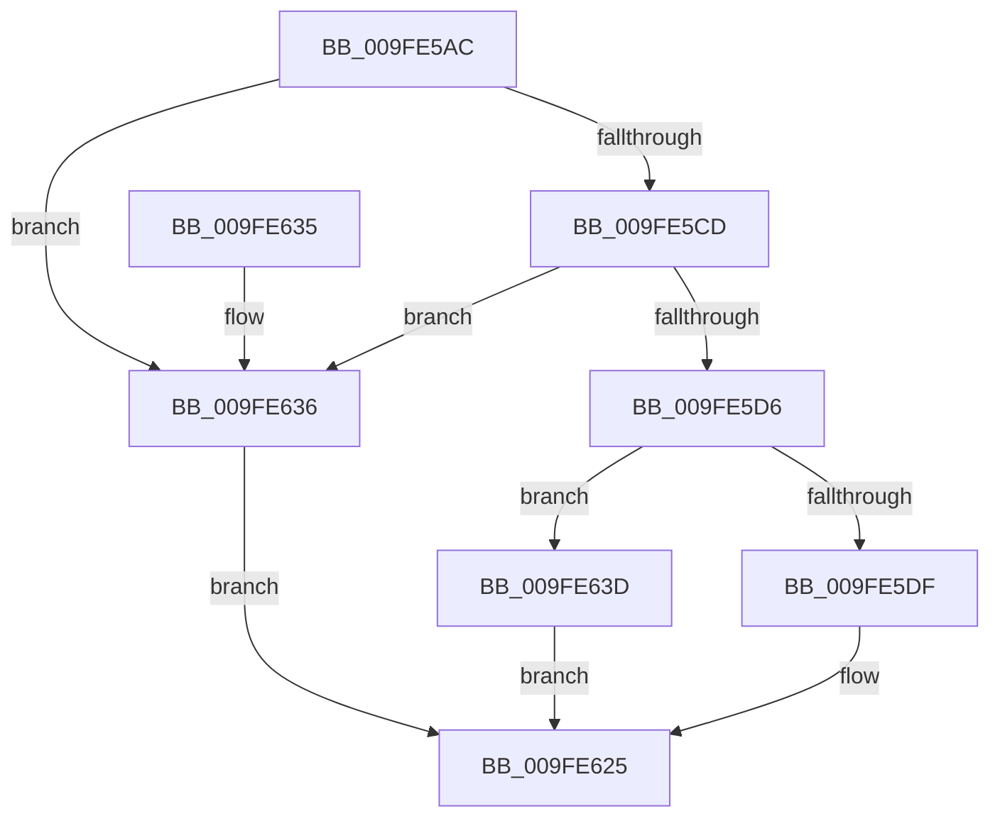

# PspSetEnergyTrackingStateJobTree

- RVA: `0x009FE5AC`–`0x009FE644` (길이 `152` bytes)
- VA: `0x00000001409FE5AC`
- 실행 섹션: `PAGE`
- PDB 이름 있음: `예`; PDB Function 태그: `아니요`
- unwind 정보 RVA: `0x000A756C`
- 디코드: `40`개 명령, `152/152` bytes 표시
- 미해석 바이트: `0` (있으면 어셈블리에 `.byte`로 보존)

> 이 문서는 커널 이미지의 기계어와 PDB 기호를 분석해 생성했습니다. 4번과 5번은 함수 원형과 자료형을 바이너리 사용 방식에서 추정한 C 해석이며 원본 소스 복구 결과는 아닙니다.

## 1. Dependencies

- 직접 호출 지점: **4**; 고유 호출 대상: **4**
- 직접 호출자로 확인된 함수: **1**
- RIP 상대 이미지 참조: **2**

### Outgoing calls
- `0x009FE5D6` → [EtwpCoverageUserIsAdmin](EtwpCoverageUserIsAdmin_function_009FE548.md) (function, `0x009FE548`)
- `0x009FE5E5` → [ExAcquireResourceExclusiveLite](../../text/21/ExAcquireResourceExclusiveLite_function_00214E20.md) (function, `0x00214E20`)
- `0x009FE615` → [PspEnumJobsAndProcessesInJobHierarchy](../91/PspEnumJobsAndProcessesInJobHierarchy_function_0091A1EC.md) (function, `0x0091A1EC`)
- `0x009FE61E` → [ExReleaseResourceLite](../../text/25/ExReleaseResourceLite_function_0025FA10.md) (function, `0x0025FA10`)

### Direct callers
- [NtSetInformationJobObject](NtSetInformationJobObject_function_009F84C0.md) at `0x009FAD9F`

### Static image references
- `0x009FE5ED` → RVA `0x00A95120` (`PspSetProcessEnergyTrackingStateCallback`; read)
- `0x009FE5FC` → RVA `0x00A89580` (`PspSetJobEnergyTrackingStateCallback`; read)

## 2. Other-region calls and transfers

- 다른 실행 섹션으로 향하는 call: **2**
  - `0x009FE5E5` → [ExAcquireResourceExclusiveLite](../../text/21/ExAcquireResourceExclusiveLite_function_00214E20.md) (`PAGE` → `.text`)
  - `0x009FE61E` → [ExReleaseResourceLite](../../text/25/ExReleaseResourceLite_function_0025FA10.md) (`PAGE` → `.text`)
- 별도 외부 분기/꼬리 이동을 확인하지 못했습니다.

## 3. Assembly (complete function range)

```asm
009FE5AC  48 89 5C 24 08                  mov qword ptr [rsp + 8], rbx
009FE5B1  48 89 74 24 10                  mov qword ptr [rsp + 0x10], rsi
009FE5B6  57                              push rdi
009FE5B7  48 83 EC 30                     sub rsp, 0x30
009FE5BB  44 8B 02                        mov r8d, dword ptr [rdx]
009FE5BE  48 8B FA                        mov rdi, rdx
009FE5C1  48 8B F1                        mov rsi, rcx
009FE5C4  41 F7 C0 F3 FF FF FF            test r8d, 0xfffffff3
009FE5CB  75 69                           jne 0x1409fe636
009FE5CD  41 F7 D0                        not r8d
009FE5D0  44 85 42 04                     test dword ptr [rdx + 4], r8d
009FE5D4  75 60                           jne 0x1409fe636
009FE5D6  E8 6D FF FF FF                  call 0x1409fe548
009FE5DB  84 C0                           test al, al
009FE5DD  74 5E                           je 0x1409fe63d
009FE5DF  B2 01                           mov dl, 1
009FE5E1  48 8D 4E 38                     lea rcx, [rsi + 0x38]
009FE5E5  E8 36 68 81 FF                  call 0x140214e20
009FE5EA  48 8B 07                        mov rax, qword ptr [rdi]
009FE5ED  4C 8D 0D 2C 6B 09 00            lea r9, [rip + 0x96b2c]
009FE5F4  C7 44 24 28 05 00 00 00         mov dword ptr [rsp + 0x28], 5
009FE5FC  48 8D 15 7D AF 08 00            lea rdx, [rip + 0x8af7d]
009FE603  45 33 C0                        xor r8d, r8d
009FE606  48 89 86 10 07 00 00            mov qword ptr [rsi + 0x710], rax
009FE60D  48 8B CE                        mov rcx, rsi
009FE610  48 89 7C 24 20                  mov qword ptr [rsp + 0x20], rdi
009FE615  E8 D2 BB F1 FF                  call 0x14091a1ec
009FE61A  48 8D 4E 38                     lea rcx, [rsi + 0x38]
009FE61E  E8 ED 13 86 FF                  call 0x14025fa10
009FE623  33 C0                           xor eax, eax
009FE625  48 8B 5C 24 40                  mov rbx, qword ptr [rsp + 0x40]
009FE62A  48 8B 74 24 48                  mov rsi, qword ptr [rsp + 0x48]
009FE62F  48 83 C4 30                     add rsp, 0x30
009FE633  5F                              pop rdi
009FE634  C3                              ret
009FE635  CC                              int3
009FE636  B8 0D 00 00 C0                  mov eax, 0xc000000d
009FE63B  EB E8                           jmp 0x1409fe625
009FE63D  B8 22 00 00 C0                  mov eax, 0xc0000022
009FE642  EB E1                           jmp 0x1409fe625
```

## 4. C-style interpretation (structured pseudocode)

```c
__int64 __fastcall PspSetEnergyTrackingStateJobTree(__int64 a1, __int64 a2)
{
    __int64 result;
    __int64 v_rsp;
    unsigned int v_stack_m10;
    unsigned __int64 v_stack_m18;
    unsigned __int64 v_stack_p10;
    unsigned __int64 v_stack_p8;

    v_stack_p8 = v_rbx;
    v_stack_p10 = v_rsi;
    v_rsp = (v_rsp) - (48);
    if ((((unsigned int)((unsigned int)(*(unsigned int *)(a2)))) & (0xFFFFFFF3ULL)) != 0) goto loc_009FE636;
    a3 = (unsigned int)(~((unsigned int)(*(unsigned int *)(a2))));
    if (((*(unsigned int *)(a2 + 4)) & ((unsigned int)(a3))) != 0) goto loc_009FE636;
    result = EtwpCoverageUserIsAdmin(a1, a2, a3, a4);
    if ((unsigned __int8)(result) == 0) goto loc_009FE63D;
    result = ExAcquireResourceExclusiveLite(a1 + 56, 1, a3, a4);
    v_stack_m10 = 5;
    a3 = 0;
    *(unsigned __int64 *)(a1 + 1808) = *(unsigned __int64 *)(a2);
    v_stack_m18 = a2;
    result = PspEnumJobsAndProcessesInJobHierarchy(a1, v_rip + 569213, a3, v_rip + 617260);
    result = ExReleaseResourceLite(a1 + 56, v_rip + 569213, a3, v_rip + 617260);
    result = 0;
loc_009FE625:
    v_rsp = (v_rsp) + (48);
    return result;
loc_009FE636:
    goto loc_009FE625;
loc_009FE63D:
    goto loc_009FE625;
}
```

## 5. (Beta) C Style

```c
int64_t PspSetEnergyTrackingStateJobTree(void *Arg1, void *Arg2)
{
    uint8_t *arg1 = (uint8_t *)Arg1;
    uint8_t *arg2 = (uint8_t *)Arg2;

    int64_t result;
    int64_t local_rsp;
    uint32_t v_stack_m10;
    uint64_t v_stack_m18;
    uint64_t v_stack_p10;
    uint64_t v_stack_p8;

    v_stack_p8 = local_rbx;
    v_stack_p10 = local_rsi;
    local_rsp = (local_rsp) - (48);
    if ((((uint32_t)((uint32_t)(*(uint32_t *)(arg2)))) & (0xFFFFFFF3ULL)) != 0) goto loc_009FE636;
    a3 = (uint32_t)(~((uint32_t)(*(uint32_t *)(arg2))));
    if (((*(uint32_t *)(arg2 + 0x4)) & ((uint32_t)(a3))) != 0) goto loc_009FE636;
    result = EtwpCoverageUserIsAdmin(Arg1, Arg2, a3, a4);
    if ((uint8_t)(result) == 0) goto loc_009FE63D;
    result = ExAcquireResourceExclusiveLite(Arg1 + 56, 1, a3, a4);
    v_stack_m10 = 5;
    a3 = 0;
    *(uint64_t *)(arg1 + 0x710) = *(uint64_t *)(arg2);
    v_stack_m18 = Arg2;
    result = PspEnumJobsAndProcessesInJobHierarchy(Arg1, v_rip + 569213, a3, v_rip + 617260);
    result = ExReleaseResourceLite(Arg1 + 56, v_rip + 569213, a3, v_rip + 617260);
    result = 0;
loc_009FE625:
    local_rsp = (local_rsp) + (48);
    return result;
loc_009FE636:
    goto loc_009FE625;
loc_009FE63D:
    goto loc_009FE625;
}
```

### 관측된 메모리 오프셋

구조체 형식이 확인되지 않은 접근은 인자 기준의 오프셋으로만 기록했습니다.

| 기준 인자 | 오프셋 표현 | 폭 (bit) | 접근 |
|---|---:|---:|---|
| `Arg1` | `+ 0x38` | `64` | `R` |
| `Arg1` | `+ 0x710` | `64` | `W` |
| `Arg2` | `+ 0x0` | `32` | `R` |
| `Arg2` | `+ 0x0` | `64` | `R` |
| `Arg2` | `+ 0x4` | `32` | `R` |

## 6. Execution-region graph

[열기: 2D/3D 그래프와 함수 탐색 컨트롤 패널](../../../control-panel.html?section=page&rva=0x009FE5AC&view=graph)

- 2D 그래프는 위에서 아래로 흐르고, 3D 그래프는 빈 공간을 드래그해 회전합니다. Shift+드래그는 이동, 휠은 확대·축소, 함수 노드 선택은 대상 보고서 이동입니다.

### Static fallback


