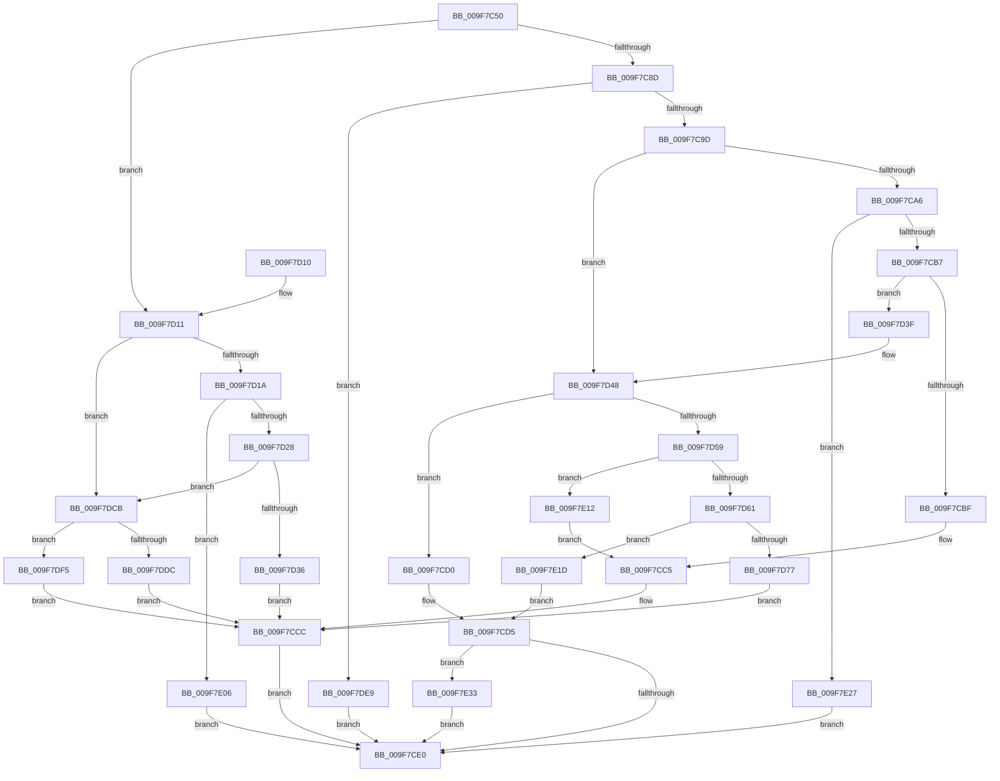

# PspSetJobIoAttribution

- RVA: `0x009F7C50`–`0x009F7E3E` (길이 `494` bytes)
- VA: `0x00000001409F7C50`
- 실행 섹션: `PAGE`
- PDB 이름 있음: `예`; PDB Function 태그: `아니요`
- unwind 정보 RVA: `0x000A6DA8`
- 디코드: `120`개 명령, `494/494` bytes 표시
- 미해석 바이트: `0` (있으면 어셈블리에 `.byte`로 보존)

> 이 문서는 커널 이미지의 기계어와 PDB 기호를 분석해 생성했습니다. 4번과 5번은 함수 원형과 자료형을 바이너리 사용 방식에서 추정한 C 해석이며 원본 소스 복구 결과는 아닙니다.

## 1. Dependencies

- 직접 호출 지점: **6**; 고유 호출 대상: **6**
- 직접 호출자로 확인된 함수: **2**
- RIP 상대 이미지 참조: **2**

### Outgoing calls
- `0x009F7C90` → [PspIsSetJobIoAttribution](PspIsSetJobIoAttribution_function_009F7F0C.md) (function, `0x009F7F0C`)
- `0x009F7CEF` → [EtwTracePsIoAttribution](EtwTracePsIoAttribution_function_009F7E44.md) (function, `0x009F7E44`)
- `0x009F7D66` → [IoDiskIoAttributionAllocate](IoDiskIoAttributionAllocate_function_009F7F6C.md) (function, `0x009F7F6C`)
- `0x009F7D7A` → [IoStartDiskIoAttributionForContext](../../text/46/IoStartDiskIoAttributionForContext_function_0046B434.md) (function, `0x0046B434`)
- `0x009F7DB4` → [PspEnumJobsAndProcessesInJobHierarchy](../91/PspEnumJobsAndProcessesInJobHierarchy_function_0091A1EC.md) (function, `0x0091A1EC`)
- `0x009F7DF5` → [PspRemoveIoAttribution](PspRemoveIoAttribution_function_009F8014.md) (function, `0x009F8014`)

### Direct callers
- [PspSetJobIoRateControl](PspSetJobIoRateControl_function_009F78EC.md) at `0x009F79C5`
- [PspSetJobIoRateControl](PspSetJobIoRateControl_function_009F78EC.md) at `0x009F7B2B`
- [NtSetInformationJobObject](NtSetInformationJobObject_function_009F84C0.md) at `0x009FAB4F`

### Static image references
- `0x009F7D8C` → RVA `0x00A81DA0` (`PspSetJobIoAttributionProcessCallback`; read)
- `0x009F7DA0` → RVA `0x00A7E540` (`PspSetJobIoAttributionJobPreCallback`; read)

## 2. Other-region calls and transfers

- 다른 실행 섹션으로 향하는 call: **1**
  - `0x009F7D7A` → [IoStartDiskIoAttributionForContext](../../text/46/IoStartDiskIoAttributionForContext_function_0046B434.md) (`PAGE` → `.text`)
- 별도 외부 분기/꼬리 이동을 확인하지 못했습니다.

## 3. Assembly (complete function range)

```asm
009F7C50  4C 8B DC                        mov r11, rsp
009F7C53  49 89 5B 08                     mov qword ptr [r11 + 8], rbx
009F7C57  49 89 6B 10                     mov qword ptr [r11 + 0x10], rbp
009F7C5B  49 89 73 18                     mov qword ptr [r11 + 0x18], rsi
009F7C5F  57                              push rdi
009F7C60  41 56                           push r14
009F7C62  41 57                           push r15
009F7C64  48 83 EC 50                     sub rsp, 0x50
009F7C68  33 C0                           xor eax, eax
009F7C6A  0F 57 C0                        xorps xmm0, xmm0
009F7C6D  45 32 F6                        xor r14b, r14b
009F7C70  41 8B E9                        mov ebp, r9d
009F7C73  41 8A F8                        mov dil, r8b
009F7C76  44 8A FA                        mov r15b, dl
009F7C79  48 8B D9                        mov rbx, rcx
009F7C7C  0F 11 44 24 30                  movups xmmword ptr [rsp + 0x30], xmm0
009F7C81  49 89 43 D8                     mov qword ptr [r11 - 0x28], rax
009F7C85  84 D2                           test dl, dl
009F7C87  0F 84 84 00 00 00               je 0x1409f7d11
009F7C8D  45 33 C0                        xor r8d, r8d
009F7C90  E8 77 02 00 00                  call 0x1409f7f0c
009F7C95  84 C0                           test al, al
009F7C97  0F 85 4C 01 00 00               jne 0x1409f7de9
009F7C9D  40 84 FF                        test dil, dil
009F7CA0  0F 84 A2 00 00 00               je 0x1409f7d48
009F7CA6  8B 83 28 06 00 00               mov eax, dword ptr [rbx + 0x628]
009F7CAC  8D 0C 28                        lea ecx, [rax + rbp]
009F7CAF  3B C8                           cmp ecx, eax
009F7CB1  0F 82 70 01 00 00               jb 0x1409f7e27
009F7CB7  85 C0                           test eax, eax
009F7CB9  0F 84 80 00 00 00               je 0x1409f7d3f
009F7CBF  89 8B 28 06 00 00               mov dword ptr [rbx + 0x628], ecx
009F7CC5  48 8B BB 30 06 00 00            mov rdi, qword ptr [rbx + 0x630]
009F7CCC  33 F6                           xor esi, esi
009F7CCE  EB 10                           jmp 0x1409f7ce0
009F7CD0  BE 9A 00 00 C0                  mov esi, 0xc000009a
009F7CD5  33 FF                           xor edi, edi
009F7CD7  45 84 F6                        test r14b, r14b
009F7CDA  0F 85 53 01 00 00               jne 0x1409f7e33
009F7CE0  8B 8B BC 05 00 00               mov ecx, dword ptr [rbx + 0x5bc]
009F7CE6  44 8B CE                        mov r9d, esi
009F7CE9  4C 8B C7                        mov r8, rdi
009F7CEC  41 8A D7                        mov dl, r15b
009F7CEF  E8 50 01 00 00                  call 0x1409f7e44
009F7CF4  4C 8D 5C 24 50                  lea r11, [rsp + 0x50]
009F7CF9  8B C6                           mov eax, esi
009F7CFB  49 8B 5B 20                     mov rbx, qword ptr [r11 + 0x20]
009F7CFF  49 8B 6B 28                     mov rbp, qword ptr [r11 + 0x28]
009F7D03  49 8B 73 30                     mov rsi, qword ptr [r11 + 0x30]
009F7D07  49 8B E3                        mov rsp, r11
009F7D0A  41 5F                           pop r15
009F7D0C  41 5E                           pop r14
009F7D0E  5F                              pop rdi
009F7D0F  C3                              ret
009F7D10  CC                              int3
009F7D11  40 84 FF                        test dil, dil
009F7D14  0F 84 B1 00 00 00               je 0x1409f7dcb
009F7D1A  8B 81 28 06 00 00               mov eax, dword ptr [rcx + 0x628]
009F7D20  3B C5                           cmp eax, ebp
009F7D22  0F 82 DE 00 00 00               jb 0x1409f7e06
009F7D28  2B C5                           sub eax, ebp
009F7D2A  89 81 28 06 00 00               mov dword ptr [rcx + 0x628], eax
009F7D30  0F 84 95 00 00 00               je 0x1409f7dcb
009F7D36  48 8B B9 30 06 00 00            mov rdi, qword ptr [rcx + 0x630]
009F7D3D  EB 8D                           jmp 0x1409f7ccc
009F7D3F  89 AB 28 06 00 00               mov dword ptr [rbx + 0x628], ebp
009F7D45  41 B6 01                        mov r14b, 1
009F7D48  8B 83 2C 06 00 00               mov eax, dword ptr [rbx + 0x62c]
009F7D4E  8D 0C 28                        lea ecx, [rax + rbp]
009F7D51  3B C8                           cmp ecx, eax
009F7D53  0F 82 77 FF FF FF               jb 0x1409f7cd0
009F7D59  85 C0                           test eax, eax
009F7D5B  0F 85 B1 00 00 00               jne 0x1409f7e12
009F7D61  33 D2                           xor edx, edx
009F7D63  48 8B CB                        mov rcx, rbx
009F7D66  E8 01 02 00 00                  call 0x1409f7f6c
009F7D6B  48 8B F8                        mov rdi, rax
009F7D6E  48 85 C0                        test rax, rax
009F7D71  0F 84 A6 00 00 00               je 0x1409f7e1d
009F7D77  48 8B C8                        mov rcx, rax
009F7D7A  E8 B5 36 A7 FF                  call 0x14046b434
009F7D7F  48 8D 44 24 30                  lea rax, [rsp + 0x30]
009F7D84  C7 44 24 28 05 00 00 00         mov dword ptr [rsp + 0x28], 5
009F7D8C  4C 8D 0D 0D A0 08 00            lea r9, [rip + 0x8a00d]
009F7D93  48 89 44 24 20                  mov qword ptr [rsp + 0x20], rax
009F7D98  45 33 C0                        xor r8d, r8d
009F7D9B  48 89 7C 24 30                  mov qword ptr [rsp + 0x30], rdi
009F7DA0  48 8D 15 99 67 08 00            lea rdx, [rip + 0x86799]
009F7DA7  C6 44 24 40 01                  mov byte ptr [rsp + 0x40], 1
009F7DAC  48 8B CB                        mov rcx, rbx
009F7DAF  48 89 5C 24 38                  mov qword ptr [rsp + 0x38], rbx
009F7DB4  E8 33 24 F2 FF                  call 0x14091a1ec
009F7DB9  89 AB 2C 06 00 00               mov dword ptr [rbx + 0x62c], ebp
009F7DBF  48 89 BB 30 06 00 00            mov qword ptr [rbx + 0x630], rdi
009F7DC6  E9 01 FF FF FF                  jmp 0x1409f7ccc
009F7DCB  8B 81 2C 06 00 00               mov eax, dword ptr [rcx + 0x62c]
009F7DD1  48 8B B9 30 06 00 00            mov rdi, qword ptr [rcx + 0x630]
009F7DD8  3B C5                           cmp eax, ebp
009F7DDA  76 19                           jbe 0x1409f7df5
009F7DDC  2B C5                           sub eax, ebp
009F7DDE  89 81 2C 06 00 00               mov dword ptr [rcx + 0x62c], eax
009F7DE4  E9 E3 FE FF FF                  jmp 0x1409f7ccc
009F7DE9  33 FF                           xor edi, edi
009F7DEB  BE BB 00 00 C0                  mov esi, 0xc00000bb
009F7DF0  E9 EB FE FF FF                  jmp 0x1409f7ce0
009F7DF5  E8 1A 02 00 00                  call 0x1409f8014
009F7DFA  83 A3 2C 06 00 00 00            and dword ptr [rbx + 0x62c], 0
009F7E01  E9 C6 FE FF FF                  jmp 0x1409f7ccc
009F7E06  33 FF                           xor edi, edi
009F7E08  BE 0D 00 00 C0                  mov esi, 0xc000000d
009F7E0D  E9 CE FE FF FF                  jmp 0x1409f7ce0
009F7E12  89 8B 2C 06 00 00               mov dword ptr [rbx + 0x62c], ecx
009F7E18  E9 A8 FE FF FF                  jmp 0x1409f7cc5
009F7E1D  BE 17 00 00 C0                  mov esi, 0xc0000017
009F7E22  E9 AE FE FF FF                  jmp 0x1409f7cd5
009F7E27  33 FF                           xor edi, edi
009F7E29  BE 9A 00 00 C0                  mov esi, 0xc000009a
009F7E2E  E9 AD FE FF FF                  jmp 0x1409f7ce0
009F7E33  29 AB 28 06 00 00               sub dword ptr [rbx + 0x628], ebp
009F7E39  E9 A2 FE FF FF                  jmp 0x1409f7ce0
```

## 4. C-style interpretation (structured pseudocode)

```c
__int64 __fastcall PspSetJobIoAttribution(__int64 a1, unsigned __int8 a2, int a3, int a4)
{
    __int64 result;
    __int64 v_r14;
    __int64 v_rdi;
    __int64 v_rsi;
    __int64 v_rsp;
    unsigned __int8 v_stack_m10;
    unsigned __int64 v_stack_m18;
    unsigned __int64 v_stack_m20;
    unsigned int v_stack_m28;
    unsigned __int64 v_stack_m30;
    unsigned __int64 v_stack_m38;

    *(unsigned __int64 *)(v_rsp + 8) = v_rbx;
    *(unsigned __int64 *)(v_rsp + 16) = v_rbp;
    *(unsigned __int64 *)(v_rsp + 24) = v_rsi;
    v_rsp = (v_rsp) - (80);
    result = 0;
    v_r14 = 0;
    v_stack_m38 = v_xmm0;
    *(unsigned __int64 *)(v_rsp - 40) = 0;
    if (a2 == 0) goto loc_009F7D11;
    a3 = 0;
    result = PspIsSetJobIoAttribution(a1, a2, a3, a4);
    if ((unsigned __int8)(result) != 0) goto loc_009F7DE9;
    if ((unsigned __int8)((unsigned __int8)(a3)) == 0) goto loc_009F7D48;
    if (((unsigned int)((unsigned int)(*(unsigned int *)(a1 + 1576)) + (unsigned int)(a4) * 1)) < ((unsigned int)((unsigned int)(*(unsigned int *)(a1 + 1576))))) goto loc_009F7E27;
    if ((unsigned int)((unsigned int)(*(unsigned int *)(a1 + 1576))) == 0) goto loc_009F7D3F;
    *(unsigned int *)(a1 + 1576) = (unsigned int)((unsigned int)(*(unsigned int *)(a1 + 1576)) + (unsigned int)(a4) * 1);
loc_009F7CC5:
loc_009F7CCC:
    v_rsi = 0;
    goto loc_009F7CE0;
loc_009F7CD0:
loc_009F7CD5:
    v_rdi = 0;
    if (0 != 0) goto loc_009F7E33;
loc_009F7CE0:
    result = EtwTracePsIoAttribution((unsigned int)(*(unsigned int *)(a1 + 1468)), a2, 0, (unsigned int)((unsigned int)((unsigned int)(0xC000009AULL))));
    return (unsigned int)((unsigned int)((unsigned int)(0xC000009AULL)));
loc_009F7D11:
    if (0 == 0) goto loc_009F7DCB;
    if (((unsigned int)((unsigned int)(*(unsigned int *)((unsigned int)(*(unsigned int *)(a1 + 1468)) + 1576)))) < ((unsigned int)(*(unsigned __int64 *)(v_stack_m18 + 40)))) goto loc_009F7E06;
    result = (unsigned int)(((unsigned int)(*(unsigned int *)((unsigned int)(*(unsigned int *)(a1 + 1468)) + 1576))) - ((unsigned int)(*(unsigned __int64 *)(v_stack_m18 + 40))));
    *(unsigned int *)((unsigned int)(*(unsigned int *)(a1 + 1468)) + 1576) = (unsigned int)(result);
    if (condition_is_equal) goto loc_009F7DCB;
    goto loc_009F7CCC;
loc_009F7D3F:
    *(unsigned int *)(*(unsigned __int64 *)(v_stack_m18 + 32) + 1576) = (unsigned int)(*(unsigned __int64 *)(v_stack_m18 + 40));
loc_009F7D48:
    if (((unsigned int)((unsigned int)(*(unsigned int *)(*(unsigned __int64 *)(v_stack_m18 + 32) + 1580)) + *(unsigned __int64 *)(v_stack_m18 + 40) * 1)) < ((unsigned int)((unsigned int)(*(unsigned int *)(*(unsigned __int64 *)(v_stack_m18 + 32) + 1580))))) goto loc_009F7CD0;
    if ((unsigned int)((unsigned int)(*(unsigned int *)(*(unsigned __int64 *)(v_stack_m18 + 32) + 1580))) != 0) goto loc_009F7E12;
    a2 = 0;
    result = IoDiskIoAttributionAllocate(*(unsigned __int64 *)(v_stack_m18 + 32), a2, 0, (unsigned int)((unsigned int)((unsigned int)(0xC000009AULL))));
    if (result == 0) goto loc_009F7E1D;
    result = IoStartDiskIoAttributionForContext(result, a2, 0, (unsigned int)((unsigned int)((unsigned int)(0xC000009AULL))));
    v_stack_m28 = 5;
    v_stack_m30 = v_stack_m20;
    a3 = 0;
    v_stack_m20 = result;
    v_stack_m10 = 1;
    v_stack_m18 = *(unsigned __int64 *)(v_stack_m18 + 32);
    result = PspEnumJobsAndProcessesInJobHierarchy(*(unsigned __int64 *)(v_stack_m18 + 32), v_rip + 550809, a3, v_rip + 565261);
    *(unsigned int *)(*(unsigned __int64 *)(v_stack_m18 + 32) + 1580) = (unsigned int)(*(unsigned __int64 *)(v_stack_m18 + 40));
    *(unsigned __int64 *)(*(unsigned __int64 *)(v_stack_m18 + 32) + 1584) = result;
    goto loc_009F7CCC;
loc_009F7DCB:
    if (((unsigned int)((unsigned int)(*(unsigned int *)(*(unsigned __int64 *)(v_stack_m18 + 32) + 1580)))) <= ((unsigned int)(*(unsigned __int64 *)(v_stack_m18 + 40)))) goto loc_009F7DF5;
    result = (unsigned int)(((unsigned int)(*(unsigned int *)(*(unsigned __int64 *)(v_stack_m18 + 32) + 1580))) - ((unsigned int)(*(unsigned __int64 *)(v_stack_m18 + 40))));
    *(unsigned int *)(*(unsigned __int64 *)(v_stack_m18 + 32) + 1580) = (unsigned int)(result);
    goto loc_009F7CCC;
loc_009F7DE9:
    v_rdi = 0;
    goto loc_009F7CE0;
loc_009F7DF5:
    result = PspRemoveIoAttribution(*(unsigned __int64 *)(v_stack_m18 + 32), v_rip + 550809, a3, v_rip + 565261);
    goto loc_009F7CCC;
loc_009F7E06:
    v_rdi = 0;
    goto loc_009F7CE0;
loc_009F7E12:
    *(unsigned int *)(*(unsigned __int64 *)(v_stack_m18 + 32) + 1580) = (unsigned int)(*(unsigned __int64 *)(v_stack_m18 + 32));
    goto loc_009F7CC5;
loc_009F7E1D:
    goto loc_009F7CD5;
loc_009F7E27:
    v_rdi = 0;
    goto loc_009F7CE0;
loc_009F7E33:
    goto loc_009F7CE0;
}
```

## 5. (Beta) C Style

```c
int64_t PspSetJobIoAttribution(void *Arg1, uint8_t Arg2, int32_t Arg3, int32_t Arg4)
{
    uint8_t *arg1 = (uint8_t *)Arg1;

    int64_t result;
    int64_t local_r14;
    int64_t local_rdi;
    int64_t local_rsi;
    int64_t local_rsp;
    uint8_t v_stack_m10;
    uint64_t v_stack_m18;
    uint64_t v_stack_m20;
    uint32_t v_stack_m28;
    uint64_t v_stack_m30;
    uint64_t v_stack_m38;

    *(uint64_t *)(local_rsp + 0x8) = local_rbx;
    *(uint64_t *)(local_rsp + 0x10) = local_rbp;
    *(uint64_t *)(local_rsp + 0x18) = local_rsi;
    local_rsp = (local_rsp) - (80);
    result = 0;
    local_r14 = 0;
    v_stack_m38 = v_xmm0;
    *(uint64_t *)(local_rsp - 0x28) = 0;
    if (Arg2 == 0) goto loc_009F7D11;
    Arg3 = 0;
    result = PspIsSetJobIoAttribution(Arg1, Arg2, Arg3, Arg4);
    if ((uint8_t)(result) != 0) goto loc_009F7DE9;
    if ((uint8_t)((uint8_t)(Arg3)) == 0) goto loc_009F7D48;
    if (((uint32_t)((uint32_t)(*(uint32_t *)(arg1 + 0x628)) + (uint32_t)(Arg4) * 1)) < ((uint32_t)((uint32_t)(*(uint32_t *)(arg1 + 0x628))))) goto loc_009F7E27;
    if ((uint32_t)((uint32_t)(*(uint32_t *)(arg1 + 0x628))) == 0) goto loc_009F7D3F;
    *(uint32_t *)(arg1 + 0x628) = (uint32_t)((uint32_t)(*(uint32_t *)(arg1 + 0x628)) + (uint32_t)(Arg4) * 1);
loc_009F7CC5:
loc_009F7CCC:
    local_rsi = 0;
    goto loc_009F7CE0;
loc_009F7CD0:
loc_009F7CD5:
    local_rdi = 0;
    if (0 != 0) goto loc_009F7E33;
loc_009F7CE0:
    result = EtwTracePsIoAttribution((uint32_t)(*(uint32_t *)(arg1 + 0x5BC)), Arg2, 0, (uint32_t)((uint32_t)((uint32_t)(0xC000009AULL))));
    return (uint32_t)((uint32_t)((uint32_t)(0xC000009AULL)));
loc_009F7D11:
    if (0 == 0) goto loc_009F7DCB;
    if (((uint32_t)((uint32_t)(*(uint32_t *)((uint32_t)(*(uint32_t *)(arg1 + 0x5BC)) + 0x628)))) < ((uint32_t)(*(uint64_t *)(v_stack_m18 + 0x28)))) goto loc_009F7E06;
    result = (uint32_t)(((uint32_t)(*(uint32_t *)((uint32_t)(*(uint32_t *)(arg1 + 0x5BC)) + 0x628))) - ((uint32_t)(*(uint64_t *)(v_stack_m18 + 0x28))));
    *(uint32_t *)((uint32_t)(*(uint32_t *)(arg1 + 0x5BC)) + 0x628) = (uint32_t)(result);
    if (condition_is_equal) goto loc_009F7DCB;
    goto loc_009F7CCC;
loc_009F7D3F:
    *(uint32_t *)(*(uint64_t *)(v_stack_m18 + 0x20) + 0x628) = (uint32_t)(*(uint64_t *)(v_stack_m18 + 0x28));
loc_009F7D48:
    if (((uint32_t)((uint32_t)(*(uint32_t *)(*(uint64_t *)(v_stack_m18 + 0x20) + 0x62C)) + *(uint64_t *)(v_stack_m18 + 0x28) * 1)) < ((uint32_t)((uint32_t)(*(uint32_t *)(*(uint64_t *)(v_stack_m18 + 0x20) + 0x62C))))) goto loc_009F7CD0;
    if ((uint32_t)((uint32_t)(*(uint32_t *)(*(uint64_t *)(v_stack_m18 + 0x20) + 0x62C))) != 0) goto loc_009F7E12;
    Arg2 = 0;
    result = IoDiskIoAttributionAllocate(*(uint64_t *)(v_stack_m18 + 0x20), Arg2, 0, (uint32_t)((uint32_t)((uint32_t)(0xC000009AULL))));
    if (result == 0) goto loc_009F7E1D;
    result = IoStartDiskIoAttributionForContext(result, Arg2, 0, (uint32_t)((uint32_t)((uint32_t)(0xC000009AULL))));
    v_stack_m28 = 5;
    v_stack_m30 = v_stack_m20;
    Arg3 = 0;
    v_stack_m20 = result;
    v_stack_m10 = 1;
    v_stack_m18 = *(uint64_t *)(v_stack_m18 + 0x20);
    result = PspEnumJobsAndProcessesInJobHierarchy(*(uint64_t *)(v_stack_m18 + 0x20), v_rip + 550809, Arg3, v_rip + 565261);
    *(uint32_t *)(*(uint64_t *)(v_stack_m18 + 0x20) + 0x62C) = (uint32_t)(*(uint64_t *)(v_stack_m18 + 0x28));
    *(uint64_t *)(*(uint64_t *)(v_stack_m18 + 0x20) + 0x630) = result;
    goto loc_009F7CCC;
loc_009F7DCB:
    if (((uint32_t)((uint32_t)(*(uint32_t *)(*(uint64_t *)(v_stack_m18 + 0x20) + 0x62C)))) <= ((uint32_t)(*(uint64_t *)(v_stack_m18 + 0x28)))) goto loc_009F7DF5;
    result = (uint32_t)(((uint32_t)(*(uint32_t *)(*(uint64_t *)(v_stack_m18 + 0x20) + 0x62C))) - ((uint32_t)(*(uint64_t *)(v_stack_m18 + 0x28))));
    *(uint32_t *)(*(uint64_t *)(v_stack_m18 + 0x20) + 0x62C) = (uint32_t)(result);
    goto loc_009F7CCC;
loc_009F7DE9:
    local_rdi = 0;
    goto loc_009F7CE0;
loc_009F7DF5:
    result = PspRemoveIoAttribution(*(uint64_t *)(v_stack_m18 + 0x20), v_rip + 550809, Arg3, v_rip + 565261);
    goto loc_009F7CCC;
loc_009F7E06:
    local_rdi = 0;
    goto loc_009F7CE0;
loc_009F7E12:
    *(uint32_t *)(*(uint64_t *)(v_stack_m18 + 0x20) + 0x62C) = (uint32_t)(*(uint64_t *)(v_stack_m18 + 0x20));
    goto loc_009F7CC5;
loc_009F7E1D:
    goto loc_009F7CD5;
loc_009F7E27:
    local_rdi = 0;
    goto loc_009F7CE0;
loc_009F7E33:
    goto loc_009F7CE0;
}
```

### 관측된 메모리 오프셋

구조체 형식이 확인되지 않은 접근은 인자 기준의 오프셋으로만 기록했습니다.

| 기준 인자 | 오프셋 표현 | 폭 (bit) | 접근 |
|---|---:|---:|---|
| `Arg1` | `+ 0x5BC` | `32` | `R` |
| `Arg1` | `+ 0x628` | `32` | `R` |
| `Arg1` | `+ 0x628` | `32` | `R/W` |
| `Arg1` | `+ 0x628` | `32` | `W` |
| `Arg1` | `+ 0x62C` | `32` | `R` |
| `Arg1` | `+ 0x62C` | `32` | `R/W` |
| `Arg1` | `+ 0x62C` | `32` | `W` |
| `Arg1` | `+ 0x630` | `64` | `R` |
| `Arg1` | `+ 0x630` | `64` | `W` |

## 6. Execution-region graph

[열기: 2D/3D 그래프와 함수 탐색 컨트롤 패널](../../../control-panel.html?section=page&rva=0x009F7C50&view=graph)

- 2D 그래프는 위에서 아래로 흐르고, 3D 그래프는 빈 공간을 드래그해 회전합니다. Shift+드래그는 이동, 휠은 확대·축소, 함수 노드 선택은 대상 보고서 이동입니다.

### Static fallback


