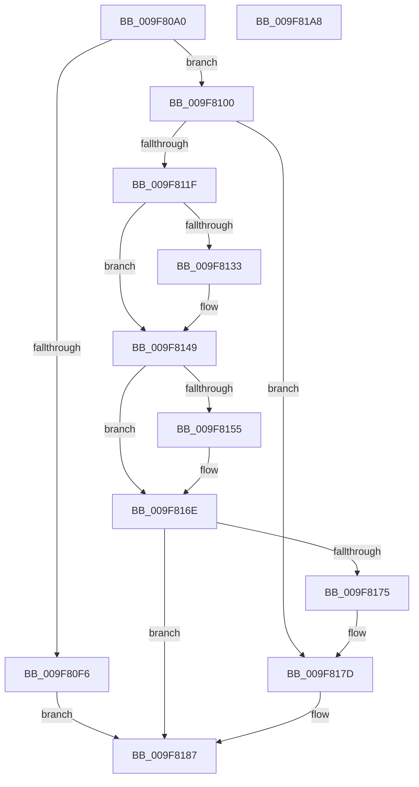

# PspSetJobIoRateControlForVolume

- RVA: `0x009F80A0`–`0x009F81A9` (길이 `265` bytes)
- VA: `0x00000001409F80A0`
- 실행 섹션: `PAGE`
- PDB 이름 있음: `예`; PDB Function 태그: `아니요`
- unwind 정보 RVA: `0x0005FEF8`
- 디코드: `78`개 명령, `265/265` bytes 표시
- 미해석 바이트: `0` (있으면 어셈블리에 `.byte`로 보존)

> 이 문서는 커널 이미지의 기계어와 PDB 기호를 분석해 생성했습니다. 4번과 5번은 함수 원형과 자료형을 바이너리 사용 방식에서 추정한 C 해석이며 원본 소스 복구 결과는 아닙니다.

## 1. Dependencies

- 직접 호출 지점: **10**; 고유 호출 대상: **8**
- 직접 호출자로 확인된 함수: **1**
- RIP 상대 이미지 참조: **0**

### Outgoing calls
- `0x009F80E9` → [ExAllocatePool2](../../poolcode/B8/ExAllocatePool2_function_00B820F0.md) (function, `0x00B820F0`)
- `0x009F8103` → [PspIoRateEntryInitialize](../91/PspIoRateEntryInitialize_function_00917734.md) (function, `0x00917734`)
- `0x009F8114` → [PspIoRateEntryActivate](PspIoRateEntryActivate_function_009F8398.md) (function, `0x009F8398`)
- `0x009F8126` → [PspJobIoRateVolumeEntryRemove](../../text/5E/PspJobIoRateVolumeEntryRemove_function_005E3B6C.md) (function, `0x005E3B6C`)
- `0x009F8136` → [PspIoRateEntryDeactivate](PspIoRateEntryDeactivate_function_009F7BD4.md) (function, `0x009F7BD4`)
- `0x009F8140` → [ExFreePoolWithTag](../../poolcode/B8/ExFreePoolWithTag_function_00B82870.md) (function, `0x00B82870`)
- `0x009F814C` → [PspIoRateControlInfoIsAnySet](../../text/4B/PspIoRateControlInfoIsAnySet_function_004B9594.md) (function, `0x004B9594`)
- `0x009F8163` → [PspJobIoRateVolumeEntryInsert](../../text/5E/PspJobIoRateVolumeEntryInsert_function_005E39C8.md) (function, `0x005E39C8`)
- `0x009F8178` → [PspIoRateEntryDeactivate](PspIoRateEntryDeactivate_function_009F7BD4.md) (function, `0x009F7BD4`)
- `0x009F8182` → [ExFreePoolWithTag](../../poolcode/B8/ExFreePoolWithTag_function_00B82870.md) (function, `0x00B82870`)

### Direct callers
- [PspSetJobIoRateControl](PspSetJobIoRateControl_function_009F78EC.md) at `0x009F7AED`

### Static image references
- 디코드된 RIP-relative 메모리 참조가 없습니다.

## 2. Other-region calls and transfers

- 다른 실행 섹션으로 향하는 call: **6**
  - `0x009F80E9` → [ExAllocatePool2](../../poolcode/B8/ExAllocatePool2_function_00B820F0.md) (`PAGE` → `POOLCODE`)
  - `0x009F8126` → [PspJobIoRateVolumeEntryRemove](../../text/5E/PspJobIoRateVolumeEntryRemove_function_005E3B6C.md) (`PAGE` → `.text`)
  - `0x009F8140` → [ExFreePoolWithTag](../../poolcode/B8/ExFreePoolWithTag_function_00B82870.md) (`PAGE` → `POOLCODE`)
  - `0x009F814C` → [PspIoRateControlInfoIsAnySet](../../text/4B/PspIoRateControlInfoIsAnySet_function_004B9594.md) (`PAGE` → `.text`)
  - `0x009F8163` → [PspJobIoRateVolumeEntryInsert](../../text/5E/PspJobIoRateVolumeEntryInsert_function_005E39C8.md) (`PAGE` → `.text`)
  - `0x009F8182` → [ExFreePoolWithTag](../../poolcode/B8/ExFreePoolWithTag_function_00B82870.md) (`PAGE` → `POOLCODE`)
- 별도 외부 분기/꼬리 이동을 확인하지 못했습니다.

## 3. Assembly (complete function range)

```asm
009F80A0  48 8B C4                        mov rax, rsp
009F80A3  48 89 58 08                     mov qword ptr [rax + 8], rbx
009F80A7  48 89 68 10                     mov qword ptr [rax + 0x10], rbp
009F80AB  48 89 70 18                     mov qword ptr [rax + 0x18], rsi
009F80AF  48 89 78 20                     mov qword ptr [rax + 0x20], rdi
009F80B3  41 54                           push r12
009F80B5  41 56                           push r14
009F80B7  41 57                           push r15
009F80B9  48 83 EC 20                     sub rsp, 0x20
009F80BD  4C 8B 64 24 60                  mov r12, qword ptr [rsp + 0x60]
009F80C2  48 8B EA                        mov rbp, rdx
009F80C5  BA 38 00 00 00                  mov edx, 0x38
009F80CA  41 C6 00 00                     mov byte ptr [r8], 0
009F80CE  4D 8B F0                        mov r14, r8
009F80D1  41 C6 01 00                     mov byte ptr [r9], 0
009F80D5  48 8B F1                        mov rsi, rcx
009F80D8  41 B8 50 73 4A 69               mov r8d, 0x694a7350
009F80DE  49 83 24 24 00                  and qword ptr [r12], 0
009F80E3  4D 8B F9                        mov r15, r9
009F80E6  8D 4A 08                        lea ecx, [rdx + 8]
009F80E9  E8 02 A0 18 00                  call 0x140b820f0
009F80EE  48 8B D8                        mov rbx, rax
009F80F1  48 85 C0                        test rax, rax
009F80F4  75 0A                           jne 0x1409f8100
009F80F6  BF 9A 00 00 C0                  mov edi, 0xc000009a
009F80FB  E9 87 00 00 00                  jmp 0x1409f8187
009F8100  48 8B CB                        mov rcx, rbx
009F8103  E8 2C F6 F1 FF                  call 0x140917734
009F8108  45 33 C9                        xor r9d, r9d
009F810B  4C 8B C5                        mov r8, rbp
009F810E  48 8B D6                        mov rdx, rsi
009F8111  48 8B CB                        mov rcx, rbx
009F8114  E8 7F 02 00 00                  call 0x1409f8398
009F8119  8B F8                           mov edi, eax
009F811B  85 C0                           test eax, eax
009F811D  78 5E                           js 0x1409f817d
009F811F  48 8B 53 18                     mov rdx, qword ptr [rbx + 0x18]
009F8123  48 8B CE                        mov rcx, rsi
009F8126  E8 41 BA BE FF                  call 0x1405e3b6c
009F812B  48 8B F8                        mov rdi, rax
009F812E  48 85 C0                        test rax, rax
009F8131  74 16                           je 0x1409f8149
009F8133  48 8B C8                        mov rcx, rax
009F8136  E8 99 FA FF FF                  call 0x1409f7bd4
009F813B  33 D2                           xor edx, edx
009F813D  48 8B CF                        mov rcx, rdi
009F8140  E8 2B A7 18 00                  call 0x140b82870
009F8145  41 C6 06 01                     mov byte ptr [r14], 1
009F8149  48 8B CD                        mov rcx, rbp
009F814C  E8 43 14 AC FF                  call 0x1404b9594
009F8151  84 C0                           test al, al
009F8153  74 19                           je 0x1409f816e
009F8155  48 8B 43 28                     mov rax, qword ptr [rbx + 0x28]
009F8159  48 8B D3                        mov rdx, rbx
009F815C  48 8B CE                        mov rcx, rsi
009F815F  49 89 04 24                     mov qword ptr [r12], rax
009F8163  E8 60 B8 BE FF                  call 0x1405e39c8
009F8168  33 DB                           xor ebx, ebx
009F816A  41 C6 07 01                     mov byte ptr [r15], 1
009F816E  33 FF                           xor edi, edi
009F8170  48 85 DB                        test rbx, rbx
009F8173  74 12                           je 0x1409f8187
009F8175  48 8B CB                        mov rcx, rbx
009F8178  E8 57 FA FF FF                  call 0x1409f7bd4
009F817D  33 D2                           xor edx, edx
009F817F  48 8B CB                        mov rcx, rbx
009F8182  E8 E9 A6 18 00                  call 0x140b82870
009F8187  48 8B 5C 24 40                  mov rbx, qword ptr [rsp + 0x40]
009F818C  8B C7                           mov eax, edi
009F818E  48 8B 7C 24 58                  mov rdi, qword ptr [rsp + 0x58]
009F8193  48 8B 6C 24 48                  mov rbp, qword ptr [rsp + 0x48]
009F8198  48 8B 74 24 50                  mov rsi, qword ptr [rsp + 0x50]
009F819D  48 83 C4 20                     add rsp, 0x20
009F81A1  41 5F                           pop r15
009F81A3  41 5E                           pop r14
009F81A5  41 5C                           pop r12
009F81A7  C3                              ret
009F81A8  CC                              int3
```

## 4. C-style interpretation (structured pseudocode)

```c
__int64 __fastcall PspSetJobIoRateControlForVolume(__int64 a1, __int64 a2, __int64 a3, __int64 a4, __int64 a5)
{
    __int64 result;
    __int64 v_rbx;
    __int64 v_rdi;
    __int64 v_rsp;
    unsigned __int64 v_stack_p10;
    unsigned __int64 v_stack_p18;
    unsigned __int64 v_stack_p20;
    unsigned __int64 v_stack_p8;

    *(unsigned __int64 *)(v_rsp + 8) = v_rbx;
    *(unsigned __int64 *)(v_rsp + 16) = v_rbp;
    *(unsigned __int64 *)(v_rsp + 24) = v_rsi;
    *(unsigned __int64 *)(v_rsp + 32) = v_rdi;
    v_rsp = (v_rsp) - (32);
    *(unsigned __int8 *)(a3) = 0;
    *(unsigned __int8 *)(a4) = 0;
    result = ExAllocatePool2(56 + 8, 56, (unsigned int)(0x694A7350ULL), a4);
    if (result != 0) goto loc_009F8100;
    goto loc_009F8187;
loc_009F8100:
    result = PspIoRateEntryInitialize(result, 56, (unsigned int)(0x694A7350ULL), a4);
    a4 = 0;
    result = PspIoRateEntryActivate(result, a1, a2, a4);
    if (sign_flag) goto loc_009F817D;
    result = PspJobIoRateVolumeEntryRemove(a1, *(unsigned __int64 *)(result + 24), a2, a4);
    if (result != 0) {
        a1 = result;
        result = PspIoRateEntryDeactivate(a1, *(unsigned __int64 *)(result + 24), a2, a4);
        a2 = 0;
        a1 = result;
        result = ExFreePoolWithTag(a1, a2, a2, a4);
        *(unsigned __int8 *)(a3) = 1;
    }
    result = PspIoRateControlInfoIsAnySet(0, a2, a2, a4);
    v_rbx = result;
    if ((unsigned __int8)(result) != 0) {
        result = *(unsigned __int64 *)(result + 40);
        a2 = result;
        a1 = a1;
        *(unsigned __int64 *)(a5) = result;
        result = PspJobIoRateVolumeEntryInsert(a1, a2, a2, a4);
        v_rbx = 0;
        *(unsigned __int8 *)(a4) = 1;
    }
    v_rdi = 0;
    if (0 == 0) goto loc_009F8187;
    result = PspIoRateEntryDeactivate(0, a2, a2, a4);
loc_009F817D:
    a2 = 0;
    result = ExFreePoolWithTag(0, a2, a2, a4);
loc_009F8187:
    v_rsp = (v_rsp) + (32);
    return 0;
}
```

## 5. (Beta) C Style

```c
int64_t PspSetJobIoRateControlForVolume(int64_t Arg1, int64_t Arg2, void *Arg3, void *Arg4, void *Arg5)
{
    uint8_t *arg3 = (uint8_t *)Arg3;
    uint8_t *arg4 = (uint8_t *)Arg4;
    uint8_t *arg5 = (uint8_t *)Arg5;

    int64_t result;
    int64_t local_rbx;
    int64_t local_rdi;
    int64_t local_rsp;
    uint64_t v_stack_p10;
    uint64_t v_stack_p18;
    uint64_t v_stack_p20;
    uint64_t v_stack_p8;

    *(uint64_t *)(local_rsp + 0x8) = local_rbx;
    *(uint64_t *)(local_rsp + 0x10) = local_rbp;
    *(uint64_t *)(local_rsp + 0x18) = local_rsi;
    *(uint64_t *)(local_rsp + 0x20) = local_rdi;
    local_rsp = (local_rsp) - (32);
    *(uint8_t *)(arg3) = 0;
    *(uint8_t *)(arg4) = 0;
    result = ExAllocatePool2(56 + 8, 56, (uint32_t)(0x694A7350ULL), Arg4);
    if (result != 0) goto loc_009F8100;
    goto loc_009F8187;
loc_009F8100:
    result = PspIoRateEntryInitialize(result, 56, (uint32_t)(0x694A7350ULL), Arg4);
    Arg4 = 0;
    result = PspIoRateEntryActivate(result, Arg1, Arg2, Arg4);
    if (sign_flag) goto loc_009F817D;
    result = PspJobIoRateVolumeEntryRemove(Arg1, *(uint64_t *)(result + 0x18), Arg2, Arg4);
    if (result != 0) {
        Arg1 = result;
        result = PspIoRateEntryDeactivate(Arg1, *(uint64_t *)(result + 0x18), Arg2, Arg4);
        Arg2 = 0;
        Arg1 = result;
        result = ExFreePoolWithTag(Arg1, Arg2, Arg2, Arg4);
        *(uint8_t *)(arg3) = 1;
    }
    result = PspIoRateControlInfoIsAnySet(0, Arg2, Arg2, Arg4);
    local_rbx = result;
    if ((uint8_t)(result) != 0) {
        result = *(uint64_t *)(result + 0x28);
        Arg2 = result;
        Arg1 = Arg1;
        *(uint64_t *)(arg5) = result;
        result = PspJobIoRateVolumeEntryInsert(Arg1, Arg2, Arg2, Arg4);
        local_rbx = 0;
        *(uint8_t *)(arg4) = 1;
    }
    local_rdi = 0;
    if (0 == 0) goto loc_009F8187;
    result = PspIoRateEntryDeactivate(0, Arg2, Arg2, Arg4);
loc_009F817D:
    Arg2 = 0;
    result = ExFreePoolWithTag(0, Arg2, Arg2, Arg4);
loc_009F8187:
    local_rsp = (local_rsp) + (32);
    return 0;
}
```

### 관측된 메모리 오프셋

구조체 형식이 확인되지 않은 접근은 인자 기준의 오프셋으로만 기록했습니다.

| 기준 인자 | 오프셋 표현 | 폭 (bit) | 접근 |
|---|---:|---:|---|
| `Arg3` | `+ 0x0` | `8` | `W` |
| `Arg4` | `+ 0x0` | `8` | `W` |
| `Arg5` | `+ 0x0` | `64` | `R/W` |
| `Arg5` | `+ 0x0` | `64` | `W` |

## 6. Execution-region graph

[열기: 2D/3D 그래프와 함수 탐색 컨트롤 패널](../../../control-panel.html?section=page&rva=0x009F80A0&view=graph)

- 2D 그래프는 위에서 아래로 흐르고, 3D 그래프는 빈 공간을 드래그해 회전합니다. Shift+드래그는 이동, 휠은 확대·축소, 함수 노드 선택은 대상 보고서 이동입니다.

### Static fallback


