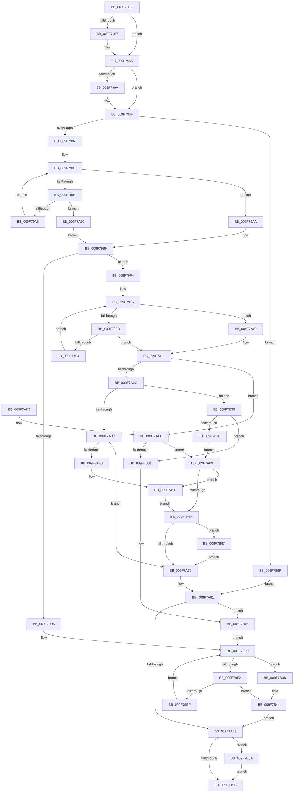

# PspSetJobIoRateControl

- RVA: `0x009F78EC`–`0x009F7BCD` (길이 `737` bytes)
- VA: `0x00000001409F78EC`
- 실행 섹션: `PAGE`
- PDB 이름 있음: `예`; PDB Function 태그: `아니요`
- unwind 정보 RVA: `0x000A6D8C`
- 디코드: `200`개 명령, `737/737` bytes 표시
- 미해석 바이트: `0` (있으면 어셈블리에 `.byte`로 보존)

> 이 문서는 커널 이미지의 기계어와 PDB 기호를 분석해 생성했습니다. 4번과 5번은 함수 원형과 자료형을 바이너리 사용 방식에서 추정한 C 해석이며 원본 소스 복구 결과는 아닙니다.

## 1. Dependencies

- 직접 호출 지점: **21**; 고유 호출 대상: **17**
- 직접 호출자로 확인된 함수: **1**
- RIP 상대 이미지 참조: **0**

### Outgoing calls
- `0x009F7946` → [KeAbPreAcquire](../../text/21/KeAbPreAcquire_function_00210230.md) (function, `0x00210230`)
- `0x009F7960` → [ExfAcquirePushLockExclusiveEx](../../text/20/ExfAcquirePushLockExclusiveEx_function_0020FC90.md) (function, `0x0020FC90`)
- `0x009F798C` → [PspLockRootJobExclusive](../91/PspLockRootJobExclusive_function_00917D0C.md) (function, `0x00917D0C`)
- `0x009F79B4` → [ExAcquireResourceExclusiveLite](../../text/21/ExAcquireResourceExclusiveLite_function_00214E20.md) (function, `0x00214E20`)
- `0x009F79C5` → [PspSetJobIoAttribution](PspSetJobIoAttribution_function_009F7C50.md) (function, `0x009F7C50`)
- `0x009F7A0C` → [ExReleaseResourceLite](../../text/25/ExReleaseResourceLite_function_0025FA10.md) (function, `0x0025FA10`)
- `0x009F7A19` → [PspUnlockJob](../91/PspUnlockJob_function_00919E00.md) (function, `0x00919E00`)
- `0x009F7A2F` → [PspIoRateControlInfoIsAnySet](../../text/4B/PspIoRateControlInfoIsAnySet_function_004B9594.md) (function, `0x004B9594`)
- `0x009F7A53` → [PspIoRateEntryDeactivate](PspIoRateEntryDeactivate_function_009F7BD4.md) (function, `0x009F7BD4`)
- `0x009F7A9E` → [KeAbPostRelease](../../text/2E/KeAbPostRelease_function_002E1600.md) (function, `0x002E1600`)
- `0x009F7AA6` → [KiLeaveCriticalRegionUnsafe](../../text/25/KiLeaveCriticalRegionUnsafe_function_0025F010.md) (function, `0x0025F010`)
- `0x009F7ABC` → [EtwTracePsIoRateControl](EtwTracePsIoRateControl_function_009F81B0.md) (function, `0x009F81B0`)
- `0x009F7AED` → [PspSetJobIoRateControlForVolume](PspSetJobIoRateControlForVolume_function_009F80A0.md) (function, `0x009F80A0`)
- `0x009F7B0F` → [PspLockRootJobExclusive](../91/PspLockRootJobExclusive_function_00917D0C.md) (function, `0x00917D0C`)
- `0x009F7B1B` → [PspLockJobConditionally](PspLockJobConditionally_function_009F7C20.md) (function, `0x009F7C20`)
- `0x009F7B2B` → [PspSetJobIoAttribution](PspSetJobIoAttribution_function_009F7C50.md) (function, `0x009F7C50`)
- `0x009F7B3F` → [ExReleaseResourceLite](../../text/25/ExReleaseResourceLite_function_0025FA10.md) (function, `0x0025FA10`)
- `0x009F7B4B` → [PspUnlockJob](../91/PspUnlockJob_function_00919E00.md) (function, `0x00919E00`)
- `0x009F7B66` → [PspIoRateEntryActivate](PspIoRateEntryActivate_function_009F8398.md) (function, `0x009F8398`)
- `0x009F7B8D` → [ExfTryToWakePushLock](../../text/26/ExfTryToWakePushLock_function_00265DD0.md) (function, `0x00265DD0`)
- `0x009F7BB8` → [PspJobIoRateControlDisable](../A7/PspJobIoRateControlDisable_function_00A76854.md) (function, `0x00A76854`)

### Direct callers
- [NtSetInformationJobObject](NtSetInformationJobObject_function_009F84C0.md) at `0x009FAA09`

### Static image references
- 디코드된 RIP-relative 메모리 참조가 없습니다.

## 2. Other-region calls and transfers

- 다른 실행 섹션으로 향하는 call: **9**
  - `0x009F7946` → [KeAbPreAcquire](../../text/21/KeAbPreAcquire_function_00210230.md) (`PAGE` → `.text`)
  - `0x009F7960` → [ExfAcquirePushLockExclusiveEx](../../text/20/ExfAcquirePushLockExclusiveEx_function_0020FC90.md) (`PAGE` → `.text`)
  - `0x009F79B4` → [ExAcquireResourceExclusiveLite](../../text/21/ExAcquireResourceExclusiveLite_function_00214E20.md) (`PAGE` → `.text`)
  - `0x009F7A0C` → [ExReleaseResourceLite](../../text/25/ExReleaseResourceLite_function_0025FA10.md) (`PAGE` → `.text`)
  - `0x009F7A2F` → [PspIoRateControlInfoIsAnySet](../../text/4B/PspIoRateControlInfoIsAnySet_function_004B9594.md) (`PAGE` → `.text`)
  - `0x009F7A9E` → [KeAbPostRelease](../../text/2E/KeAbPostRelease_function_002E1600.md) (`PAGE` → `.text`)
  - `0x009F7AA6` → [KiLeaveCriticalRegionUnsafe](../../text/25/KiLeaveCriticalRegionUnsafe_function_0025F010.md) (`PAGE` → `.text`)
  - `0x009F7B3F` → [ExReleaseResourceLite](../../text/25/ExReleaseResourceLite_function_0025FA10.md) (`PAGE` → `.text`)
  - `0x009F7B8D` → [ExfTryToWakePushLock](../../text/26/ExfTryToWakePushLock_function_00265DD0.md) (`PAGE` → `.text`)
- 별도 외부 분기/꼬리 이동을 확인하지 못했습니다.

## 3. Assembly (complete function range)

```asm
009F78EC  48 89 54 24 10                  mov qword ptr [rsp + 0x10], rdx
009F78F1  55                              push rbp
009F78F2  53                              push rbx
009F78F3  56                              push rsi
009F78F4  57                              push rdi
009F78F5  41 54                           push r12
009F78F7  41 55                           push r13
009F78F9  41 56                           push r14
009F78FB  41 57                           push r15
009F78FD  48 8B EC                        mov rbp, rsp
009F7900  48 83 EC 58                     sub rsp, 0x58
009F7904  65 4C 8B 24 25 88 01 00 00      mov r12, qword ptr gs:[0x188]
009F790D  4C 8D A9 D0 06 00 00            lea r13, [rcx + 0x6d0]
009F7914  33 FF                           xor edi, edi
009F7916  4C 89 65 E0                     mov qword ptr [rbp - 0x20], r12
009F791A  4C 8B FA                        mov r15, rdx
009F791D  48 89 7D 60                     mov qword ptr [rbp + 0x60], rdi
009F7921  48 8B F1                        mov rsi, rcx
009F7924  48 89 7D D8                     mov qword ptr [rbp - 0x28], rdi
009F7928  48 83 CB FF                     or rbx, 0xffffffffffffffff
009F792C  40 88 7D 48                     mov byte ptr [rbp + 0x48], dil
009F7930  66 41 01 9C 24 E4 01 00 00      add word ptr [r12 + 0x1e4], bx
009F7939  45 33 C0                        xor r8d, r8d
009F793C  33 D2                           xor edx, edx
009F793E  40 88 7D 58                     mov byte ptr [rbp + 0x58], dil
009F7942  49 8B CD                        mov rcx, r13
009F7945  90                              nop
009F7946  E8 E5 88 81 FF                  call 0x140210230
009F794B  F0 49 0F BA 6D 00 00            lock bts qword ptr [r13], 0
009F7952  4C 8B F0                        mov r14, rax
009F7955  73 0E                           jae 0x1409f7965
009F7957  4D 8B C5                        mov r8, r13
009F795A  48 8B D0                        mov rdx, rax
009F795D  49 8B CD                        mov rcx, r13
009F7960  E8 2B 83 81 FF                  call 0x14020fc90
009F7965  4D 85 F6                        test r14, r14
009F7968  74 05                           je 0x1409f796f
009F796A  41 C6 46 0A 01                  mov byte ptr [r14 + 0xa], 1
009F796F  41 8B 47 24                     mov eax, dword ptr [r15 + 0x24]
009F7973  41 BE 01 00 00 00               mov r14d, 1
009F7979  41 84 C6                        test r14b, al
009F797C  0F 84 1D 02 00 00               je 0x1409f7b9f
009F7982  4C 8D 45 60                     lea r8, [rbp + 0x60]
009F7986  49 8B D4                        mov rdx, r12
009F7989  48 8B CE                        mov rcx, rsi
009F798C  E8 7B 03 F2 FF                  call 0x140917d0c
009F7991  8B CF                           mov ecx, edi
009F7993  41 3B CE                        cmp ecx, r14d
009F7996  73 12                           jae 0x1409f79aa
009F7998  8B C1                           mov eax, ecx
009F799A  48 3B 74 C5 60                  cmp rsi, qword ptr [rbp + rax*8 + 0x60]
009F799F  0F 84 BB 00 00 00               je 0x1409f7a60
009F79A5  41 03 CE                        add ecx, r14d
009F79A8  EB E9                           jmp 0x1409f7993
009F79AA  4C 8D 66 38                     lea r12, [rsi + 0x38]
009F79AE  41 8A D6                        mov dl, r14b
009F79B1  49 8B CC                        mov rcx, r12
009F79B4  E8 67 D4 81 FF                  call 0x140214e20
009F79B9  45 8B CE                        mov r9d, r14d
009F79BC  45 33 C0                        xor r8d, r8d
009F79BF  41 8A D6                        mov dl, r14b
009F79C2  48 8B CE                        mov rcx, rsi
009F79C5  E8 86 02 00 00                  call 0x1409f7c50
009F79CA  4C 89 65 E8                     mov qword ptr [rbp - 0x18], r12
009F79CE  44 8B F8                        mov r15d, eax
009F79D1  85 C0                           test eax, eax
009F79D3  79 1F                           jns 0x1409f79f4
009F79D5  4C 8B 65 E0                     mov r12, qword ptr [rbp - 0x20]
009F79D9  41 3B FE                        cmp edi, r14d
009F79DC  0F 83 59 01 00 00               jae 0x1409f7b3b
009F79E2  8B C7                           mov eax, edi
009F79E4  48 3B 74 C5 60                  cmp rsi, qword ptr [rbp + rax*8 + 0x60]
009F79E9  0F 84 55 01 00 00               je 0x1409f7b44
009F79EF  41 03 FE                        add edi, r14d
009F79F2  EB E5                           jmp 0x1409f79d9
009F79F4  8B CF                           mov ecx, edi
009F79F6  41 3B CE                        cmp ecx, r14d
009F79F9  73 0E                           jae 0x1409f7a09
009F79FB  8B C1                           mov eax, ecx
009F79FD  48 3B 74 C5 60                  cmp rsi, qword ptr [rbp + rax*8 + 0x60]
009F7A02  74 0D                           je 0x1409f7a11
009F7A04  41 03 CE                        add ecx, r14d
009F7A07  EB ED                           jmp 0x1409f79f6
009F7A09  49 8B CC                        mov rcx, r12
009F7A0C  E8 FF 7F 86 FF                  call 0x14025fa10
009F7A11  48 8B 55 E0                     mov rdx, qword ptr [rbp - 0x20]
009F7A15  48 8B 4D 60                     mov rcx, qword ptr [rbp + 0x60]
009F7A19  E8 E2 23 F2 FF                  call 0x140919e00
009F7A1E  4C 8B 7D 50                     mov r15, qword ptr [rbp + 0x50]
009F7A22  49 39 7F 18                     cmp qword ptr [r15 + 0x18], rdi
009F7A26  0F 85 AA 00 00 00               jne 0x1409f7ad6
009F7A2C  49 8B CF                        mov rcx, r15
009F7A2F  E8 60 1B AC FF                  call 0x1404b9594
009F7A34  84 C0                           test al, al
009F7A36  0F 85 19 01 00 00               jne 0x1409f7b55
009F7A3C  48 8B 86 88 06 00 00            mov rax, qword ptr [rsi + 0x688]
009F7A43  48 85 C0                        test rax, rax
009F7A46  74 31                           je 0x1409f7a79
009F7A48  48 8D 8E 60 06 00 00            lea rcx, [rsi + 0x660]
009F7A4F  48 89 45 D8                     mov qword ptr [rbp - 0x28], rax
009F7A53  E8 7C 01 00 00                  call 0x1409f7bd4
009F7A58  41 BE 02 00 00 00               mov r14d, 2
009F7A5E  EB 0F                           jmp 0x1409f7a6f
009F7A60  4C 8D 66 38                     lea r12, [rsi + 0x38]
009F7A64  E9 50 FF FF FF                  jmp 0x1409f79b9
009F7A69  40 38 7D 48                     cmp byte ptr [rbp + 0x48], dil
009F7A6D  75 E9                           jne 0x1409f7a58
009F7A6F  40 38 7D 58                     cmp byte ptr [rbp + 0x58], dil
009F7A73  0F 85 1E 01 00 00               jne 0x1409f7b97
009F7A79  4C 89 65 E8                     mov qword ptr [rbp - 0x18], r12
009F7A7D  4C 8B 65 E0                     mov r12, qword ptr [rbp - 0x20]
009F7A81  44 8B FF                        mov r15d, edi
009F7A84  45 85 F6                        test r14d, r14d
009F7A87  75 7C                           jne 0x1409f7b05
009F7A89  F0 49 0F C1 5D 00               lock xadd qword ptr [r13], rbx
009F7A8F  80 E3 06                        and bl, 6
009F7A92  80 FB 02                        cmp bl, 2
009F7A95  0F 84 EF 00 00 00               je 0x1409f7b8a
009F7A9B  49 8B CD                        mov rcx, r13
009F7A9E  E8 5D 9B 8E FF                  call 0x1402e1600
009F7AA3  49 8B CC                        mov rcx, r12
009F7AA6  E8 65 75 86 FF                  call 0x14025f010
009F7AAB  4C 8B 45 D8                     mov r8, qword ptr [rbp - 0x28]
009F7AAF  45 8B CF                        mov r9d, r15d
009F7AB2  48 8B 55 50                     mov rdx, qword ptr [rbp + 0x50]
009F7AB6  8B 8E BC 05 00 00               mov ecx, dword ptr [rsi + 0x5bc]
009F7ABC  E8 EF 06 00 00                  call 0x1409f81b0
009F7AC1  41 8B C7                        mov eax, r15d
009F7AC4  48 83 C4 58                     add rsp, 0x58
009F7AC8  41 5F                           pop r15
009F7ACA  41 5E                           pop r14
009F7ACC  41 5D                           pop r13
009F7ACE  41 5C                           pop r12
009F7AD0  5F                              pop rdi
009F7AD1  5E                              pop rsi
009F7AD2  5B                              pop rbx
009F7AD3  5D                              pop rbp
009F7AD4  C3                              ret
009F7AD5  CC                              int3
009F7AD6  48 8D 45 D8                     lea rax, [rbp - 0x28]
009F7ADA  49 8B D7                        mov rdx, r15
009F7ADD  4C 8D 4D 58                     lea r9, [rbp + 0x58]
009F7AE1  48 89 44 24 20                  mov qword ptr [rsp + 0x20], rax
009F7AE6  4C 8D 45 48                     lea r8, [rbp + 0x48]
009F7AEA  48 8B CE                        mov rcx, rsi
009F7AED  E8 AE 05 00 00                  call 0x1409f80a0
009F7AF2  4C 89 65 E8                     mov qword ptr [rbp - 0x18], r12
009F7AF6  44 8B F8                        mov r15d, eax
009F7AF9  85 C0                           test eax, eax
009F7AFB  0F 89 68 FF FF FF               jns 0x1409f7a69
009F7B01  4C 8B 65 E0                     mov r12, qword ptr [rbp - 0x20]
009F7B05  4C 8D 45 60                     lea r8, [rbp + 0x60]
009F7B09  49 8B D4                        mov rdx, r12
009F7B0C  48 8B CE                        mov rcx, rsi
009F7B0F  E8 F8 01 F2 FF                  call 0x140917d0c
009F7B14  48 8D 55 60                     lea rdx, [rbp + 0x60]
009F7B18  48 8B CE                        mov rcx, rsi
009F7B1B  E8 00 01 00 00                  call 0x1409f7c20
009F7B20  45 8B CE                        mov r9d, r14d
009F7B23  45 33 C0                        xor r8d, r8d
009F7B26  33 D2                           xor edx, edx
009F7B28  48 8B CE                        mov rcx, rsi
009F7B2B  E8 20 01 00 00                  call 0x1409f7c50
009F7B30  41 BE 01 00 00 00               mov r14d, 1
009F7B36  E9 9E FE FF FF                  jmp 0x1409f79d9
009F7B3B  48 8B 4D E8                     mov rcx, qword ptr [rbp - 0x18]
009F7B3F  E8 CC 7E 86 FF                  call 0x14025fa10
009F7B44  48 8B 4D 60                     mov rcx, qword ptr [rbp + 0x60]
009F7B48  49 8B D4                        mov rdx, r12
009F7B4B  E8 B0 22 F2 FF                  call 0x140919e00
009F7B50  E9 34 FF FF FF                  jmp 0x1409f7a89
009F7B55  48 8D 8E 60 06 00 00            lea rcx, [rsi + 0x660]
009F7B5C  4D 8B C7                        mov r8, r15
009F7B5F  4C 8D 4D 48                     lea r9, [rbp + 0x48]
009F7B63  48 8B D6                        mov rdx, rsi
009F7B66  E8 2D 08 00 00                  call 0x1409f8398
009F7B6B  4C 89 65 E8                     mov qword ptr [rbp - 0x18], r12
009F7B6F  44 8B F8                        mov r15d, eax
009F7B72  85 C0                           test eax, eax
009F7B74  78 8B                           js 0x1409f7b01
009F7B76  48 8B 86 88 06 00 00            mov rax, qword ptr [rsi + 0x688]
009F7B7D  48 89 45 D8                     mov qword ptr [rbp - 0x28], rax
009F7B81  44 88 75 58                     mov byte ptr [rbp + 0x58], r14b
009F7B85  E9 DF FE FF FF                  jmp 0x1409f7a69
009F7B8A  49 8B CD                        mov rcx, r13
009F7B8D  E8 3E E2 86 FF                  call 0x140265dd0
009F7B92  E9 04 FF FF FF                  jmp 0x1409f7a9b
009F7B97  41 FF CE                        dec r14d
009F7B9A  E9 DA FE FF FF                  jmp 0x1409f7a79
009F7B9F  48 8B 8E 88 06 00 00            mov rcx, qword ptr [rsi + 0x688]
009F7BA6  48 8B 45 D8                     mov rax, qword ptr [rbp - 0x28]
009F7BAA  48 85 C9                        test rcx, rcx
009F7BAD  48 0F 45 C1                     cmovne rax, rcx
009F7BB1  48 8B CE                        mov rcx, rsi
009F7BB4  48 89 45 D8                     mov qword ptr [rbp - 0x28], rax
009F7BB8  E8 97 EC 07 00                  call 0x140a76854
009F7BBD  44 8B F0                        mov r14d, eax
009F7BC0  48 8D 46 38                     lea rax, [rsi + 0x38]
009F7BC4  48 89 45 E8                     mov qword ptr [rbp - 0x18], rax
009F7BC8  E9 B4 FE FF FF                  jmp 0x1409f7a81
```

## 4. C-style interpretation (structured pseudocode)

```c
__int64 __fastcall PspSetJobIoRateControl(__int64 a1, __int64 a2, int a3)
{
    __int64 result;
    __int64 v_r14;
    __int64 v_rbx;
    __int64 v_rdi;
    __int64 v_rsp;
    unsigned __int64 v_stack_m58;
    unsigned __int64 v_stack_m60;
    unsigned __int64 v_stack_m68;
    unsigned __int64 v_stack_p10;
    unsigned __int8 v_stack_p18;
    unsigned __int64 v_stack_p20;
    unsigned __int8 v_stack_p8;

    v_stack_p10 = a2;
    v_rsp = (v_rsp) - (88);
    v_rdi = 0;
    v_stack_m60 = *(unsigned __int64 *)(gs_base + (0 + 392));
    v_stack_p20 = 0;
    v_stack_m68 = 0;
    v_rbx = (v_rbx) | (-1);
    v_stack_p8 = 0;
    a3 = 0;
    a2 = 0;
    v_stack_p18 = 0;
    result = KeAbPreAcquire(a1 + 1744, a2, a3, a4);
    if (!(condition_is_above_or_equal)) {
        a3 = a1 + 1744;
        a2 = result;
        a1 = a1 + 1744;
        result = ExfAcquirePushLockExclusiveEx(a1, a2, a3, a4);
    }
    if (result != 0) {
        *(unsigned __int8 *)(result + 10) = 1;
    }
    if (((1) & ((unsigned __int8)((unsigned int)(*(unsigned int *)(a2 + 36))))) == 0) goto loc_009F7B9F;
    result = PspLockRootJobExclusive(a1, *(unsigned __int64 *)(gs_base + (0 + 392)), v_stack_p20, a4);
loc_009F7993:
    if (0 >= 1) goto loc_009F79AA;
    if (a1 == (*(unsigned __int64 *)(v_rsp + 0 * 8 + 96))) goto loc_009F7A60;
    a1 = (unsigned int)((0) + (1));
    goto loc_009F7993;
loc_009F79AA:
    result = ExAcquireResourceExclusiveLite(a1 + 56, 1, v_stack_p20, a4);
loc_009F79B9:
    a3 = 0;
    result = PspSetJobIoAttribution(a1, 1, a3, 1);
    v_stack_m58 = a1 + 56;
    if (!sign_flag) goto loc_009F79F4;
loc_009F79D9:
    if (0 >= 1) goto loc_009F7B3B;
    if (a1 == (*(unsigned __int64 *)(v_rsp + 0 * 8 + 96))) goto loc_009F7B44;
    v_rdi = (unsigned int)((v_rdi) + (1));
    goto loc_009F79D9;
loc_009F79F4:
loc_009F79F6:
    if (((unsigned int)((unsigned int)((unsigned int)(v_rdi)))) >= 1) goto loc_009F7A09;
    if (a1 == (*(unsigned __int64 *)(v_rsp + (unsigned int)((unsigned int)((unsigned int)((unsigned int)(v_rdi)))) * 8 + 96))) goto loc_009F7A11;
    a1 = (unsigned int)(((unsigned int)((unsigned int)(v_rdi))) + (1));
    goto loc_009F79F6;
loc_009F7A09:
    result = ExReleaseResourceLite(v_stack_m60, 1, a3, 1);
loc_009F7A11:
    result = PspUnlockJob(v_stack_p20, v_stack_m60, a3, 1);
    if ((*(unsigned __int64 *)(v_stack_p10 + 24)) != v_rdi) goto loc_009F7AD6;
    result = PspIoRateControlInfoIsAnySet(v_stack_p10, v_stack_m60, a3, 1);
    if ((unsigned __int8)(result) != 0) goto loc_009F7B55;
    if (*(unsigned __int64 *)(a1 + 1672) == 0) goto loc_009F7A79;
    v_stack_m68 = *(unsigned __int64 *)(a1 + 1672);
    result = PspIoRateEntryDeactivate(a1 + 1632, v_stack_m60, a3, 1);
loc_009F7A58:
    goto loc_009F7A6F;
loc_009F7A60:
    goto loc_009F79B9;
loc_009F7A69:
    if (v_stack_p8 != ((unsigned __int8)(v_rdi))) goto loc_009F7A58;
loc_009F7A6F:
    if (v_stack_p18 != ((unsigned __int8)(v_rdi))) goto loc_009F7B97;
loc_009F7A79:
    v_stack_m58 = a1 + 56;
loc_009F7A81:
    if (2 != 0) goto loc_009F7B05;
loc_009F7A89:
    v_rbx = (unsigned __int8)((v_rbx) & (6));
    if (((unsigned __int8)(v_rbx)) == 2) goto loc_009F7B8A;
loc_009F7A9B:
    result = KeAbPostRelease(a1 + 1744, v_stack_m60, a3, 1);
    result = KiLeaveCriticalRegionUnsafe(v_stack_m60, v_stack_m60, a3, 1);
    result = EtwTracePsIoRateControl((unsigned int)(*(unsigned int *)(a1 + 1468)), v_stack_p10, v_stack_m68, (unsigned int)((unsigned int)((unsigned int)((unsigned int)(v_rdi)))));
    v_rsp = (v_rsp) + (88);
    return (unsigned int)((unsigned int)((unsigned int)((unsigned int)(v_rdi))));
loc_009F7AD6:
    v_stack_p20 = v_stack_m68;
    result = PspSetJobIoRateControlForVolume(a1, (unsigned int)((unsigned int)(v_rdi)), v_stack_p8, v_stack_p18);
    v_stack_m58 = v_stack_m60;
    if (!sign_flag) goto loc_009F7A69;
loc_009F7B01:
loc_009F7B05:
    result = PspLockRootJobExclusive(a1, v_stack_m60, v_stack_p20, v_stack_p18);
    result = PspLockJobConditionally(a1, v_stack_p20, v_stack_p20, v_stack_p18);
    a3 = 0;
    a2 = 0;
    result = PspSetJobIoAttribution(a1, a2, a3, 2);
    goto loc_009F79D9;
loc_009F7B3B:
    result = ExReleaseResourceLite(v_stack_m58, a2, a3, 2);
loc_009F7B44:
    result = PspUnlockJob(v_stack_p20, v_stack_m60, a3, 2);
    goto loc_009F7A89;
loc_009F7B55:
    result = PspIoRateEntryActivate(a1 + 1632, a1, (unsigned int)((unsigned int)(result)), v_stack_p8);
    v_stack_m58 = v_stack_m60;
    if (sign_flag) goto loc_009F7B01;
    v_stack_m68 = *(unsigned __int64 *)(a1 + 1672);
    v_stack_p18 = 1;
    goto loc_009F7A69;
loc_009F7B8A:
    result = ExfTryToWakePushLock(a1 + 1744, a1, (unsigned int)((unsigned int)(result)), v_stack_p8);
    goto loc_009F7A9B;
loc_009F7B97:
    v_r14 = (unsigned int)((1) - 1);
    goto loc_009F7A79;
loc_009F7B9F:
    result = v_stack_m68;
    if (*(unsigned __int64 *)(a1 + 1672) != 0) { result = *(unsigned __int64 *)(a1 + 1672); }
    v_stack_m68 = result;
    result = PspJobIoRateControlDisable(a1, a1, (unsigned int)((unsigned int)(result)), v_stack_p8);
    v_stack_m58 = a1 + 56;
    goto loc_009F7A81;
}
```

## 5. (Beta) C Style

```c
int64_t PspSetJobIoRateControl(void *Arg1, void *Arg2, int32_t Arg3)
{
    uint8_t *arg1 = (uint8_t *)Arg1;
    uint8_t *arg2 = (uint8_t *)Arg2;

    int64_t result;
    int64_t local_r14;
    int64_t local_rbx;
    int64_t local_rdi;
    int64_t local_rsp;
    uint64_t v_stack_m58;
    uint64_t v_stack_m60;
    uint64_t v_stack_m68;
    uint64_t v_stack_p10;
    uint8_t v_stack_p18;
    uint64_t v_stack_p20;
    uint8_t v_stack_p8;

    v_stack_p10 = Arg2;
    local_rsp = (local_rsp) - (88);
    local_rdi = 0;
    v_stack_m60 = *(uint64_t *)(gs_base + (0 + 0x188));
    v_stack_p20 = 0;
    v_stack_m68 = 0;
    local_rbx = (local_rbx) | (-1);
    v_stack_p8 = 0;
    Arg3 = 0;
    Arg2 = 0;
    v_stack_p18 = 0;
    result = KeAbPreAcquire(Arg1 + 1744, Arg2, Arg3, a4);
    if (!(condition_is_above_or_equal)) {
        Arg3 = Arg1 + 1744;
        Arg2 = result;
        Arg1 = Arg1 + 1744;
        result = ExfAcquirePushLockExclusiveEx(Arg1, Arg2, Arg3, a4);
    }
    if (result != 0) {
        *(uint8_t *)(result + 0xA) = 1;
    }
    if (((1) & ((uint8_t)((uint32_t)(*(uint32_t *)(arg2 + 0x24))))) == 0) goto loc_009F7B9F;
    result = PspLockRootJobExclusive(Arg1, *(uint64_t *)(gs_base + (0 + 0x188)), v_stack_p20, a4);
loc_009F7993:
    if (0 >= 1) goto loc_009F79AA;
    if (Arg1 == (*(uint64_t *)(local_rsp + 0x0 * 8 + 0x60))) goto loc_009F7A60;
    Arg1 = (uint32_t)((0) + (1));
    goto loc_009F7993;
loc_009F79AA:
    result = ExAcquireResourceExclusiveLite(Arg1 + 56, 1, v_stack_p20, a4);
loc_009F79B9:
    Arg3 = 0;
    result = PspSetJobIoAttribution(Arg1, 1, Arg3, 1);
    v_stack_m58 = Arg1 + 56;
    if (!sign_flag) goto loc_009F79F4;
loc_009F79D9:
    if (0 >= 1) goto loc_009F7B3B;
    if (Arg1 == (*(uint64_t *)(local_rsp + 0x0 * 8 + 0x60))) goto loc_009F7B44;
    local_rdi = (uint32_t)((local_rdi) + (1));
    goto loc_009F79D9;
loc_009F79F4:
loc_009F79F6:
    if (((uint32_t)((uint32_t)((uint32_t)(local_rdi)))) >= 1) goto loc_009F7A09;
    if (Arg1 == (*(uint64_t *)(local_rsp + (uint32_t)((uint32_t)((uint32_t)((uint32_t)(local_rdi)))) * 8 + 0x60))) goto loc_009F7A11;
    Arg1 = (uint32_t)(((uint32_t)((uint32_t)(local_rdi))) + (1));
    goto loc_009F79F6;
loc_009F7A09:
    result = ExReleaseResourceLite(v_stack_m60, 1, Arg3, 1);
loc_009F7A11:
    result = PspUnlockJob(v_stack_p20, v_stack_m60, Arg3, 1);
    if ((*(uint64_t *)(v_stack_p10 + 0x18)) != local_rdi) goto loc_009F7AD6;
    result = PspIoRateControlInfoIsAnySet(v_stack_p10, v_stack_m60, Arg3, 1);
    if ((uint8_t)(result) != 0) goto loc_009F7B55;
    if (*(uint64_t *)(arg1 + 0x688) == 0) goto loc_009F7A79;
    v_stack_m68 = *(uint64_t *)(arg1 + 0x688);
    result = PspIoRateEntryDeactivate(Arg1 + 1632, v_stack_m60, Arg3, 1);
loc_009F7A58:
    goto loc_009F7A6F;
loc_009F7A60:
    goto loc_009F79B9;
loc_009F7A69:
    if (v_stack_p8 != ((uint8_t)(local_rdi))) goto loc_009F7A58;
loc_009F7A6F:
    if (v_stack_p18 != ((uint8_t)(local_rdi))) goto loc_009F7B97;
loc_009F7A79:
    v_stack_m58 = Arg1 + 56;
loc_009F7A81:
    if (2 != 0) goto loc_009F7B05;
loc_009F7A89:
    local_rbx = (uint8_t)((local_rbx) & (6));
    if (((uint8_t)(local_rbx)) == 2) goto loc_009F7B8A;
loc_009F7A9B:
    result = KeAbPostRelease(Arg1 + 1744, v_stack_m60, Arg3, 1);
    result = KiLeaveCriticalRegionUnsafe(v_stack_m60, v_stack_m60, Arg3, 1);
    result = EtwTracePsIoRateControl((uint32_t)(*(uint32_t *)(arg1 + 0x5BC)), v_stack_p10, v_stack_m68, (uint32_t)((uint32_t)((uint32_t)((uint32_t)(local_rdi)))));
    local_rsp = (local_rsp) + (88);
    return (uint32_t)((uint32_t)((uint32_t)((uint32_t)(local_rdi))));
loc_009F7AD6:
    v_stack_p20 = v_stack_m68;
    result = PspSetJobIoRateControlForVolume(Arg1, (uint32_t)((uint32_t)(local_rdi)), v_stack_p8, v_stack_p18);
    v_stack_m58 = v_stack_m60;
    if (!sign_flag) goto loc_009F7A69;
loc_009F7B01:
loc_009F7B05:
    result = PspLockRootJobExclusive(Arg1, v_stack_m60, v_stack_p20, v_stack_p18);
    result = PspLockJobConditionally(Arg1, v_stack_p20, v_stack_p20, v_stack_p18);
    Arg3 = 0;
    Arg2 = 0;
    result = PspSetJobIoAttribution(Arg1, Arg2, Arg3, 2);
    goto loc_009F79D9;
loc_009F7B3B:
    result = ExReleaseResourceLite(v_stack_m58, Arg2, Arg3, 2);
loc_009F7B44:
    result = PspUnlockJob(v_stack_p20, v_stack_m60, Arg3, 2);
    goto loc_009F7A89;
loc_009F7B55:
    result = PspIoRateEntryActivate(Arg1 + 1632, Arg1, (uint32_t)((uint32_t)(result)), v_stack_p8);
    v_stack_m58 = v_stack_m60;
    if (sign_flag) goto loc_009F7B01;
    v_stack_m68 = *(uint64_t *)(arg1 + 0x688);
    v_stack_p18 = 1;
    goto loc_009F7A69;
loc_009F7B8A:
    result = ExfTryToWakePushLock(Arg1 + 1744, Arg1, (uint32_t)((uint32_t)(result)), v_stack_p8);
    goto loc_009F7A9B;
loc_009F7B97:
    local_r14 = (uint32_t)((1) - 1);
    goto loc_009F7A79;
loc_009F7B9F:
    result = v_stack_m68;
    if (*(uint64_t *)(arg1 + 0x688) != 0) { result = *(uint64_t *)(arg1 + 0x688); }
    v_stack_m68 = result;
    result = PspJobIoRateControlDisable(Arg1, Arg1, (uint32_t)((uint32_t)(result)), v_stack_p8);
    v_stack_m58 = Arg1 + 56;
    goto loc_009F7A81;
}
```

### 관측된 메모리 오프셋

구조체 형식이 확인되지 않은 접근은 인자 기준의 오프셋으로만 기록했습니다.

| 기준 인자 | 오프셋 표현 | 폭 (bit) | 접근 |
|---|---:|---:|---|
| `Arg1` | `+ 0x0` | `64` | `R/W` |
| `Arg1` | `+ 0x38` | `64` | `R` |
| `Arg1` | `+ 0x688` | `64` | `R` |
| `Arg1` | `+ 0x6D0` | `64` | `R` |
| `Arg2` | `+ 0x24` | `32` | `R` |

## 6. Execution-region graph

[열기: 2D/3D 그래프와 함수 탐색 컨트롤 패널](../../../control-panel.html?section=page&rva=0x009F78EC&view=graph)

- 2D 그래프는 위에서 아래로 흐르고, 3D 그래프는 빈 공간을 드래그해 회전합니다. Shift+드래그는 이동, 휠은 확대·축소, 함수 노드 선택은 대상 보고서 이동입니다.

### Static fallback


