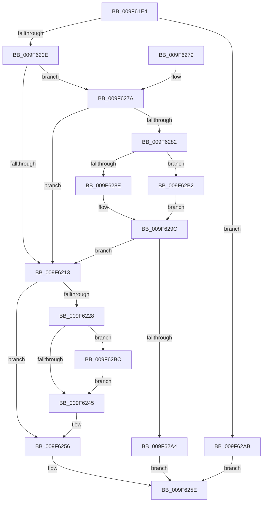

# PspSetProcessPriorityClass

- RVA: `0x009F61E4`–`0x009F62C4` (길이 `224` bytes)
- VA: `0x00000001409F61E4`
- 실행 섹션: `PAGE`
- PDB 이름 있음: `예`; PDB Function 태그: `아니요`
- unwind 정보 RVA: `0x00070190`
- 디코드: `59`개 명령, `224/224` bytes 표시
- 미해석 바이트: `0` (있으면 어셈블리에 `.byte`로 보존)

> 이 문서는 커널 이미지의 기계어와 PDB 기호를 분석해 생성했습니다. 4번과 5번은 함수 원형과 자료형을 바이너리 사용 방식에서 추정한 C 해석이며 원본 소스 복구 결과는 아닙니다.

## 1. Dependencies

- 직접 호출 지점: **5**; 고유 호출 대상: **5**
- 직접 호출자로 확인된 함수: **3**
- RIP 상대 이미지 참조: **1**

### Outgoing calls
- `0x009F6236` → [ExAcquireResourceSharedLite](../../text/21/ExAcquireResourceSharedLite_function_00211BC0.md) (function, `0x00211BC0`)
- `0x009F6249` → [ExReleaseResourceLite](../../text/25/ExReleaseResourceLite_function_0025FA10.md) (function, `0x0025FA10`)
- `0x009F6251` → [KiLeaveCriticalRegionUnsafe](../../text/25/KiLeaveCriticalRegionUnsafe_function_0025F010.md) (function, `0x0025F010`)
- `0x009F6297` → [SeCheckPrivilegedObject](SeCheckPrivilegedObject_function_009F62CC.md) (function, `0x009F62CC`)
- `0x009F62B5` → [SeSinglePrivilegeCheck](../87/SeSinglePrivilegeCheck_function_00871E20.md) (function, `0x00871E20`)

### Direct callers
- [PspApplyIFEOPerfOptions](../78/PspApplyIFEOPerfOptions_function_00783ED8.md) at `0x00783F90`
- [PspAllocateProcess](../A1/PspAllocateProcess_function_00A13B3C.md) at `0x00A15582`
- [NtSetInformationProcess](../AE/NtSetInformationProcess_function_00AE5370.md) at `0x00AE59B0`
- [NtSetInformationProcess](../AE/NtSetInformationProcess_function_00AE5370.md) at `0x00AE5C07`

### Static image references
- `0x009F6282` → RVA `0x00FD9AE8` (`PAGEDATA`; read)

## 2. Other-region calls and transfers

- 다른 실행 섹션으로 향하는 call: **3**
  - `0x009F6236` → [ExAcquireResourceSharedLite](../../text/21/ExAcquireResourceSharedLite_function_00211BC0.md) (`PAGE` → `.text`)
  - `0x009F6249` → [ExReleaseResourceLite](../../text/25/ExReleaseResourceLite_function_0025FA10.md) (`PAGE` → `.text`)
  - `0x009F6251` → [KiLeaveCriticalRegionUnsafe](../../text/25/KiLeaveCriticalRegionUnsafe_function_0025F010.md) (`PAGE` → `.text`)
- 별도 외부 분기/꼬리 이동을 확인하지 못했습니다.

## 3. Assembly (complete function range)

```asm
009F61E4  48 8B C4                        mov rax, rsp
009F61E7  48 89 58 08                     mov qword ptr [rax + 8], rbx
009F61EB  48 89 68 10                     mov qword ptr [rax + 0x10], rbp
009F61EF  48 89 70 18                     mov qword ptr [rax + 0x18], rsi
009F61F3  48 89 78 20                     mov qword ptr [rax + 0x20], rdi
009F61F7  41 56                           push r14
009F61F9  48 83 EC 20                     sub rsp, 0x20
009F61FD  49 8B C0                        mov rax, r8
009F6200  8A DA                           mov bl, dl
009F6202  48 8B F1                        mov rsi, rcx
009F6205  80 FA 06                        cmp dl, 6
009F6208  0F 87 9D 00 00 00               ja 0x1409f62ab
009F620E  80 FA 04                        cmp dl, 4
009F6211  74 67                           je 0x1409f627a
009F6213  48 8B BE A0 02 00 00            mov rdi, qword ptr [rsi + 0x2a0]
009F621A  65 48 8B 2C 25 88 01 00 00      mov rbp, qword ptr gs:[0x188]
009F6223  48 85 FF                        test rdi, rdi
009F6226  74 2E                           je 0x1409f6256
009F6228  66 FF 8D E4 01 00 00            dec word ptr [rbp + 0x1e4]
009F622F  48 8D 4F 38                     lea rcx, [rdi + 0x38]
009F6233  B2 01                           mov dl, 1
009F6235  90                              nop
009F6236  E8 85 B9 81 FF                  call 0x140211bc0
009F623B  8B 87 20 04 00 00               mov eax, dword ptr [rdi + 0x420]
009F6241  A8 20                           test al, 0x20
009F6243  75 77                           jne 0x1409f62bc
009F6245  48 8D 4F 38                     lea rcx, [rdi + 0x38]
009F6249  E8 C2 97 86 FF                  call 0x14025fa10
009F624E  48 8B CD                        mov rcx, rbp
009F6251  E8 BA 8D 86 FF                  call 0x14025f010
009F6256  88 9E 47 03 00 00               mov byte ptr [rsi + 0x347], bl
009F625C  33 C0                           xor eax, eax
009F625E  48 8B 5C 24 30                  mov rbx, qword ptr [rsp + 0x30]
009F6263  48 8B 6C 24 38                  mov rbp, qword ptr [rsp + 0x38]
009F6268  48 8B 74 24 40                  mov rsi, qword ptr [rsp + 0x40]
009F626D  48 8B 7C 24 48                  mov rdi, qword ptr [rsp + 0x48]
009F6272  48 83 C4 20                     add rsp, 0x20
009F6276  41 5E                           pop r14
009F6278  C3                              ret
009F6279  CC                              int3
009F627A  3A 91 47 03 00 00               cmp dl, byte ptr [rcx + 0x347]
009F6280  74 91                           je 0x1409f6213
009F6282  48 8B 0D 5F 38 5E 00            mov rcx, qword ptr [rip + 0x5e385f]
009F6289  48 85 C0                        test rax, rax
009F628C  74 24                           je 0x1409f62b2
009F628E  41 B8 00 02 00 00               mov r8d, 0x200
009F6294  48 8B D0                        mov rdx, rax
009F6297  E8 30 00 00 00                  call 0x1409f62cc
009F629C  84 C0                           test al, al
009F629E  0F 85 6F FF FF FF               jne 0x1409f6213
009F62A4  B8 61 00 00 C0                  mov eax, 0xc0000061
009F62A9  EB B3                           jmp 0x1409f625e
009F62AB  B8 0D 00 00 C0                  mov eax, 0xc000000d
009F62B0  EB AC                           jmp 0x1409f625e
009F62B2  41 8A D1                        mov dl, r9b
009F62B5  E8 66 BB E7 FF                  call 0x140871e20
009F62BA  EB E0                           jmp 0x1409f629c
009F62BC  8A 9F 4C 04 00 00               mov bl, byte ptr [rdi + 0x44c]
009F62C2  EB 81                           jmp 0x1409f6245
```

## 4. C-style interpretation (structured pseudocode)

```c
__int64 __fastcall PspSetProcessPriorityClass(__int64 a1, unsigned __int8 a2, __int64 a3, unsigned __int8 a4)
{
    __int64 result;
    __int64 v_rsp;
    unsigned __int64 v_stack_p10;
    unsigned __int64 v_stack_p18;
    unsigned __int64 v_stack_p20;
    unsigned __int64 v_stack_p8;

    *(unsigned __int64 *)(v_rsp + 8) = v_rbx;
    *(unsigned __int64 *)(v_rsp + 16) = v_rbp;
    *(unsigned __int64 *)(v_rsp + 24) = v_rsi;
    *(unsigned __int64 *)(v_rsp + 32) = v_rdi;
    v_rsp = (v_rsp) - (32);
    if (a2 > 6) goto loc_009F62AB;
    if (a2 == 4) goto loc_009F627A;
loc_009F6213:
    if (*(unsigned __int64 *)(a1 + 672) == 0) goto loc_009F6256;
    result = ExAcquireResourceSharedLite(*(unsigned __int64 *)(a1 + 672) + 56, 1, a3, a4);
    if ((((unsigned __int8)((unsigned int)(*(unsigned int *)(*(unsigned __int64 *)(a1 + 672) + 1056)))) & (32)) != 0) goto loc_009F62BC;
loc_009F6245:
    result = ExReleaseResourceLite(*(unsigned __int64 *)(a1 + 672) + 56, 1, a3, a4);
    result = KiLeaveCriticalRegionUnsafe(*(unsigned __int64 *)(gs_base + (0 + 392)), 1, a3, a4);
loc_009F6256:
    *(unsigned __int8 *)(a1 + 839) = a2;
    result = 0;
loc_009F625E:
    v_rsp = (v_rsp) + (32);
    return result;
loc_009F627A:
    if (1 == (*(unsigned __int8 *)(*(unsigned __int64 *)(gs_base + (0 + 392)) + 839))) goto loc_009F6213;
    if (0 == 0) goto loc_009F62B2;
    result = SeCheckPrivilegedObject(*(unsigned __int64 *)(v_rip + 6174815), 0, 512, a4);
loc_009F629C:
    if ((unsigned __int8)(result) != 0) goto loc_009F6213;
    goto loc_009F625E;
loc_009F62AB:
    goto loc_009F625E;
loc_009F62B2:
    result = SeSinglePrivilegeCheck(*(unsigned __int64 *)(v_rip + 6174815), a4, 512, a4);
    goto loc_009F629C;
loc_009F62BC:
    goto loc_009F6245;
}
```

## 5. (Beta) C Style

```c
int64_t PspSetProcessPriorityClass(void *Arg1, uint8_t Arg2, int64_t Arg3, uint8_t Arg4)
{
    uint8_t *arg1 = (uint8_t *)Arg1;

    int64_t result;
    int64_t local_rsp;
    uint64_t v_stack_p10;
    uint64_t v_stack_p18;
    uint64_t v_stack_p20;
    uint64_t v_stack_p8;

    *(uint64_t *)(local_rsp + 0x8) = local_rbx;
    *(uint64_t *)(local_rsp + 0x10) = local_rbp;
    *(uint64_t *)(local_rsp + 0x18) = local_rsi;
    *(uint64_t *)(local_rsp + 0x20) = local_rdi;
    local_rsp = (local_rsp) - (32);
    if (Arg2 > 6) goto loc_009F62AB;
    if (Arg2 == 4) goto loc_009F627A;
loc_009F6213:
    if (*(uint64_t *)(arg1 + 0x2A0) == 0) goto loc_009F6256;
    result = ExAcquireResourceSharedLite(*(uint64_t *)(arg1 + 0x2A0) + 56, 1, Arg3, Arg4);
    if ((((uint8_t)((uint32_t)(*(uint32_t *)(*(uint64_t *)(arg1 + 0x2A0) + 0x420)))) & (32)) != 0) goto loc_009F62BC;
loc_009F6245:
    result = ExReleaseResourceLite(*(uint64_t *)(arg1 + 0x2A0) + 56, 1, Arg3, Arg4);
    result = KiLeaveCriticalRegionUnsafe(*(uint64_t *)(gs_base + (0 + 0x188)), 1, Arg3, Arg4);
loc_009F6256:
    *(uint8_t *)(arg1 + 0x347) = Arg2;
    result = 0;
loc_009F625E:
    local_rsp = (local_rsp) + (32);
    return result;
loc_009F627A:
    if (1 == (*(uint8_t *)(*(uint64_t *)(gs_base + (0 + 0x188)) + 0x347))) goto loc_009F6213;
    if (0 == 0) goto loc_009F62B2;
    result = SeCheckPrivilegedObject(*(uint64_t *)(v_rip + 0x5E385F), 0, 512, Arg4);
loc_009F629C:
    if ((uint8_t)(result) != 0) goto loc_009F6213;
    goto loc_009F625E;
loc_009F62AB:
    goto loc_009F625E;
loc_009F62B2:
    result = SeSinglePrivilegeCheck(*(uint64_t *)(v_rip + 0x5E385F), Arg4, 512, Arg4);
    goto loc_009F629C;
loc_009F62BC:
    goto loc_009F6245;
}
```

### 관측된 메모리 오프셋

구조체 형식이 확인되지 않은 접근은 인자 기준의 오프셋으로만 기록했습니다.

| 기준 인자 | 오프셋 표현 | 폭 (bit) | 접근 |
|---|---:|---:|---|
| `Arg1` | `+ 0x2A0` | `64` | `R` |
| `Arg1` | `+ 0x347` | `8` | `R` |
| `Arg1` | `+ 0x347` | `8` | `W` |

## 6. Execution-region graph

[열기: 2D/3D 그래프와 함수 탐색 컨트롤 패널](../../../control-panel.html?section=page&rva=0x009F61E4&view=graph)

- 2D 그래프는 위에서 아래로 흐르고, 3D 그래프는 빈 공간을 드래그해 회전합니다. Shift+드래그는 이동, 휠은 확대·축소, 함수 노드 선택은 대상 보고서 이동입니다.

### Static fallback


