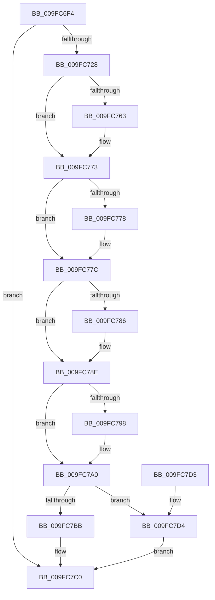

# PspStorageGetObject

- RVA: `0x009FC6F4`–`0x009FC7DB` (길이 `231` bytes)
- VA: `0x00000001409FC6F4`
- 실행 섹션: `PAGE`
- PDB 이름 있음: `예`; PDB Function 태그: `아니요`
- unwind 정보 RVA: `0x000A719C`
- 디코드: `67`개 명령, `231/231` bytes 표시
- 미해석 바이트: `0` (있으면 어셈블리에 `.byte`로 보존)

> 이 문서는 커널 이미지의 기계어와 PDB 기호를 분석해 생성했습니다. 4번과 5번은 함수 원형과 자료형을 바이너리 사용 방식에서 추정한 C 해석이며 원본 소스 복구 결과는 아닙니다.

## 1. Dependencies

- 직접 호출 지점: **7**; 고유 호출 대상: **7**
- 직접 호출자로 확인된 함수: **2**
- RIP 상대 이미지 참조: **0**

### Outgoing calls
- `0x009FC71B` → [PspGetStorageArrayIfPossible](../../text/42/PspGetStorageArrayIfPossible_function_00420E40.md) (function, `0x00420E40`)
- `0x009FC74E` → [KeAbPreAcquire](../../text/21/KeAbPreAcquire_function_00210230.md) (function, `0x00210230`)
- `0x009FC76E` → [ExfAcquirePushLockSharedEx](../../text/21/ExfAcquirePushLockSharedEx_function_0021044C.md) (function, `0x0021044C`)
- `0x009FC789` → [ObfReferenceObject](../../text/20/ObfReferenceObject_function_0020FA20.md) (function, `0x0020FA20`)
- `0x009FC79B` → [ExfReleasePushLockShared](../../text/26/ExfReleasePushLockShared_function_00263440.md) (function, `0x00263440`)
- `0x009FC7A3` → [KeAbPostRelease](../../text/2E/KeAbPostRelease_function_002E1600.md) (function, `0x002E1600`)
- `0x009FC7B1` → [KeLeaveCriticalRegionThread](../../text/25/KeLeaveCriticalRegionThread_function_0025EFF0.md) (function, `0x0025EFF0`)

### Direct callers
- [PsGetSiloContext](../../text/47/PsGetSiloContext_function_00471240.md) at `0x00471254`
- [PsFreeSiloContextSlot](../77/PsFreeSiloContextSlot_function_0077F360.md) at `0x0077F396`

### Static image references
- 디코드된 RIP-relative 메모리 참조가 없습니다.

## 2. Other-region calls and transfers

- 다른 실행 섹션으로 향하는 call: **7**
  - `0x009FC71B` → [PspGetStorageArrayIfPossible](../../text/42/PspGetStorageArrayIfPossible_function_00420E40.md) (`PAGE` → `.text`)
  - `0x009FC74E` → [KeAbPreAcquire](../../text/21/KeAbPreAcquire_function_00210230.md) (`PAGE` → `.text`)
  - `0x009FC76E` → [ExfAcquirePushLockSharedEx](../../text/21/ExfAcquirePushLockSharedEx_function_0021044C.md) (`PAGE` → `.text`)
  - `0x009FC789` → [ObfReferenceObject](../../text/20/ObfReferenceObject_function_0020FA20.md) (`PAGE` → `.text`)
  - `0x009FC79B` → [ExfReleasePushLockShared](../../text/26/ExfReleasePushLockShared_function_00263440.md) (`PAGE` → `.text`)
  - `0x009FC7A3` → [KeAbPostRelease](../../text/2E/KeAbPostRelease_function_002E1600.md) (`PAGE` → `.text`)
  - `0x009FC7B1` → [KeLeaveCriticalRegionThread](../../text/25/KeLeaveCriticalRegionThread_function_0025EFF0.md) (`PAGE` → `.text`)
- 별도 외부 분기/꼬리 이동을 확인하지 못했습니다.

## 3. Assembly (complete function range)

```asm
009FC6F4  48 8B C4                        mov rax, rsp
009FC6F7  48 89 58 08                     mov qword ptr [rax + 8], rbx
009FC6FB  48 89 68 10                     mov qword ptr [rax + 0x10], rbp
009FC6FF  56                              push rsi
009FC700  57                              push rdi
009FC701  41 56                           push r14
009FC703  48 83 EC 30                     sub rsp, 0x30
009FC707  33 ED                           xor ebp, ebp
009FC709  4C 8D 48 D8                     lea r9, [rax - 0x28]
009FC70D  49 8B F0                        mov rsi, r8
009FC710  89 68 20                        mov dword ptr [rax + 0x20], ebp
009FC713  4C 8D 40 20                     lea r8, [rax + 0x20]
009FC717  48 89 68 D8                     mov qword ptr [rax - 0x28], rbp
009FC71B  E8 20 47 A2 FF                  call 0x140420e40
009FC720  85 C0                           test eax, eax
009FC722  0F 88 98 00 00 00               js 0x1409fc7c0
009FC728  65 48 8B 04 25 88 01 00 00      mov rax, qword ptr gs:[0x188]
009FC731  45 33 C0                        xor r8d, r8d
009FC734  8B 5C 24 68                     mov ebx, dword ptr [rsp + 0x68]
009FC738  33 D2                           xor edx, edx
009FC73A  48 C1 E3 04                     shl rbx, 4
009FC73E  48 03 5C 24 20                  add rbx, qword ptr [rsp + 0x20]
009FC743  66 FF 88 E4 01 00 00            dec word ptr [rax + 0x1e4]
009FC74A  48 8B CB                        mov rcx, rbx
009FC74D  90                              nop
009FC74E  E8 DD 3A 81 FF                  call 0x140210230
009FC753  48 8B F8                        mov rdi, rax
009FC756  44 8D 75 11                     lea r14d, [rbp + 0x11]
009FC75A  33 C0                           xor eax, eax
009FC75C  F0 4C 0F B1 33                  lock cmpxchg qword ptr [rbx], r14
009FC761  74 10                           je 0x1409fc773
009FC763  4C 8B CB                        mov r9, rbx
009FC766  4C 8B C7                        mov r8, rdi
009FC769  33 D2                           xor edx, edx
009FC76B  48 8B CB                        mov rcx, rbx
009FC76E  E8 D9 3C 81 FF                  call 0x14021044c
009FC773  48 85 FF                        test rdi, rdi
009FC776  74 04                           je 0x1409fc77c
009FC778  C6 47 0A 01                     mov byte ptr [rdi + 0xa], 1
009FC77C  48 8B 7B 08                     mov rdi, qword ptr [rbx + 8]
009FC780  48 83 E7 FE                     and rdi, 0xfffffffffffffffe
009FC784  74 08                           je 0x1409fc78e
009FC786  48 8B CF                        mov rcx, rdi
009FC789  E8 92 32 81 FF                  call 0x14020fa20
009FC78E  49 8B C6                        mov rax, r14
009FC791  F0 48 0F B1 2B                  lock cmpxchg qword ptr [rbx], rbp
009FC796  74 08                           je 0x1409fc7a0
009FC798  48 8B CB                        mov rcx, rbx
009FC79B  E8 A0 6C 86 FF                  call 0x140263440
009FC7A0  48 8B CB                        mov rcx, rbx
009FC7A3  E8 58 4E 8E FF                  call 0x1402e1600
009FC7A8  65 48 8B 0C 25 88 01 00 00      mov rcx, qword ptr gs:[0x188]
009FC7B1  E8 3A 28 86 FF                  call 0x14025eff0
009FC7B6  48 85 FF                        test rdi, rdi
009FC7B9  74 19                           je 0x1409fc7d4
009FC7BB  48 89 3E                        mov qword ptr [rsi], rdi
009FC7BE  33 C0                           xor eax, eax
009FC7C0  48 8B 5C 24 50                  mov rbx, qword ptr [rsp + 0x50]
009FC7C5  48 8B 6C 24 58                  mov rbp, qword ptr [rsp + 0x58]
009FC7CA  48 83 C4 30                     add rsp, 0x30
009FC7CE  41 5E                           pop r14
009FC7D0  5F                              pop rdi
009FC7D1  5E                              pop rsi
009FC7D2  C3                              ret
009FC7D3  CC                              int3
009FC7D4  B8 25 02 00 C0                  mov eax, 0xc0000225
009FC7D9  EB E5                           jmp 0x1409fc7c0
```

## 4. C-style interpretation (structured pseudocode)

```c
__int64 __fastcall PspStorageGetObject(__int64 a1, int a2, __int64 a3)
{
    __int64 result;
    __int64 v_rbp;
    __int64 v_rbx;
    __int64 v_rdi;
    __int64 v_rsp;
    unsigned __int64 v_stack_m28;
    unsigned __int64 v_stack_p10;
    unsigned int v_stack_p20;
    unsigned __int64 v_stack_p8;

    *(unsigned __int64 *)(v_rsp + 8) = v_rbx;
    *(unsigned __int64 *)(v_rsp + 16) = v_rbp;
    v_rsp = (v_rsp) - (48);
    v_rbp = 0;
    *(unsigned int *)(v_rsp + 32) = 0;
    *(unsigned __int64 *)(v_rsp - 40) = 0;
    result = PspGetStorageArrayIfPossible(a1, a2, v_rsp + 32, v_rsp - 40);
    if (sign_flag) goto loc_009FC7C0;
    a3 = 0;
    a2 = 0;
    v_rbx = ((unsigned int)(v_stack_p20)) << (4);
    v_rbx = (v_rbx) + (v_stack_m28);
    result = KeAbPreAcquire(v_rbx, a2, a3, v_rsp - 40);
    result = 0;
    if (!(condition_is_equal)) {
        a4 = v_rbx;
        a3 = 0;
        a2 = 0;
        a1 = v_rbx;
        result = ExfAcquirePushLockSharedEx(a1, a2, a3, a4);
    }
    if (result != 0) {
        *(unsigned __int8 *)(result + 10) = 1;
    }
    v_rdi = (*(unsigned __int64 *)(v_rbx + 8)) & (-2);
    if (!(condition_is_equal)) {
        a1 = v_rdi;
        result = ObfReferenceObject(a1, a2, a3, a4);
    }
    result = v_rbp + 17;
    if (!(condition_is_equal)) {
        a1 = v_rbx;
        result = ExfReleasePushLockShared(a1, a2, a3, a4);
    }
    result = KeAbPostRelease(v_rbx, a2, a3, a4);
    result = KeLeaveCriticalRegionThread(*(unsigned __int64 *)(gs_base + (0 + 392)), a2, a3, a4);
    if (v_rdi == 0) goto loc_009FC7D4;
    *(unsigned __int64 *)(a3) = v_rdi;
    result = 0;
loc_009FC7C0:
    v_rsp = (v_rsp) + (48);
    return result;
loc_009FC7D4:
    goto loc_009FC7C0;
}
```

## 5. (Beta) C Style

```c
int64_t PspStorageGetObject(int64_t Arg1, int32_t Arg2, void *Arg3)
{
    uint8_t *arg3 = (uint8_t *)Arg3;

    int64_t result;
    int64_t local_rbp;
    int64_t local_rbx;
    int64_t local_rdi;
    int64_t local_rsp;
    uint64_t v_stack_m28;
    uint64_t v_stack_p10;
    uint32_t v_stack_p20;
    uint64_t v_stack_p8;

    *(uint64_t *)(local_rsp + 0x8) = local_rbx;
    *(uint64_t *)(local_rsp + 0x10) = local_rbp;
    local_rsp = (local_rsp) - (48);
    local_rbp = 0;
    *(uint32_t *)(local_rsp + 0x20) = 0;
    *(uint64_t *)(local_rsp - 0x28) = 0;
    result = PspGetStorageArrayIfPossible(Arg1, Arg2, local_rsp + 32, local_rsp - 40);
    if (sign_flag) goto loc_009FC7C0;
    Arg3 = 0;
    Arg2 = 0;
    local_rbx = ((uint32_t)(v_stack_p20)) << (4);
    local_rbx = (local_rbx) + (v_stack_m28);
    result = KeAbPreAcquire(local_rbx, Arg2, Arg3, local_rsp - 40);
    result = 0;
    if (!(condition_is_equal)) {
        a4 = local_rbx;
        Arg3 = 0;
        Arg2 = 0;
        Arg1 = local_rbx;
        result = ExfAcquirePushLockSharedEx(Arg1, Arg2, Arg3, a4);
    }
    if (result != 0) {
        *(uint8_t *)(result + 0xA) = 1;
    }
    local_rdi = (*(uint64_t *)(local_rbx + 0x8)) & (-2);
    if (!(condition_is_equal)) {
        Arg1 = local_rdi;
        result = ObfReferenceObject(Arg1, Arg2, Arg3, a4);
    }
    result = local_rbp + 17;
    if (!(condition_is_equal)) {
        Arg1 = local_rbx;
        result = ExfReleasePushLockShared(Arg1, Arg2, Arg3, a4);
    }
    result = KeAbPostRelease(local_rbx, Arg2, Arg3, a4);
    result = KeLeaveCriticalRegionThread(*(uint64_t *)(gs_base + (0 + 0x188)), Arg2, Arg3, a4);
    if (local_rdi == 0) goto loc_009FC7D4;
    *(uint64_t *)(arg3) = local_rdi;
    result = 0;
loc_009FC7C0:
    local_rsp = (local_rsp) + (48);
    return result;
loc_009FC7D4:
    goto loc_009FC7C0;
}
```

### 관측된 메모리 오프셋

구조체 형식이 확인되지 않은 접근은 인자 기준의 오프셋으로만 기록했습니다.

| 기준 인자 | 오프셋 표현 | 폭 (bit) | 접근 |
|---|---:|---:|---|
| `Arg3` | `+ 0x0` | `64` | `W` |

## 6. Execution-region graph

[열기: 2D/3D 그래프와 함수 탐색 컨트롤 패널](../../../control-panel.html?section=page&rva=0x009FC6F4&view=graph)

- 2D 그래프는 위에서 아래로 흐르고, 3D 그래프는 빈 공간을 드래그해 회전합니다. Shift+드래그는 이동, 휠은 확대·축소, 함수 노드 선택은 대상 보고서 이동입니다.

### Static fallback


