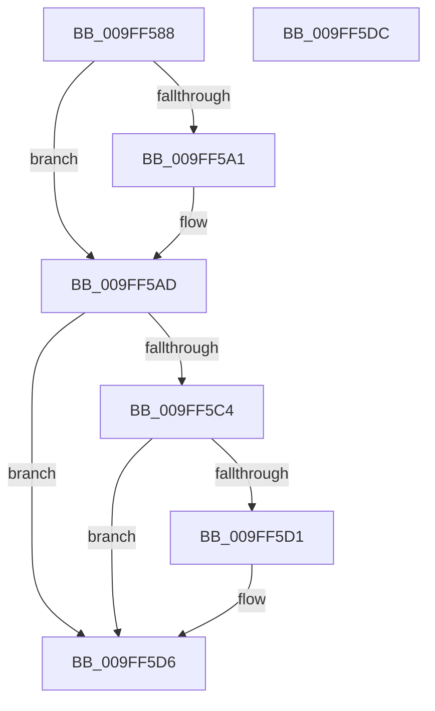

# PspUnlockJobListShared

- RVA: `0x009FF588`–`0x009FF5DD` (길이 `85` bytes)
- VA: `0x00000001409FF588`
- 실행 섹션: `PAGE`
- PDB 이름 있음: `예`; PDB Function 태그: `아니요`
- unwind 정보 RVA: `0x0005CF00`
- 디코드: `23`개 명령, `85/85` bytes 표시
- 미해석 바이트: `0` (있으면 어셈블리에 `.byte`로 보존)

> 이 문서는 커널 이미지의 기계어와 PDB 기호를 분석해 생성했습니다. 4번과 5번은 함수 원형과 자료형을 바이너리 사용 방식에서 추정한 C 해석이며 원본 소스 복구 결과는 아닙니다.

## 1. Dependencies

- 직접 호출 지점: **3**; 고유 호출 대상: **3**
- 직접 호출자로 확인된 함수: **1**
- RIP 상대 이미지 참조: **1**

### Outgoing calls
- `0x009FF5A8` → [ExfReleasePushLockShared](../../text/26/ExfReleasePushLockShared_function_00263440.md) (function, `0x00263440`)
- `0x009FF5B4` → [KeAbPostRelease](../../text/2E/KeAbPostRelease_function_002E1600.md) (function, `0x002E1600`)
- `0x009FF5D1` → [KiCheckForKernelApcDelivery](../../text/2E/KiCheckForKernelApcDelivery_function_002E2C80.md) (function, `0x002E2C80`)

### Direct callers
- [sub_00B316B4](../B3/Unknown_function_00B316B4.md) at `0x00B3190E`

### Static image references
- `0x009FF596` → RVA `0x00FD9DA8` (`PAGEDATA`; read)

## 2. Other-region calls and transfers

- 다른 실행 섹션으로 향하는 call: **3**
  - `0x009FF5A8` → [ExfReleasePushLockShared](../../text/26/ExfReleasePushLockShared_function_00263440.md) (`PAGE` → `.text`)
  - `0x009FF5B4` → [KeAbPostRelease](../../text/2E/KeAbPostRelease_function_002E1600.md) (`PAGE` → `.text`)
  - `0x009FF5D1` → [KiCheckForKernelApcDelivery](../../text/2E/KiCheckForKernelApcDelivery_function_002E2C80.md) (`PAGE` → `.text`)
- 별도 외부 분기/꼬리 이동을 확인하지 못했습니다.

## 3. Assembly (complete function range)

```asm
009FF588  40 53                           push rbx
009FF58A  48 83 EC 20                     sub rsp, 0x20
009FF58E  33 D2                           xor edx, edx
009FF590  48 8B D9                        mov rbx, rcx
009FF593  8D 42 11                        lea eax, [rdx + 0x11]
009FF596  F0 48 0F B1 15 09 A8 5D 00      lock cmpxchg qword ptr [rip + 0x5da809], rdx
009FF59F  74 0C                           je 0x1409ff5ad
009FF5A1  48 8D 0D 00 A8 5D 00            lea rcx, [rip + 0x5da800]
009FF5A8  E8 93 3E 86 FF                  call 0x140263440
009FF5AD  48 8D 0D F4 A7 5D 00            lea rcx, [rip + 0x5da7f4]
009FF5B4  E8 47 20 8E FF                  call 0x1402e1600
009FF5B9  90                              nop
009FF5BA  66 83 83 E6 01 00 00 01         add word ptr [rbx + 0x1e6], 1
009FF5C2  75 12                           jne 0x1409ff5d6
009FF5C4  48 8D 83 98 00 00 00            lea rax, [rbx + 0x98]
009FF5CB  90                              nop
009FF5CC  48 39 00                        cmp qword ptr [rax], rax
009FF5CF  74 05                           je 0x1409ff5d6
009FF5D1  E8 AA 36 8E FF                  call 0x1402e2c80
009FF5D6  48 83 C4 20                     add rsp, 0x20
009FF5DA  5B                              pop rbx
009FF5DB  C3                              ret
009FF5DC  CC                              int3
```

## 4. C-style interpretation (structured pseudocode)

```c
__int64 __fastcall PspUnlockJobListShared(__int64 a1, int a2)
{
    __int64 result;
    __int64 v_rsp;

    v_rsp = (v_rsp) - (32);
    a2 = 0;
    result = a2 + 17;
    if (!(condition_is_equal)) {
        a1 = v_rip + 6137856;
        result = ExfReleasePushLockShared(a1, a2, a3, a4);
    }
    result = KeAbPostRelease(v_rip + 6137844, a2, a3, a4);
    if (condition_is_not_equal) goto loc_009FF5D6;
    result = a1 + 152;
    if ((*(unsigned __int64 *)(a1 + 152)) != (a1 + 152)) {
        result = KiCheckForKernelApcDelivery(v_rip + 6137844, a2, a3, a4);
    }
    v_rsp = (v_rsp) + (32);
    return result;
}
```

## 5. (Beta) C Style

```c
int64_t PspUnlockJobListShared(void *Arg1, int32_t Arg2)
{
    uint8_t *arg1 = (uint8_t *)Arg1;

    int64_t result;
    int64_t local_rsp;

    local_rsp = (local_rsp) - (32);
    Arg2 = 0;
    result = Arg2 + 17;
    if (!(condition_is_equal)) {
        Arg1 = v_rip + 6137856;
        result = ExfReleasePushLockShared(Arg1, Arg2, a3, a4);
    }
    result = KeAbPostRelease(v_rip + 6137844, Arg2, a3, a4);
    if (condition_is_not_equal) goto loc_009FF5D6;
    result = Arg1 + 152;
    if ((*(uint64_t *)(arg1 + 0x98)) != (Arg1 + 152)) {
        result = KiCheckForKernelApcDelivery(v_rip + 6137844, Arg2, a3, a4);
    }
    local_rsp = (local_rsp) + (32);
    return result;
}
```

### 관측된 메모리 오프셋

구조체 형식이 확인되지 않은 접근은 인자 기준의 오프셋으로만 기록했습니다.

| 기준 인자 | 오프셋 표현 | 폭 (bit) | 접근 |
|---|---:|---:|---|
| `Arg1` | `+ 0x0` | `64` | `R` |
| `Arg1` | `+ 0x98` | `64` | `R` |
| `Arg1` | `+ 0x1E6` | `16` | `R/W` |

## 6. Execution-region graph

[열기: 2D/3D 그래프와 함수 탐색 컨트롤 패널](../../../control-panel.html?section=page&rva=0x009FF588&view=graph)

- 2D 그래프는 위에서 아래로 흐르고, 3D 그래프는 빈 공간을 드래그해 회전합니다. Shift+드래그는 이동, 휠은 확대·축소, 함수 노드 선택은 대상 보고서 이동입니다.

### Static fallback


