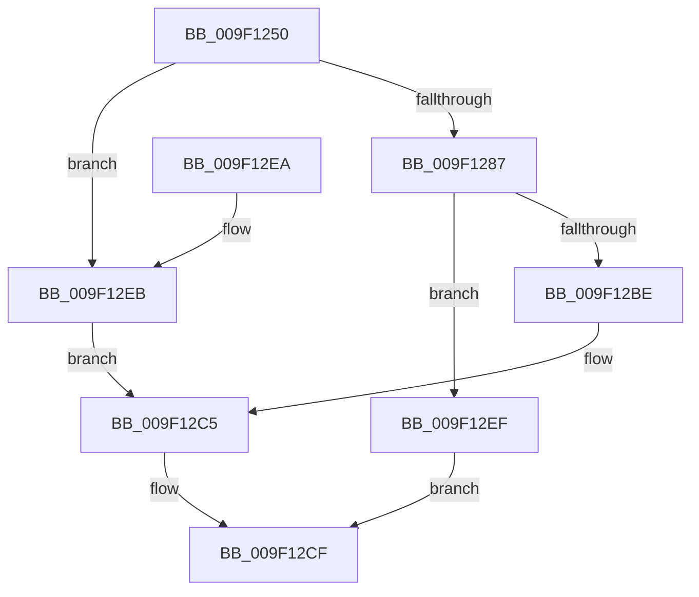

# PspWow64SetupUserStack

- RVA: `0x009F1250`–`0x009F12F8` (길이 `168` bytes)
- VA: `0x00000001409F1250`
- 실행 섹션: `PAGE`
- PDB 이름 있음: `예`; PDB Function 태그: `아니요`
- unwind 정보 RVA: `0x000A5DF0`
- 디코드: `48`개 명령, `168/168` bytes 표시
- 미해석 바이트: `0` (있으면 어셈블리에 `.byte`로 보존)

> 이 문서는 커널 이미지의 기계어와 PDB 기호를 분석해 생성했습니다. 4번과 5번은 함수 원형과 자료형을 바이너리 사용 방식에서 추정한 C 해석이며 원본 소스 복구 결과는 아닙니다.

## 1. Dependencies

- 직접 호출 지점: **5**; 고유 호출 대상: **4**
- 직접 호출자로 확인된 함수: **1**
- RIP 상대 이미지 참조: **1**

### Outgoing calls
- `0x009F128E` → [KiStackAttachProcess](../../text/21/KiStackAttachProcess_function_00216820.md) (function, `0x00216820`)
- `0x009F12AC` → [RtlpWow64CreateUserStack](RtlpWow64CreateUserStack_function_009F1300.md) (function, `0x009F1300`)
- `0x009F12BE` → [KiUnstackDetachProcess](../../text/21/KiUnstackDetachProcess_function_00217D30.md) (function, `0x00217D30`)
- `0x009F12D7` → [_security_check_cookie](../../text/6A/_security_check_cookie_function_006AC640.md) (function, `0x006AC640`)
- `0x009F12EF` → [KiUnstackDetachProcess](../../text/21/KiUnstackDetachProcess_function_00217D30.md) (function, `0x00217D30`)

### Direct callers
- [PspAllocateThread](../9E/PspAllocateThread_function_009EF72C.md) at `0x009F0112`

### Static image references
- `0x009F125A` → RVA `0x00E0A740` (`.data`; read)

## 2. Other-region calls and transfers

- 다른 실행 섹션으로 향하는 call: **4**
  - `0x009F128E` → [KiStackAttachProcess](../../text/21/KiStackAttachProcess_function_00216820.md) (`PAGE` → `.text`)
  - `0x009F12BE` → [KiUnstackDetachProcess](../../text/21/KiUnstackDetachProcess_function_00217D30.md) (`PAGE` → `.text`)
  - `0x009F12D7` → [_security_check_cookie](../../text/6A/_security_check_cookie_function_006AC640.md) (`PAGE` → `.text`)
  - `0x009F12EF` → [KiUnstackDetachProcess](../../text/21/KiUnstackDetachProcess_function_00217D30.md) (`PAGE` → `.text`)
- 별도 외부 분기/꼬리 이동을 확인하지 못했습니다.

## 3. Assembly (complete function range)

```asm
009F1250  48 89 5C 24 10                  mov qword ptr [rsp + 0x10], rbx
009F1255  57                              push rdi
009F1256  48 83 EC 70                     sub rsp, 0x70
009F125A  48 8B 05 DF 94 41 00            mov rax, qword ptr [rip + 0x4194df]
009F1261  48 33 C4                        xor rax, rsp
009F1264  48 89 44 24 60                  mov qword ptr [rsp + 0x60], rax
009F1269  41 F6 01 01                     test byte ptr [r9], 1
009F126D  0F 57 C0                        xorps xmm0, xmm0
009F1270  0F 11 44 24 30                  movups xmmword ptr [rsp + 0x30], xmm0
009F1275  49 8B D9                        mov rbx, r9
009F1278  49 8B F8                        mov rdi, r8
009F127B  0F 11 44 24 40                  movups xmmword ptr [rsp + 0x40], xmm0
009F1280  0F 11 44 24 50                  movups xmmword ptr [rsp + 0x50], xmm0
009F1285  75 64                           jne 0x1409f12eb
009F1287  4C 8D 44 24 30                  lea r8, [rsp + 0x30]
009F128C  33 D2                           xor edx, edx
009F128E  E8 8D 55 82 FF                  call 0x140216820
009F1293  44 8B 8C 24 A0 00 00 00         mov r9d, dword ptr [rsp + 0xa0]
009F129B  4C 8B 43 08                     mov r8, qword ptr [rbx + 8]
009F129F  48 8B 53 18                     mov rdx, qword ptr [rbx + 0x18]
009F12A3  48 8B 4B 10                     mov rcx, qword ptr [rbx + 0x10]
009F12A7  48 89 7C 24 20                  mov qword ptr [rsp + 0x20], rdi
009F12AC  E8 4F 00 00 00                  call 0x1409f1300
009F12B1  8B F8                           mov edi, eax
009F12B3  33 D2                           xor edx, edx
009F12B5  48 8D 4C 24 30                  lea rcx, [rsp + 0x30]
009F12BA  85 C0                           test eax, eax
009F12BC  78 31                           js 0x1409f12ef
009F12BE  E8 6D 6A 82 FF                  call 0x140217d30
009F12C3  B1 04                           mov cl, 4
009F12C5  8A 03                           mov al, byte ptr [rbx]
009F12C7  24 FB                           and al, 0xfb
009F12C9  0A C1                           or al, cl
009F12CB  88 03                           mov byte ptr [rbx], al
009F12CD  33 C0                           xor eax, eax
009F12CF  48 8B 4C 24 60                  mov rcx, qword ptr [rsp + 0x60]
009F12D4  48 33 CC                        xor rcx, rsp
009F12D7  E8 64 B3 CB FF                  call 0x1406ac640
009F12DC  48 8B 9C 24 88 00 00 00         mov rbx, qword ptr [rsp + 0x88]
009F12E4  48 83 C4 70                     add rsp, 0x70
009F12E8  5F                              pop rdi
009F12E9  C3                              ret
009F12EA  CC                              int3
009F12EB  33 C9                           xor ecx, ecx
009F12ED  EB D6                           jmp 0x1409f12c5
009F12EF  E8 3C 6A 82 FF                  call 0x140217d30
009F12F4  8B C7                           mov eax, edi
009F12F6  EB D7                           jmp 0x1409f12cf
```

## 4. C-style interpretation (structured pseudocode)

```c
__int64 __fastcall PspWow64SetupUserStack(__int64 a1, int a2, __int64 a3, __int64 a4, unsigned int a5)
{
    __int64 result;
    __int64 v_rsp;
    unsigned __int64 v_stack_m18;
    unsigned __int64 v_stack_m28;
    unsigned __int64 v_stack_m38;
    unsigned __int64 v_stack_m48;
    unsigned __int64 v_stack_m58;
    unsigned __int64 v_stack_p10;

    v_stack_p10 = v_rbx;
    v_rsp = (v_rsp) - (112);
    result = (*(unsigned __int64 *)(v_rip + 4297951)) ^ (v_rsp);
    v_stack_m18 = result;
    v_stack_m48 = v_xmm0;
    v_stack_m38 = v_xmm0;
    v_stack_m28 = v_xmm0;
    if (((*(unsigned __int8 *)(a4)) & (1)) != 0) goto loc_009F12EB;
    a2 = 0;
    result = KiStackAttachProcess(a1, a2, v_stack_m48, a4);
    v_stack_m58 = a3;
    result = RtlpWow64CreateUserStack(*(unsigned __int64 *)(a4 + 16), *(unsigned __int64 *)(a4 + 24), *(unsigned __int64 *)(a4 + 8), (unsigned int)(a5));
    a2 = 0;
    if (sign_flag) goto loc_009F12EF;
    result = KiUnstackDetachProcess(v_stack_m48, a2, *(unsigned __int64 *)(a4 + 8), (unsigned int)(a5));
loc_009F12C5:
    result = (unsigned __int8)((*(unsigned __int8 *)(a4)) & (251));
    result = (unsigned __int8)((result) | (4));
    *(unsigned __int8 *)(a4) = (unsigned __int8)(result);
    result = 0;
loc_009F12CF:
    a1 = (v_stack_m18) ^ (v_rsp);
    result = _security_check_cookie(a1, a2, *(unsigned __int64 *)(a4 + 8), (unsigned int)(a5));
    v_rsp = (v_rsp) + (112);
    return result;
loc_009F12EB:
    a1 = 0;
    goto loc_009F12C5;
loc_009F12EF:
    result = KiUnstackDetachProcess(a1, a2, *(unsigned __int64 *)(a4 + 8), (unsigned int)(a5));
    goto loc_009F12CF;
}
```

## 5. (Beta) C Style

```c
int64_t PspWow64SetupUserStack(int64_t Arg1, int32_t Arg2, int64_t Arg3, void *Arg4, uint32_t Arg5)
{
    uint8_t *arg4 = (uint8_t *)Arg4;

    int64_t result;
    int64_t local_rsp;
    uint64_t v_stack_m18;
    uint64_t v_stack_m28;
    uint64_t v_stack_m38;
    uint64_t v_stack_m48;
    uint64_t v_stack_m58;
    uint64_t v_stack_p10;

    v_stack_p10 = local_rbx;
    local_rsp = (local_rsp) - (112);
    result = (*(uint64_t *)(v_rip + 0x4194DF)) ^ (local_rsp);
    v_stack_m18 = result;
    v_stack_m48 = v_xmm0;
    v_stack_m38 = v_xmm0;
    v_stack_m28 = v_xmm0;
    if (((*(uint8_t *)(arg4)) & (1)) != 0) goto loc_009F12EB;
    Arg2 = 0;
    result = KiStackAttachProcess(Arg1, Arg2, v_stack_m48, Arg4);
    v_stack_m58 = Arg3;
    result = RtlpWow64CreateUserStack(*(uint64_t *)(arg4 + 0x10), *(uint64_t *)(arg4 + 0x18), *(uint64_t *)(arg4 + 0x8), (uint32_t)(Arg5));
    Arg2 = 0;
    if (sign_flag) goto loc_009F12EF;
    result = KiUnstackDetachProcess(v_stack_m48, Arg2, *(uint64_t *)(arg4 + 0x8), (uint32_t)(Arg5));
loc_009F12C5:
    result = (uint8_t)((*(uint8_t *)(arg4)) & (251));
    result = (uint8_t)((result) | (4));
    *(uint8_t *)(arg4) = (uint8_t)(result);
    result = 0;
loc_009F12CF:
    Arg1 = (v_stack_m18) ^ (local_rsp);
    result = _security_check_cookie(Arg1, Arg2, *(uint64_t *)(arg4 + 0x8), (uint32_t)(Arg5));
    local_rsp = (local_rsp) + (112);
    return result;
loc_009F12EB:
    Arg1 = 0;
    goto loc_009F12C5;
loc_009F12EF:
    result = KiUnstackDetachProcess(Arg1, Arg2, *(uint64_t *)(arg4 + 0x8), (uint32_t)(Arg5));
    goto loc_009F12CF;
}
```

### 관측된 메모리 오프셋

구조체 형식이 확인되지 않은 접근은 인자 기준의 오프셋으로만 기록했습니다.

| 기준 인자 | 오프셋 표현 | 폭 (bit) | 접근 |
|---|---:|---:|---|
| `Arg4` | `+ 0x0` | `8` | `R` |
| `Arg4` | `+ 0x0` | `8` | `W` |
| `Arg4` | `+ 0x8` | `64` | `R` |
| `Arg4` | `+ 0x10` | `64` | `R` |
| `Arg4` | `+ 0x18` | `64` | `R` |

## 6. Execution-region graph

[열기: 2D/3D 그래프와 함수 탐색 컨트롤 패널](../../../control-panel.html?section=page&rva=0x009F1250&view=graph)

- 2D 그래프는 위에서 아래로 흐르고, 3D 그래프는 빈 공간을 드래그해 회전합니다. Shift+드래그는 이동, 휠은 확대·축소, 함수 노드 선택은 대상 보고서 이동입니다.

### Static fallback


