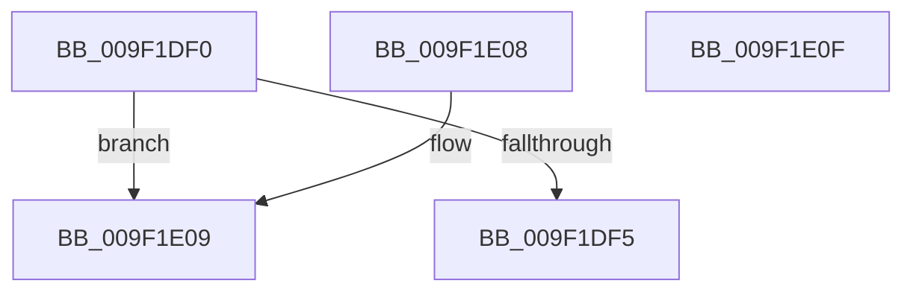

# RtlCreateSecurityDescriptor

- RVA: `0x009F1DF0`–`0x009F1E10` (길이 `32` bytes)
- VA: `0x00000001409F1DF0`
- 실행 섹션: `PAGE`
- PDB 이름 있음: `예`; PDB Function 태그: `아니요`
- unwind 정보 RVA: `0x000DB714`
- 디코드: `13`개 명령, `32/32` bytes 표시
- 미해석 바이트: `0` (있으면 어셈블리에 `.byte`로 보존)

> 이 문서는 커널 이미지의 기계어와 PDB 기호를 분석해 생성했습니다. 4번과 5번은 함수 원형과 자료형을 바이너리 사용 방식에서 추정한 C 해석이며 원본 소스 복구 결과는 아닙니다.

## 1. Dependencies

- 직접 호출 지점: **0**; 고유 호출 대상: **0**
- 직접 호출자로 확인된 함수: **58**
- RIP 상대 이미지 참조: **0**

### Outgoing calls
- 직접 디코드된 call 명령이 없습니다.

### Direct callers
- [RtlCheckTokenCapability](../../text/3A/RtlCheckTokenCapability_function_003A5520.md) at `0x003A5689`
- [RtlCheckTokenMembershipEx](../../text/3A/RtlCheckTokenMembershipEx_function_003A5A30.md) at `0x003A5AFB`
- [sub_00400840](../../text/40/Unknown_function_00400840.md) at `0x004008F5`
- [AdtpBuildAccessReasonAuditStringInternal](../../text/40/AdtpBuildAccessReasonAuditStringInternal_function_0040F344.md) at `0x0040F6FB`
- [SepMandatorySubProcessToken](../../text/4C/SepMandatorySubProcessToken_function_004C0B88.md) at `0x004C0C21`
- [SepMandatorySubProcessToken](../../text/4C/SepMandatorySubProcessToken_function_004C0B88.md) at `0x004C0C89`
- [SepBuildCapeSecurityDescriptor](../../text/4D/SepBuildCapeSecurityDescriptor_function_004D9E38.md) at `0x004D9E58`
- [SepInitProcessAuditSd](../../text/60/SepInitProcessAuditSd_function_00606230.md) at `0x00606326`
- [SepInitProcessAuditSd](../../text/60/SepInitProcessAuditSd_function_00606230.md) at `0x00606443`
- [SeAdjustAntiTamperCreatorAccess](../../text/60/SeAdjustAntiTamperCreatorAccess_function_00607590.md) at `0x00607612`
- [SepVerifyDesktopAppxImage](../../text/60/SepVerifyDesktopAppxImage_function_0060885C.md) at `0x0060894C`
- [SepVerifyDesktopAppxImage](../../text/60/SepVerifyDesktopAppxImage_function_0060885C.md) at `0x006089B2`
- [WdipAccessCheck](../../text/64/WdipAccessCheck_function_0064E084.md) at `0x0064E1B6`
- [ExpPlRunOnceInit](../../text/65/ExpPlRunOnceInit_function_006571E0.md) at `0x00657229`
- [DbgkpCreateNotificationEvent](../71/DbgkpCreateNotificationEvent_function_00710480.md) at `0x0071050C`
- [PiAuCheckTokenMembership](../73/PiAuCheckTokenMembership_function_00731348.md) at `0x007313DE`
- [PiAuGetServiceStateSecurityObject](../73/PiAuGetServiceStateSecurityObject_function_007314F0.md) at `0x00731640`
- [PiAuGetStateDirectorySecurityObject](../73/PiAuGetStateDirectorySecurityObject_function_00731738.md) at `0x00731920`
- [ObCreateKernelObjectsSD](../74/ObCreateKernelObjectsSD_function_0074D7A8.md) at `0x0074D7BF`
- [ObpGetDosDevicesProtection](../74/ObpGetDosDevicesProtection_function_0074E2BC.md) at `0x0074E2DD`
- [PfpCreateEventInternal](../75/PfpCreateEventInternal_function_00753480.md) at `0x007534DD`
- [PopCreateHiberFileSecurityDescriptor](../75/PopCreateHiberFileSecurityDescriptor_function_0075D3DC.md) at `0x0075D504`
- [PspSessionObjectCreate](../78/PspSessionObjectCreate_function_007892A8.md) at `0x0078930D`
- [RtlpSysVolCreateSecurityDescriptor](../79/RtlpSysVolCreateSecurityDescriptor_function_00791654.md) at `0x007916AB`
- [RtlpSysVolTakeOwnership](../79/RtlpSysVolTakeOwnership_function_007917C8.md) at `0x007918FB`
- [SepInitializationPhase1](../79/SepInitializationPhase1_function_0079C580.md) at `0x0079C64F`
- [SmKmStoreFileMakeSecurityDescriptor](../7A/SmKmStoreFileMakeSecurityDescriptor_function_007A9988.md) at `0x007A9B92`
- [NtSetUuidSeed](../7D/NtSetUuidSeed_function_007D0DD0.md) at `0x007D0F9D`
- [CMFCreateSecurityDescriptor](../7D/CMFCreateSecurityDescriptor_function_007D2B10.md) at `0x007D2B89`
- [CmpAdminSystemSecurityDescriptor](../7E/CmpAdminSystemSecurityDescriptor_function_007EBED8.md) at `0x007EC0B5`
- [CmpCopySaclToVirtualKey](../7E/CmpCopySaclToVirtualKey_function_007ECA6C.md) at `0x007ECB60`
- [CmpGenerateAppHiveSecurityDescriptor](../7E/CmpGenerateAppHiveSecurityDescriptor_function_007ECEAC.md) at `0x007ECF25`
- [CmpGenerateAppHiveSecurityDescriptor](../7E/CmpGenerateAppHiveSecurityDescriptor_function_007ECEAC.md) at `0x007ECF6A`
- [CmpHiveRootSecurityDescriptor](../7E/CmpHiveRootSecurityDescriptor_function_007ED104.md) at `0x007ED575`
- [MiCreatePagingFile](../7F/MiCreatePagingFile_function_007FEFF4.md) at `0x007FF313`
- [MiCreateMemoryEventSD](../81/MiCreateMemoryEventSD_function_00810F40.md) at `0x00810F61`
- [PnpGetEnumSecurityDescriptor](../83/PnpGetEnumSecurityDescriptor_function_00831FCC.md) at `0x008321FD`
- [DrvDbGetRegistrarSecurityDescriptor](../83/DrvDbGetRegistrarSecurityDescriptor_function_00835728.md) at `0x00835758`
- [DrvDbGetSecurityDescriptor](../83/DrvDbGetSecurityDescriptor_function_0083580C.md) at `0x00835A8F`
- [ObpGetSilosRootDirectory](../83/ObpGetSilosRootDirectory_function_0083CF00.md) at `0x0083CF49`
- [PiDevCfgGetKeySecurityDescriptor](../99/PiDevCfgGetKeySecurityDescriptor_function_00996240.md) at `0x00996504`
- [IopCreateDefaultDeviceSecurityDescriptor](../9A/IopCreateDefaultDeviceSecurityDescriptor_function_009A5008.md) at `0x009A51B3`
- [IopCreateSecurityDescriptorPerType](../AD/IopCreateSecurityDescriptorPerType_function_00ADCC6C.md) at `0x00ADCD05`
- [sub_00B3E006](../B3/Unknown_function_00B3E006.md) at `0x00B3E05C`
- [sub_00B4403A](../B4/Unknown_function_00B4403A.md) at `0x00B44043`
- [ViInitializeLocalSystemDescriptor](../../pagevrfy/B9/ViInitializeLocalSystemDescriptor_function_00B936F8.md) at `0x00B9374E`
- [IopCreateUmdfDirectory](../../init/C2/IopCreateUmdfDirectory_function_00C2C818.md) at `0x00C2C975`
- [IopApplySystemPartitionProt](../../init/C2/IopApplySystemPartitionProt_function_00C2E398.md) at `0x00C2E4B1`
- [PiAuCreateLocalSystemSecurityObject](../../init/C3/PiAuCreateLocalSystemSecurityObject_function_00C34570.md) at `0x00C34617`
- [PiAuCreateStandardSecurityObject](../../init/C3/PiAuCreateStandardSecurityObject_function_00C34710.md) at `0x00C34B53`
- [PiAuGetDriverDataDirectorySecurityObject](../../init/C3/PiAuGetDriverDataDirectorySecurityObject_function_00C34EEC.md) at `0x00C35025`
- [PopUmpoInitializeChannel](../../init/C4/PopUmpoInitializeChannel_function_00C428F0.md) at `0x00C42A08`
- [SshpAlpcInitialize](../../init/C4/SshpAlpcInitialize_function_00C448B4.md) at `0x00C44A33`
- [PspInitializeCpuPartitionsDefaultSd](../../init/C4/PspInitializeCpuPartitionsDefaultSd_function_00C457D4.md) at `0x00C45980`
- [PspInitializeSystemPartitionPhase0](../../init/C4/PspInitializeSystemPartitionPhase0_function_00C46898.md) at `0x00C468E5`
- [SepInitSystemDacls](../../init/C4/SepInitSystemDacls_function_00C478DC.md) at `0x00C48074`
- [SepInitSystemDacls](../../init/C4/SepInitSystemDacls_function_00C478DC.md) at `0x00C480A1`
- [SepInitSystemDacls](../../init/C4/SepInitSystemDacls_function_00C478DC.md) at `0x00C480D7`
- [SepInitSystemDacls](../../init/C4/SepInitSystemDacls_function_00C478DC.md) at `0x00C48104`
- [SepInitSystemDacls](../../init/C4/SepInitSystemDacls_function_00C478DC.md) at `0x00C48131`
- [SepInitSystemDacls](../../init/C4/SepInitSystemDacls_function_00C478DC.md) at `0x00C4815B`
- [SepInitSystemDacls](../../init/C4/SepInitSystemDacls_function_00C478DC.md) at `0x00C4818C`
- [SepInitSystemDacls](../../init/C4/SepInitSystemDacls_function_00C478DC.md) at `0x00C481B9`
- [SepInitSystemDacls](../../init/C4/SepInitSystemDacls_function_00C478DC.md) at `0x00C481E6`
- [SepInitSystemDacls](../../init/C4/SepInitSystemDacls_function_00C478DC.md) at `0x00C48236`
- [SepInitSystemDacls](../../init/C4/SepInitSystemDacls_function_00C478DC.md) at `0x00C4827C`
- [SepInitSystemDacls](../../init/C4/SepInitSystemDacls_function_00C478DC.md) at `0x00C48294`
- [SeMakeAnonymousLogonToken](../../init/C4/SeMakeAnonymousLogonToken_function_00C4A8D8.md) at `0x00C4AA4E`
- [SeMakeAnonymousLogonTokenNoEveryone](../../init/C4/SeMakeAnonymousLogonTokenNoEveryone_function_00C4AB5C.md) at `0x00C4ACAC`
- [SeMakeSystemToken](../../init/C4/SeMakeSystemToken_function_00C4ADBC.md) at `0x00C4B212`
- [WmipInitializeSecurity](../../init/C4/WmipInitializeSecurity_function_00C4D840.md) at `0x00C4D9C5`
- [ExpKeyedEventInitialization](../../init/C5/ExpKeyedEventInitialization_function_00C5460C.md) at `0x00C546EC`
- [ObInitSystem](../../init/C7/ObInitSystem_function_00C71C7C.md) at `0x00C72156`

### Static image references
- 디코드된 RIP-relative 메모리 참조가 없습니다.

## 2. Other-region calls and transfers

- 다른 실행 섹션으로 향하는 call: **0**
- 별도 외부 분기/꼬리 이동을 확인하지 못했습니다.

## 3. Assembly (complete function range)

```asm
009F1DF0  83 FA 01                        cmp edx, 1
009F1DF3  75 14                           jne 0x1409f1e09
009F1DF5  0F 57 C0                        xorps xmm0, xmm0
009F1DF8  33 C0                           xor eax, eax
009F1DFA  0F 11 01                        movups xmmword ptr [rcx], xmm0
009F1DFD  0F 11 41 10                     movups xmmword ptr [rcx + 0x10], xmm0
009F1E01  48 89 41 20                     mov qword ptr [rcx + 0x20], rax
009F1E05  88 11                           mov byte ptr [rcx], dl
009F1E07  C3                              ret
009F1E08  CC                              int3
009F1E09  B8 58 00 00 C0                  mov eax, 0xc0000058
009F1E0E  C3                              ret
009F1E0F  CC                              int3
```

## 4. C-style interpretation (structured pseudocode)

```c
__int64 __fastcall RtlCreateSecurityDescriptor(__int64 a1, int a2)
{
    __int64 result;

    if (a2 != 1) goto loc_009F1E09;
    result = 0;
    *(unsigned __int64 *)(a1) = v_xmm0;
    *(unsigned __int64 *)(a1 + 16) = v_xmm0;
    *(unsigned __int64 *)(a1 + 32) = 0;
    *(unsigned __int8 *)(a1) = (unsigned __int8)(a2);
    return result;
loc_009F1E09:
    return (unsigned int)(0xC0000058ULL);
}
```

## 5. (Beta) C Style

```c
int64_t RtlCreateSecurityDescriptor(void *Arg1, int32_t Arg2)
{
    uint8_t *arg1 = (uint8_t *)Arg1;

    int64_t result;

    if (Arg2 != 1) goto loc_009F1E09;
    result = 0;
    *(uint64_t *)(arg1) = v_xmm0;
    *(uint64_t *)(arg1 + 0x10) = v_xmm0;
    *(uint64_t *)(arg1 + 0x20) = 0;
    *(uint8_t *)(arg1) = (uint8_t)(Arg2);
    return result;
loc_009F1E09:
    return (uint32_t)(0xC0000058ULL);
}
```

### 관측된 메모리 오프셋

구조체 형식이 확인되지 않은 접근은 인자 기준의 오프셋으로만 기록했습니다.

| 기준 인자 | 오프셋 표현 | 폭 (bit) | 접근 |
|---|---:|---:|---|
| `Arg1` | `+ 0x0` | `8` | `W` |
| `Arg1` | `+ 0x0` | `128` | `R` |
| `Arg1` | `+ 0x10` | `128` | `R` |
| `Arg1` | `+ 0x20` | `64` | `W` |

## 6. Execution-region graph

[열기: 2D/3D 그래프와 함수 탐색 컨트롤 패널](../../../control-panel.html?section=page&rva=0x009F1DF0&view=graph)

- 2D 그래프는 위에서 아래로 흐르고, 3D 그래프는 빈 공간을 드래그해 회전합니다. Shift+드래그는 이동, 휠은 확대·축소, 함수 노드 선택은 대상 보고서 이동입니다.

### Static fallback


