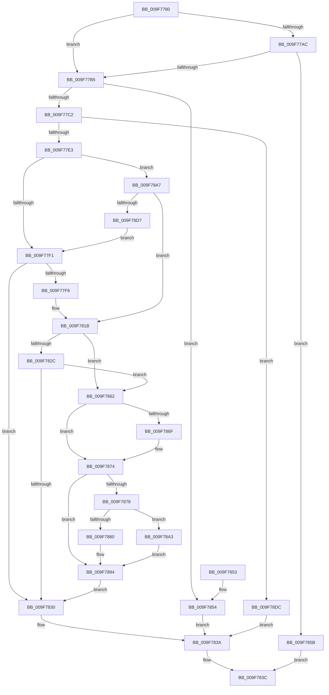

# RtlQueryRegistryValueWithFallback

- RVA: `0x009F7780`–`0x009F78E6` (길이 `358` bytes)
- VA: `0x00000001409F7780`
- 실행 섹션: `PAGE`
- PDB 이름 있음: `예`; PDB Function 태그: `아니요`
- unwind 정보 RVA: `0x000A6D70`
- 디코드: `101`개 명령, `358/358` bytes 표시
- 미해석 바이트: `0` (있으면 어셈블리에 `.byte`로 보존)

> 이 문서는 커널 이미지의 기계어와 PDB 기호를 분석해 생성했습니다. 4번과 5번은 함수 원형과 자료형을 바이너리 사용 방식에서 추정한 C 해석이며 원본 소스 복구 결과는 아닙니다.

## 1. Dependencies

- 직접 호출 지점: **5**; 고유 호출 대상: **4**
- 직접 호출자로 확인된 함수: **1**
- RIP 상대 이미지 참조: **0**

### Outgoing calls
- `0x009F77D2` → [ExAllocatePool2](../../poolcode/B8/ExAllocatePool2_function_00B820F0.md) (function, `0x00B820F0`)
- `0x009F7814` → [ZwQueryValueKey](../../text/6A/ZwQueryValueKey_function_006AD3B0.md) (function, `0x006AD3B0`)
- `0x009F7835` → [ExFreePoolWithTag](../../poolcode/B8/ExFreePoolWithTag_function_00B82870.md) (function, `0x00B82870`)
- `0x009F788F` → [memcpy](../../text/6C/memcpy_function_006C6840.md) (function, `0x006C6840`)
- `0x009F78C5` → [ZwQueryValueKey](../../text/6A/ZwQueryValueKey_function_006AD3B0.md) (function, `0x006AD3B0`)

### Direct callers
- [DifRtlQueryRegistryValueWithFallbackWrapper](../../text/63/DifRtlQueryRegistryValueWithFallbackWrapper_function_0063C0C0.md) at `0x0063C1E8`

### Static image references
- 디코드된 RIP-relative 메모리 참조가 없습니다.

## 2. Other-region calls and transfers

- 다른 실행 섹션으로 향하는 call: **5**
  - `0x009F77D2` → [ExAllocatePool2](../../poolcode/B8/ExAllocatePool2_function_00B820F0.md) (`PAGE` → `POOLCODE`)
  - `0x009F7814` → [ZwQueryValueKey](../../text/6A/ZwQueryValueKey_function_006AD3B0.md) (`PAGE` → `.text`)
  - `0x009F7835` → [ExFreePoolWithTag](../../poolcode/B8/ExFreePoolWithTag_function_00B82870.md) (`PAGE` → `POOLCODE`)
  - `0x009F788F` → [memcpy](../../text/6C/memcpy_function_006C6840.md) (`PAGE` → `.text`)
  - `0x009F78C5` → [ZwQueryValueKey](../../text/6A/ZwQueryValueKey_function_006AD3B0.md) (`PAGE` → `.text`)
- 별도 외부 분기/꼬리 이동을 확인하지 못했습니다.

## 3. Assembly (complete function range)

```asm
009F7780  48 89 5C 24 10                  mov qword ptr [rsp + 0x10], rbx
009F7785  48 89 6C 24 18                  mov qword ptr [rsp + 0x18], rbp
009F778A  56                              push rsi
009F778B  57                              push rdi
009F778C  41 54                           push r12
009F778E  41 56                           push r14
009F7790  41 57                           push r15
009F7792  48 83 EC 30                     sub rsp, 0x30
009F7796  83 64 24 60 00                  and dword ptr [rsp + 0x60], 0
009F779B  45 8B F1                        mov r14d, r9d
009F779E  4D 8B E0                        mov r12, r8
009F77A1  48 8B F2                        mov rsi, rdx
009F77A4  48 8B E9                        mov rbp, rcx
009F77A7  48 85 C9                        test rcx, rcx
009F77AA  75 09                           jne 0x1409f77b5
009F77AC  48 85 D2                        test rdx, rdx
009F77AF  0F 84 A6 00 00 00               je 0x1409f785b
009F77B5  41 8D 41 10                     lea eax, [r9 + 0x10]
009F77B9  83 F8 10                        cmp eax, 0x10
009F77BC  0F 82 92 00 00 00               jb 0x1409f7854
009F77C2  8B D0                           mov edx, eax
009F77C4  B9 00 01 00 00                  mov ecx, 0x100
009F77C9  41 B8 72 74 6C 6D               mov r8d, 0x6d6c7472
009F77CF  44 8B F8                        mov r15d, eax
009F77D2  E8 19 A9 18 00                  call 0x140b820f0
009F77D7  48 8B F8                        mov rdi, rax
009F77DA  48 85 C0                        test rax, rax
009F77DD  0F 84 F9 00 00 00               je 0x1409f78dc
009F77E3  BB 34 00 00 C0                  mov ebx, 0xc0000034
009F77E8  48 85 ED                        test rbp, rbp
009F77EB  0F 85 B6 00 00 00               jne 0x1409f78a7
009F77F1  48 85 F6                        test rsi, rsi
009F77F4  74 3A                           je 0x1409f7830
009F77F6  48 8D 44 24 60                  lea rax, [rsp + 0x60]
009F77FB  4C 8B CF                        mov r9, rdi
009F77FE  48 89 44 24 28                  mov qword ptr [rsp + 0x28], rax
009F7803  41 B8 02 00 00 00               mov r8d, 2
009F7809  49 8B D4                        mov rdx, r12
009F780C  44 89 7C 24 20                  mov dword ptr [rsp + 0x20], r15d
009F7811  48 8B CE                        mov rcx, rsi
009F7814  E8 97 5B CB FF                  call 0x1406ad3b0
009F7819  8B D8                           mov ebx, eax
009F781B  B9 00 00 00 80                  mov ecx, 0x80000000
009F7820  BA 05 00 00 80                  mov edx, 0x80000005
009F7825  8D 04 0B                        lea eax, [rbx + rcx]
009F7828  85 C1                           test ecx, eax
009F782A  75 36                           jne 0x1409f7862
009F782C  3B DA                           cmp ebx, edx
009F782E  74 32                           je 0x1409f7862
009F7830  33 D2                           xor edx, edx
009F7832  48 8B CF                        mov rcx, rdi
009F7835  E8 36 B0 18 00                  call 0x140b82870
009F783A  8B C3                           mov eax, ebx
009F783C  48 8B 5C 24 68                  mov rbx, qword ptr [rsp + 0x68]
009F7841  48 8B 6C 24 70                  mov rbp, qword ptr [rsp + 0x70]
009F7846  48 83 C4 30                     add rsp, 0x30
009F784A  41 5F                           pop r15
009F784C  41 5E                           pop r14
009F784E  41 5C                           pop r12
009F7850  5F                              pop rdi
009F7851  5E                              pop rsi
009F7852  C3                              ret
009F7853  CC                              int3
009F7854  BB 95 00 00 C0                  mov ebx, 0xc0000095
009F7859  EB DF                           jmp 0x1409f783a
009F785B  B8 0D 00 00 C0                  mov eax, 0xc000000d
009F7860  EB DA                           jmp 0x1409f783c
009F7862  48 8B 8C 24 80 00 00 00         mov rcx, qword ptr [rsp + 0x80]
009F786A  48 85 C9                        test rcx, rcx
009F786D  74 05                           je 0x1409f7874
009F786F  8B 47 04                        mov eax, dword ptr [rdi + 4]
009F7872  89 01                           mov dword ptr [rcx], eax
009F7874  85 DB                           test ebx, ebx
009F7876  78 1C                           js 0x1409f7894
009F7878  8B 47 08                        mov eax, dword ptr [rdi + 8]
009F787B  44 3B F0                        cmp r14d, eax
009F787E  72 23                           jb 0x1409f78a3
009F7880  48 8B 8C 24 88 00 00 00         mov rcx, qword ptr [rsp + 0x88]
009F7888  48 8D 57 0C                     lea rdx, [rdi + 0xc]
009F788C  44 8B C0                        mov r8d, eax
009F788F  E8 AC EF CC FF                  call 0x1406c6840
009F7894  48 8B 84 24 90 00 00 00         mov rax, qword ptr [rsp + 0x90]
009F789C  8B 4F 08                        mov ecx, dword ptr [rdi + 8]
009F789F  89 08                           mov dword ptr [rax], ecx
009F78A1  EB 8D                           jmp 0x1409f7830
009F78A3  8B DA                           mov ebx, edx
009F78A5  EB ED                           jmp 0x1409f7894
009F78A7  48 8D 44 24 60                  lea rax, [rsp + 0x60]
009F78AC  4C 8B CF                        mov r9, rdi
009F78AF  48 89 44 24 28                  mov qword ptr [rsp + 0x28], rax
009F78B4  41 B8 02 00 00 00               mov r8d, 2
009F78BA  49 8B D4                        mov rdx, r12
009F78BD  44 89 7C 24 20                  mov dword ptr [rsp + 0x20], r15d
009F78C2  48 8B CD                        mov rcx, rbp
009F78C5  E8 E6 5A CB FF                  call 0x1406ad3b0
009F78CA  8B D8                           mov ebx, eax
009F78CC  3D 34 00 00 C0                  cmp eax, 0xc0000034
009F78D1  0F 85 44 FF FF FF               jne 0x1409f781b
009F78D7  E9 15 FF FF FF                  jmp 0x1409f77f1
009F78DC  BB 17 00 00 C0                  mov ebx, 0xc0000017
009F78E1  E9 54 FF FF FF                  jmp 0x1409f783a
```

## 4. C-style interpretation (structured pseudocode)

```c
__int64 __fastcall RtlQueryRegistryValueWithFallback(__int64 a1, __int64 a2, __int64 a3, __int64 a4, __int64 a5, __int64 a6, __int64 a7)
{
    __int64 result;
    __int64 v_rsp;
    unsigned __int64 v_stack_m30;
    unsigned int v_stack_m38;
    unsigned __int64 v_stack_p10;
    unsigned __int64 v_stack_p18;
    unsigned int v_stack_p20;
    unsigned __int64 v_stack_p28;
    unsigned __int64 v_stack_p60;
    unsigned int v_stack_p8;

    v_stack_p10 = v_rbx;
    v_stack_p18 = v_rbp;
    v_rsp = (v_rsp) - (48);
    if (a1 != 0) goto loc_009F77B5;
    if (a2 == 0) goto loc_009F785B;
loc_009F77B5:
    if (((unsigned int)(a4 + 16)) < 16) goto loc_009F7854;
    result = ExAllocatePool2(256, (unsigned int)((unsigned int)(a4 + 16)), (unsigned int)(0x6D6C7472ULL), a4);
    if (result == 0) goto loc_009F78DC;
    if (a1 != 0) goto loc_009F78A7;
loc_009F77F1:
    if (a2 == 0) goto loc_009F7830;
    v_stack_m30 = v_stack_p8;
    v_stack_m38 = (unsigned int)((unsigned int)((unsigned int)(a4 + 16)));
    result = ZwQueryValueKey(a2, a3, 2, result);
loc_009F781B:
    if ((((unsigned int)((unsigned int)(0x80000000ULL))) & ((unsigned int)((unsigned int)((unsigned int)(result)) + (unsigned int)(0x80000000ULL) * 1))) != 0) goto loc_009F7862;
    if (((unsigned int)((unsigned int)((unsigned int)(result)))) == ((unsigned int)((unsigned int)(0x80000005ULL)))) goto loc_009F7862;
loc_009F7830:
    a2 = 0;
    result = ExFreePoolWithTag(result, a2, 2, result);
loc_009F783A:
loc_009F783C:
    v_rsp = (v_rsp) + (48);
    return (unsigned int)((unsigned int)((unsigned int)((unsigned int)(result))));
loc_009F7854:
    goto loc_009F783A;
loc_009F785B:
    goto loc_009F783C;
loc_009F7862:
    result = (unsigned int)(0xC000000DULL);
    if (a5 != 0) {
        result = *(unsigned int *)(result + 4);
        *(unsigned int *)(a5) = (unsigned int)(result);
    }
    if (sign_flag) goto loc_009F7894;
    if (((unsigned int)((unsigned int)((unsigned int)(a4)))) < ((unsigned int)((unsigned int)(*(unsigned int *)(result + 8))))) goto loc_009F78A3;
    result = memcpy(a6, result + 12, (unsigned int)((unsigned int)((unsigned int)(*(unsigned int *)(result + 8)))), result);
loc_009F7894:
    *(unsigned int *)(a7) = (unsigned int)((unsigned int)(*(unsigned int *)(result + 8)));
    goto loc_009F7830;
loc_009F78A3:
    goto loc_009F7894;
loc_009F78A7:
    v_stack_p28 = v_stack_p60;
    v_stack_p20 = (unsigned int)((unsigned int)((unsigned int)(a4 + 16)));
    result = ZwQueryValueKey(v_stack_p18, a3, 2, result);
    if (((unsigned int)(result)) != 0xC0000034ULL) goto loc_009F781B;
    goto loc_009F77F1;
loc_009F78DC:
    goto loc_009F783A;
}
```

## 5. (Beta) C Style

```c
int64_t RtlQueryRegistryValueWithFallback(int64_t Arg1, int64_t Arg2, int64_t Arg3, void *Arg4, int64_t Arg5, int64_t Arg6, void *Arg7)
{
    uint8_t *arg4 = (uint8_t *)Arg4;
    uint8_t *arg7 = (uint8_t *)Arg7;

    int64_t result;
    int64_t local_rsp;
    uint64_t v_stack_m30;
    uint32_t v_stack_m38;
    uint64_t v_stack_p10;
    uint64_t v_stack_p18;
    uint32_t v_stack_p20;
    uint64_t v_stack_p28;
    uint64_t v_stack_p60;
    uint32_t v_stack_p8;

    v_stack_p10 = local_rbx;
    v_stack_p18 = local_rbp;
    local_rsp = (local_rsp) - (48);
    if (Arg1 != 0) goto loc_009F77B5;
    if (Arg2 == 0) goto loc_009F785B;
loc_009F77B5:
    if (((uint32_t)(Arg4 + 16)) < 16) goto loc_009F7854;
    result = ExAllocatePool2(256, (uint32_t)((uint32_t)(Arg4 + 16)), (uint32_t)(0x6D6C7472ULL), Arg4);
    if (result == 0) goto loc_009F78DC;
    if (Arg1 != 0) goto loc_009F78A7;
loc_009F77F1:
    if (Arg2 == 0) goto loc_009F7830;
    v_stack_m30 = v_stack_p8;
    v_stack_m38 = (uint32_t)((uint32_t)((uint32_t)(Arg4 + 16)));
    result = ZwQueryValueKey(Arg2, Arg3, 2, result);
loc_009F781B:
    if ((((uint32_t)((uint32_t)(0x80000000ULL))) & ((uint32_t)((uint32_t)((uint32_t)(result)) + (uint32_t)(0x80000000ULL) * 1))) != 0) goto loc_009F7862;
    if (((uint32_t)((uint32_t)((uint32_t)(result)))) == ((uint32_t)((uint32_t)(0x80000005ULL)))) goto loc_009F7862;
loc_009F7830:
    Arg2 = 0;
    result = ExFreePoolWithTag(result, Arg2, 2, result);
loc_009F783A:
loc_009F783C:
    local_rsp = (local_rsp) + (48);
    return (uint32_t)((uint32_t)((uint32_t)((uint32_t)(result))));
loc_009F7854:
    goto loc_009F783A;
loc_009F785B:
    goto loc_009F783C;
loc_009F7862:
    result = (uint32_t)(0xC000000DULL);
    if (Arg5 != 0) {
        result = *(uint32_t *)(result + 0x4);
        *(uint32_t *)(Arg5) = (uint32_t)(result);
    }
    if (sign_flag) goto loc_009F7894;
    if (((uint32_t)((uint32_t)((uint32_t)(Arg4)))) < ((uint32_t)((uint32_t)(*(uint32_t *)(result + 0x8))))) goto loc_009F78A3;
    result = memcpy(Arg6, result + 12, (uint32_t)((uint32_t)((uint32_t)(*(uint32_t *)(result + 0x8)))), result);
loc_009F7894:
    *(uint32_t *)(arg7) = (uint32_t)((uint32_t)(*(uint32_t *)(result + 0x8)));
    goto loc_009F7830;
loc_009F78A3:
    goto loc_009F7894;
loc_009F78A7:
    v_stack_p28 = v_stack_p60;
    v_stack_p20 = (uint32_t)((uint32_t)((uint32_t)(Arg4 + 16)));
    result = ZwQueryValueKey(v_stack_p18, Arg3, 2, result);
    if (((uint32_t)(result)) != 0xC0000034ULL) goto loc_009F781B;
    goto loc_009F77F1;
loc_009F78DC:
    goto loc_009F783A;
}
```

### 관측된 메모리 오프셋

구조체 형식이 확인되지 않은 접근은 인자 기준의 오프셋으로만 기록했습니다.

| 기준 인자 | 오프셋 표현 | 폭 (bit) | 접근 |
|---|---:|---:|---|
| `Arg4` | `+ 0x10` | `32` | `R` |
| `Arg7` | `+ 0x0` | `32` | `W` |

## 6. Execution-region graph

[열기: 2D/3D 그래프와 함수 탐색 컨트롤 패널](../../../control-panel.html?section=page&rva=0x009F7780&view=graph)

- 2D 그래프는 위에서 아래로 흐르고, 3D 그래프는 빈 공간을 드래그해 회전합니다. Shift+드래그는 이동, 휠은 확대·축소, 함수 노드 선택은 대상 보고서 이동입니다.

### Static fallback


