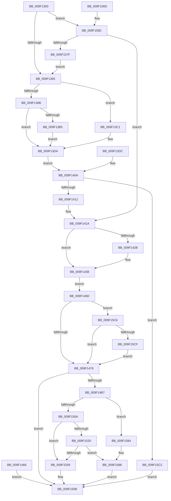

# RtlpWow64CreateUserStack

- RVA: `0x009F1300`–`0x009F15EC` (길이 `748` bytes)
- VA: `0x00000001409F1300`
- 실행 섹션: `PAGE`
- PDB 이름 있음: `예`; PDB Function 태그: `아니요`
- unwind 정보 RVA: `0x000A5E08`
- 디코드: `167`개 명령, `748/748` bytes 표시
- 미해석 바이트: `0` (있으면 어셈블리에 `.byte`로 보존)

> 이 문서는 커널 이미지의 기계어와 PDB 기호를 분석해 생성했습니다. 4번과 5번은 함수 원형과 자료형을 바이너리 사용 방식에서 추정한 C 해석이며 원본 소스 복구 결과는 아닙니다.

## 1. Dependencies

- 직접 호출 지점: **5**; 고유 호출 대상: **4**
- 직접 호출자로 확인된 함수: **1**
- RIP 상대 이미지 참조: **0**

### Outgoing calls
- `0x009F137E` → [RtlImageNtHeader](../../text/44/RtlImageNtHeader_function_00443B60.md) (function, `0x00443B60`)
- `0x009F14AA` → [ZwSetInformationProcess](../../text/6A/ZwSetInformationProcess_function_006AD450.md) (function, `0x006AD450`)
- `0x009F14FE` → [ZwAllocateVirtualMemory](../../text/6A/ZwAllocateVirtualMemory_function_006AD3D0.md) (function, `0x006AD3D0`)
- `0x009F154D` → [ZwAllocateVirtualMemory](../../text/6A/ZwAllocateVirtualMemory_function_006AD3D0.md) (function, `0x006AD3D0`)
- `0x009F15AA` → [ZwFreeVirtualMemory](../../text/6A/ZwFreeVirtualMemory_function_006AD490.md) (function, `0x006AD490`)

### Direct callers
- [PspWow64SetupUserStack](PspWow64SetupUserStack_function_009F1250.md) at `0x009F12AC`

### Static image references
- 디코드된 RIP-relative 메모리 참조가 없습니다.

## 2. Other-region calls and transfers

- 다른 실행 섹션으로 향하는 call: **5**
  - `0x009F137E` → [RtlImageNtHeader](../../text/44/RtlImageNtHeader_function_00443B60.md) (`PAGE` → `.text`)
  - `0x009F14AA` → [ZwSetInformationProcess](../../text/6A/ZwSetInformationProcess_function_006AD450.md) (`PAGE` → `.text`)
  - `0x009F14FE` → [ZwAllocateVirtualMemory](../../text/6A/ZwAllocateVirtualMemory_function_006AD3D0.md) (`PAGE` → `.text`)
  - `0x009F154D` → [ZwAllocateVirtualMemory](../../text/6A/ZwAllocateVirtualMemory_function_006AD3D0.md) (`PAGE` → `.text`)
  - `0x009F15AA` → [ZwFreeVirtualMemory](../../text/6A/ZwFreeVirtualMemory_function_006AD490.md) (`PAGE` → `.text`)
- 별도 외부 분기/꼬리 이동을 확인하지 못했습니다.

## 3. Assembly (complete function range)

```asm
009F1300  4C 8B DC                        mov r11, rsp
009F1303  45 89 4B 20                     mov dword ptr [r11 + 0x20], r9d
009F1307  4D 89 43 18                     mov qword ptr [r11 + 0x18], r8
009F130B  49 89 53 10                     mov qword ptr [r11 + 0x10], rdx
009F130F  49 89 4B 08                     mov qword ptr [r11 + 8], rcx
009F1313  56                              push rsi
009F1314  57                              push rdi
009F1315  41 54                           push r12
009F1317  41 55                           push r13
009F1319  41 56                           push r14
009F131B  41 57                           push r15
009F131D  48 81 EC 98 00 00 00            sub rsp, 0x98
009F1324  45 8B E1                        mov r12d, r9d
009F1327  4C 8B B4 24 F0 00 00 00         mov r14, qword ptr [rsp + 0xf0]
009F132F  4D 8B EE                        mov r13, r14
009F1332  49 83 63 88 00                  and qword ptr [r11 - 0x78], 0
009F1337  49 83 63 B8 00                  and qword ptr [r11 - 0x48], 0
009F133C  65 48 8B 04 25 88 01 00 00      mov rax, qword ptr gs:[0x188]
009F1345  48 8B 88 B8 00 00 00            mov rcx, qword ptr [rax + 0xb8]
009F134C  4C 8B B9 E0 02 00 00            mov r15, qword ptr [rcx + 0x2e0]
009F1353  4C 89 7C 24 40                  mov qword ptr [rsp + 0x40], r15
009F1358  49 8B 4B 08                     mov rcx, qword ptr [r11 + 8]
009F135C  48 85 C9                        test rcx, rcx
009F135F  0F 85 09 02 00 00               jne 0x1409f156e
009F1365  65 48 8B 04 25 88 01 00 00      mov rax, qword ptr gs:[0x188]
009F136E  48 8B 88 B8 00 00 00            mov rcx, qword ptr [rax + 0xb8]
009F1375  48 8B 89 B0 02 00 00            mov rcx, qword ptr [rcx + 0x2b0]
009F137C  33 FF                           xor edi, edi
009F137E  E8 DD 27 A5 FF                  call 0x140443b60
009F1383  48 8B C8                        mov rcx, rax
009F1386  48 85 C0                        test rax, rax
009F1389  74 36                           je 0x1409f13c1
009F138B  8B 40 64                        mov eax, dword ptr [rax + 0x64]
009F138E  8B 51 60                        mov edx, dword ptr [rcx + 0x60]
009F1391  48 8B 8C 24 D0 00 00 00         mov rcx, qword ptr [rsp + 0xd0]
009F1399  48 85 C9                        test rcx, rcx
009F139C  48 0F 44 C8                     cmove rcx, rax
009F13A0  48 89 8C 24 D0 00 00 00         mov qword ptr [rsp + 0xd0], rcx
009F13A8  48 8B 84 24 D8 00 00 00         mov rax, qword ptr [rsp + 0xd8]
009F13B0  48 85 C0                        test rax, rax
009F13B3  75 25                           jne 0x1409f13da
009F13B5  8B C2                           mov eax, edx
009F13B7  48 89 94 24 D8 00 00 00         mov qword ptr [rsp + 0xd8], rdx
009F13BF  EB 19                           jmp 0x1409f13da
009F13C1  BF 7B 00 00 C0                  mov edi, 0xc000007b
009F13C6  89 7C 24 38                     mov dword ptr [rsp + 0x38], edi
009F13CA  48 8B 84 24 D8 00 00 00         mov rax, qword ptr [rsp + 0xd8]
009F13D2  48 8B 8C 24 D0 00 00 00         mov rcx, qword ptr [rsp + 0xd0]
009F13DA  EB 2E                           jmp 0x1409f140a
009F13DC  8B F8                           mov edi, eax
009F13DE  89 44 24 38                     mov dword ptr [rsp + 0x38], eax
009F13E2  4C 8B B4 24 F0 00 00 00         mov r14, qword ptr [rsp + 0xf0]
009F13EA  44 8B A4 24 E8 00 00 00         mov r12d, dword ptr [rsp + 0xe8]
009F13F2  48 8B 84 24 D8 00 00 00         mov rax, qword ptr [rsp + 0xd8]
009F13FA  48 8B 8C 24 D0 00 00 00         mov rcx, qword ptr [rsp + 0xd0]
009F1402  4C 8B 7C 24 40                  mov r15, qword ptr [rsp + 0x40]
009F1407  4D 8B EE                        mov r13, r14
009F140A  85 FF                           test edi, edi
009F140C  0F 88 B0 01 00 00               js 0x1409f15c2
009F1412  4C 8B 84 24 E0 00 00 00         mov r8, qword ptr [rsp + 0xe0]
009F141A  BA 00 40 00 00                  mov edx, 0x4000
009F141F  48 85 C9                        test rcx, rcx
009F1422  48 0F 44 CA                     cmove rcx, rdx
009F1426  48 3B C8                        cmp rcx, rax
009F1429  72 0D                           jb 0x1409f1438
009F142B  48 8D 81 FF FF 0F 00            lea rax, [rcx + 0xfffff]
009F1432  48 25 00 00 F0 FF               and rax, 0xfffffffffff00000
009F1438  48 8D B1 FF 0F 00 00            lea rsi, [rcx + 0xfff]
009F143F  48 C7 C1 00 F0 FF FF            mov rcx, 0xfffffffffffff000
009F1446  48 23 F1                        and rsi, rcx
009F1449  48 8D B8 FF FF 00 00            lea rdi, [rax + 0xffff]
009F1450  48 81 E7 00 00 FF FF            and rdi, 0xffffffffffff0000
009F1457  49 8B 87 18 03 00 00            mov rax, qword ptr [r15 + 0x318]
009F145E  48 89 84 24 88 00 00 00         mov qword ptr [rsp + 0x88], rax
009F1466  EB 05                           jmp 0x1409f146d
009F1468  E9 EE 00 00 00                  jmp 0x1409f155b
009F146D  48 85 C0                        test rax, rax
009F1470  0F 85 50 01 00 00               jne 0x1409f15c6
009F1476  44 89 64 24 60                  mov dword ptr [rsp + 0x60], r12d
009F147B  83 64 24 64 00                  and dword ptr [rsp + 0x64], 0
009F1480  83 64 24 6C 00                  and dword ptr [rsp + 0x6c], 0
009F1485  83 64 24 68 00                  and dword ptr [rsp + 0x68], 0
009F148A  48 89 7C 24 70                  mov qword ptr [rsp + 0x70], rdi
009F148F  4C 89 44 24 78                  mov qword ptr [rsp + 0x78], r8
009F1494  41 B9 28 00 00 00               mov r9d, 0x28
009F149A  4C 8D 44 24 60                  lea r8, [rsp + 0x60]
009F149F  41 8D 51 01                     lea edx, [r9 + 1]
009F14A3  49 83 CC FF                     or r12, 0xffffffffffffffff
009F14A7  49 8B CC                        mov rcx, r12
009F14AA  E8 A1 BF CB FF                  call 0x1406ad450
009F14AF  85 C0                           test eax, eax
009F14B1  0F 88 A4 00 00 00               js 0x1409f155b
009F14B7  48 8B 8C 24 80 00 00 00         mov rcx, qword ptr [rsp + 0x80]
009F14BF  49 89 4E 38                     mov qword ptr [r14 + 0x38], rcx
009F14C3  48 8D 04 39                     lea rax, [rcx + rdi]
009F14C7  49 89 46 28                     mov qword ptr [r14 + 0x28], rax
009F14CB  48 2B CE                        sub rcx, rsi
009F14CE  48 03 CF                        add rcx, rdi
009F14D1  48 89 4C 24 30                  mov qword ptr [rsp + 0x30], rcx
009F14D6  48 2B FE                        sub rdi, rsi
009F14D9  48 89 74 24 58                  mov qword ptr [rsp + 0x58], rsi
009F14DE  C7 44 24 28 04 00 00 00         mov dword ptr [rsp + 0x28], 4
009F14E6  C7 44 24 20 00 10 00 00         mov dword ptr [rsp + 0x20], 0x1000
009F14EE  4C 8D 4C 24 58                  lea r9, [rsp + 0x58]
009F14F3  45 33 C0                        xor r8d, r8d
009F14F6  48 8D 54 24 30                  lea rdx, [rsp + 0x30]
009F14FB  49 8B CC                        mov rcx, r12
009F14FE  E8 CD BE CB FF                  call 0x1406ad3d0
009F1503  44 8B F8                        mov r15d, eax
009F1506  85 C0                           test eax, eax
009F1508  78 7A                           js 0x1409f1584
009F150A  49 8D 76 30                     lea rsi, [r14 + 0x30]
009F150E  48 8B 44 24 30                  mov rax, qword ptr [rsp + 0x30]
009F1513  48 89 06                        mov qword ptr [rsi], rax
009F1516  B9 00 20 00 00                  mov ecx, 0x2000
009F151B  48 3B F9                        cmp rdi, rcx
009F151E  72 39                           jb 0x1409f1559
009F1520  48 2B C1                        sub rax, rcx
009F1523  48 89 44 24 30                  mov qword ptr [rsp + 0x30], rax
009F1528  48 89 4C 24 50                  mov qword ptr [rsp + 0x50], rcx
009F152D  C7 44 24 28 04 01 00 00         mov dword ptr [rsp + 0x28], 0x104
009F1535  C7 44 24 20 00 10 00 00         mov dword ptr [rsp + 0x20], 0x1000
009F153D  4C 8D 4C 24 50                  lea r9, [rsp + 0x50]
009F1542  45 33 C0                        xor r8d, r8d
009F1545  48 8D 54 24 30                  lea rdx, [rsp + 0x30]
009F154A  49 8B CC                        mov rcx, r12
009F154D  E8 7E BE CB FF                  call 0x1406ad3d0
009F1552  44 8B F8                        mov r15d, eax
009F1555  85 C0                           test eax, eax
009F1557  78 2F                           js 0x1409f1588
009F1559  33 C0                           xor eax, eax
009F155B  48 81 C4 98 00 00 00            add rsp, 0x98
009F1562  41 5F                           pop r15
009F1564  41 5E                           pop r14
009F1566  41 5D                           pop r13
009F1568  41 5C                           pop r12
009F156A  5F                              pop rdi
009F156B  5E                              pop rsi
009F156C  C3                              ret
009F156D  CC                              int3
009F156E  48 8B 84 24 D8 00 00 00         mov rax, qword ptr [rsp + 0xd8]
009F1576  48 85 C0                        test rax, rax
009F1579  0F 85 9B FE FF FF               jne 0x1409f141a
009F157F  E9 E1 FD FF FF                  jmp 0x1409f1365
009F1584  49 8D 75 30                     lea rsi, [r13 + 0x30]
009F1588  49 8B 46 38                     mov rax, qword ptr [r14 + 0x38]
009F158C  48 89 44 24 40                  mov qword ptr [rsp + 0x40], rax
009F1591  48 83 64 24 48 00               and qword ptr [rsp + 0x48], 0
009F1597  41 B9 00 80 00 00               mov r9d, 0x8000
009F159D  4C 8D 44 24 48                  lea r8, [rsp + 0x48]
009F15A2  48 8D 54 24 40                  lea rdx, [rsp + 0x40]
009F15A7  49 8B CC                        mov rcx, r12
009F15AA  E8 E1 BE CB FF                  call 0x1406ad490
009F15AF  49 83 66 38 00                  and qword ptr [r14 + 0x38], 0
009F15B4  49 83 66 28 00                  and qword ptr [r14 + 0x28], 0
009F15B9  48 83 26 00                     and qword ptr [rsi], 0
009F15BD  41 8B C7                        mov eax, r15d
009F15C0  EB 99                           jmp 0x1409f155b
009F15C2  8B C7                           mov eax, edi
009F15C4  EB 95                           jmp 0x1409f155b
009F15C6  48 3B F0                        cmp rsi, rax
009F15C9  0F 83 A7 FE FF FF               jae 0x1409f1476
009F15CF  48 8D B0 FF 0F 00 00            lea rsi, [rax + 0xfff]
009F15D6  48 23 F1                        and rsi, rcx
009F15D9  48 8D BE FF FF 0F 00            lea rdi, [rsi + 0xfffff]
009F15E0  48 81 E7 00 00 F0 FF            and rdi, 0xfffffffffff00000
009F15E7  E9 8A FE FF FF                  jmp 0x1409f1476
```

## 4. C-style interpretation (structured pseudocode)

```c
__int64 __fastcall RtlpWow64CreateUserStack(__int64 a1, __int64 a2, __int64 a3, int a4, __int64 a5)
{
    __int64 result;
    __int64 v_r12;
    __int64 v_rdi;
    __int64 v_rsi;
    __int64 v_rsp;
    unsigned __int64 v_stack_m40;
    unsigned __int64 v_stack_m48;
    unsigned __int64 v_stack_m50;
    unsigned __int64 v_stack_m58;
    unsigned int v_stack_m5C;
    unsigned int v_stack_m60;
    unsigned int v_stack_m64;
    unsigned int v_stack_m68;
    unsigned __int64 v_stack_m70;
    unsigned __int64 v_stack_m78;
    unsigned __int64 v_stack_m88;
    unsigned int v_stack_m90;
    unsigned __int64 v_stack_m98;
    unsigned int v_stack_mA0;
    unsigned int v_stack_mA8;
    unsigned __int64 v_stack_p10;
    unsigned __int64 v_stack_p18;
    unsigned int v_stack_p20;
    unsigned __int64 v_stack_p28;
    unsigned __int64 v_stack_p40;
    unsigned __int64 v_stack_p48;
    unsigned __int64 v_stack_p8;
    unsigned __int64 v_stack_pD8;

    *(unsigned int *)(v_rsp + 32) = a4;
    *(unsigned __int64 *)(v_rsp + 24) = a3;
    *(unsigned __int64 *)(v_rsp + 16) = a2;
    *(unsigned __int64 *)(v_rsp + 8) = a1;
    v_rsp = (v_rsp) - (152);
    v_stack_m88 = *(unsigned __int64 *)(*(unsigned __int64 *)(*(unsigned __int64 *)(gs_base + (0 + 392)) + 184) + 736);
    if (*(unsigned __int64 *)(v_rsp + 8) != 0) goto loc_009F156E;
loc_009F1365:
    v_rdi = 0;
    result = RtlImageNtHeader(*(unsigned __int64 *)(*(unsigned __int64 *)(*(unsigned __int64 *)(gs_base + (0 + 392)) + 184) + 688), a2, a3, a4);
    if (result == 0) goto loc_009F13C1;
    a1 = v_stack_p8;
    if (v_stack_p8 == 0) { a1 = (unsigned int)(*(unsigned int *)(result + 100)); }
    v_stack_p8 = a1;
    if (v_stack_p10 != 0) goto loc_009F13DA;
    v_stack_p10 = (unsigned int)(*(unsigned int *)(result + 96));
    goto loc_009F13DA;
loc_009F13C1:
    v_stack_m90 = (unsigned int)((unsigned int)(0xC000007BULL));
loc_009F13DA:
    goto loc_009F140A;
loc_009F140A:
    if (sign_flag) goto loc_009F15C2;
loc_009F141A:
    a1 = v_stack_p8;
    if (v_stack_p8 == 0) { a1 = (unsigned int)(0x4000ULL); }
    result = v_stack_p10;
    if (a1 >= v_stack_p10) {
        result = a1 + 1048575;
        result = (result) & (0xFFFFFFFFFFF00000ULL);
    }
    v_rsi = (a1 + 4095) & (0xFFFFFFFFFFFFF000ULL);
    v_rdi = (result + 65535) & (0xFFFFFFFFFFFF0000ULL);
    v_stack_m40 = *(unsigned __int64 *)(*(unsigned __int64 *)(*(unsigned __int64 *)(*(unsigned __int64 *)(gs_base + (0 + 392)) + 184) + 736) + 792);
    goto loc_009F146D;
loc_009F146D:
    if (*(unsigned __int64 *)(*(unsigned __int64 *)(*(unsigned __int64 *)(*(unsigned __int64 *)(gs_base + (0 + 392)) + 184) + 736) + 792) != 0) goto loc_009F15C6;
loc_009F1476:
    v_stack_m68 = (unsigned int)((unsigned int)(a4));
    v_stack_m58 = v_rdi;
    v_stack_m50 = v_stack_p18;
    v_r12 = ((unsigned int)(a4)) | (-1);
    result = ZwSetInformationProcess(v_r12, 40 + 1, v_stack_m68, 40);
    if (sign_flag) goto loc_009F155B;
    *(unsigned __int64 *)(a5 + 56) = v_stack_m48;
    *(unsigned __int64 *)(a5 + 40) = v_stack_m48 + v_rdi * 1;
    a1 = (v_stack_m48) - (v_rsi);
    a1 = (a1) + (v_rdi);
    v_stack_m98 = a1;
    v_rdi = (v_rdi) - (v_rsi);
    v_stack_m70 = v_rsi;
    v_stack_mA0 = 4;
    v_stack_mA8 = 0x1000ULL;
    a3 = 0;
    result = ZwAllocateVirtualMemory(v_r12, v_stack_m98, a3, v_stack_m70);
    if (sign_flag) goto loc_009F1584;
    *(unsigned __int64 *)(a5 + 48) = v_stack_m98;
    if (v_rdi < ((unsigned int)(0x2000ULL))) goto loc_009F1559;
    result = (v_stack_m98) - ((unsigned int)(0x2000ULL));
    v_stack_m98 = result;
    v_stack_m78 = (unsigned int)(0x2000ULL);
    v_stack_mA0 = 260;
    v_stack_mA8 = 0x1000ULL;
    a3 = 0;
    result = ZwAllocateVirtualMemory(v_r12, v_stack_m98, a3, v_stack_m78);
    if (sign_flag) goto loc_009F1588;
loc_009F1559:
    result = 0;
loc_009F155B:
    v_rsp = (v_rsp) + (152);
    return result;
loc_009F156E:
    if (v_stack_pD8 != 0) goto loc_009F141A;
    goto loc_009F1365;
loc_009F1584:
loc_009F1588:
    v_stack_p40 = *(unsigned __int64 *)(a5 + 56);
    result = ZwFreeVirtualMemory(v_r12, v_stack_p40, v_stack_p48, (unsigned int)(0x8000ULL));
    goto loc_009F155B;
loc_009F15C2:
    goto loc_009F155B;
loc_009F15C6:
    if ((a5 + 48) >= ((unsigned int)((unsigned int)(v_rdi)))) goto loc_009F1476;
    v_rsi = ((unsigned int)((unsigned int)(v_rdi)) + 4095) & (v_r12);
    v_rdi = (v_rsi + 1048575) & (0xFFFFFFFFFFF00000ULL);
    goto loc_009F1476;
}
```

## 5. (Beta) C Style

```c
int64_t RtlpWow64CreateUserStack(int64_t Arg1, int64_t Arg2, int64_t Arg3, int32_t Arg4, void *Arg5)
{
    uint8_t *arg5 = (uint8_t *)Arg5;

    int64_t result;
    int64_t local_r12;
    int64_t local_rdi;
    int64_t local_rsi;
    int64_t local_rsp;
    uint64_t v_stack_m40;
    uint64_t v_stack_m48;
    uint64_t v_stack_m50;
    uint64_t v_stack_m58;
    uint32_t v_stack_m5C;
    uint32_t v_stack_m60;
    uint32_t v_stack_m64;
    uint32_t v_stack_m68;
    uint64_t v_stack_m70;
    uint64_t v_stack_m78;
    uint64_t v_stack_m88;
    uint32_t v_stack_m90;
    uint64_t v_stack_m98;
    uint32_t v_stack_mA0;
    uint32_t v_stack_mA8;
    uint64_t v_stack_p10;
    uint64_t v_stack_p18;
    uint32_t v_stack_p20;
    uint64_t v_stack_p28;
    uint64_t v_stack_p40;
    uint64_t v_stack_p48;
    uint64_t v_stack_p8;
    uint64_t v_stack_pD8;

    *(uint32_t *)(local_rsp + 0x20) = Arg4;
    *(uint64_t *)(local_rsp + 0x18) = Arg3;
    *(uint64_t *)(local_rsp + 0x10) = Arg2;
    *(uint64_t *)(local_rsp + 0x8) = Arg1;
    local_rsp = (local_rsp) - (152);
    v_stack_m88 = *(uint64_t *)(*(uint64_t *)(*(uint64_t *)(gs_base + (0 + 0x188)) + 0xB8) + 0x2E0);
    if (*(uint64_t *)(local_rsp + 0x8) != 0) goto loc_009F156E;
loc_009F1365:
    local_rdi = 0;
    result = RtlImageNtHeader(*(uint64_t *)(*(uint64_t *)(*(uint64_t *)(gs_base + (0 + 0x188)) + 0xB8) + 0x2B0), Arg2, Arg3, Arg4);
    if (result == 0) goto loc_009F13C1;
    Arg1 = v_stack_p8;
    if (v_stack_p8 == 0) { Arg1 = (uint32_t)(*(uint32_t *)(result + 0x64)); }
    v_stack_p8 = Arg1;
    if (v_stack_p10 != 0) goto loc_009F13DA;
    v_stack_p10 = (uint32_t)(*(uint32_t *)(result + 0x60));
    goto loc_009F13DA;
loc_009F13C1:
    v_stack_m90 = (uint32_t)((uint32_t)(0xC000007BULL));
loc_009F13DA:
    goto loc_009F140A;
loc_009F140A:
    if (sign_flag) goto loc_009F15C2;
loc_009F141A:
    Arg1 = v_stack_p8;
    if (v_stack_p8 == 0) { Arg1 = (uint32_t)(0x4000ULL); }
    result = v_stack_p10;
    if (Arg1 >= v_stack_p10) {
        result = Arg1 + 1048575;
        result = (result) & (0xFFFFFFFFFFF00000ULL);
    }
    local_rsi = (Arg1 + 4095) & (0xFFFFFFFFFFFFF000ULL);
    local_rdi = (result + 65535) & (0xFFFFFFFFFFFF0000ULL);
    v_stack_m40 = *(uint64_t *)(*(uint64_t *)(*(uint64_t *)(*(uint64_t *)(gs_base + (0 + 0x188)) + 0xB8) + 0x2E0) + 0x318);
    goto loc_009F146D;
loc_009F146D:
    if (*(uint64_t *)(*(uint64_t *)(*(uint64_t *)(*(uint64_t *)(gs_base + (0 + 0x188)) + 0xB8) + 0x2E0) + 0x318) != 0) goto loc_009F15C6;
loc_009F1476:
    v_stack_m68 = (uint32_t)((uint32_t)(Arg4));
    v_stack_m58 = local_rdi;
    v_stack_m50 = v_stack_p18;
    local_r12 = ((uint32_t)(Arg4)) | (-1);
    result = ZwSetInformationProcess(local_r12, 40 + 1, v_stack_m68, 40);
    if (sign_flag) goto loc_009F155B;
    *(uint64_t *)(arg5 + 0x38) = v_stack_m48;
    *(uint64_t *)(arg5 + 0x28) = v_stack_m48 + local_rdi * 1;
    Arg1 = (v_stack_m48) - (local_rsi);
    Arg1 = (Arg1) + (local_rdi);
    v_stack_m98 = Arg1;
    local_rdi = (local_rdi) - (local_rsi);
    v_stack_m70 = local_rsi;
    v_stack_mA0 = 4;
    v_stack_mA8 = 0x1000ULL;
    Arg3 = 0;
    result = ZwAllocateVirtualMemory(local_r12, v_stack_m98, Arg3, v_stack_m70);
    if (sign_flag) goto loc_009F1584;
    *(uint64_t *)(arg5 + 0x30) = v_stack_m98;
    if (local_rdi < ((uint32_t)(0x2000ULL))) goto loc_009F1559;
    result = (v_stack_m98) - ((uint32_t)(0x2000ULL));
    v_stack_m98 = result;
    v_stack_m78 = (uint32_t)(0x2000ULL);
    v_stack_mA0 = 260;
    v_stack_mA8 = 0x1000ULL;
    Arg3 = 0;
    result = ZwAllocateVirtualMemory(local_r12, v_stack_m98, Arg3, v_stack_m78);
    if (sign_flag) goto loc_009F1588;
loc_009F1559:
    result = 0;
loc_009F155B:
    local_rsp = (local_rsp) + (152);
    return result;
loc_009F156E:
    if (v_stack_pD8 != 0) goto loc_009F141A;
    goto loc_009F1365;
loc_009F1584:
loc_009F1588:
    v_stack_p40 = *(uint64_t *)(arg5 + 0x38);
    result = ZwFreeVirtualMemory(local_r12, v_stack_p40, v_stack_p48, (uint32_t)(0x8000ULL));
    goto loc_009F155B;
loc_009F15C2:
    goto loc_009F155B;
loc_009F15C6:
    if ((Arg5 + 48) >= ((uint32_t)((uint32_t)(local_rdi)))) goto loc_009F1476;
    local_rsi = ((uint32_t)((uint32_t)(local_rdi)) + 4095) & (local_r12);
    local_rdi = (local_rsi + 1048575) & (0xFFFFFFFFFFF00000ULL);
    goto loc_009F1476;
}
```

### 관측된 메모리 오프셋

구조체 형식이 확인되지 않은 접근은 인자 기준의 오프셋으로만 기록했습니다.

| 기준 인자 | 오프셋 표현 | 폭 (bit) | 접근 |
|---|---:|---:|---|
| `Arg5` | `+ 0x0` | `64` | `R/W` |
| `Arg5` | `+ 0x0` | `64` | `W` |
| `Arg5` | `+ 0x28` | `64` | `R/W` |
| `Arg5` | `+ 0x28` | `64` | `W` |
| `Arg5` | `+ 0x30` | `64` | `R` |
| `Arg5` | `+ 0x38` | `64` | `R` |
| `Arg5` | `+ 0x38` | `64` | `R/W` |
| `Arg5` | `+ 0x38` | `64` | `W` |

## 6. Execution-region graph

[열기: 2D/3D 그래프와 함수 탐색 컨트롤 패널](../../../control-panel.html?section=page&rva=0x009F1300&view=graph)

- 2D 그래프는 위에서 아래로 흐르고, 3D 그래프는 빈 공간을 드래그해 회전합니다. Shift+드래그는 이동, 휠은 확대·축소, 함수 노드 선택은 대상 보고서 이동입니다.

### Static fallback


