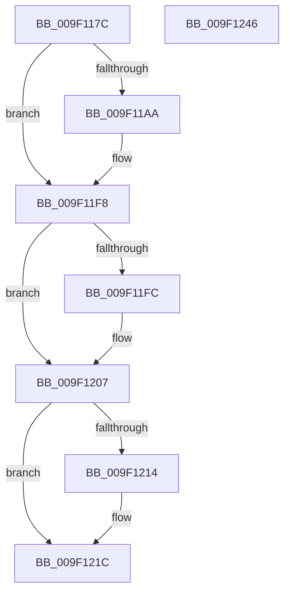

# SeAssignPrimaryToken

- RVA: `0x009F117C`–`0x009F1247` (길이 `203` bytes)
- VA: `0x00000001409F117C`
- 실행 섹션: `PAGE`
- PDB 이름 있음: `예`; PDB Function 태그: `아니요`
- unwind 정보 RVA: `0x000A5DDC`
- 디코드: `52`개 명령, `203/203` bytes 표시
- 미해석 바이트: `0` (있으면 어셈블리에 `.byte`로 보존)

> 이 문서는 커널 이미지의 기계어와 PDB 기호를 분석해 생성했습니다. 4번과 5번은 함수 원형과 자료형을 바이너리 사용 방식에서 추정한 C 해석이며 원본 소스 복구 결과는 아닙니다.

## 1. Dependencies

- 직접 호출 지점: **8**; 고유 호출 대상: **8**
- 직접 호출자로 확인된 함수: **1**
- RIP 상대 이미지 참조: **1**

### Outgoing calls
- `0x009F1198` → [SepAuditingForSubCategory](../../text/47/SepAuditingForSubCategory_function_00477E84.md) (function, `0x00477E84`)
- `0x009F11BC` → [SeCaptureSubjectContext](../86/SeCaptureSubjectContext_function_0086B820.md) (function, `0x0086B820`)
- `0x009F11E5` → [SepAdtIncorporatePerUserPolicy](../79/SepAdtIncorporatePerUserPolicy_function_0079FC18.md) (function, `0x0079FC18`)
- `0x009F11EF` → [SeReleaseSubjectContext](../86/SeReleaseSubjectContext_function_0086B710.md) (function, `0x0086B710`)
- `0x009F1202` → [SepAuditAssignPrimaryToken](../79/SepAuditAssignPrimaryToken_function_0079F828.md) (function, `0x0079F828`)
- `0x009F1217` → [SeDeassignPrimaryToken](../90/SeDeassignPrimaryToken_function_009075C0.md) (function, `0x009075C0`)
- `0x009F121F` → [ObfReferenceObject](../../text/20/ObfReferenceObject_function_0020FA20.md) (function, `0x0020FA20`)
- `0x009F1231` → [ObInitializeFastReference](ObInitializeFastReference_function_009F0D24.md) (function, `0x009F0D24`)

### Direct callers
- [PspInitializeProcessSecurity](../AA/PspInitializeProcessSecurity_function_00AAD368.md) at `0x00AAD53F`

### Static image references
- `0x009F119D` → RVA `0x00F04C68` (`.data`; read)

## 2. Other-region calls and transfers

- 다른 실행 섹션으로 향하는 call: **2**
  - `0x009F1198` → [SepAuditingForSubCategory](../../text/47/SepAuditingForSubCategory_function_00477E84.md) (`PAGE` → `.text`)
  - `0x009F121F` → [ObfReferenceObject](../../text/20/ObfReferenceObject_function_0020FA20.md) (`PAGE` → `.text`)
- 별도 외부 분기/꼬리 이동을 확인하지 못했습니다.

## 3. Assembly (complete function range)

```asm
009F117C  48 89 5C 24 10                  mov qword ptr [rsp + 0x10], rbx
009F1181  48 89 74 24 18                  mov qword ptr [rsp + 0x18], rsi
009F1186  57                              push rdi
009F1187  48 83 EC 50                     sub rsp, 0x50
009F118B  48 8B F9                        mov rdi, rcx
009F118E  48 8B DA                        mov rbx, rdx
009F1191  B2 01                           mov dl, 1
009F1193  B9 86 00 00 00                  mov ecx, 0x86
009F1198  E8 E7 6C A8 FF                  call 0x140477e84
009F119D  83 3D C4 3A 51 00 00            cmp dword ptr [rip + 0x513ac4], 0
009F11A4  88 44 24 60                     mov byte ptr [rsp + 0x60], al
009F11A8  74 4E                           je 0x1409f11f8
009F11AA  0F 57 C0                        xorps xmm0, xmm0
009F11AD  48 8D 4C 24 30                  lea rcx, [rsp + 0x30]
009F11B2  0F 11 44 24 30                  movups xmmword ptr [rsp + 0x30], xmm0
009F11B7  0F 11 44 24 40                  movups xmmword ptr [rsp + 0x40], xmm0
009F11BC  E8 5F A6 E7 FF                  call 0x14086b820
009F11C1  48 8B 44 24 30                  mov rax, qword ptr [rsp + 0x30]
009F11C6  B2 01                           mov dl, 1
009F11C8  4C 8B 4C 24 40                  mov r9, qword ptr [rsp + 0x40]
009F11CD  48 85 C0                        test rax, rax
009F11D0  4C 0F 45 C8                     cmovne r9, rax
009F11D4  45 33 C0                        xor r8d, r8d
009F11D7  48 8D 44 24 60                  lea rax, [rsp + 0x60]
009F11DC  48 89 44 24 20                  mov qword ptr [rsp + 0x20], rax
009F11E1  41 8D 48 22                     lea ecx, [r8 + 0x22]
009F11E5  E8 2E EA DA FF                  call 0x14079fc18
009F11EA  48 8D 4C 24 30                  lea rcx, [rsp + 0x30]
009F11EF  E8 1C A5 E7 FF                  call 0x14086b710
009F11F4  8A 44 24 60                     mov al, byte ptr [rsp + 0x60]
009F11F8  84 C0                           test al, al
009F11FA  74 0B                           je 0x1409f1207
009F11FC  48 8B D3                        mov rdx, rbx
009F11FF  48 8B CF                        mov rcx, rdi
009F1202  E8 21 E6 DA FF                  call 0x14079f828
009F1207  48 8D B7 48 02 00 00            lea rsi, [rdi + 0x248]
009F120E  48 83 3E 00                     cmp qword ptr [rsi], 0
009F1212  74 08                           je 0x1409f121c
009F1214  48 8B CF                        mov rcx, rdi
009F1217  E8 A4 63 F1 FF                  call 0x1409075c0
009F121C  48 8B CB                        mov rcx, rbx
009F121F  E8 FC E7 81 FF                  call 0x14020fa20
009F1224  48 8B D3                        mov rdx, rbx
009F1227  C6 83 CC 00 00 00 01            mov byte ptr [rbx + 0xcc], 1
009F122E  48 8B CE                        mov rcx, rsi
009F1231  E8 EE FA FF FF                  call 0x1409f0d24
009F1236  48 8B 5C 24 68                  mov rbx, qword ptr [rsp + 0x68]
009F123B  48 8B 74 24 70                  mov rsi, qword ptr [rsp + 0x70]
009F1240  48 83 C4 50                     add rsp, 0x50
009F1244  5F                              pop rdi
009F1245  C3                              ret
009F1246  CC                              int3
```

## 4. C-style interpretation (structured pseudocode)

```c
__int64 __fastcall SeAssignPrimaryToken(__int64 a1, __int64 a2, int a3)
{
    __int64 result;
    __int64 v_rsp;
    unsigned __int64 v_stack_m18;
    unsigned __int64 v_stack_m28;
    unsigned __int64 v_stack_m38;
    unsigned __int64 v_stack_p10;
    unsigned __int64 v_stack_p18;
    unsigned __int8 v_stack_p8;

    v_stack_p10 = v_rbx;
    v_stack_p18 = v_rsi;
    v_rsp = (v_rsp) - (80);
    result = SepAuditingForSubCategory(134, 1, a3, a4);
    v_stack_p8 = (unsigned __int8)(result);
    if ((*(unsigned int *)(v_rip + 5323460)) != 0) {
        a1 = v_stack_m28;
        v_stack_m28 = v_xmm0;
        v_stack_m18 = v_xmm0;
        result = SeCaptureSubjectContext(a1, 1, a3, a4);
        result = v_stack_m28;
        a2 = 1;
        a4 = v_stack_m18;
        if (result != 0) { a4 = result; }
        a3 = 0;
        result = v_stack_p8;
        v_stack_m38 = result;
        a1 = a3 + 34;
        result = SepAdtIncorporatePerUserPolicy(a1, a2, a3, a4);
        a1 = v_stack_m28;
        result = SeReleaseSubjectContext(a1, a2, a3, a4);
        result = v_stack_p8;
    }
    if ((unsigned __int8)(result) != 0) {
        a2 = a2;
        a1 = a1;
        result = SepAuditAssignPrimaryToken(a1, a2, a3, a4);
    }
    if ((*(unsigned __int64 *)(a1 + 584)) != 0) {
        a1 = a1;
        result = SeDeassignPrimaryToken(a1, a2, a3, a4);
    }
    result = ObfReferenceObject(a2, a2, a3, a4);
    *(unsigned __int8 *)(a2 + 204) = 1;
    result = ObInitializeFastReference(a1 + 584, a2, a3, a4);
    v_rsp = (v_rsp) + (80);
    return result;
}
```

## 5. (Beta) C Style

```c
int64_t SeAssignPrimaryToken(void *Arg1, void *Arg2, int32_t Arg3)
{
    uint8_t *arg1 = (uint8_t *)Arg1;
    uint8_t *arg2 = (uint8_t *)Arg2;

    int64_t result;
    int64_t local_rsp;
    uint64_t v_stack_m18;
    uint64_t v_stack_m28;
    uint64_t v_stack_m38;
    uint64_t v_stack_p10;
    uint64_t v_stack_p18;
    uint8_t v_stack_p8;

    v_stack_p10 = local_rbx;
    v_stack_p18 = local_rsi;
    local_rsp = (local_rsp) - (80);
    result = SepAuditingForSubCategory(134, 1, Arg3, a4);
    v_stack_p8 = (uint8_t)(result);
    if ((*(uint32_t *)(v_rip + 0x513AC4)) != 0) {
        Arg1 = v_stack_m28;
        v_stack_m28 = v_xmm0;
        v_stack_m18 = v_xmm0;
        result = SeCaptureSubjectContext(Arg1, 1, Arg3, a4);
        result = v_stack_m28;
        Arg2 = 1;
        a4 = v_stack_m18;
        if (result != 0) { a4 = result; }
        Arg3 = 0;
        result = v_stack_p8;
        v_stack_m38 = result;
        Arg1 = Arg3 + 34;
        result = SepAdtIncorporatePerUserPolicy(Arg1, Arg2, Arg3, a4);
        Arg1 = v_stack_m28;
        result = SeReleaseSubjectContext(Arg1, Arg2, Arg3, a4);
        result = v_stack_p8;
    }
    if ((uint8_t)(result) != 0) {
        Arg2 = Arg2;
        Arg1 = Arg1;
        result = SepAuditAssignPrimaryToken(Arg1, Arg2, Arg3, a4);
    }
    if ((*(uint64_t *)(arg1 + 0x248)) != 0) {
        Arg1 = Arg1;
        result = SeDeassignPrimaryToken(Arg1, Arg2, Arg3, a4);
    }
    result = ObfReferenceObject(Arg2, Arg2, Arg3, a4);
    *(uint8_t *)(arg2 + 0xCC) = 1;
    result = ObInitializeFastReference(Arg1 + 584, Arg2, Arg3, a4);
    local_rsp = (local_rsp) + (80);
    return result;
}
```

### 관측된 메모리 오프셋

구조체 형식이 확인되지 않은 접근은 인자 기준의 오프셋으로만 기록했습니다.

| 기준 인자 | 오프셋 표현 | 폭 (bit) | 접근 |
|---|---:|---:|---|
| `Arg1` | `+ 0x0` | `64` | `R` |
| `Arg1` | `+ 0x248` | `64` | `R` |
| `Arg2` | `+ 0xCC` | `8` | `W` |

## 6. Execution-region graph

[열기: 2D/3D 그래프와 함수 탐색 컨트롤 패널](../../../control-panel.html?section=page&rva=0x009F117C&view=graph)

- 2D 그래프는 위에서 아래로 흐르고, 3D 그래프는 빈 공간을 드래그해 회전합니다. Shift+드래그는 이동, 휠은 확대·축소, 함수 노드 선택은 대상 보고서 이동입니다.

### Static fallback


