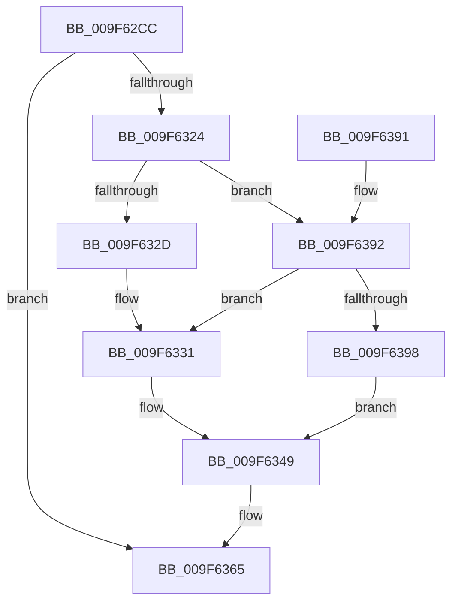

# SeCheckPrivilegedObject

- RVA: `0x009F62CC`–`0x009F639C` (길이 `208` bytes)
- VA: `0x00000001409F62CC`
- 실행 섹션: `PAGE`
- PDB 이름 있음: `예`; PDB Function 태그: `아니요`
- unwind 정보 RVA: `0x000A6B70`
- 디코드: `61`개 명령, `208/208` bytes 표시
- 미해석 바이트: `0` (있으면 어셈블리에 `.byte`로 보존)

> 이 문서는 커널 이미지의 기계어와 PDB 기호를 분석해 생성했습니다. 4번과 5번은 함수 원형과 자료형을 바이너리 사용 방식에서 추정한 C 해석이며 원본 소스 복구 결과는 아닙니다.

## 1. Dependencies

- 직접 호출 지점: **5**; 고유 호출 대상: **5**
- 직접 호출자로 확인된 함수: **5**
- RIP 상대 이미지 참조: **1**

### Outgoing calls
- `0x009F631A` → [SeCaptureSubjectContext](../86/SeCaptureSubjectContext_function_0086B820.md) (function, `0x0086B820`)
- `0x009F6342` → [SepPrivilegeCheck](../../text/40/SepPrivilegeCheck_function_0040B6B0.md) (function, `0x0040B6B0`)
- `0x009F6360` → [SePrivilegeObjectAuditAlarm](SePrivilegeObjectAuditAlarm_function_009F63B0.md) (function, `0x009F63B0`)
- `0x009F6369` → [SeReleaseSubjectContext](../86/SeReleaseSubjectContext_function_0086B710.md) (function, `0x0086B710`)
- `0x009F6377` → [_security_check_cookie](../../text/6A/_security_check_cookie_function_006AC640.md) (function, `0x006AC640`)

### Direct callers
- [PspAssignPrimaryToken](../78/PspAssignPrimaryToken_function_00784870.md) at `0x00784906`
- [NtSetInformationThread](../8C/NtSetInformationThread_function_008C9F60.md) at `0x008CB593`
- [NtSetInformationThread](../8C/NtSetInformationThread_function_008C9F60.md) at `0x008CB5B4`
- [PspSetProcessPriorityClass](PspSetProcessPriorityClass_function_009F61E4.md) at `0x009F6297`
- [NtSetInformationJobObject](NtSetInformationJobObject_function_009F84C0.md) at `0x009F8C7A`
- [NtSetInformationJobObject](NtSetInformationJobObject_function_009F84C0.md) at `0x009F8CE6`
- [NtSetInformationProcess](../AE/NtSetInformationProcess_function_00AE5370.md) at `0x00AE58F6`
- [NtSetInformationProcess](../AE/NtSetInformationProcess_function_00AE5370.md) at `0x00AE6A08`

### Static image references
- `0x009F62E1` → RVA `0x00E0A740` (`.data`; read)

## 2. Other-region calls and transfers

- 다른 실행 섹션으로 향하는 call: **2**
  - `0x009F6342` → [SepPrivilegeCheck](../../text/40/SepPrivilegeCheck_function_0040B6B0.md) (`PAGE` → `.text`)
  - `0x009F6377` → [_security_check_cookie](../../text/6A/_security_check_cookie_function_006AC640.md) (`PAGE` → `.text`)
- 별도 외부 분기/꼬리 이동을 확인하지 못했습니다.

## 3. Assembly (complete function range)

```asm
009F62CC  48 89 5C 24 18                  mov qword ptr [rsp + 0x18], rbx
009F62D1  48 89 74 24 20                  mov qword ptr [rsp + 0x20], rsi
009F62D6  55                              push rbp
009F62D7  57                              push rdi
009F62D8  41 56                           push r14
009F62DA  48 8B EC                        mov rbp, rsp
009F62DD  48 83 EC 70                     sub rsp, 0x70
009F62E1  48 8B 05 58 44 41 00            mov rax, qword ptr [rip + 0x414458]
009F62E8  48 33 C4                        xor rax, rsp
009F62EB  48 89 45 F8                     mov qword ptr [rbp - 8], rax
009F62EF  83 65 F0 00                     and dword ptr [rbp - 0x10], 0
009F62F3  0F 57 C0                        xorps xmm0, xmm0
009F62F6  BB 01 00 00 00                  mov ebx, 1
009F62FB  48 89 4D E8                     mov qword ptr [rbp - 0x18], rcx
009F62FF  48 8D 4D C0                     lea rcx, [rbp - 0x40]
009F6303  89 5D E0                        mov dword ptr [rbp - 0x20], ebx
009F6306  0F 11 45 C0                     movups xmmword ptr [rbp - 0x40], xmm0
009F630A  89 5D E4                        mov dword ptr [rbp - 0x1c], ebx
009F630D  41 8A F9                        mov dil, r9b
009F6310  0F 11 45 D0                     movups xmmword ptr [rbp - 0x30], xmm0
009F6314  41 8B F0                        mov esi, r8d
009F6317  4C 8B F2                        mov r14, rdx
009F631A  E8 01 55 E7 FF                  call 0x14086b820
009F631F  40 84 FF                        test dil, dil
009F6322  74 41                           je 0x1409f6365
009F6324  48 8B 4D C0                     mov rcx, qword ptr [rbp - 0x40]
009F6328  48 85 C9                        test rcx, rcx
009F632B  75 65                           jne 0x1409f6392
009F632D  48 8B 4D D0                     mov rcx, qword ptr [rbp - 0x30]
009F6331  44 8B 4D E4                     mov r9d, dword ptr [rbp - 0x1c]
009F6335  48 8D 55 E8                     lea rdx, [rbp - 0x18]
009F6339  44 8B 45 E0                     mov r8d, dword ptr [rbp - 0x20]
009F633D  40 88 7C 24 20                  mov byte ptr [rsp + 0x20], dil
009F6342  E8 69 53 A1 FF                  call 0x14040b6b0
009F6347  8A D8                           mov bl, al
009F6349  40 88 7C 24 28                  mov byte ptr [rsp + 0x28], dil
009F634E  4C 8D 4D E0                     lea r9, [rbp - 0x20]
009F6352  44 8B C6                        mov r8d, esi
009F6355  88 5C 24 20                     mov byte ptr [rsp + 0x20], bl
009F6359  48 8D 55 C0                     lea rdx, [rbp - 0x40]
009F635D  49 8B CE                        mov rcx, r14
009F6360  E8 4B 00 00 00                  call 0x1409f63b0
009F6365  48 8D 4D C0                     lea rcx, [rbp - 0x40]
009F6369  E8 A2 53 E7 FF                  call 0x14086b710
009F636E  8A C3                           mov al, bl
009F6370  48 8B 4D F8                     mov rcx, qword ptr [rbp - 8]
009F6374  48 33 CC                        xor rcx, rsp
009F6377  E8 C4 62 CB FF                  call 0x1406ac640
009F637C  4C 8D 5C 24 70                  lea r11, [rsp + 0x70]
009F6381  49 8B 5B 30                     mov rbx, qword ptr [r11 + 0x30]
009F6385  49 8B 73 38                     mov rsi, qword ptr [r11 + 0x38]
009F6389  49 8B E3                        mov rsp, r11
009F638C  41 5E                           pop r14
009F638E  5F                              pop rdi
009F638F  5D                              pop rbp
009F6390  C3                              ret
009F6391  CC                              int3
009F6392  83 7D C8 02                     cmp dword ptr [rbp - 0x38], 2
009F6396  7D 99                           jge 0x1409f6331
009F6398  32 DB                           xor bl, bl
009F639A  EB AD                           jmp 0x1409f6349
```

## 4. C-style interpretation (structured pseudocode)

```c
__int64 __fastcall SeCheckPrivilegedObject(__int64 a1, __int64 a2, int a3, unsigned __int8 a4)
{
    __int64 result;
    __int64 v_rbx;
    __int64 v_rsp;
    unsigned __int64 v_stack_m18;
    unsigned __int64 v_stack_m20;
    unsigned int v_stack_m28;
    unsigned __int64 v_stack_m30;
    unsigned int v_stack_m34;
    unsigned int v_stack_m38;
    unsigned __int64 v_stack_m48;
    unsigned int v_stack_m50;
    unsigned __int64 v_stack_m58;
    unsigned __int8 v_stack_m60;
    unsigned __int8 v_stack_m68;
    unsigned __int64 v_stack_p18;
    unsigned __int64 v_stack_p20;

    v_stack_p18 = v_rbx;
    v_stack_p20 = v_rsi;
    v_rsp = (v_rsp) - (112);
    result = (*(unsigned __int64 *)(v_rip + 4277336)) ^ (v_rsp);
    v_stack_m20 = result;
    v_stack_m30 = a1;
    v_stack_m38 = 1;
    v_stack_m58 = v_xmm0;
    v_stack_m34 = 1;
    v_stack_m48 = v_xmm0;
    result = SeCaptureSubjectContext(v_stack_m58, a2, a3, a4);
    if (a4 == 0) goto loc_009F6365;
    if (v_stack_m58 != 0) goto loc_009F6392;
loc_009F6331:
    v_stack_m68 = a4;
    result = SepPrivilegeCheck(v_stack_m48, v_stack_m30, (unsigned int)(v_stack_m38), (unsigned int)(v_stack_m34));
loc_009F6349:
    v_stack_m60 = a4;
    v_stack_m68 = (unsigned __int8)((unsigned __int8)(result));
    result = SePrivilegeObjectAuditAlarm(a2, v_stack_m58, (unsigned int)((unsigned int)((unsigned int)(a3))), v_stack_m38);
loc_009F6365:
    result = SeReleaseSubjectContext(v_stack_m58, v_stack_m58, (unsigned int)((unsigned int)((unsigned int)(a3))), v_stack_m38);
    a1 = (v_stack_m20) ^ (v_rsp);
    result = _security_check_cookie(a1, v_stack_m58, (unsigned int)((unsigned int)((unsigned int)(a3))), v_stack_m38);
    return result;
loc_009F6392:
    if (v_stack_m50 >= 2) goto loc_009F6331;
    v_rbx = 0;
    goto loc_009F6349;
}
```

## 5. (Beta) C Style

```c
int64_t SeCheckPrivilegedObject(int64_t Arg1, int64_t Arg2, int32_t Arg3, uint8_t Arg4)
{
    int64_t result;
    int64_t local_rbx;
    int64_t local_rsp;
    uint64_t v_stack_m18;
    uint64_t v_stack_m20;
    uint32_t v_stack_m28;
    uint64_t v_stack_m30;
    uint32_t v_stack_m34;
    uint32_t v_stack_m38;
    uint64_t v_stack_m48;
    uint32_t v_stack_m50;
    uint64_t v_stack_m58;
    uint8_t v_stack_m60;
    uint8_t v_stack_m68;
    uint64_t v_stack_p18;
    uint64_t v_stack_p20;

    v_stack_p18 = local_rbx;
    v_stack_p20 = local_rsi;
    local_rsp = (local_rsp) - (112);
    result = (*(uint64_t *)(v_rip + 0x414458)) ^ (local_rsp);
    v_stack_m20 = result;
    v_stack_m30 = Arg1;
    v_stack_m38 = 1;
    v_stack_m58 = v_xmm0;
    v_stack_m34 = 1;
    v_stack_m48 = v_xmm0;
    result = SeCaptureSubjectContext(v_stack_m58, Arg2, Arg3, Arg4);
    if (Arg4 == 0) goto loc_009F6365;
    if (v_stack_m58 != 0) goto loc_009F6392;
loc_009F6331:
    v_stack_m68 = Arg4;
    result = SepPrivilegeCheck(v_stack_m48, v_stack_m30, (uint32_t)(v_stack_m38), (uint32_t)(v_stack_m34));
loc_009F6349:
    v_stack_m60 = Arg4;
    v_stack_m68 = (uint8_t)((uint8_t)(result));
    result = SePrivilegeObjectAuditAlarm(Arg2, v_stack_m58, (uint32_t)((uint32_t)((uint32_t)(Arg3))), v_stack_m38);
loc_009F6365:
    result = SeReleaseSubjectContext(v_stack_m58, v_stack_m58, (uint32_t)((uint32_t)((uint32_t)(Arg3))), v_stack_m38);
    Arg1 = (v_stack_m20) ^ (local_rsp);
    result = _security_check_cookie(Arg1, v_stack_m58, (uint32_t)((uint32_t)((uint32_t)(Arg3))), v_stack_m38);
    return result;
loc_009F6392:
    if (v_stack_m50 >= 2) goto loc_009F6331;
    local_rbx = 0;
    goto loc_009F6349;
}
```

## 6. Execution-region graph

[열기: 2D/3D 그래프와 함수 탐색 컨트롤 패널](../../../control-panel.html?section=page&rva=0x009F62CC&view=graph)

- 2D 그래프는 위에서 아래로 흐르고, 3D 그래프는 빈 공간을 드래그해 회전합니다. Shift+드래그는 이동, 휠은 확대·축소, 함수 노드 선택은 대상 보고서 이동입니다.

### Static fallback


