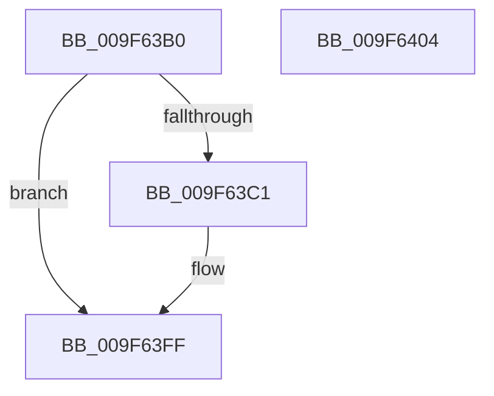

# SePrivilegeObjectAuditAlarm

- RVA: `0x009F63B0`–`0x009F6405` (길이 `85` bytes)
- VA: `0x00000001409F63B0`
- 실행 섹션: `PAGE`
- PDB 이름 있음: `예`; PDB Function 태그: `아니요`
- unwind 정보 RVA: `0x0005CC98`
- 디코드: `22`개 명령, `85/85` bytes 표시
- 미해석 바이트: `0` (있으면 어셈블리에 `.byte`로 보존)

> 이 문서는 커널 이미지의 기계어와 PDB 기호를 분석해 생성했습니다. 4번과 5번은 함수 원형과 자료형을 바이너리 사용 방식에서 추정한 C 해석이며 원본 소스 복구 결과는 아닙니다.

## 1. Dependencies

- 직접 호출 지점: **1**; 고유 호출 대상: **1**
- 직접 호출자로 확인된 함수: **1**
- RIP 상대 이미지 참조: **1**

### Outgoing calls
- `0x009F63FA` → [SepAdtPrivilegeObjectAuditAlarm](../86/SepAdtPrivilegeObjectAuditAlarm_function_0086E3F0.md) (function, `0x0086E3F0`)

### Direct callers
- [SeCheckPrivilegedObject](SeCheckPrivilegedObject_function_009F62CC.md) at `0x009F6360`

### Static image references
- `0x009F63DB` → RVA `0x000013A8` (`.rdata`; read)

## 2. Other-region calls and transfers

- 다른 실행 섹션으로 향하는 call: **0**
- 별도 외부 분기/꼬리 이동을 확인하지 못했습니다.

## 3. Assembly (complete function range)

```asm
009F63B0  4C 8B DC                        mov r11, rsp
009F63B3  48 83 EC 58                     sub rsp, 0x58
009F63B7  80 BC 24 88 00 00 00 00         cmp byte ptr [rsp + 0x88], 0
009F63BF  74 3E                           je 0x1409f63ff
009F63C1  8A 84 24 80 00 00 00            mov al, byte ptr [rsp + 0x80]
009F63C8  88 44 24 48                     mov byte ptr [rsp + 0x48], al
009F63CC  48 8B 42 18                     mov rax, qword ptr [rdx + 0x18]
009F63D0  4D 89 4B E8                     mov qword ptr [r11 - 0x18], r9
009F63D4  4C 8B C9                        mov r9, rcx
009F63D7  45 89 43 E0                     mov dword ptr [r11 - 0x20], r8d
009F63DB  48 8D 0D C6 AF 60 FF            lea rcx, [rip - 0x9f503a]
009F63E2  49 89 43 D8                     mov qword ptr [r11 - 0x28], rax
009F63E6  45 33 C0                        xor r8d, r8d
009F63E9  48 8B 42 10                     mov rax, qword ptr [rdx + 0x10]
009F63ED  49 89 43 D0                     mov qword ptr [r11 - 0x30], rax
009F63F1  48 8B 02                        mov rax, qword ptr [rdx]
009F63F4  33 D2                           xor edx, edx
009F63F6  49 89 43 C8                     mov qword ptr [r11 - 0x38], rax
009F63FA  E8 F1 7F E7 FF                  call 0x14086e3f0
009F63FF  48 83 C4 58                     add rsp, 0x58
009F6403  C3                              ret
009F6404  CC                              int3
```

## 4. C-style interpretation (structured pseudocode)

```c
__int64 __fastcall SePrivilegeObjectAuditAlarm(__int64 a1, __int64 a2, int a3, __int64 a4, unsigned __int8 a5, unsigned __int8 a6)
{
    __int64 result;
    __int64 v_rsp;
    unsigned __int8 v_stack_m10;

    v_rsp = (v_rsp) - (88);
    if (a6 != 0) {
        result = a5;
        v_stack_m10 = (unsigned __int8)(result);
        result = *(unsigned __int64 *)(a2 + 24);
        *(unsigned __int64 *)(v_rsp - 24) = a4;
        a4 = a1;
        *(unsigned int *)(v_rsp - 32) = a3;
        a1 = v_rip - 10440762;
        *(unsigned __int64 *)(v_rsp - 40) = result;
        a3 = 0;
        result = *(unsigned __int64 *)(a2 + 16);
        *(unsigned __int64 *)(v_rsp - 48) = result;
        result = *(unsigned __int64 *)(a2);
        a2 = 0;
        *(unsigned __int64 *)(v_rsp - 56) = result;
        result = SepAdtPrivilegeObjectAuditAlarm(a1, a2, a3, a4);
    }
    v_rsp = (v_rsp) + (88);
    return result;
}
```

## 5. (Beta) C Style

```c
int64_t SePrivilegeObjectAuditAlarm(int64_t Arg1, void *Arg2, int32_t Arg3, int64_t Arg4, uint8_t Arg5, uint8_t Arg6)
{
    uint8_t *arg2 = (uint8_t *)Arg2;

    int64_t result;
    int64_t local_rsp;
    uint8_t v_stack_m10;

    local_rsp = (local_rsp) - (88);
    if (Arg6 != 0) {
        result = Arg5;
        v_stack_m10 = (uint8_t)(result);
        result = *(uint64_t *)(arg2 + 0x18);
        *(uint64_t *)(local_rsp - 0x18) = Arg4;
        Arg4 = Arg1;
        *(uint32_t *)(local_rsp - 0x20) = Arg3;
        Arg1 = v_rip - 10440762;
        *(uint64_t *)(local_rsp - 0x28) = result;
        Arg3 = 0;
        result = *(uint64_t *)(arg2 + 0x10);
        *(uint64_t *)(local_rsp - 0x30) = result;
        result = *(uint64_t *)(arg2);
        Arg2 = 0;
        *(uint64_t *)(local_rsp - 0x38) = result;
        result = SepAdtPrivilegeObjectAuditAlarm(Arg1, Arg2, Arg3, Arg4);
    }
    local_rsp = (local_rsp) + (88);
    return result;
}
```

### 관측된 메모리 오프셋

구조체 형식이 확인되지 않은 접근은 인자 기준의 오프셋으로만 기록했습니다.

| 기준 인자 | 오프셋 표현 | 폭 (bit) | 접근 |
|---|---:|---:|---|
| `Arg2` | `+ 0x0` | `64` | `R` |
| `Arg2` | `+ 0x10` | `64` | `R` |
| `Arg2` | `+ 0x18` | `64` | `R` |

## 6. Execution-region graph

[열기: 2D/3D 그래프와 함수 탐색 컨트롤 패널](../../../control-panel.html?section=page&rva=0x009F63B0&view=graph)

- 2D 그래프는 위에서 아래로 흐르고, 3D 그래프는 빈 공간을 드래그해 회전합니다. Shift+드래그는 이동, 휠은 확대·축소, 함수 노드 선택은 대상 보고서 이동입니다.

### Static fallback


