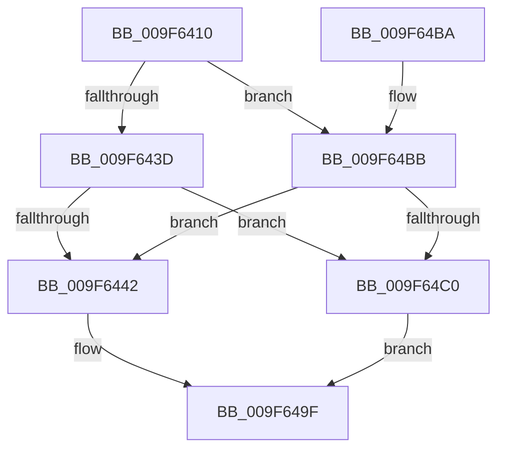

# SeQuerySecurityAttributesToken

- RVA: `0x009F6410`–`0x009F64C7` (길이 `183` bytes)
- VA: `0x00000001409F6410`
- 실행 섹션: `PAGE`
- PDB 이름 있음: `예`; PDB Function 태그: `아니요`
- unwind 정보 RVA: `0x000A6B90`
- 디코드: `49`개 명령, `183/183` bytes 표시
- 미해석 바이트: `0` (있으면 어셈블리에 `.byte`로 보존)

> 이 문서는 커널 이미지의 기계어와 PDB 기호를 분석해 생성했습니다. 4번과 5번은 함수 원형과 자료형을 바이너리 사용 방식에서 추정한 C 해석이며 원본 소스 복구 결과는 아닙니다.

## 1. Dependencies

- 직접 호출 지점: **4**; 고유 호출 대상: **4**
- 직접 호출자로 확인된 함수: **3**
- RIP 상대 이미지 참조: **0**

### Outgoing calls
- `0x009F6459` → [ExAcquireResourceSharedLite](../../text/21/ExAcquireResourceSharedLite_function_00211BC0.md) (function, `0x00211BC0`)
- `0x009F647F` → [SepInternalQuerySecurityAttributesTokenEx](../../text/3A/SepInternalQuerySecurityAttributesTokenEx_function_003A77B0.md) (function, `0x003A77B0`)
- `0x009F648A` → [ExReleaseResourceLite](../../text/25/ExReleaseResourceLite_function_0025FA10.md) (function, `0x0025FA10`)
- `0x009F6498` → [KeLeaveCriticalRegionThread](../../text/25/KeLeaveCriticalRegionThread_function_0025EFF0.md) (function, `0x0025EFF0`)

### Direct callers
- [SepVerifyDesktopAppxPackageName](../../text/3A/SepVerifyDesktopAppxPackageName_function_003A9728.md) at `0x003A9889`
- [RtlpQueryPackageIdentityAttributes](../../text/45/RtlpQueryPackageIdentityAttributes_function_00453C9C.md) at `0x00453D00`
- [RtlpQueryPackageIdentityAttributes](../../text/45/RtlpQueryPackageIdentityAttributes_function_00453C9C.md) at `0x00453D3A`
- [RtlpQueryPackageIdentityAttributes](../../text/45/RtlpQueryPackageIdentityAttributes_function_00453C9C.md) at `0x00453DCF`
- [RtlpQueryPackageIdentityAttributes](../../text/45/RtlpQueryPackageIdentityAttributes_function_00453C9C.md) at `0x00453DFD`
- [sub_006E6B3A](../../text/6E/Unknown_function_006E6B3A.md) at `0x006E6B59`

### Static image references
- 디코드된 RIP-relative 메모리 참조가 없습니다.

## 2. Other-region calls and transfers

- 다른 실행 섹션으로 향하는 call: **4**
  - `0x009F6459` → [ExAcquireResourceSharedLite](../../text/21/ExAcquireResourceSharedLite_function_00211BC0.md) (`PAGE` → `.text`)
  - `0x009F647F` → [SepInternalQuerySecurityAttributesTokenEx](../../text/3A/SepInternalQuerySecurityAttributesTokenEx_function_003A77B0.md) (`PAGE` → `.text`)
  - `0x009F648A` → [ExReleaseResourceLite](../../text/25/ExReleaseResourceLite_function_0025FA10.md) (`PAGE` → `.text`)
  - `0x009F6498` → [KeLeaveCriticalRegionThread](../../text/25/KeLeaveCriticalRegionThread_function_0025EFF0.md) (`PAGE` → `.text`)
- 별도 외부 분기/꼬리 이동을 확인하지 못했습니다.

## 3. Assembly (complete function range)

```asm
009F6410  48 8B C4                        mov rax, rsp
009F6413  48 89 58 08                     mov qword ptr [rax + 8], rbx
009F6417  48 89 68 10                     mov qword ptr [rax + 0x10], rbp
009F641B  48 89 70 18                     mov qword ptr [rax + 0x18], rsi
009F641F  48 89 78 20                     mov qword ptr [rax + 0x20], rdi
009F6423  41 56                           push r14
009F6425  48 83 EC 40                     sub rsp, 0x40
009F6429  8B 7C 24 70                     mov edi, dword ptr [rsp + 0x70]
009F642D  49 8B D9                        mov rbx, r9
009F6430  41 8B E8                        mov ebp, r8d
009F6433  4C 8B F2                        mov r14, rdx
009F6436  48 8B F1                        mov rsi, rcx
009F6439  85 FF                           test edi, edi
009F643B  74 7E                           je 0x1409f64bb
009F643D  48 85 DB                        test rbx, rbx
009F6440  74 7E                           je 0x1409f64c0
009F6442  65 48 8B 04 25 88 01 00 00      mov rax, qword ptr gs:[0x188]
009F644B  B2 01                           mov dl, 1
009F644D  66 FF 88 E4 01 00 00            dec word ptr [rax + 0x1e4]
009F6454  90                              nop
009F6455  48 8B 49 30                     mov rcx, qword ptr [rcx + 0x30]
009F6459  E8 62 B7 81 FF                  call 0x140211bc0
009F645E  48 8B 44 24 78                  mov rax, qword ptr [rsp + 0x78]
009F6463  44 8B CD                        mov r9d, ebp
009F6466  48 89 44 24 38                  mov qword ptr [rsp + 0x38], rax
009F646B  4D 8B C6                        mov r8, r14
009F646E  89 7C 24 30                     mov dword ptr [rsp + 0x30], edi
009F6472  48 8B CE                        mov rcx, rsi
009F6475  48 89 5C 24 28                  mov qword ptr [rsp + 0x28], rbx
009F647A  C6 44 24 20 00                  mov byte ptr [rsp + 0x20], 0
009F647F  E8 2C 13 9B FF                  call 0x1403a77b0
009F6484  48 8B 4E 30                     mov rcx, qword ptr [rsi + 0x30]
009F6488  8B D8                           mov ebx, eax
009F648A  E8 81 95 86 FF                  call 0x14025fa10
009F648F  65 48 8B 0C 25 88 01 00 00      mov rcx, qword ptr gs:[0x188]
009F6498  E8 53 8B 86 FF                  call 0x14025eff0
009F649D  8B C3                           mov eax, ebx
009F649F  48 8B 5C 24 50                  mov rbx, qword ptr [rsp + 0x50]
009F64A4  48 8B 6C 24 58                  mov rbp, qword ptr [rsp + 0x58]
009F64A9  48 8B 74 24 60                  mov rsi, qword ptr [rsp + 0x60]
009F64AE  48 8B 7C 24 68                  mov rdi, qword ptr [rsp + 0x68]
009F64B3  48 83 C4 40                     add rsp, 0x40
009F64B7  41 5E                           pop r14
009F64B9  C3                              ret
009F64BA  CC                              int3
009F64BB  48 85 DB                        test rbx, rbx
009F64BE  74 82                           je 0x1409f6442
009F64C0  B8 0D 00 00 C0                  mov eax, 0xc000000d
009F64C5  EB D8                           jmp 0x1409f649f
```

## 4. C-style interpretation (structured pseudocode)

```c
__int64 __fastcall SeQuerySecurityAttributesToken(__int64 a1, __int64 a2, int a3, __int64 a4, unsigned int a5, __int64 a6)
{
    __int64 result;
    __int64 v_rsp;
    unsigned __int64 v_stack_m10;
    unsigned int v_stack_m18;
    unsigned __int64 v_stack_m20;
    unsigned __int8 v_stack_m28;
    unsigned __int64 v_stack_p10;
    unsigned __int64 v_stack_p18;
    unsigned __int64 v_stack_p20;
    unsigned __int64 v_stack_p8;

    *(unsigned __int64 *)(v_rsp + 8) = v_rbx;
    *(unsigned __int64 *)(v_rsp + 16) = v_rbp;
    *(unsigned __int64 *)(v_rsp + 24) = v_rsi;
    *(unsigned __int64 *)(v_rsp + 32) = v_rdi;
    v_rsp = (v_rsp) - (64);
    if ((unsigned int)((unsigned int)(a5)) == 0) goto loc_009F64BB;
    if (a4 == 0) goto loc_009F64C0;
loc_009F6442:
    result = ExAcquireResourceSharedLite(*(unsigned __int64 *)(a1 + 48), 1, a3, a4);
    v_stack_m10 = a6;
    v_stack_m18 = (unsigned int)((unsigned int)(a5));
    v_stack_m20 = a4;
    v_stack_m28 = 0;
    result = SepInternalQuerySecurityAttributesTokenEx(a1, 1, a2, (unsigned int)((unsigned int)((unsigned int)(a3))));
    result = ExReleaseResourceLite(*(unsigned __int64 *)(a1 + 48), 1, a2, (unsigned int)((unsigned int)((unsigned int)(a3))));
    result = KeLeaveCriticalRegionThread(*(unsigned __int64 *)(gs_base + (0 + 392)), 1, a2, (unsigned int)((unsigned int)((unsigned int)(a3))));
loc_009F649F:
    v_rsp = (v_rsp) + (64);
    return (unsigned int)((unsigned int)((unsigned int)((unsigned int)(result))));
loc_009F64BB:
    if (v_stack_p8 == 0) goto loc_009F6442;
loc_009F64C0:
    goto loc_009F649F;
}
```

## 5. (Beta) C Style

```c
int64_t SeQuerySecurityAttributesToken(void *Arg1, int64_t Arg2, int32_t Arg3, int64_t Arg4, uint32_t Arg5, int64_t Arg6)
{
    uint8_t *arg1 = (uint8_t *)Arg1;

    int64_t result;
    int64_t local_rsp;
    uint64_t v_stack_m10;
    uint32_t v_stack_m18;
    uint64_t v_stack_m20;
    uint8_t v_stack_m28;
    uint64_t v_stack_p10;
    uint64_t v_stack_p18;
    uint64_t v_stack_p20;
    uint64_t v_stack_p8;

    *(uint64_t *)(local_rsp + 0x8) = local_rbx;
    *(uint64_t *)(local_rsp + 0x10) = local_rbp;
    *(uint64_t *)(local_rsp + 0x18) = local_rsi;
    *(uint64_t *)(local_rsp + 0x20) = local_rdi;
    local_rsp = (local_rsp) - (64);
    if ((uint32_t)((uint32_t)(Arg5)) == 0) goto loc_009F64BB;
    if (Arg4 == 0) goto loc_009F64C0;
loc_009F6442:
    result = ExAcquireResourceSharedLite(*(uint64_t *)(arg1 + 0x30), 1, Arg3, Arg4);
    v_stack_m10 = Arg6;
    v_stack_m18 = (uint32_t)((uint32_t)(Arg5));
    v_stack_m20 = Arg4;
    v_stack_m28 = 0;
    result = SepInternalQuerySecurityAttributesTokenEx(Arg1, 1, Arg2, (uint32_t)((uint32_t)((uint32_t)(Arg3))));
    result = ExReleaseResourceLite(*(uint64_t *)(arg1 + 0x30), 1, Arg2, (uint32_t)((uint32_t)((uint32_t)(Arg3))));
    result = KeLeaveCriticalRegionThread(*(uint64_t *)(gs_base + (0 + 0x188)), 1, Arg2, (uint32_t)((uint32_t)((uint32_t)(Arg3))));
loc_009F649F:
    local_rsp = (local_rsp) + (64);
    return (uint32_t)((uint32_t)((uint32_t)((uint32_t)(result))));
loc_009F64BB:
    if (v_stack_p8 == 0) goto loc_009F6442;
loc_009F64C0:
    goto loc_009F649F;
}
```

### 관측된 메모리 오프셋

구조체 형식이 확인되지 않은 접근은 인자 기준의 오프셋으로만 기록했습니다.

| 기준 인자 | 오프셋 표현 | 폭 (bit) | 접근 |
|---|---:|---:|---|
| `Arg1` | `+ 0x30` | `64` | `R` |

## 6. Execution-region graph

[열기: 2D/3D 그래프와 함수 탐색 컨트롤 패널](../../../control-panel.html?section=page&rva=0x009F6410&view=graph)

- 2D 그래프는 위에서 아래로 흐르고, 3D 그래프는 빈 공간을 드래그해 회전합니다. Shift+드래그는 이동, 휠은 확대·축소, 함수 노드 선택은 대상 보고서 이동입니다.

### Static fallback


