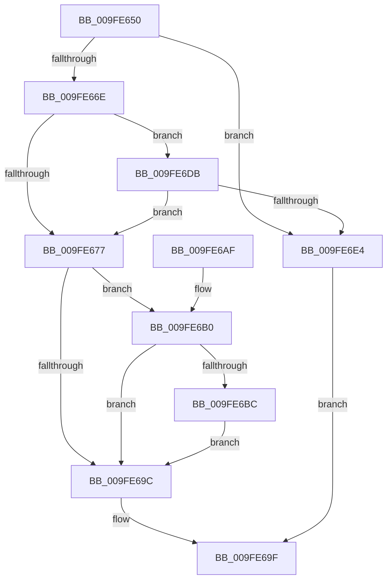

# SeTokenIsAdmin

- RVA: `0x009FE650`–`0x009FE6E8` (길이 `152` bytes)
- VA: `0x00000001409FE650`
- 실행 섹션: `PAGE`
- PDB 이름 있음: `예`; PDB Function 태그: `아니요`
- unwind 정보 RVA: `0x000A7580`
- 디코드: `43`개 명령, `152/152` bytes 표시
- 미해석 바이트: `0` (있으면 어셈블리에 `.byte`로 보존)

> 이 문서는 커널 이미지의 기계어와 PDB 기호를 분석해 생성했습니다. 4번과 5번은 함수 원형과 자료형을 바이너리 사용 방식에서 추정한 C 해석이며 원본 소스 복구 결과는 아닙니다.

## 1. Dependencies

- 직접 호출 지점: **3**; 고유 호출 대상: **2**
- 직접 호출자로 확인된 함수: **7**
- RIP 상대 이미지 참조: **1**

### Outgoing calls
- `0x009FE690` → [SepSidInToken](../../text/3D/SepSidInToken_function_003D0430.md) (function, `0x003D0430`)
- `0x009FE6B3` → [SeTokenIsRestricted](../../text/43/SeTokenIsRestricted_function_00438CE0.md) (function, `0x00438CE0`)
- `0x009FE6D1` → [SepSidInToken](../../text/3D/SepSidInToken_function_003D0430.md) (function, `0x003D0430`)

### Direct callers
- [IoComputeRedirectionTrustLevel](../../text/4B/IoComputeRedirectionTrustLevel_function_004BFE50.md) at `0x004BFE8C`
- [SepMandatorySubProcessToken](../../text/4C/SepMandatorySubProcessToken_function_004C0B88.md) at `0x004C0E0B`
- [IopParseDevice](../89/IopParseDevice_function_0089E510.md) at `0x008A0491`
- [PspDisablePrimaryTokenExchange](../8D/PspDisablePrimaryTokenExchange_function_008D5C10.md) at `0x008D5C69`
- [MiIsUserQueryVmCallerTrusted](MiIsUserQueryVmCallerTrusted_function_009FE378.md) at `0x009FE3F0`
- [EtwpCoverageUserIsAdmin](EtwpCoverageUserIsAdmin_function_009FE548.md) at `0x009FE580`
- [sub_00B20A40](../B2/Unknown_function_00B20A40.md) at `0x00B20A53`

### Static image references
- `0x009FE677` → RVA `0x00FD9A68` (`PAGEDATA`; read)

## 2. Other-region calls and transfers

- 다른 실행 섹션으로 향하는 call: **3**
  - `0x009FE690` → [SepSidInToken](../../text/3D/SepSidInToken_function_003D0430.md) (`PAGE` → `.text`)
  - `0x009FE6B3` → [SeTokenIsRestricted](../../text/43/SeTokenIsRestricted_function_00438CE0.md) (`PAGE` → `.text`)
  - `0x009FE6D1` → [SepSidInToken](../../text/3D/SepSidInToken_function_003D0430.md) (`PAGE` → `.text`)
- 별도 외부 분기/꼬리 이동을 확인하지 못했습니다.

## 3. Assembly (complete function range)

```asm
009FE650  48 89 5C 24 08                  mov qword ptr [rsp + 8], rbx
009FE655  48 89 74 24 10                  mov qword ptr [rsp + 0x10], rsi
009FE65A  57                              push rdi
009FE65B  48 83 EC 30                     sub rsp, 0x30
009FE65F  F7 81 C8 00 00 00 00 40 00 00   test dword ptr [rcx + 0xc8], 0x4000
009FE669  48 8B D9                        mov rbx, rcx
009FE66C  75 76                           jne 0x1409fe6e4
009FE66E  83 B9 C0 00 00 00 02            cmp dword ptr [rcx + 0xc0], 2
009FE675  74 64                           je 0x1409fe6db
009FE677  48 8B 35 EA B3 5D 00            mov rsi, qword ptr [rip + 0x5db3ea]
009FE67E  45 33 C9                        xor r9d, r9d
009FE681  4C 8B C6                        mov r8, rsi
009FE684  C6 44 24 28 00                  mov byte ptr [rsp + 0x28], 0
009FE689  33 D2                           xor edx, edx
009FE68B  C6 44 24 20 00                  mov byte ptr [rsp + 0x20], 0
009FE690  E8 9B 1D 9D FF                  call 0x1403d0430
009FE695  40 8A F8                        mov dil, al
009FE698  84 C0                           test al, al
009FE69A  75 14                           jne 0x1409fe6b0
009FE69C  40 8A C7                        mov al, dil
009FE69F  48 8B 5C 24 40                  mov rbx, qword ptr [rsp + 0x40]
009FE6A4  48 8B 74 24 48                  mov rsi, qword ptr [rsp + 0x48]
009FE6A9  48 83 C4 30                     add rsp, 0x30
009FE6AD  5F                              pop rdi
009FE6AE  C3                              ret
009FE6AF  CC                              int3
009FE6B0  48 8B CB                        mov rcx, rbx
009FE6B3  E8 28 A6 A3 FF                  call 0x140438ce0
009FE6B8  84 C0                           test al, al
009FE6BA  74 E0                           je 0x1409fe69c
009FE6BC  C6 44 24 28 00                  mov byte ptr [rsp + 0x28], 0
009FE6C1  45 33 C9                        xor r9d, r9d
009FE6C4  4C 8B C6                        mov r8, rsi
009FE6C7  C6 44 24 20 01                  mov byte ptr [rsp + 0x20], 1
009FE6CC  33 D2                           xor edx, edx
009FE6CE  48 8B CB                        mov rcx, rbx
009FE6D1  E8 5A 1D 9D FF                  call 0x1403d0430
009FE6D6  40 8A F8                        mov dil, al
009FE6D9  EB C1                           jmp 0x1409fe69c
009FE6DB  83 B9 C4 00 00 00 02            cmp dword ptr [rcx + 0xc4], 2
009FE6E2  7D 93                           jge 0x1409fe677
009FE6E4  32 C0                           xor al, al
009FE6E6  EB B7                           jmp 0x1409fe69f
```

## 4. C-style interpretation (structured pseudocode)

```c
__int64 __fastcall SeTokenIsAdmin(__int64 a1, int a2, __int64 a3, int a4)
{
    __int64 result;
    __int64 v_rsp;
    unsigned __int8 v_stack_m10;
    unsigned __int8 v_stack_m18;
    unsigned __int64 v_stack_p10;
    unsigned __int8 v_stack_p20;
    unsigned __int8 v_stack_p28;
    unsigned __int64 v_stack_p8;

    v_stack_p8 = v_rbx;
    v_stack_p10 = v_rsi;
    v_rsp = (v_rsp) - (48);
    if (((*(unsigned int *)(a1 + 200)) & (0x4000ULL)) != 0) goto loc_009FE6E4;
    if ((*(unsigned int *)(a1 + 192)) == 2) goto loc_009FE6DB;
loc_009FE677:
    a4 = 0;
    v_stack_m10 = 0;
    a2 = 0;
    v_stack_m18 = 0;
    result = SepSidInToken(a1, a2, *(unsigned __int64 *)(v_rip + 6140906), a4);
    if ((unsigned __int8)(result) != 0) goto loc_009FE6B0;
loc_009FE69C:
loc_009FE69F:
    v_rsp = (v_rsp) + (48);
    return (unsigned __int8)((unsigned __int8)(result));
loc_009FE6B0:
    result = SeTokenIsRestricted(v_stack_p8, a2, *(unsigned __int64 *)(v_rip + 6140906), a4);
    if ((unsigned __int8)(result) == 0) goto loc_009FE69C;
    v_stack_p28 = 0;
    a4 = 0;
    v_stack_p20 = 1;
    a2 = 0;
    result = SepSidInToken(v_stack_p8, a2, v_stack_p10, a4);
    goto loc_009FE69C;
loc_009FE6DB:
    if ((*(unsigned int *)(v_stack_p8 + 196)) >= 2) goto loc_009FE677;
loc_009FE6E4:
    result = 0;
    goto loc_009FE69F;
}
```

## 5. (Beta) C Style

```c
int64_t SeTokenIsAdmin(void *Arg1, int32_t Arg2, int64_t Arg3, int32_t Arg4)
{
    uint8_t *arg1 = (uint8_t *)Arg1;

    int64_t result;
    int64_t local_rsp;
    uint8_t v_stack_m10;
    uint8_t v_stack_m18;
    uint64_t v_stack_p10;
    uint8_t v_stack_p20;
    uint8_t v_stack_p28;
    uint64_t v_stack_p8;

    v_stack_p8 = local_rbx;
    v_stack_p10 = local_rsi;
    local_rsp = (local_rsp) - (48);
    if (((*(uint32_t *)(arg1 + 0xC8)) & (0x4000ULL)) != 0) goto loc_009FE6E4;
    if ((*(uint32_t *)(arg1 + 0xC0)) == 2) goto loc_009FE6DB;
loc_009FE677:
    Arg4 = 0;
    v_stack_m10 = 0;
    Arg2 = 0;
    v_stack_m18 = 0;
    result = SepSidInToken(Arg1, Arg2, *(uint64_t *)(v_rip + 0x5DB3EA), Arg4);
    if ((uint8_t)(result) != 0) goto loc_009FE6B0;
loc_009FE69C:
loc_009FE69F:
    local_rsp = (local_rsp) + (48);
    return (uint8_t)((uint8_t)(result));
loc_009FE6B0:
    result = SeTokenIsRestricted(v_stack_p8, Arg2, *(uint64_t *)(v_rip + 0x5DB3EA), Arg4);
    if ((uint8_t)(result) == 0) goto loc_009FE69C;
    v_stack_p28 = 0;
    Arg4 = 0;
    v_stack_p20 = 1;
    Arg2 = 0;
    result = SepSidInToken(v_stack_p8, Arg2, v_stack_p10, Arg4);
    goto loc_009FE69C;
loc_009FE6DB:
    if ((*(uint32_t *)(v_stack_p8 + 0xC4)) >= 2) goto loc_009FE677;
loc_009FE6E4:
    result = 0;
    goto loc_009FE69F;
}
```

### 관측된 메모리 오프셋

구조체 형식이 확인되지 않은 접근은 인자 기준의 오프셋으로만 기록했습니다.

| 기준 인자 | 오프셋 표현 | 폭 (bit) | 접근 |
|---|---:|---:|---|
| `Arg1` | `+ 0xC0` | `32` | `R` |
| `Arg1` | `+ 0xC4` | `32` | `R` |
| `Arg1` | `+ 0xC8` | `32` | `R` |

## 6. Execution-region graph

[열기: 2D/3D 그래프와 함수 탐색 컨트롤 패널](../../../control-panel.html?section=page&rva=0x009FE650&view=graph)

- 2D 그래프는 위에서 아래로 흐르고, 3D 그래프는 빈 공간을 드래그해 회전합니다. Shift+드래그는 이동, 휠은 확대·축소, 함수 노드 선택은 대상 보고서 이동입니다.

### Static fallback


