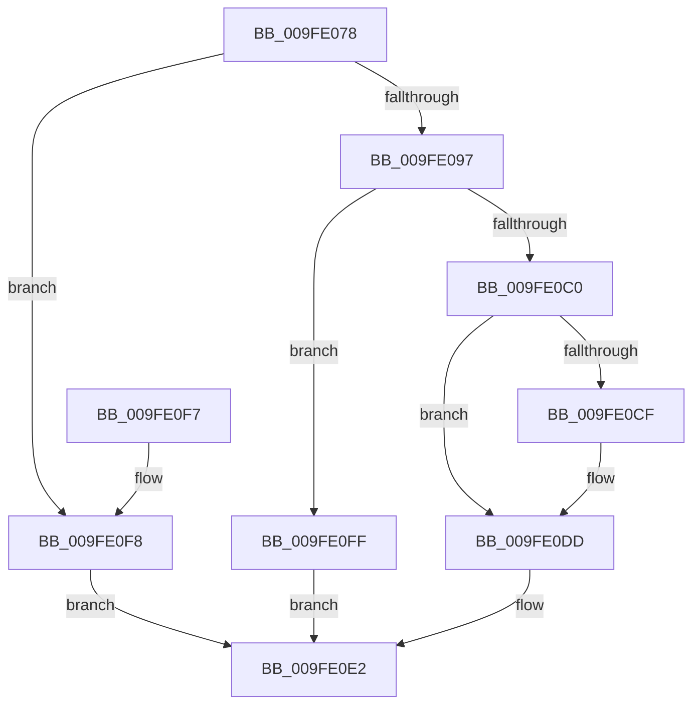

# SepDuplicateSid

- RVA: `0x009FE078`–`0x009FE106` (길이 `142` bytes)
- VA: `0x00000001409FE078`
- 실행 섹션: `PAGE`
- PDB 이름 있음: `예`; PDB Function 태그: `아니요`
- unwind 정보 RVA: `0x0007A3F0`
- 디코드: `40`개 명령, `142/142` bytes 표시
- 미해석 바이트: `0` (있으면 어셈블리에 `.byte`로 보존)

> 이 문서는 커널 이미지의 기계어와 PDB 기호를 분석해 생성했습니다. 4번과 5번은 함수 원형과 자료형을 바이너리 사용 방식에서 추정한 C 해석이며 원본 소스 복구 결과는 아닙니다.

## 1. Dependencies

- 직접 호출 지점: **2**; 고유 호출 대상: **2**
- 직접 호출자로 확인된 함수: **2**
- RIP 상대 이미지 참조: **0**

### Outgoing calls
- `0x009FE0B3` → [ExAllocatePool2](../../poolcode/B8/ExAllocatePool2_function_00B820F0.md) (function, `0x00B820F0`)
- `0x009FE0D8` → [memcpy](../../text/6C/memcpy_function_006C6840.md) (function, `0x006C6840`)

### Direct callers
- [SepSetTokenUserAndGroups](SepSetTokenUserAndGroups_function_009FDCD0.md) at `0x009FDD20`
- [SepDuplicateTokenUserAndGroups](SepDuplicateTokenUserAndGroups_function_009FDFD4.md) at `0x009FE018`

### Static image references
- 디코드된 RIP-relative 메모리 참조가 없습니다.

## 2. Other-region calls and transfers

- 다른 실행 섹션으로 향하는 call: **2**
  - `0x009FE0B3` → [ExAllocatePool2](../../poolcode/B8/ExAllocatePool2_function_00B820F0.md) (`PAGE` → `POOLCODE`)
  - `0x009FE0D8` → [memcpy](../../text/6C/memcpy_function_006C6840.md) (`PAGE` → `.text`)
- 별도 외부 분기/꼬리 이동을 확인하지 못했습니다.

## 3. Assembly (complete function range)

```asm
009FE078  48 89 5C 24 08                  mov qword ptr [rsp + 8], rbx
009FE07D  48 89 6C 24 10                  mov qword ptr [rsp + 0x10], rbp
009FE082  48 89 74 24 18                  mov qword ptr [rsp + 0x18], rsi
009FE087  57                              push rdi
009FE088  48 83 EC 20                     sub rsp, 0x20
009FE08C  48 8B DA                        mov rbx, rdx
009FE08F  48 8B F9                        mov rdi, rcx
009FE092  48 85 D2                        test rdx, rdx
009FE095  74 61                           je 0x1409fe0f8
009FE097  0F B6 41 01                     movzx eax, byte ptr [rcx + 1]
009FE09B  41 B8 53 65 53 69               mov r8d, 0x69536553
009FE0A1  48 83 22 00                     and qword ptr [rdx], 0
009FE0A5  B9 00 01 00 00                  mov ecx, 0x100
009FE0AA  8D 2C 85 08 00 00 00            lea ebp, [rax*4 + 8]
009FE0B1  8B D5                           mov edx, ebp
009FE0B3  E8 38 40 18 00                  call 0x140b820f0
009FE0B8  48 8B F0                        mov rsi, rax
009FE0BB  48 85 C0                        test rax, rax
009FE0BE  74 3F                           je 0x1409fe0ff
009FE0C0  0F B6 47 01                     movzx eax, byte ptr [rdi + 1]
009FE0C4  8D 04 85 08 00 00 00            lea eax, [rax*4 + 8]
009FE0CB  3B C5                           cmp eax, ebp
009FE0CD  77 0E                           ja 0x1409fe0dd
009FE0CF  44 8B C0                        mov r8d, eax
009FE0D2  48 8B D7                        mov rdx, rdi
009FE0D5  48 8B CE                        mov rcx, rsi
009FE0D8  E8 63 87 CC FF                  call 0x1406c6840
009FE0DD  48 89 33                        mov qword ptr [rbx], rsi
009FE0E0  33 C0                           xor eax, eax
009FE0E2  48 8B 5C 24 30                  mov rbx, qword ptr [rsp + 0x30]
009FE0E7  48 8B 6C 24 38                  mov rbp, qword ptr [rsp + 0x38]
009FE0EC  48 8B 74 24 40                  mov rsi, qword ptr [rsp + 0x40]
009FE0F1  48 83 C4 20                     add rsp, 0x20
009FE0F5  5F                              pop rdi
009FE0F6  C3                              ret
009FE0F7  CC                              int3
009FE0F8  B8 0D 00 00 C0                  mov eax, 0xc000000d
009FE0FD  EB E3                           jmp 0x1409fe0e2
009FE0FF  B8 9A 00 00 C0                  mov eax, 0xc000009a
009FE104  EB DC                           jmp 0x1409fe0e2
```

## 4. C-style interpretation (structured pseudocode)

```c
__int64 __fastcall SepDuplicateSid(__int64 a1, __int64 a2)
{
    __int64 result;
    __int64 v_rsp;
    unsigned __int64 v_stack_p10;
    unsigned __int64 v_stack_p18;
    unsigned __int64 v_stack_p8;

    v_stack_p8 = v_rbx;
    v_stack_p10 = v_rbp;
    v_stack_p18 = v_rsi;
    v_rsp = (v_rsp) - (32);
    if (a2 == 0) goto loc_009FE0F8;
    result = ExAllocatePool2(256, (unsigned int)((unsigned int)(*(unsigned __int8 *)(a1 + 1) * 4 + 8)), (unsigned int)(0x69536553ULL), a4);
    if (result == 0) goto loc_009FE0FF;
    result = *(unsigned __int8 *)(a1 + 1) * 4 + 8;
    if (((unsigned int)(*(unsigned __int8 *)(a1 + 1) * 4 + 8)) <= ((unsigned int)(*(unsigned __int8 *)(a1 + 1) * 4 + 8))) {
        a3 = (unsigned int)(*(unsigned __int8 *)(a1 + 1) * 4 + 8);
        a2 = a1;
        a1 = result;
        result = memcpy(a1, a2, a3, a4);
    }
    *(unsigned __int64 *)(a2) = result;
    result = 0;
loc_009FE0E2:
    v_rsp = (v_rsp) + (32);
    return result;
loc_009FE0F8:
    goto loc_009FE0E2;
loc_009FE0FF:
    goto loc_009FE0E2;
}
```

## 5. (Beta) C Style

```c
int64_t SepDuplicateSid(void *Arg1, void *Arg2)
{
    uint8_t *arg1 = (uint8_t *)Arg1;
    uint8_t *arg2 = (uint8_t *)Arg2;

    int64_t result;
    int64_t local_rsp;
    uint64_t v_stack_p10;
    uint64_t v_stack_p18;
    uint64_t v_stack_p8;

    v_stack_p8 = local_rbx;
    v_stack_p10 = local_rbp;
    v_stack_p18 = local_rsi;
    local_rsp = (local_rsp) - (32);
    if (Arg2 == NULL) goto loc_009FE0F8;
    result = ExAllocatePool2(256, (uint32_t)((uint32_t)(*(uint8_t *)(arg1 + 0x1) * 4 + 8)), (uint32_t)(0x69536553ULL), a4);
    if (result == 0) goto loc_009FE0FF;
    result = *(uint8_t *)(arg1 + 0x1) * 4 + 8;
    if (((uint32_t)(*(uint8_t *)(arg1 + 0x1) * 4 + 8)) <= ((uint32_t)(*(uint8_t *)(arg1 + 0x1) * 4 + 8))) {
        a3 = (uint32_t)(*(uint8_t *)(arg1 + 0x1) * 4 + 8);
        Arg2 = Arg1;
        Arg1 = result;
        result = memcpy(Arg1, Arg2, a3, a4);
    }
    *(uint64_t *)(arg2) = result;
    result = 0;
loc_009FE0E2:
    local_rsp = (local_rsp) + (32);
    return result;
loc_009FE0F8:
    goto loc_009FE0E2;
loc_009FE0FF:
    goto loc_009FE0E2;
}
```

### 관측된 메모리 오프셋

구조체 형식이 확인되지 않은 접근은 인자 기준의 오프셋으로만 기록했습니다.

| 기준 인자 | 오프셋 표현 | 폭 (bit) | 접근 |
|---|---:|---:|---|
| `Arg1` | `+ 0x1` | `8` | `R` |
| `Arg2` | `+ 0x0` | `64` | `W` |

## 6. Execution-region graph

[열기: 2D/3D 그래프와 함수 탐색 컨트롤 패널](../../../control-panel.html?section=page&rva=0x009FE078&view=graph)

- 2D 그래프는 위에서 아래로 흐르고, 3D 그래프는 빈 공간을 드래그해 회전합니다. Shift+드래그는 이동, 휠은 확대·축소, 함수 노드 선택은 대상 보고서 이동입니다.

### Static fallback


