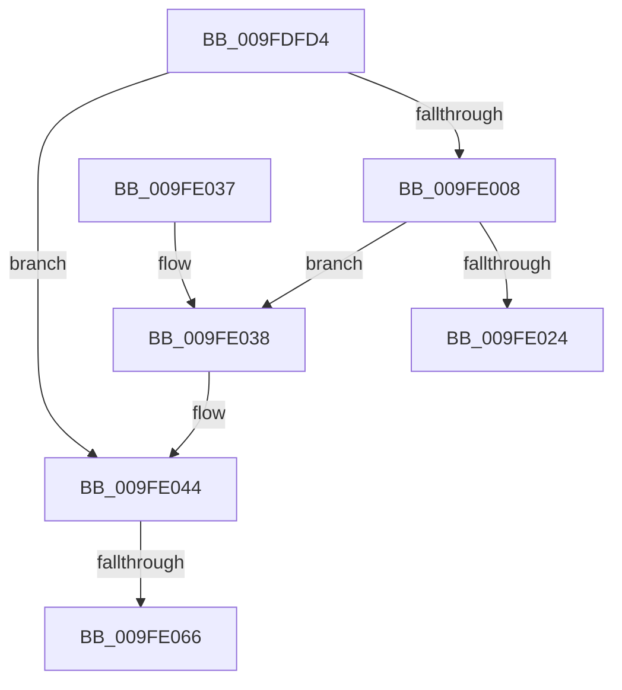

# SepDuplicateTokenUserAndGroups

- RVA: `0x009FDFD4`–`0x009FE071` (길이 `157` bytes)
- VA: `0x00000001409FDFD4`
- 실행 섹션: `PAGE`
- PDB 이름 있음: `예`; PDB Function 태그: `예`
- unwind 정보 RVA: `0x000A7424`
- 디코드: `45`개 명령, `157/157` bytes 표시
- 미해석 바이트: `0` (있으면 어셈블리에 `.byte`로 보존)

> 이 문서는 커널 이미지의 기계어와 PDB 기호를 분석해 생성했습니다. 4번과 5번은 함수 원형과 자료형을 바이너리 사용 방식에서 추정한 C 해석이며 원본 소스 복구 결과는 아닙니다.

## 1. Dependencies

- 직접 호출 지점: **1**; 고유 호출 대상: **1**
- 직접 호출자로 확인된 함수: **2**
- RIP 상대 이미지 참조: **0**

### Outgoing calls
- `0x009FE018` → [SepDuplicateSid](SepDuplicateSid_function_009FE078.md) (function, `0x009FE078`)

### Direct callers
- [SepDuplicateToken](../8B/SepDuplicateToken_function_008B87EC.md) at `0x008B8CE8`
- [SepFilterToken](../9C/SepFilterToken_function_009C6B80.md) at `0x009C72AA`

### Static image references
- 디코드된 RIP-relative 메모리 참조가 없습니다.

## 2. Other-region calls and transfers

- 다른 실행 섹션으로 향하는 call: **0**
- call이 아닌 외부 분기/꼬리 이동: **2**
  - `0x009FE060` → [sub_00B3274C](../B3/Unknown_function_00B3274C.md) (`tail-transfer`)
  - `0x009FE06C` → [sub_00B3274C](../B3/Unknown_function_00B3274C.md) (`tail-transfer`)

## 3. Assembly (complete function range)

```asm
009FDFD4  4C 8B DC                        mov r11, rsp
009FDFD7  49 89 5B 10                     mov qword ptr [r11 + 0x10], rbx
009FDFDB  49 89 6B 18                     mov qword ptr [r11 + 0x18], rbp
009FDFDF  56                              push rsi
009FDFE0  57                              push rdi
009FDFE1  41 56                           push r14
009FDFE3  48 83 EC 20                     sub rsp, 0x20
009FDFE7  8B A9 D0 00 00 00               mov ebp, dword ptr [rcx + 0xd0]
009FDFED  4C 8D B1 98 00 00 00            lea r14, [rcx + 0x98]
009FDFF4  33 DB                           xor ebx, ebx
009FDFF6  48 8B FA                        mov rdi, rdx
009FDFF9  49 89 5B 08                     mov qword ptr [r11 + 8], rbx
009FDFFD  48 8B F1                        mov rsi, rcx
009FE000  44 8B C3                        mov r8d, ebx
009FE003  83 FD FF                        cmp ebp, -1
009FE006  74 3C                           je 0x1409fe044
009FE008  49 8B 0E                        mov rcx, qword ptr [r14]
009FE00B  49 8D 53 08                     lea rdx, [r11 + 8]
009FE00F  8B C5                           mov eax, ebp
009FE011  48 03 C0                        add rax, rax
009FE014  48 8B 0C C1                     mov rcx, qword ptr [rcx + rax*8]
009FE018  E8 5B 00 00 00                  call 0x1409fe078
009FE01D  44 8B C0                        mov r8d, eax
009FE020  85 C0                           test eax, eax
009FE022  79 14                           jns 0x1409fe038
009FE024  48 8B 5C 24 48                  mov rbx, qword ptr [rsp + 0x48]
009FE029  48 8B 6C 24 50                  mov rbp, qword ptr [rsp + 0x50]
009FE02E  48 83 C4 20                     add rsp, 0x20
009FE032  41 5E                           pop r14
009FE034  5F                              pop rdi
009FE035  5E                              pop rsi
009FE036  C3                              ret
009FE037  CC                              int3
009FE038  48 8B 44 24 40                  mov rax, qword ptr [rsp + 0x40]
009FE03D  48 89 87 60 04 00 00            mov qword ptr [rdi + 0x460], rax
009FE044  48 8B 8E 68 04 00 00            mov rcx, qword ptr [rsi + 0x468]
009FE04B  41 B9 01 00 00 00               mov r9d, 1
009FE051  41 8B C1                        mov eax, r9d
009FE054  F0 48 0F C1 41 08               lock xadd qword ptr [rcx + 8], rax
009FE05A  49 03 C1                        add rax, r9
009FE05D  49 3B C1                        cmp rax, r9
009FE060  0F 8F E6 46 13 00               jg 0x140b3274c
009FE066  41 8D 49 0D                     lea ecx, [r9 + 0xd]
009FE06A  CD 29                           int 0x29
009FE06C  E9 DB 46 13 00                  jmp 0x140b3274c
```

## 4. C-style interpretation (structured pseudocode)

```c
__int64 __fastcall SepDuplicateTokenUserAndGroups(__int64 a1, __int64 a2)
{
    __int64 result;
    __int64 v_rbx;
    __int64 v_rsp;
    unsigned __int64 v_stack_p10;
    unsigned __int64 v_stack_p18;
    unsigned __int64 v_stack_p40;

    *(unsigned __int64 *)(v_rsp + 16) = v_rbx;
    *(unsigned __int64 *)(v_rsp + 24) = v_rbp;
    v_rsp = (v_rsp) - (32);
    v_rbx = 0;
    *(unsigned __int64 *)(v_rsp + 8) = 0;
    if (((unsigned int)((unsigned int)(*(unsigned int *)(a1 + 208)))) == -1) goto loc_009FE044;
    result = ((unsigned int)((unsigned int)((unsigned int)(*(unsigned int *)(a1 + 208))))) + ((unsigned int)((unsigned int)((unsigned int)(*(unsigned int *)(a1 + 208)))));
    result = SepDuplicateSid(*(unsigned __int64 *)(*(unsigned __int64 *)(a1 + 152) + result * 8), v_rsp + 8, 0, a4);
    if (!sign_flag) goto loc_009FE038;
    v_rsp = (v_rsp) + (32);
    return result;
loc_009FE038:
    *(unsigned __int64 *)(a2 + 1120) = v_stack_p40;
loc_009FE044:
    result = (1) + (1);
}
```

## 5. (Beta) C Style

```c
int64_t SepDuplicateTokenUserAndGroups(void *Arg1, void *Arg2)
{
    uint8_t *arg1 = (uint8_t *)Arg1;
    uint8_t *arg2 = (uint8_t *)Arg2;

    int64_t result;
    int64_t local_rbx;
    int64_t local_rsp;
    uint64_t v_stack_p10;
    uint64_t v_stack_p18;
    uint64_t v_stack_p40;

    *(uint64_t *)(local_rsp + 0x10) = local_rbx;
    *(uint64_t *)(local_rsp + 0x18) = local_rbp;
    local_rsp = (local_rsp) - (32);
    local_rbx = 0;
    *(uint64_t *)(local_rsp + 0x8) = 0;
    if (((uint32_t)((uint32_t)(*(uint32_t *)(arg1 + 0xD0)))) == -1) goto loc_009FE044;
    result = ((uint32_t)((uint32_t)((uint32_t)(*(uint32_t *)(arg1 + 0xD0))))) + ((uint32_t)((uint32_t)((uint32_t)(*(uint32_t *)(arg1 + 0xD0)))));
    result = SepDuplicateSid(*(uint64_t *)(*(uint64_t *)(arg1 + 0x98) + result * 8), local_rsp + 8, 0, a4);
    if (!sign_flag) goto loc_009FE038;
    local_rsp = (local_rsp) + (32);
    return result;
loc_009FE038:
    *(uint64_t *)(arg2 + 0x460) = v_stack_p40;
loc_009FE044:
    result = (1) + (1);
}
```

### 관측된 메모리 오프셋

구조체 형식이 확인되지 않은 접근은 인자 기준의 오프셋으로만 기록했습니다.

| 기준 인자 | 오프셋 표현 | 폭 (bit) | 접근 |
|---|---:|---:|---|
| `Arg1` | `+ 0x0` | `64` | `R` |
| `Arg1` | `+ 0x98` | `64` | `R` |
| `Arg1` | `+ 0xD0` | `32` | `R` |
| `Arg1` | `+ 0x468` | `64` | `R` |
| `Arg2` | `+ 0x460` | `64` | `W` |

## 6. Execution-region graph

[열기: 2D/3D 그래프와 함수 탐색 컨트롤 패널](../../../control-panel.html?section=page&rva=0x009FDFD4&view=graph)

- 2D 그래프는 위에서 아래로 흐르고, 3D 그래프는 빈 공간을 드래그해 회전합니다. Shift+드래그는 이동, 휠은 확대·축소, 함수 노드 선택은 대상 보고서 이동입니다.

### Static fallback


