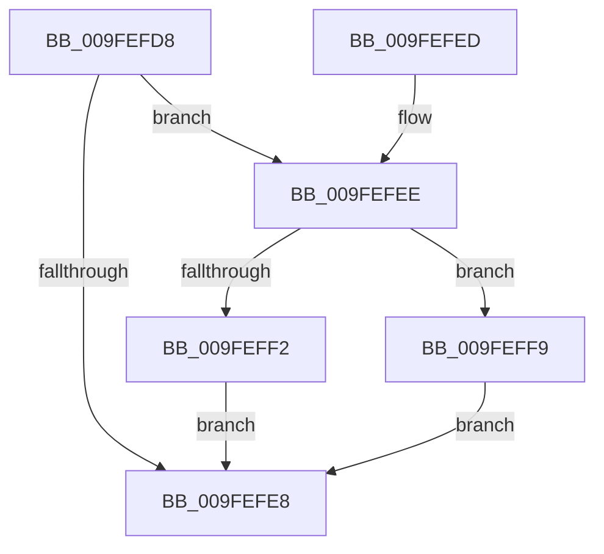

# SepRefDerefLuidToIndexEntryIfNecessary

- RVA: `0x009FEFD8`–`0x009FF000` (길이 `40` bytes)
- VA: `0x00000001409FEFD8`
- 실행 섹션: `PAGE`
- PDB 이름 있음: `예`; PDB Function 태그: `아니요`
- unwind 정보 RVA: `0x0007A1AC`
- 디코드: `13`개 명령, `40/40` bytes 표시
- 미해석 바이트: `0` (있으면 어셈블리에 `.byte`로 보존)

> 이 문서는 커널 이미지의 기계어와 PDB 기호를 분석해 생성했습니다. 4번과 5번은 함수 원형과 자료형을 바이너리 사용 방식에서 추정한 C 해석이며 원본 소스 복구 결과는 아닙니다.

## 1. Dependencies

- 직접 호출 지점: **2**; 고유 호출 대상: **2**
- 직접 호출자로 확인된 함수: **3**
- RIP 상대 이미지 참조: **0**

### Outgoing calls
- `0x009FEFF2` → [SepReferenceLuidToIndexEntry](../../text/45/SepReferenceLuidToIndexEntry_function_004595C4.md) (function, `0x004595C4`)
- `0x009FEFF9` → [SepDereferenceLuidToIndexEntry](../../text/45/SepDereferenceLuidToIndexEntry_function_0045CEE8.md) (function, `0x0045CEE8`)

### Direct callers
- [SepDuplicateToken](../8B/SepDuplicateToken_function_008B87EC.md) at `0x008B8C6B`
- [SepFilterToken](../9C/SepFilterToken_function_009C6B80.md) at `0x009C70E5`
- [SepTokenDeleteMethod](../AF/SepTokenDeleteMethod_function_00AF23D0.md) at `0x00AF253A`

### Static image references
- 디코드된 RIP-relative 메모리 참조가 없습니다.

## 2. Other-region calls and transfers

- 다른 실행 섹션으로 향하는 call: **2**
  - `0x009FEFF2` → [SepReferenceLuidToIndexEntry](../../text/45/SepReferenceLuidToIndexEntry_function_004595C4.md) (`PAGE` → `.text`)
  - `0x009FEFF9` → [SepDereferenceLuidToIndexEntry](../../text/45/SepDereferenceLuidToIndexEntry_function_0045CEE8.md) (`PAGE` → `.text`)
- 별도 외부 분기/꼬리 이동을 확인하지 못했습니다.

## 3. Assembly (complete function range)

```asm
009FEFD8  48 83 EC 28                     sub rsp, 0x28
009FEFDC  48 8B 89 70 04 00 00            mov rcx, qword ptr [rcx + 0x470]
009FEFE3  48 85 C9                        test rcx, rcx
009FEFE6  75 06                           jne 0x1409fefee
009FEFE8  48 83 C4 28                     add rsp, 0x28
009FEFEC  C3                              ret
009FEFED  CC                              int3
009FEFEE  84 D2                           test dl, dl
009FEFF0  75 07                           jne 0x1409feff9
009FEFF2  E8 CD A5 A5 FF                  call 0x1404595c4
009FEFF7  EB EF                           jmp 0x1409fefe8
009FEFF9  E8 EA DE A5 FF                  call 0x14045cee8
009FEFFE  EB E8                           jmp 0x1409fefe8
```

## 4. C-style interpretation (structured pseudocode)

```c
__int64 __fastcall SepRefDerefLuidToIndexEntryIfNecessary(__int64 a1, unsigned __int8 a2)
{
    __int64 result;
    __int64 v_rsp;

    v_rsp = (v_rsp) - (40);
    if (*(unsigned __int64 *)(a1 + 1136) != 0) goto loc_009FEFEE;
loc_009FEFE8:
    v_rsp = (v_rsp) + (40);
    return result;
loc_009FEFEE:
    if (a2 != 0) goto loc_009FEFF9;
    result = SepReferenceLuidToIndexEntry(*(unsigned __int64 *)(a1 + 1136), a2, a3, a4);
    goto loc_009FEFE8;
loc_009FEFF9:
    result = SepDereferenceLuidToIndexEntry(*(unsigned __int64 *)(a1 + 1136), a2, a3, a4);
    goto loc_009FEFE8;
}
```

## 5. (Beta) C Style

```c
int64_t SepRefDerefLuidToIndexEntryIfNecessary(void *Arg1, uint8_t Arg2)
{
    uint8_t *arg1 = (uint8_t *)Arg1;

    int64_t result;
    int64_t local_rsp;

    local_rsp = (local_rsp) - (40);
    if (*(uint64_t *)(arg1 + 0x470) != 0) goto loc_009FEFEE;
loc_009FEFE8:
    local_rsp = (local_rsp) + (40);
    return result;
loc_009FEFEE:
    if (Arg2 != 0) goto loc_009FEFF9;
    result = SepReferenceLuidToIndexEntry(*(uint64_t *)(arg1 + 0x470), Arg2, a3, a4);
    goto loc_009FEFE8;
loc_009FEFF9:
    result = SepDereferenceLuidToIndexEntry(*(uint64_t *)(arg1 + 0x470), Arg2, a3, a4);
    goto loc_009FEFE8;
}
```

### 관측된 메모리 오프셋

구조체 형식이 확인되지 않은 접근은 인자 기준의 오프셋으로만 기록했습니다.

| 기준 인자 | 오프셋 표현 | 폭 (bit) | 접근 |
|---|---:|---:|---|
| `Arg1` | `+ 0x470` | `64` | `R` |

## 6. Execution-region graph

[열기: 2D/3D 그래프와 함수 탐색 컨트롤 패널](../../../control-panel.html?section=page&rva=0x009FEFD8&view=graph)

- 2D 그래프는 위에서 아래로 흐르고, 3D 그래프는 빈 공간을 드래그해 회전합니다. Shift+드래그는 이동, 휠은 확대·축소, 함수 노드 선택은 대상 보고서 이동입니다.

### Static fallback


