# SepSetTokenUserAndGroups

- RVA: `0x009FDCD0`–`0x009FDFCE` (길이 `766` bytes)
- VA: `0x00000001409FDCD0`
- 실행 섹션: `PAGE`
- PDB 이름 있음: `예`; PDB Function 태그: `아니요`
- unwind 정보 RVA: `0x000A7408`
- 디코드: `189`개 명령, `766/766` bytes 표시
- 미해석 바이트: `0` (있으면 어셈블리에 `.byte`로 보존)

> 이 문서는 커널 이미지의 기계어와 PDB 기호를 분석해 생성했습니다. 4번과 5번은 함수 원형과 자료형을 바이너리 사용 방식에서 추정한 C 해석이며 원본 소스 복구 결과는 아닙니다.

## 1. Dependencies

- 직접 호출 지점: **11**; 고유 호출 대상: **10**
- 직접 호출자로 확인된 함수: **1**
- RIP 상대 이미지 참조: **0**

### Outgoing calls
- `0x009FDD20` → [SepDuplicateSid](SepDuplicateSid_function_009FE078.md) (function, `0x009FE078`)
- `0x009FDD59` → [SepCreateSidValuesBlock](../7A/SepCreateSidValuesBlock_function_007A0C84.md) (function, `0x007A0C84`)
- `0x009FDDA5` → [KeAbPreAcquire](../../text/21/KeAbPreAcquire_function_00210230.md) (function, `0x00210230`)
- `0x009FDDBE` → [ExfAcquirePushLockExclusiveEx](../../text/20/ExfAcquirePushLockExclusiveEx_function_0020FC90.md) (function, `0x0020FC90`)
- `0x009FDE2F` → [ExfTryToWakePushLock](../../text/26/ExfTryToWakePushLock_function_00265DD0.md) (function, `0x00265DD0`)
- `0x009FDE38` → [KeAbPostRelease](../../text/2E/KeAbPostRelease_function_002E1600.md) (function, `0x002E1600`)
- `0x009FDE3D` → [KeLeaveCriticalRegion](../../text/25/KeLeaveCriticalRegion_function_0025D8B0.md) (function, `0x0025D8B0`)
- `0x009FDE6A` → [SepCompareSidValuesBlocks](../7A/SepCompareSidValuesBlocks_function_007A0BE0.md) (function, `0x007A0BE0`)
- `0x009FDEAA` → [SepLogTokenSidManagement](../79/SepLogTokenSidManagement_function_0079DA10.md) (function, `0x0079DA10`)
- `0x009FDEFB` → [SepDereferenceSidValuesBlock](../7A/SepDereferenceSidValuesBlock_function_007A0F80.md) (function, `0x007A0F80`)
- `0x009FDF12` → [SepLogTokenSidManagement](../79/SepLogTokenSidManagement_function_0079DA10.md) (function, `0x0079DA10`)

### Direct callers
- [SepCreateTokenEx](../../text/4E/SepCreateTokenEx_function_004E9CD0.md) at `0x004EA619`

### Static image references
- 디코드된 RIP-relative 메모리 참조가 없습니다.

## 2. Other-region calls and transfers

- 다른 실행 섹션으로 향하는 call: **5**
  - `0x009FDDA5` → [KeAbPreAcquire](../../text/21/KeAbPreAcquire_function_00210230.md) (`PAGE` → `.text`)
  - `0x009FDDBE` → [ExfAcquirePushLockExclusiveEx](../../text/20/ExfAcquirePushLockExclusiveEx_function_0020FC90.md) (`PAGE` → `.text`)
  - `0x009FDE2F` → [ExfTryToWakePushLock](../../text/26/ExfTryToWakePushLock_function_00265DD0.md) (`PAGE` → `.text`)
  - `0x009FDE38` → [KeAbPostRelease](../../text/2E/KeAbPostRelease_function_002E1600.md) (`PAGE` → `.text`)
  - `0x009FDE3D` → [KeLeaveCriticalRegion](../../text/25/KeLeaveCriticalRegion_function_0025D8B0.md) (`PAGE` → `.text`)
- 별도 외부 분기/꼬리 이동을 확인하지 못했습니다.

## 3. Assembly (complete function range)

```asm
009FDCD0  4C 8B DC                        mov r11, rsp
009FDCD3  49 89 5B 18                     mov qword ptr [r11 + 0x18], rbx
009FDCD7  49 89 53 10                     mov qword ptr [r11 + 0x10], rdx
009FDCDB  55                              push rbp
009FDCDC  56                              push rsi
009FDCDD  57                              push rdi
009FDCDE  41 54                           push r12
009FDCE0  41 55                           push r13
009FDCE2  41 56                           push r14
009FDCE4  41 57                           push r15
009FDCE6  48 83 EC 40                     sub rsp, 0x40
009FDCEA  8B 81 D0 00 00 00               mov eax, dword ptr [rcx + 0xd0]
009FDCF0  33 ED                           xor ebp, ebp
009FDCF2  83 CB FF                        or ebx, 0xffffffff
009FDCF5  49 89 6B 08                     mov qword ptr [r11 + 8], rbp
009FDCF9  49 89 6B B8                     mov qword ptr [r11 - 0x48], rbp
009FDCFD  4D 8B F9                        mov r15, r9
009FDD00  45 8B E8                        mov r13d, r8d
009FDD03  48 8B F2                        mov rsi, rdx
009FDD06  48 8B F9                        mov rdi, rcx
009FDD09  44 8A F5                        mov r14b, bpl
009FDD0C  3B C3                           cmp eax, ebx
009FDD0E  74 29                           je 0x1409fdd39
009FDD10  8D 58 FF                        lea ebx, [rax - 1]
009FDD13  8B CB                           mov ecx, ebx
009FDD15  49 8D 53 B8                     lea rdx, [r11 - 0x48]
009FDD19  48 03 C9                        add rcx, rcx
009FDD1C  49 8B 0C C9                     mov rcx, qword ptr [r9 + rcx*8]
009FDD20  E8 53 03 00 00                  call 0x1409fe078
009FDD25  85 C0                           test eax, eax
009FDD27  0F 88 88 02 00 00               js 0x1409fdfb5
009FDD2D  48 8B 44 24 30                  mov rax, qword ptr [rsp + 0x30]
009FDD32  48 89 87 60 04 00 00            mov qword ptr [rdi + 0x460], rax
009FDD39  8B 84 24 A0 00 00 00            mov eax, dword ptr [rsp + 0xa0]
009FDD40  48 8D 8C 24 80 00 00 00         lea rcx, [rsp + 0x80]
009FDD48  89 5C 24 28                     mov dword ptr [rsp + 0x28], ebx
009FDD4C  4D 8B CF                        mov r9, r15
009FDD4F  45 8B C5                        mov r8d, r13d
009FDD52  89 44 24 20                     mov dword ptr [rsp + 0x20], eax
009FDD56  48 8B D6                        mov rdx, rsi
009FDD59  E8 26 2F DA FF                  call 0x1407a0c84
009FDD5E  44 8B E0                        mov r12d, eax
009FDD61  85 C0                           test eax, eax
009FDD63  0F 88 49 02 00 00               js 0x1409fdfb2
009FDD69  48 8B 8F D8 00 00 00            mov rcx, qword ptr [rdi + 0xd8]
009FDD70  48 39 A9 80 00 00 00            cmp qword ptr [rcx + 0x80], rbp
009FDD77  0F 85 D4 00 00 00               jne 0x1409fde51
009FDD7D  65 48 8B 0C 25 88 01 00 00      mov rcx, qword ptr gs:[0x188]
009FDD86  48 83 CB FF                     or rbx, 0xffffffffffffffff
009FDD8A  45 33 C0                        xor r8d, r8d
009FDD8D  33 D2                           xor edx, edx
009FDD8F  66 01 99 E4 01 00 00            add word ptr [rcx + 0x1e4], bx
009FDD96  90                              nop
009FDD97  48 8B B7 D8 00 00 00            mov rsi, qword ptr [rdi + 0xd8]
009FDD9E  48 83 C6 70                     add rsi, 0x70
009FDDA2  48 8B CE                        mov rcx, rsi
009FDDA5  E8 86 24 81 FF                  call 0x140210230
009FDDAA  F0 48 0F BA 2E 00               lock bts qword ptr [rsi], 0
009FDDB0  48 8B E8                        mov rbp, rax
009FDDB3  73 0E                           jae 0x1409fddc3
009FDDB5  4C 8B C6                        mov r8, rsi
009FDDB8  48 8B D0                        mov rdx, rax
009FDDBB  48 8B CE                        mov rcx, rsi
009FDDBE  E8 CD 1E 81 FF                  call 0x14020fc90
009FDDC3  48 85 ED                        test rbp, rbp
009FDDC6  74 04                           je 0x1409fddcc
009FDDC8  C6 45 0A 01                     mov byte ptr [rbp + 0xa], 1
009FDDCC  48 8B 87 D8 00 00 00            mov rax, qword ptr [rdi + 0xd8]
009FDDD3  33 ED                           xor ebp, ebp
009FDDD5  48 39 A8 80 00 00 00            cmp qword ptr [rax + 0x80], rbp
009FDDDC  75 38                           jne 0x1409fde16
009FDDDE  48 8B 84 24 80 00 00 00         mov rax, qword ptr [rsp + 0x80]
009FDDE6  8D 4D 01                        lea ecx, [rbp + 1]
009FDDE9  F0 48 0F C1 48 08               lock xadd qword ptr [rax + 8], rcx
009FDDEF  48 FF C1                        inc rcx
009FDDF2  48 83 F9 01                     cmp rcx, 1
009FDDF6  7F 05                           jg 0x1409fddfd
009FDDF8  8D 4D 0E                        lea ecx, [rbp + 0xe]
009FDDFB  CD 29                           int 0x29
009FDDFD  48 8B 8F D8 00 00 00            mov rcx, qword ptr [rdi + 0xd8]
009FDE04  41 B6 01                        mov r14b, 1
009FDE07  48 8B 84 24 80 00 00 00         mov rax, qword ptr [rsp + 0x80]
009FDE0F  48 89 81 80 00 00 00            mov qword ptr [rcx + 0x80], rax
009FDE16  48 8B B7 D8 00 00 00            mov rsi, qword ptr [rdi + 0xd8]
009FDE1D  F0 48 0F C1 5E 70               lock xadd qword ptr [rsi + 0x70], rbx
009FDE23  80 E3 06                        and bl, 6
009FDE26  80 FB 02                        cmp bl, 2
009FDE29  75 09                           jne 0x1409fde34
009FDE2B  48 8D 4E 70                     lea rcx, [rsi + 0x70]
009FDE2F  E8 9C 7F 86 FF                  call 0x140265dd0
009FDE34  48 8D 4E 70                     lea rcx, [rsi + 0x70]
009FDE38  E8 C3 37 8E FF                  call 0x1402e1600
009FDE3D  E8 6E FA 85 FF                  call 0x14025d8b0
009FDE42  45 84 F6                        test r14b, r14b
009FDE45  74 0A                           je 0x1409fde51
009FDE47  48 8B 9C 24 80 00 00 00         mov rbx, qword ptr [rsp + 0x80]
009FDE4F  EB 25                           jmp 0x1409fde76
009FDE51  48 8B 97 D8 00 00 00            mov rdx, qword ptr [rdi + 0xd8]
009FDE58  48 8B 9C 24 80 00 00 00         mov rbx, qword ptr [rsp + 0x80]
009FDE60  48 8B CB                        mov rcx, rbx
009FDE63  48 8B 92 80 00 00 00            mov rdx, qword ptr [rdx + 0x80]
009FDE6A  E8 71 2D DA FF                  call 0x1407a0be0
009FDE6F  8A C8                           mov cl, al
009FDE71  45 84 F6                        test r14b, r14b
009FDE74  74 12                           je 0x1409fde88
009FDE76  4C 8B 87 D8 00 00 00            mov r8, qword ptr [rdi + 0xd8]
009FDE7D  33 C9                           xor ecx, ecx
009FDE7F  4D 8B 80 80 00 00 00            mov r8, qword ptr [r8 + 0x80]
009FDE86  EB 7F                           jmp 0x1409fdf07
009FDE88  48 8B 87 D8 00 00 00            mov rax, qword ptr [rdi + 0xd8]
009FDE8F  4C 8B 80 80 00 00 00            mov r8, qword ptr [rax + 0x80]
009FDE96  84 C9                           test cl, cl
009FDE98  74 68                           je 0x1409fdf02
009FDE9A  4C 8B CF                        mov r9, rdi
009FDE9D  48 89 6C 24 20                  mov qword ptr [rsp + 0x20], rbp
009FDEA2  48 8B D3                        mov rdx, rbx
009FDEA5  B9 02 00 00 00                  mov ecx, 2
009FDEAA  E8 61 FB D9 FF                  call 0x14079da10
009FDEAF  48 8B 87 D8 00 00 00            mov rax, qword ptr [rdi + 0xd8]
009FDEB6  48 8B 90 80 00 00 00            mov rdx, qword ptr [rax + 0x80]
009FDEBD  B8 01 00 00 00                  mov eax, 1
009FDEC2  F0 48 0F C1 42 08               lock xadd qword ptr [rdx + 8], rax
009FDEC8  48 FF C0                        inc rax
009FDECB  48 83 F8 01                     cmp rax, 1
009FDECF  7F 07                           jg 0x1409fded8
009FDED1  B9 0E 00 00 00                  mov ecx, 0xe
009FDED6  CD 29                           int 0x29
009FDED8  48 8B 87 D8 00 00 00            mov rax, qword ptr [rdi + 0xd8]
009FDEDF  45 33 C0                        xor r8d, r8d
009FDEE2  48 8B D7                        mov rdx, rdi
009FDEE5  48 8B 88 80 00 00 00            mov rcx, qword ptr [rax + 0x80]
009FDEEC  48 89 8F 68 04 00 00            mov qword ptr [rdi + 0x468], rcx
009FDEF3  48 8B 8C 24 80 00 00 00         mov rcx, qword ptr [rsp + 0x80]
009FDEFB  E8 80 30 DA FF                  call 0x1407a0f80
009FDF00  EB 1C                           jmp 0x1409fdf1e
009FDF02  B9 01 00 00 00                  mov ecx, 1
009FDF07  4C 8B CF                        mov r9, rdi
009FDF0A  48 89 6C 24 20                  mov qword ptr [rsp + 0x20], rbp
009FDF0F  48 8B D3                        mov rdx, rbx
009FDF12  E8 F9 FA D9 FF                  call 0x14079da10
009FDF17  48 89 9F 68 04 00 00            mov qword ptr [rdi + 0x468], rbx
009FDF1E  4C 8B 8F 68 04 00 00            mov r9, qword ptr [rdi + 0x468]
009FDF25  48 8D 87 C0 05 00 00            lea rax, [rdi + 0x5c0]
009FDF2C  48 89 87 98 00 00 00            mov qword ptr [rdi + 0x98], rax
009FDF33  49 83 C1 18                     add r9, 0x18
009FDF37  41 8D 45 01                     lea eax, [r13 + 1]
009FDF3B  8B D5                           mov edx, ebp
009FDF3D  89 47 7C                        mov dword ptr [rdi + 0x7c], eax
009FDF40  85 C0                           test eax, eax
009FDF42  74 6E                           je 0x1409fdfb2
009FDF44  4C 8B 9C 24 88 00 00 00         mov r11, qword ptr [rsp + 0x88]
009FDF4C  48 8B 8F 98 00 00 00            mov rcx, qword ptr [rdi + 0x98]
009FDF53  44 8B C2                        mov r8d, edx
009FDF56  4D 03 C0                        add r8, r8
009FDF59  3B 97 D0 00 00 00               cmp edx, dword ptr [rdi + 0xd0]
009FDF5F  74 1E                           je 0x1409fdf7f
009FDF61  4E 89 0C C1                     mov qword ptr [rcx + r8*8], r9
009FDF65  B9 FC FF FF FF                  mov ecx, 0xfffffffc
009FDF6A  41 0F B6 41 01                  movzx eax, byte ptr [r9 + 1]
009FDF6F  48 8D 04 85 0B 00 00 00         lea rax, [rax*4 + 0xb]
009FDF77  48 23 C1                        and rax, rcx
009FDF7A  4C 03 C8                        add r9, rax
009FDF7D  EB 0B                           jmp 0x1409fdf8a
009FDF7F  48 8B 87 60 04 00 00            mov rax, qword ptr [rdi + 0x460]
009FDF86  4A 89 04 C1                     mov qword ptr [rcx + r8*8], rax
009FDF8A  4C 8B 97 98 00 00 00            mov r10, qword ptr [rdi + 0x98]
009FDF91  85 D2                           test edx, edx
009FDF93  75 06                           jne 0x1409fdf9b
009FDF95  41 8B 43 08                     mov eax, dword ptr [r11 + 8]
009FDF99  EB 0B                           jmp 0x1409fdfa6
009FDF9B  8D 4A FF                        lea ecx, [rdx - 1]
009FDF9E  48 03 C9                        add rcx, rcx
009FDFA1  41 8B 44 CF 08                  mov eax, dword ptr [r15 + rcx*8 + 8]
009FDFA6  FF C2                           inc edx
009FDFA8  43 89 44 C2 08                  mov dword ptr [r10 + r8*8 + 8], eax
009FDFAD  3B 57 7C                        cmp edx, dword ptr [rdi + 0x7c]
009FDFB0  72 9A                           jb 0x1409fdf4c
009FDFB2  41 8B C4                        mov eax, r12d
009FDFB5  48 8B 9C 24 90 00 00 00         mov rbx, qword ptr [rsp + 0x90]
009FDFBD  48 83 C4 40                     add rsp, 0x40
009FDFC1  41 5F                           pop r15
009FDFC3  41 5E                           pop r14
009FDFC5  41 5D                           pop r13
009FDFC7  41 5C                           pop r12
009FDFC9  5F                              pop rdi
009FDFCA  5E                              pop rsi
009FDFCB  5D                              pop rbp
009FDFCC  C3                              ret
009FDFCD  CC                              int3
```

## 4. C-style interpretation (structured pseudocode)

```c
__int64 __fastcall SepSetTokenUserAndGroups(__int64 a1, __int64 a2, int a3, __int64 a4, unsigned int a5)
{
    __int64 result;
    __int64 v_rbp;
    __int64 v_rbx;
    __int64 v_rsi;
    __int64 v_rsp;
    unsigned __int64 v_stack_m48;
    unsigned int v_stack_m50;
    unsigned int v_stack_m58;
    unsigned __int64 v_stack_p10;
    unsigned __int64 v_stack_p18;
    unsigned __int64 v_stack_p8;

    *(unsigned __int64 *)(v_rsp + 24) = v_rbx;
    *(unsigned __int64 *)(v_rsp + 16) = a2;
    v_rsp = (v_rsp) - (64);
    v_rbp = 0;
    v_rbx = (unsigned int)((v_rbx) | (0xFFFFFFFFULL));
    *(unsigned __int64 *)(v_rsp + 8) = 0;
    *(unsigned __int64 *)(v_rsp - 72) = 0;
    if (((unsigned int)((unsigned int)(*(unsigned int *)(a1 + 208)))) == ((unsigned int)(v_rbx))) goto loc_009FDD39;
    a1 = ((unsigned int)((unsigned int)((unsigned int)(*(unsigned int *)(a1 + 208)) - 1))) + ((unsigned int)((unsigned int)((unsigned int)(*(unsigned int *)(a1 + 208)) - 1)));
    result = SepDuplicateSid(*(unsigned __int64 *)(a4 + a1 * 8), v_rsp - 72, a3, a4);
    if (sign_flag) goto loc_009FDFB5;
    *(unsigned __int64 *)(a1 + 1120) = v_stack_m48;
loc_009FDD39:
    v_stack_m50 = (unsigned int)((unsigned int)(*(unsigned int *)(a1 + 208)) - 1);
    v_stack_m58 = (unsigned int)((unsigned int)(a5));
    result = SepCreateSidValuesBlock(v_stack_p8, a2, (unsigned int)((unsigned int)((unsigned int)(a3))), a4);
    if (sign_flag) goto loc_009FDFB2;
    if ((*(unsigned __int64 *)(*(unsigned __int64 *)(a1 + 216) + 128)) != 0) goto loc_009FDE51;
    v_rbx = ((unsigned int)(*(unsigned int *)(a1 + 208)) - 1) | (-1);
    a3 = 0;
    a2 = 0;
    v_rsi = (*(unsigned __int64 *)(a1 + 216)) + (112);
    result = KeAbPreAcquire(v_rsi, a2, a3, a4);
    if (!(condition_is_above_or_equal)) {
        a3 = v_rsi;
        a2 = result;
        a1 = v_rsi;
        result = ExfAcquirePushLockExclusiveEx(a1, a2, a3, a4);
    }
    if (result != 0) {
        *(unsigned __int8 *)(result + 10) = 1;
    }
    v_rbp = 0;
    if ((*(unsigned __int64 *)(*(unsigned __int64 *)(a1 + 216) + 128)) != 0) goto loc_009FDE16;
    a1 = (v_rbp + 1) + 1;
    if (a1 <= 1) {
        a1 = v_rbp + 14;
    }
    *(unsigned __int64 *)(*(unsigned __int64 *)(a1 + 216) + 128) = v_stack_p8;
loc_009FDE16:
    v_rbx = (unsigned __int8)((v_rbx) & (6));
    result = v_stack_p8;
    if (((unsigned __int8)(v_rbx)) == 2) {
        a1 = *(unsigned __int64 *)(a1 + 216) + 112;
        result = ExfTryToWakePushLock(a1, a2, a3, a4);
    }
    result = KeAbPostRelease(*(unsigned __int64 *)(a1 + 216) + 112, a2, a3, a4);
    result = KeLeaveCriticalRegion(*(unsigned __int64 *)(a1 + 216) + 112, a2, a3, a4);
    if (1 == 0) goto loc_009FDE51;
    goto loc_009FDE76;
loc_009FDE51:
    result = SepCompareSidValuesBlocks(v_stack_p8, *(unsigned __int64 *)(*(unsigned __int64 *)(a1 + 216) + 128), a3, a4);
    if (1 == 0) goto loc_009FDE88;
loc_009FDE76:
    a1 = 0;
    goto loc_009FDF07;
loc_009FDE88:
    if (0 == 0) goto loc_009FDF02;
    v_stack_m58 = 0;
    result = SepLogTokenSidManagement(2, v_stack_p8, *(unsigned __int64 *)(*(unsigned __int64 *)(a1 + 216) + 128), 0);
    result = (1) + 1;
    if (result <= 1) {
        a1 = 14;
    }
    a3 = 0;
    *(unsigned __int64 *)(a1 + 1128) = *(unsigned __int64 *)(*(unsigned __int64 *)(a1 + 216) + 128);
    result = SepDereferenceSidValuesBlock(v_stack_p8, a1, a3, 0);
    goto loc_009FDF1E;
loc_009FDF02:
loc_009FDF07:
    v_stack_m58 = 0;
    result = SepLogTokenSidManagement(1, v_stack_p8, a3, a1);
    *(unsigned __int64 *)(a1 + 1128) = v_stack_p8;
loc_009FDF1E:
    *(unsigned __int64 *)(a1 + 152) = a1 + 1472;
    a4 = (*(unsigned __int64 *)(a1 + 1128)) + (24);
    *(unsigned int *)(a1 + 124) = (unsigned int)((unsigned int)(a3) + 1);
    if ((unsigned int)((unsigned int)(a3) + 1) == 0) goto loc_009FDFB2;
loc_009FDF4C:
    a3 = (0) + (0);
    if (0 == (*(unsigned int *)(a1 + 208))) goto loc_009FDF7F;
    *(unsigned __int64 *)(*(unsigned __int64 *)(a1 + 152) + a3 * 8) = a4;
    result = (*(unsigned __int8 *)(a4 + 1) * 4 + 11) & ((unsigned int)(0xFFFFFFFCULL));
    a4 = (a4) + (result);
    goto loc_009FDF8A;
loc_009FDF7F:
    *(unsigned __int64 *)((unsigned int)(0xFFFFFFFCULL) + a3 * 8) = *(unsigned __int64 *)(a1 + 1120);
loc_009FDF8A:
    if (0 != 0) goto loc_009FDF9B;
    goto loc_009FDFA6;
loc_009FDF9B:
    a1 = (0 - 1) + (0 - 1);
loc_009FDFA6:
    a2 = (unsigned int)((0) + 1);
    *(unsigned int *)(*(unsigned __int64 *)(a1 + 152) + a3 * 8 + 8) = (unsigned int)((unsigned int)(*(unsigned int *)(a4 + a1 * 8 + 8)));
    if (((unsigned int)(a2)) < (*(unsigned int *)(a1 + 124))) goto loc_009FDF4C;
loc_009FDFB2:
loc_009FDFB5:
    v_rsp = (v_rsp) + (64);
    return (unsigned int)((unsigned int)((unsigned int)((unsigned int)(result))));
}
```

## 5. (Beta) C Style

```c
int64_t SepSetTokenUserAndGroups(void *Arg1, int64_t Arg2, void *Arg3, void *Arg4, uint32_t Arg5)
{
    uint8_t *arg1 = (uint8_t *)Arg1;
    uint8_t *arg3 = (uint8_t *)Arg3;
    uint8_t *arg4 = (uint8_t *)Arg4;

    int64_t result;
    int64_t local_rbp;
    int64_t local_rbx;
    int64_t local_rsi;
    int64_t local_rsp;
    uint64_t v_stack_m48;
    uint32_t v_stack_m50;
    uint32_t v_stack_m58;
    uint64_t v_stack_p10;
    uint64_t v_stack_p18;
    uint64_t v_stack_p8;

    *(uint64_t *)(local_rsp + 0x18) = local_rbx;
    *(uint64_t *)(local_rsp + 0x10) = Arg2;
    local_rsp = (local_rsp) - (64);
    local_rbp = 0;
    local_rbx = (uint32_t)((local_rbx) | (0xFFFFFFFFULL));
    *(uint64_t *)(local_rsp + 0x8) = 0;
    *(uint64_t *)(local_rsp - 0x48) = 0;
    if (((uint32_t)((uint32_t)(*(uint32_t *)(arg1 + 0xD0)))) == ((uint32_t)(local_rbx))) goto loc_009FDD39;
    Arg1 = ((uint32_t)((uint32_t)((uint32_t)(*(uint32_t *)(arg1 + 0xD0)) - 1))) + ((uint32_t)((uint32_t)((uint32_t)(*(uint32_t *)(arg1 + 0xD0)) - 1)));
    result = SepDuplicateSid(*(uint64_t *)(arg4 + arg1 * 8), local_rsp - 72, Arg3, Arg4);
    if (sign_flag) goto loc_009FDFB5;
    *(uint64_t *)(arg1 + 0x460) = v_stack_m48;
loc_009FDD39:
    v_stack_m50 = (uint32_t)((uint32_t)(*(uint32_t *)(arg1 + 0xD0)) - 1);
    v_stack_m58 = (uint32_t)((uint32_t)(Arg5));
    result = SepCreateSidValuesBlock(v_stack_p8, Arg2, (uint32_t)((uint32_t)((uint32_t)(Arg3))), Arg4);
    if (sign_flag) goto loc_009FDFB2;
    if ((*(uint64_t *)(*(uint64_t *)(arg1 + 0xD8) + 0x80)) != 0) goto loc_009FDE51;
    local_rbx = ((uint32_t)(*(uint32_t *)(arg1 + 0xD0)) - 1) | (-1);
    Arg3 = 0;
    Arg2 = 0;
    local_rsi = (*(uint64_t *)(arg1 + 0xD8)) + (112);
    result = KeAbPreAcquire(local_rsi, Arg2, Arg3, Arg4);
    if (!(condition_is_above_or_equal)) {
        Arg3 = local_rsi;
        Arg2 = result;
        Arg1 = local_rsi;
        result = ExfAcquirePushLockExclusiveEx(Arg1, Arg2, Arg3, Arg4);
    }
    if (result != 0) {
        *(uint8_t *)(result + 0xA) = 1;
    }
    local_rbp = 0;
    if ((*(uint64_t *)(*(uint64_t *)(arg1 + 0xD8) + 0x80)) != 0) goto loc_009FDE16;
    Arg1 = (local_rbp + 1) + 1;
    if (Arg1 <= 1) {
        Arg1 = local_rbp + 14;
    }
    *(uint64_t *)(*(uint64_t *)(arg1 + 0xD8) + 0x80) = v_stack_p8;
loc_009FDE16:
    local_rbx = (uint8_t)((local_rbx) & (6));
    result = v_stack_p8;
    if (((uint8_t)(local_rbx)) == 2) {
        Arg1 = *(uint64_t *)(arg1 + 0xD8) + 112;
        result = ExfTryToWakePushLock(Arg1, Arg2, Arg3, Arg4);
    }
    result = KeAbPostRelease(*(uint64_t *)(arg1 + 0xD8) + 112, Arg2, Arg3, Arg4);
    result = KeLeaveCriticalRegion(*(uint64_t *)(arg1 + 0xD8) + 112, Arg2, Arg3, Arg4);
    if (1 == 0) goto loc_009FDE51;
    goto loc_009FDE76;
loc_009FDE51:
    result = SepCompareSidValuesBlocks(v_stack_p8, *(uint64_t *)(*(uint64_t *)(arg1 + 0xD8) + 0x80), Arg3, Arg4);
    if (1 == 0) goto loc_009FDE88;
loc_009FDE76:
    Arg1 = 0;
    goto loc_009FDF07;
loc_009FDE88:
    if (0 == 0) goto loc_009FDF02;
    v_stack_m58 = 0;
    result = SepLogTokenSidManagement(2, v_stack_p8, *(uint64_t *)(*(uint64_t *)(arg1 + 0xD8) + 0x80), 0);
    result = (1) + 1;
    if (result <= 1) {
        Arg1 = 14;
    }
    Arg3 = 0;
    *(uint64_t *)(arg1 + 0x468) = *(uint64_t *)(*(uint64_t *)(arg1 + 0xD8) + 0x80);
    result = SepDereferenceSidValuesBlock(v_stack_p8, Arg1, Arg3, 0);
    goto loc_009FDF1E;
loc_009FDF02:
loc_009FDF07:
    v_stack_m58 = 0;
    result = SepLogTokenSidManagement(1, v_stack_p8, Arg3, Arg1);
    *(uint64_t *)(arg1 + 0x468) = v_stack_p8;
loc_009FDF1E:
    *(void **)(arg1 + 0x98) = Arg1 + 1472;
    Arg4 = (*(uint64_t *)(arg1 + 0x468)) + (24);
    *(uint32_t *)(arg1 + 0x7C) = (uint32_t)((uint32_t)(Arg3) + 1);
    if ((uint32_t)((uint32_t)(Arg3) + 1) == 0) goto loc_009FDFB2;
loc_009FDF4C:
    Arg3 = (0) + (0);
    if (0 == (*(uint32_t *)(arg1 + 0xD0))) goto loc_009FDF7F;
    *(void **)(*(uint64_t *)(arg1 + 0x98) + arg3 * 8) = Arg4;
    result = (*(uint8_t *)(arg4 + 0x1) * 4 + 11) & ((uint32_t)(0xFFFFFFFCULL));
    Arg4 = (Arg4) + (result);
    goto loc_009FDF8A;
loc_009FDF7F:
    *(uint64_t *)((uint32_t)(0xFFFFFFFCULL) + arg3 * 8) = *(uint64_t *)(arg1 + 0x460);
loc_009FDF8A:
    if (0 != 0) goto loc_009FDF9B;
    goto loc_009FDFA6;
loc_009FDF9B:
    Arg1 = (0 - 1) + (0 - 1);
loc_009FDFA6:
    Arg2 = (uint32_t)((0) + 1);
    *(uint32_t *)(*(uint64_t *)(arg1 + 0x98) + arg3 * 8 + 0x8) = (uint32_t)((uint32_t)(*(uint32_t *)(arg4 + arg1 * 8 + 0x8)));
    if (((uint32_t)(Arg2)) < (*(uint32_t *)(arg1 + 0x7C))) goto loc_009FDF4C;
loc_009FDFB2:
loc_009FDFB5:
    local_rsp = (local_rsp) + (64);
    return (uint32_t)((uint32_t)((uint32_t)((uint32_t)(result))));
}
```

### 관측된 메모리 오프셋

구조체 형식이 확인되지 않은 접근은 인자 기준의 오프셋으로만 기록했습니다.

| 기준 인자 | 오프셋 표현 | 폭 (bit) | 접근 |
|---|---:|---:|---|
| `Arg1` | `+ 0x7C` | `32` | `R` |
| `Arg1` | `+ 0x7C` | `32` | `W` |
| `Arg1` | `+ 0x98` | `64` | `R` |
| `Arg1` | `+ 0x98` | `64` | `W` |
| `Arg1` | `+ 0xD0` | `32` | `R` |
| `Arg1` | `+ 0xD8` | `64` | `R` |
| `Arg1` | `+ 0x460` | `64` | `R` |
| `Arg1` | `+ 0x460` | `64` | `W` |
| `Arg1` | `+ 0x468` | `64` | `R` |
| `Arg1` | `+ 0x468` | `64` | `W` |
| `Arg1` | `+ 0x5C0` | `64` | `R` |
| `Arg3` | `+ 0x1` | `32` | `R` |
| `Arg4` | `+ 0x0 + rcx*8` | `64` | `R` |
| `Arg4` | `+ 0x8 + rcx*8` | `32` | `R` |

## 6. Execution-region graph

[열기: 2D/3D 그래프와 함수 탐색 컨트롤 패널](../../../control-panel.html?section=page&rva=0x009FDCD0&view=graph)

- 2D 그래프는 위에서 아래로 흐르고, 3D 그래프는 빈 공간을 드래그해 회전합니다. Shift+드래그는 이동, 휠은 확대·축소, 함수 노드 선택은 대상 보고서 이동입니다.

### Static fallback

```mermaid
flowchart TD
  bb_009FDCD0[BB_009FDCD0]
  bb_009FDD10[BB_009FDD10]
  bb_009FDD2D[BB_009FDD2D]
  bb_009FDD39[BB_009FDD39]
  bb_009FDD69[BB_009FDD69]
  bb_009FDD7D[BB_009FDD7D]
  bb_009FDDB5[BB_009FDDB5]
  bb_009FDDC3[BB_009FDDC3]
  bb_009FDDC8[BB_009FDDC8]
  bb_009FDDCC[BB_009FDDCC]
  bb_009FDDDE[BB_009FDDDE]
  bb_009FDDF8[BB_009FDDF8]
  bb_009FDDFD[BB_009FDDFD]
  bb_009FDE16[BB_009FDE16]
  bb_009FDE2B[BB_009FDE2B]
  bb_009FDE34[BB_009FDE34]
  bb_009FDE47[BB_009FDE47]
  bb_009FDE51[BB_009FDE51]
  bb_009FDE76[BB_009FDE76]
  bb_009FDE88[BB_009FDE88]
  bb_009FDE9A[BB_009FDE9A]
  bb_009FDED1[BB_009FDED1]
  bb_009FDED8[BB_009FDED8]
  bb_009FDF02[BB_009FDF02]
  bb_009FDF07[BB_009FDF07]
  bb_009FDF1E[BB_009FDF1E]
  bb_009FDF44[BB_009FDF44]
  bb_009FDF4C[BB_009FDF4C]
  bb_009FDF61[BB_009FDF61]
  bb_009FDF7F[BB_009FDF7F]
  bb_009FDF8A[BB_009FDF8A]
  bb_009FDF95[BB_009FDF95]
  bb_009FDF9B[BB_009FDF9B]
  bb_009FDFA6[BB_009FDFA6]
  bb_009FDFB2[BB_009FDFB2]
  bb_009FDFB5[BB_009FDFB5]
  bb_009FDFCD[BB_009FDFCD]
  bb_009FDCD0 -->|branch| bb_009FDD39
  bb_009FDCD0 -->|fallthrough| bb_009FDD10
  bb_009FDD10 -->|branch| bb_009FDFB5
  bb_009FDD10 -->|fallthrough| bb_009FDD2D
  bb_009FDD2D -->|flow| bb_009FDD39
  bb_009FDD39 -->|branch| bb_009FDFB2
  bb_009FDD39 -->|fallthrough| bb_009FDD69
  bb_009FDD69 -->|branch| bb_009FDE51
  bb_009FDD69 -->|fallthrough| bb_009FDD7D
  bb_009FDD7D -->|branch| bb_009FDDC3
  bb_009FDD7D -->|fallthrough| bb_009FDDB5
  bb_009FDDB5 -->|flow| bb_009FDDC3
  bb_009FDDC3 -->|branch| bb_009FDDCC
  bb_009FDDC3 -->|fallthrough| bb_009FDDC8
  bb_009FDDC8 -->|flow| bb_009FDDCC
  bb_009FDDCC -->|branch| bb_009FDE16
  bb_009FDDCC -->|fallthrough| bb_009FDDDE
  bb_009FDDDE -->|branch| bb_009FDDFD
  bb_009FDDDE -->|fallthrough| bb_009FDDF8
  bb_009FDDF8 -->|flow| bb_009FDDFD
  bb_009FDDFD -->|flow| bb_009FDE16
  bb_009FDE16 -->|branch| bb_009FDE34
  bb_009FDE16 -->|fallthrough| bb_009FDE2B
  bb_009FDE2B -->|flow| bb_009FDE34
  bb_009FDE34 -->|branch| bb_009FDE51
  bb_009FDE34 -->|fallthrough| bb_009FDE47
  bb_009FDE47 -->|branch| bb_009FDE76
  bb_009FDE51 -->|branch| bb_009FDE88
  bb_009FDE51 -->|fallthrough| bb_009FDE76
  bb_009FDE76 -->|branch| bb_009FDF07
  bb_009FDE88 -->|branch| bb_009FDF02
  bb_009FDE88 -->|fallthrough| bb_009FDE9A
  bb_009FDE9A -->|branch| bb_009FDED8
  bb_009FDE9A -->|fallthrough| bb_009FDED1
  bb_009FDED1 -->|flow| bb_009FDED8
  bb_009FDED8 -->|branch| bb_009FDF1E
  bb_009FDF02 -->|flow| bb_009FDF07
  bb_009FDF07 -->|flow| bb_009FDF1E
  bb_009FDF1E -->|branch| bb_009FDFB2
  bb_009FDF1E -->|fallthrough| bb_009FDF44
  bb_009FDF44 -->|flow| bb_009FDF4C
  bb_009FDF4C -->|branch| bb_009FDF7F
  bb_009FDF4C -->|fallthrough| bb_009FDF61
  bb_009FDF61 -->|branch| bb_009FDF8A
  bb_009FDF7F -->|flow| bb_009FDF8A
  bb_009FDF8A -->|branch| bb_009FDF9B
  bb_009FDF8A -->|fallthrough| bb_009FDF95
  bb_009FDF95 -->|branch| bb_009FDFA6
  bb_009FDF9B -->|flow| bb_009FDFA6
  bb_009FDFA6 -->|branch| bb_009FDF4C
  bb_009FDFA6 -->|fallthrough| bb_009FDFB2
  bb_009FDFB2 -->|flow| bb_009FDFB5
```


