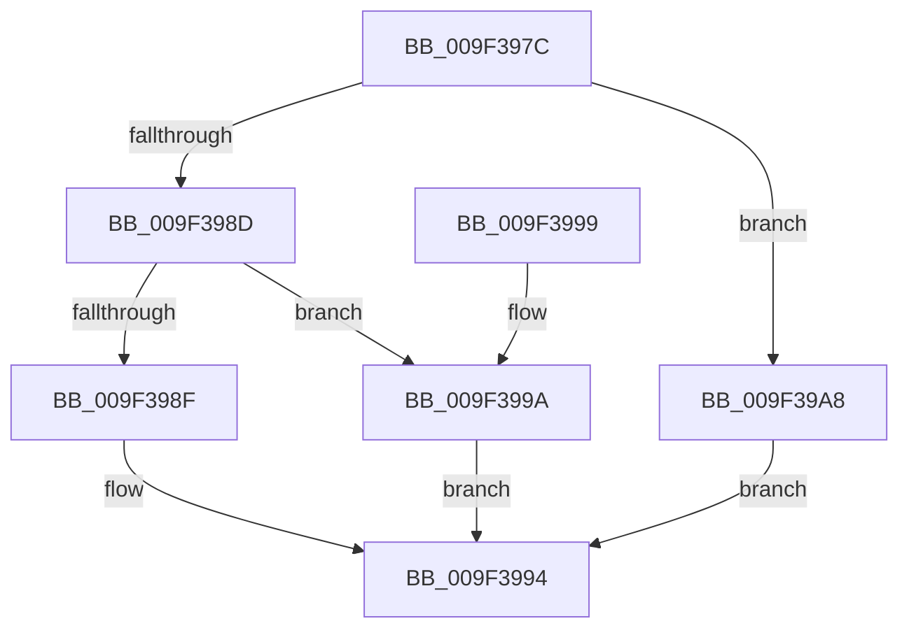

# TraitsCompare

- RVA: `0x009F397C`–`0x009F39AD` (길이 `49` bytes)
- VA: `0x00000001409F397C`
- 실행 섹션: `PAGE`
- PDB 이름 있음: `예`; PDB Function 태그: `아니요`
- unwind 정보 RVA: `0x00068D6C`
- 디코드: `16`개 명령, `49/49` bytes 표시
- 미해석 바이트: `0` (있으면 어셈블리에 `.byte`로 보존)

> 이 문서는 커널 이미지의 기계어와 PDB 기호를 분석해 생성했습니다. 4번과 5번은 함수 원형과 자료형을 바이너리 사용 방식에서 추정한 C 해석이며 원본 소스 복구 결과는 아닙니다.

## 1. Dependencies

- 직접 호출 지점: **1**; 고유 호출 대상: **1**
- 직접 호출자로 확인된 함수: **1**
- RIP 상대 이미지 참조: **0**

### Outgoing calls
- `0x009F39A1` → [memcmp](../../text/6C/memcmp_function_006C6B10.md) (function, `0x006C6B10`)

### Direct callers
- [EtwpSetProviderTraitsCommon](EtwpSetProviderTraitsCommon_function_009F36EC.md) at `0x009F37CB`

### Static image references
- 디코드된 RIP-relative 메모리 참조가 없습니다.

## 2. Other-region calls and transfers

- 다른 실행 섹션으로 향하는 call: **1**
  - `0x009F39A1` → [memcmp](../../text/6C/memcmp_function_006C6B10.md) (`PAGE` → `.text`)
- 별도 외부 분기/꼬리 이동을 확인하지 못했습니다.

## 3. Assembly (complete function range)

```asm
009F397C  48 83 EC 28                     sub rsp, 0x28
009F3980  0F B7 41 1C                     movzx eax, word ptr [rcx + 0x1c]
009F3984  48 83 C2 1C                     add rdx, 0x1c
009F3988  66 3B 02                        cmp ax, word ptr [rdx]
009F398B  72 1B                           jb 0x1409f39a8
009F398D  76 0B                           jbe 0x1409f399a
009F398F  B8 01 00 00 00                  mov eax, 1
009F3994  48 83 C4 28                     add rsp, 0x28
009F3998  C3                              ret
009F3999  CC                              int3
009F399A  4C 8B C0                        mov r8, rax
009F399D  48 83 C1 1C                     add rcx, 0x1c
009F39A1  E8 6A 31 CD FF                  call 0x1406c6b10
009F39A6  EB EC                           jmp 0x1409f3994
009F39A8  83 C8 FF                        or eax, 0xffffffff
009F39AB  EB E7                           jmp 0x1409f3994
```

## 4. C-style interpretation (structured pseudocode)

```c
__int64 __fastcall TraitsCompare(__int64 a1, __int64 a2)
{
    __int64 result;
    __int64 v_rsp;

    v_rsp = (v_rsp) - (40);
    a2 = (a2) + (28);
    if (((unsigned __int16)(*(unsigned __int16 *)(a1 + 28))) < (*(unsigned __int16 *)(a2))) goto loc_009F39A8;
    if (((unsigned __int16)(*(unsigned __int16 *)(a1 + 28))) <= (*(unsigned __int16 *)(a2))) goto loc_009F399A;
loc_009F3994:
    v_rsp = (v_rsp) + (40);
    return 1;
loc_009F399A:
    a1 = (a1) + (28);
    result = memcmp(a1, a2, 1, a4);
    goto loc_009F3994;
loc_009F39A8:
    result = (unsigned int)((result) | (0xFFFFFFFFULL));
    goto loc_009F3994;
}
```

## 5. (Beta) C Style

```c
int64_t TraitsCompare(void *Arg1, void *Arg2)
{
    uint8_t *arg1 = (uint8_t *)Arg1;
    uint8_t *arg2 = (uint8_t *)Arg2;

    int64_t result;
    int64_t local_rsp;

    local_rsp = (local_rsp) - (40);
    Arg2 = (Arg2) + (28);
    if (((uint16_t)(*(uint16_t *)(arg1 + 0x1C))) < (*(uint16_t *)(arg2))) goto loc_009F39A8;
    if (((uint16_t)(*(uint16_t *)(arg1 + 0x1C))) <= (*(uint16_t *)(arg2))) goto loc_009F399A;
loc_009F3994:
    local_rsp = (local_rsp) + (40);
    return 1;
loc_009F399A:
    Arg1 = (Arg1) + (28);
    result = memcmp(Arg1, Arg2, 1, a4);
    goto loc_009F3994;
loc_009F39A8:
    result = (uint32_t)((result) | (0xFFFFFFFFULL));
    goto loc_009F3994;
}
```

### 관측된 메모리 오프셋

구조체 형식이 확인되지 않은 접근은 인자 기준의 오프셋으로만 기록했습니다.

| 기준 인자 | 오프셋 표현 | 폭 (bit) | 접근 |
|---|---:|---:|---|
| `Arg1` | `+ 0x1C` | `16` | `R` |
| `Arg2` | `+ 0x0` | `16` | `R` |

## 6. Execution-region graph

[열기: 2D/3D 그래프와 함수 탐색 컨트롤 패널](../../../control-panel.html?section=page&rva=0x009F397C&view=graph)

- 2D 그래프는 위에서 아래로 흐르고, 3D 그래프는 빈 공간을 드래그해 회전합니다. Shift+드래그는 이동, 휠은 확대·축소, 함수 노드 선택은 대상 보고서 이동입니다.

### Static fallback


