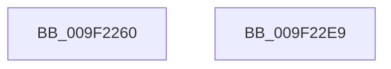

# sub_009F2260

- RVA: `0x009F2260`–`0x009F22EA` (길이 `138` bytes)
- VA: `0x00000001409F2260`
- 실행 섹션: `PAGE`
- PDB 이름 있음: `아니요`; PDB Function 태그: `아니요`
- unwind 정보 RVA: `0x000950EC`
- 디코드: `37`개 명령, `138/138` bytes 표시
- 미해석 바이트: `0` (있으면 어셈블리에 `.byte`로 보존)

> 이 문서는 커널 이미지의 기계어와 PDB 기호를 분석해 생성했습니다. 4번과 5번은 함수 원형과 자료형을 바이너리 사용 방식에서 추정한 C 해석이며 원본 소스 복구 결과는 아닙니다.

## 1. Dependencies

- 직접 호출 지점: **0**; 고유 호출 대상: **0**
- 직접 호출자로 확인된 함수: **0**
- RIP 상대 이미지 참조: **0**

### Outgoing calls
- 직접 디코드된 call 명령이 없습니다.

### Direct callers
- 이 함수 시작 RVA로 연결되는 직접 call은 확인되지 않았습니다. 간접 호출은 완전히 역산할 수 없습니다.

### Static image references
- 디코드된 RIP-relative 메모리 참조가 없습니다.

## 2. Other-region calls and transfers

- 다른 실행 섹션으로 향하는 call: **0**
- 별도 외부 분기/꼬리 이동을 확인하지 못했습니다.

## 3. Assembly (complete function range)

```asm
009F2260  48 89 5C 24 08                  mov qword ptr [rsp + 8], rbx
009F2265  48 89 7C 24 10                  mov qword ptr [rsp + 0x10], rdi
009F226A  44 8B 54 24 38                  mov r10d, dword ptr [rsp + 0x38]
009F226F  48 8B F9                        mov rdi, rcx
009F2272  48 8B DA                        mov rbx, rdx
009F2275  41 0F B6 C8                     movzx ecx, r8b
009F2279  83 E7 03                        and edi, 3
009F227C  48 B8 89 88 88 88 88 88 88 88   movabs rax, 0x8888888888888889
009F2286  49 F7 E0                        mul r8
009F2289  41 8B C2                        mov eax, r10d
009F228C  45 8B DA                        mov r11d, r10d
009F228F  48 C1 EA 03                     shr rdx, 3
009F2293  4C 6B CA 0F                     imul r9, rdx, 0xf
009F2297  41 2A C9                        sub cl, r9b
009F229A  45 2A C8                        sub r9b, r8b
009F229D  FE C1                           inc cl
009F229F  41 D3 EB                        shr r11d, cl
009F22A2  41 8D 49 1F                     lea ecx, [r9 + 0x1f]
009F22A6  D3 E0                           shl eax, cl
009F22A8  48 8B 4C 24 30                  mov rcx, qword ptr [rsp + 0x30]
009F22AD  44 0B D8                        or r11d, eax
009F22B0  48 B8 AB AA AA AA AA AA AA AA   movabs rax, 0xaaaaaaaaaaaaaaab
009F22BA  48 F7 E3                        mul rbx
009F22BD  48 8D 43 01                     lea rax, [rbx + 1]
009F22C1  48 8B 5C 24 08                  mov rbx, qword ptr [rsp + 8]
009F22C6  48 D1 EA                        shr rdx, 1
009F22C9  48 03 D7                        add rdx, rdi
009F22CC  48 03 C2                        add rax, rdx
009F22CF  83 E0 03                        and eax, 3
009F22D2  0F B7 04 41                     movzx eax, word ptr [rcx + rax*2]
009F22D6  0F B7 0C 79                     movzx ecx, word ptr [rcx + rdi*2]
009F22DA  41 33 C2                        xor eax, r10d
009F22DD  48 8B 7C 24 10                  mov rdi, qword ptr [rsp + 0x10]
009F22E2  0F AF C1                        imul eax, ecx
009F22E5  41 2B C3                        sub eax, r11d
009F22E8  C3                              ret
009F22E9  CC                              int3
```

## 4. C-style interpretation (structured pseudocode)

```c
__int64 __fastcall sub_009F2260(__int64 a1, __int64 a2, __int64 a3, __int64 a4, __int64 a5, __int64 a6, unsigned int a7)
{
    __int64 result;
    __int64 v_r11;
    __int64 v_rdi;
    unsigned __int64 v_stack_p10;
    unsigned __int64 v_stack_p8;

    v_stack_p8 = v_rbx;
    v_stack_p10 = v_rdi;
    v_rdi = (unsigned int)((a1) & (3));
    a2 = (a2) >> (3);
    a4 = (a4) * (a2);
    a1 = (unsigned __int8)(((unsigned __int8)(a3)) - ((unsigned __int8)(a4)));
    a4 = (unsigned __int8)((a4) - ((unsigned __int8)(a3)));
    a1 = (unsigned __int8)((a1) + 1);
    v_r11 = (unsigned int)(((unsigned int)((unsigned int)((unsigned int)(a7)))) >> ((unsigned __int8)(a1)));
    result = (unsigned int)(((unsigned int)((unsigned int)((unsigned int)(a7)))) << ((unsigned __int8)(a4 + 31)));
    v_r11 = (unsigned int)((v_r11) | ((unsigned int)(result)));
    a2 = (a2) >> (1);
    a2 = (a2) + (v_rdi);
    result = (a2 + 1) + (a2);
    result = (unsigned int)((result) & (3));
    result = (unsigned int)((*(unsigned __int16 *)(a6 + result * 2)) ^ ((unsigned int)((unsigned int)(a7))));
    result = (unsigned int)((result) * ((unsigned int)(*(unsigned __int16 *)(a6 + v_rdi * 2))));
    result = (unsigned int)((result) - ((unsigned int)(v_r11)));
    return result;
}
```

## 5. (Beta) C Style

```c
int64_t sub_009F2260(int64_t Arg1, int64_t Arg2, int64_t Arg3, void *Arg4, uint64_t Arg5, void *Arg6, uint32_t Arg7)
{
    uint8_t *arg4 = (uint8_t *)Arg4;
    uint8_t *arg6 = (uint8_t *)Arg6;

    int64_t result;
    int64_t local_r11;
    int64_t local_rdi;
    uint64_t v_stack_p10;
    uint64_t v_stack_p8;

    v_stack_p8 = local_rbx;
    v_stack_p10 = local_rdi;
    local_rdi = (uint32_t)((Arg1) & (3));
    Arg2 = (Arg2) >> (3);
    Arg4 = (Arg4) * (Arg2);
    Arg1 = (uint8_t)(((uint8_t)(Arg3)) - ((uint8_t)(Arg4)));
    Arg4 = (uint8_t)((Arg4) - ((uint8_t)(Arg3)));
    Arg1 = (uint8_t)((Arg1) + 1);
    local_r11 = (uint32_t)(((uint32_t)((uint32_t)((uint32_t)(Arg7)))) >> ((uint8_t)(Arg1)));
    result = (uint32_t)(((uint32_t)((uint32_t)((uint32_t)(Arg7)))) << ((uint8_t)(Arg4 + 31)));
    local_r11 = (uint32_t)((local_r11) | ((uint32_t)(result)));
    Arg2 = (Arg2) >> (1);
    Arg2 = (Arg2) + (local_rdi);
    result = (Arg2 + 1) + (Arg2);
    result = (uint32_t)((result) & (3));
    result = (uint32_t)((*(uint16_t *)(arg6 + result * 2)) ^ ((uint32_t)((uint32_t)(Arg7))));
    result = (uint32_t)((result) * ((uint32_t)(*(uint16_t *)(arg6 + local_rdi * 2))));
    result = (uint32_t)((result) - ((uint32_t)(local_r11)));
    return result;
}
```

### 관측된 메모리 오프셋

구조체 형식이 확인되지 않은 접근은 인자 기준의 오프셋으로만 기록했습니다.

| 기준 인자 | 오프셋 표현 | 폭 (bit) | 접근 |
|---|---:|---:|---|
| `Arg4` | `+ 0x1F` | `32` | `R` |
| `Arg6` | `+ 0x0 + rax*2` | `16` | `R` |
| `Arg6` | `+ 0x0 + rdi*2` | `16` | `R` |

## 6. Execution-region graph

[열기: 2D/3D 그래프와 함수 탐색 컨트롤 패널](../../../control-panel.html?section=page&rva=0x009F2260&view=graph)

- 2D 그래프는 위에서 아래로 흐르고, 3D 그래프는 빈 공간을 드래그해 회전합니다. Shift+드래그는 이동, 휠은 확대·축소, 함수 노드 선택은 대상 보고서 이동입니다.

### Static fallback


