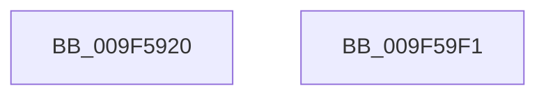

# sub_009F5920

- RVA: `0x009F5920`–`0x009F59F2` (길이 `210` bytes)
- VA: `0x00000001409F5920`
- 실행 섹션: `PAGE`
- PDB 이름 있음: `아니요`; PDB Function 태그: `아니요`
- unwind 정보 RVA: `0x000950A8`
- 디코드: `62`개 명령, `210/210` bytes 표시
- 미해석 바이트: `0` (있으면 어셈블리에 `.byte`로 보존)

> 이 문서는 커널 이미지의 기계어와 PDB 기호를 분석해 생성했습니다. 4번과 5번은 함수 원형과 자료형을 바이너리 사용 방식에서 추정한 C 해석이며 원본 소스 복구 결과는 아닙니다.

## 1. Dependencies

- 직접 호출 지점: **0**; 고유 호출 대상: **0**
- 직접 호출자로 확인된 함수: **0**
- RIP 상대 이미지 참조: **0**

### Outgoing calls
- 직접 디코드된 call 명령이 없습니다.

### Direct callers
- 이 함수 시작 RVA로 연결되는 직접 call은 확인되지 않았습니다. 간접 호출은 완전히 역산할 수 없습니다.

### Static image references
- 디코드된 RIP-relative 메모리 참조가 없습니다.

## 2. Other-region calls and transfers

- 다른 실행 섹션으로 향하는 call: **0**
- 별도 외부 분기/꼬리 이동을 확인하지 못했습니다.

## 3. Assembly (complete function range)

```asm
009F5920  48 89 5C 24 08                  mov qword ptr [rsp + 8], rbx
009F5925  48 89 6C 24 10                  mov qword ptr [rsp + 0x10], rbp
009F592A  48 89 74 24 18                  mov qword ptr [rsp + 0x18], rsi
009F592F  48 89 7C 24 20                  mov qword ptr [rsp + 0x20], rdi
009F5934  41 56                           push r14
009F5936  8B 6C 24 40                     mov ebp, dword ptr [rsp + 0x40]
009F593A  48 8B F1                        mov rsi, rcx
009F593D  48 8B 5C 24 38                  mov rbx, qword ptr [rsp + 0x38]
009F5942  48 8B C1                        mov rax, rcx
009F5945  48 D1 E8                        shr rax, 1
009F5948  4D 8B F1                        mov r14, r9
009F594B  48 FF C8                        dec rax
009F594E  49 8B F8                        mov rdi, r8
009F5951  83 E0 01                        and eax, 1
009F5954  44 8B DD                        mov r11d, ebp
009F5957  49 B9 11 42 08 21 84 10 42 08   movabs r9, 0x842108421084211
009F5961  49 8B C8                        mov rcx, r8
009F5964  83 E6 03                        and esi, 3
009F5967  44 33 1C 83                     xor r11d, dword ptr [rbx + rax*4]
009F596B  49 8B C1                        mov rax, r9
009F596E  49 F7 E0                        mul r8
009F5971  49 8B C1                        mov rax, r9
009F5974  45 8B D3                        mov r10d, r11d
009F5977  48 2B CA                        sub rcx, rdx
009F597A  48 D1 E9                        shr rcx, 1
009F597D  48 03 CA                        add rcx, rdx
009F5980  48 C1 E9 04                     shr rcx, 4
009F5984  4C 6B C1 1F                     imul r8, rcx, 0x1f
009F5988  49 F7 E6                        mul r14
009F598B  40 0F B6 CF                     movzx ecx, dil
009F598F  49 8B C6                        mov rax, r14
009F5992  41 2A C8                        sub cl, r8b
009F5995  44 2A C7                        sub r8b, dil
009F5998  48 8B 7C 24 28                  mov rdi, qword ptr [rsp + 0x28]
009F599D  FE C1                           inc cl
009F599F  41 D3 EA                        shr r10d, cl
009F59A2  48 2B C2                        sub rax, rdx
009F59A5  41 8D 48 1F                     lea ecx, [r8 + 0x1f]
009F59A9  41 D3 E3                        shl r11d, cl
009F59AC  41 0F B6 CE                     movzx ecx, r14b
009F59B0  48 D1 E8                        shr rax, 1
009F59B3  45 0B D3                        or r10d, r11d
009F59B6  48 03 C2                        add rax, rdx
009F59B9  8B D5                           mov edx, ebp
009F59BB  48 C1 E8 04                     shr rax, 4
009F59BF  4C 6B C8 1F                     imul r9, rax, 0x1f
009F59C3  0F B7 04 73                     movzx eax, word ptr [rbx + rsi*2]
009F59C7  48 8B 5C 24 10                  mov rbx, qword ptr [rsp + 0x10]
009F59CC  41 2A C9                        sub cl, r9b
009F59CF  48 8B 74 24 20                  mov rsi, qword ptr [rsp + 0x20]
009F59D4  FE C1                           inc cl
009F59D6  D3 EA                           shr edx, cl
009F59D8  45 2A CE                        sub r9b, r14b
009F59DB  41 0F AF C2                     imul eax, r10d
009F59DF  41 8D 49 1F                     lea ecx, [r9 + 0x1f]
009F59E3  D3 E5                           shl ebp, cl
009F59E5  0B D5                           or edx, ebp
009F59E7  48 8B 6C 24 18                  mov rbp, qword ptr [rsp + 0x18]
009F59EC  2B C2                           sub eax, edx
009F59EE  41 5E                           pop r14
009F59F0  C3                              ret
009F59F1  CC                              int3
```

## 4. C-style interpretation (structured pseudocode)

```c
__int64 __fastcall sub_009F5920(__int64 a1, __int64 a2, __int64 a3, __int64 a4, __int64 a5, __int64 a6, unsigned int a7)
{
    __int64 result;
    __int64 v_r10;
    __int64 v_r11;
    __int64 v_rbp;
    __int64 v_rsi;
    unsigned __int64 v_stack_p10;
    unsigned __int64 v_stack_p18;
    unsigned __int64 v_stack_p20;
    unsigned __int64 v_stack_p8;

    v_stack_p8 = v_rbx;
    v_stack_p10 = v_rbp;
    v_stack_p18 = v_rsi;
    v_stack_p20 = v_rdi;
    result = (a1) >> (1);
    result = (result) - 1;
    result = (unsigned int)((result) & (1));
    v_rsi = (unsigned int)((a1) & (3));
    v_r11 = (unsigned int)(((unsigned int)((unsigned int)((unsigned int)(a7)))) ^ (*(unsigned int *)(a6 + result * 4)));
    a1 = (a3) - (a2);
    a1 = (a1) >> (1);
    a1 = (a1) + (a2);
    a1 = (a1) >> (4);
    a3 = (a3) * (a1);
    a1 = (unsigned __int8)(((unsigned __int8)(a3)) - ((unsigned __int8)(a3)));
    a3 = (unsigned __int8)((a3) - ((unsigned __int8)(a3)));
    a1 = (unsigned __int8)((a1) + 1);
    v_r10 = (unsigned int)(((unsigned int)((unsigned int)(v_r11))) >> ((unsigned __int8)(a1)));
    result = (a4) - (a2);
    v_r11 = (unsigned int)((v_r11) << ((unsigned __int8)(a3 + 31)));
    result = (result) >> (1);
    v_r10 = (unsigned int)((v_r10) | ((unsigned int)(v_r11)));
    result = (result) + (a2);
    result = (result) >> (4);
    a4 = (a4) * (result);
    a1 = (unsigned __int8)(((unsigned __int8)(a4)) - ((unsigned __int8)(a4)));
    a1 = (unsigned __int8)((a1) + 1);
    a2 = (unsigned int)(((unsigned int)((unsigned int)((unsigned int)(a7)))) >> ((unsigned __int8)(a1)));
    a4 = (unsigned __int8)((a4) - ((unsigned __int8)(a4)));
    result = (unsigned int)((*(unsigned __int16 *)(a6 + v_rsi * 2)) * ((unsigned int)(v_r10)));
    v_rbp = (unsigned int)(((unsigned int)(a7)) << ((unsigned __int8)(a4 + 31)));
    a2 = (unsigned int)((a2) | ((unsigned int)(v_rbp)));
    result = (unsigned int)((result) - ((unsigned int)(a2)));
    return result;
}
```

## 5. (Beta) C Style

```c
int64_t sub_009F5920(int64_t Arg1, int64_t Arg2, int64_t Arg3, int64_t Arg4, uint64_t Arg5, void *Arg6, uint32_t Arg7)
{
    uint8_t *arg6 = (uint8_t *)Arg6;

    int64_t result;
    int64_t local_r10;
    int64_t local_r11;
    int64_t local_rbp;
    int64_t local_rsi;
    uint64_t v_stack_p10;
    uint64_t v_stack_p18;
    uint64_t v_stack_p20;
    uint64_t v_stack_p8;

    v_stack_p8 = local_rbx;
    v_stack_p10 = local_rbp;
    v_stack_p18 = local_rsi;
    v_stack_p20 = local_rdi;
    result = (Arg1) >> (1);
    result = (result) - 1;
    result = (uint32_t)((result) & (1));
    local_rsi = (uint32_t)((Arg1) & (3));
    local_r11 = (uint32_t)(((uint32_t)((uint32_t)((uint32_t)(Arg7)))) ^ (*(uint32_t *)(arg6 + result * 4)));
    Arg1 = (Arg3) - (Arg2);
    Arg1 = (Arg1) >> (1);
    Arg1 = (Arg1) + (Arg2);
    Arg1 = (Arg1) >> (4);
    Arg3 = (Arg3) * (Arg1);
    Arg1 = (uint8_t)(((uint8_t)(Arg3)) - ((uint8_t)(Arg3)));
    Arg3 = (uint8_t)((Arg3) - ((uint8_t)(Arg3)));
    Arg1 = (uint8_t)((Arg1) + 1);
    local_r10 = (uint32_t)(((uint32_t)((uint32_t)(local_r11))) >> ((uint8_t)(Arg1)));
    result = (Arg4) - (Arg2);
    local_r11 = (uint32_t)((local_r11) << ((uint8_t)(Arg3 + 31)));
    result = (result) >> (1);
    local_r10 = (uint32_t)((local_r10) | ((uint32_t)(local_r11)));
    result = (result) + (Arg2);
    result = (result) >> (4);
    Arg4 = (Arg4) * (result);
    Arg1 = (uint8_t)(((uint8_t)(Arg4)) - ((uint8_t)(Arg4)));
    Arg1 = (uint8_t)((Arg1) + 1);
    Arg2 = (uint32_t)(((uint32_t)((uint32_t)((uint32_t)(Arg7)))) >> ((uint8_t)(Arg1)));
    Arg4 = (uint8_t)((Arg4) - ((uint8_t)(Arg4)));
    result = (uint32_t)((*(uint16_t *)(arg6 + local_rsi * 2)) * ((uint32_t)(local_r10)));
    local_rbp = (uint32_t)(((uint32_t)(Arg7)) << ((uint8_t)(Arg4 + 31)));
    Arg2 = (uint32_t)((Arg2) | ((uint32_t)(local_rbp)));
    result = (uint32_t)((result) - ((uint32_t)(Arg2)));
    return result;
}
```

### 관측된 메모리 오프셋

구조체 형식이 확인되지 않은 접근은 인자 기준의 오프셋으로만 기록했습니다.

| 기준 인자 | 오프셋 표현 | 폭 (bit) | 접근 |
|---|---:|---:|---|
| `Arg6` | `+ 0x0 + rax*4` | `32` | `R` |
| `Arg6` | `+ 0x0 + rsi*2` | `16` | `R` |

## 6. Execution-region graph

[열기: 2D/3D 그래프와 함수 탐색 컨트롤 패널](../../../control-panel.html?section=page&rva=0x009F5920&view=graph)

- 2D 그래프는 위에서 아래로 흐르고, 3D 그래프는 빈 공간을 드래그해 회전합니다. Shift+드래그는 이동, 휠은 확대·축소, 함수 노드 선택은 대상 보고서 이동입니다.

### Static fallback


