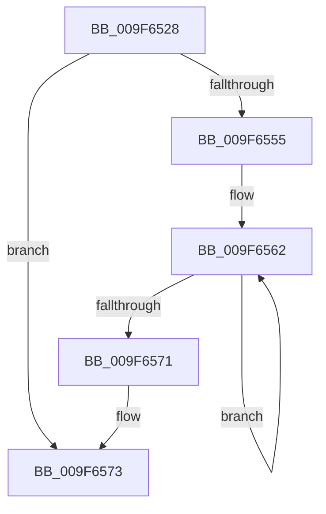

# sub_009F6528

- RVA: `0x009F6528`–`0x009F6592` (길이 `106` bytes)
- VA: `0x00000001409F6528`
- 실행 섹션: `PAGE`
- PDB 이름 있음: `아니요`; PDB Function 태그: `아니요`
- unwind 정보 RVA: `0x000A6BB8`
- 디코드: `24`개 명령, `106/106` bytes 표시
- 미해석 바이트: `0` (있으면 어셈블리에 `.byte`로 보존)

> 이 문서는 커널 이미지의 기계어와 PDB 기호를 분석해 생성했습니다. 4번과 5번은 함수 원형과 자료형을 바이너리 사용 방식에서 추정한 C 해석이며 원본 소스 복구 결과는 아닙니다.

## 1. Dependencies

- 직접 호출 지점: **2**; 고유 호출 대상: **2**
- 직접 호출자로 확인된 함수: **0**
- RIP 상대 이미지 참조: **0**

### Outgoing calls
- `0x009F6546` → [PspLockProcessExclusive](../../text/46/PspLockProcessExclusive_function_00460164.md) (function, `0x00460164`)
- `0x009F6579` → [PspUnlockProcessExclusive](../../text/46/PspUnlockProcessExclusive_function_004601C0.md) (function, `0x004601C0`)

### Direct callers
- 이 함수 시작 RVA로 연결되는 직접 call은 확인되지 않았습니다. 간접 호출은 완전히 역산할 수 없습니다.

### Static image references
- 디코드된 RIP-relative 메모리 참조가 없습니다.

## 2. Other-region calls and transfers

- 다른 실행 섹션으로 향하는 call: **2**
  - `0x009F6546` → [PspLockProcessExclusive](../../text/46/PspLockProcessExclusive_function_00460164.md) (`PAGE` → `.text`)
  - `0x009F6579` → [PspUnlockProcessExclusive](../../text/46/PspUnlockProcessExclusive_function_004601C0.md) (`PAGE` → `.text`)
- call이 아닌 외부 분기/꼬리 이동: **1**
  - `0x009F658C` → [PspProcessClose + 0x1B](PspProcessClose_function_009F64D0.md) (`tail-transfer`)

## 3. Assembly (complete function range)

```asm
009F6528  48 89 74 24 30                  mov qword ptr [rsp + 0x30], rsi
009F652D  48 8B CB                        mov rcx, rbx
009F6530  65 48 8B 34 25 88 01 00 00      mov rsi, qword ptr gs:[0x188]
009F6539  48 8B D6                        mov rdx, rsi
009F653C  48 89 7C 24 38                  mov qword ptr [rsp + 0x38], rdi
009F6541  BF 00 00 00 02                  mov edi, 0x2000000
009F6546  E8 19 9C A6 FF                  call 0x140460164
009F654B  8B 83 80 03 00 00               mov eax, dword ptr [rbx + 0x380]
009F6551  85 C0                           test eax, eax
009F6553  75 1E                           jne 0x1409f6573
009F6555  0F 0D 8B F4 01 00 00            prefetchw byte ptr [rbx + 0x1f4]
009F655C  8B 83 F4 01 00 00               mov eax, dword ptr [rbx + 0x1f4]
009F6562  8B C8                           mov ecx, eax
009F6564  83 C9 08                        or ecx, 8
009F6567  F0 0F B1 8B F4 01 00 00         lock cmpxchg dword ptr [rbx + 0x1f4], ecx
009F656F  75 F1                           jne 0x1409f6562
009F6571  8B F8                           mov edi, eax
009F6573  48 8B D6                        mov rdx, rsi
009F6576  48 8B CB                        mov rcx, rbx
009F6579  E8 42 9C A6 FF                  call 0x1404601c0
009F657E  48 8B 74 24 30                  mov rsi, qword ptr [rsp + 0x30]
009F6583  0F BA E7 19                     bt edi, 0x19
009F6587  48 8B 7C 24 38                  mov rdi, qword ptr [rsp + 0x38]
009F658C  0F 82 59 FF FF FF               jb 0x1409f64eb
```

## 4. C-style interpretation (structured pseudocode)

```c
__int64 __fastcall sub_009F6528(__int64 a1, __int64 a2, __int64 a3, __int64 a4, __int64 a5, __int64 a6, __int64 a7)
{
    __int64 result;
    unsigned __int64 v_stack_p30;
    unsigned __int64 v_stack_p38;

    v_stack_p30 = v_rsi;
    v_stack_p38 = v_rdi;
    result = PspLockProcessExclusive(v_rbx, *(unsigned __int64 *)(gs_base + (0 + 392)), a3, a4);
    if ((unsigned int)((unsigned int)(*(unsigned int *)(v_rbx + 896))) != 0) goto loc_009F6573;
loc_009F6562:
    a1 = (unsigned int)(((unsigned int)((unsigned int)((unsigned int)(*(unsigned int *)(v_rbx + 500))))) | (8));
    if (condition_is_not_equal) goto loc_009F6562;
loc_009F6573:
    result = PspUnlockProcessExclusive(v_rbx, *(unsigned __int64 *)(gs_base + (0 + 392)), a3, a4);
}
```

## 5. (Beta) C Style

```c
int64_t sub_009F6528(int64_t Arg1, int64_t Arg2, int64_t Arg3, int64_t Arg4, uint64_t Arg5, int64_t Arg6, int64_t Arg7)
{
    int64_t result;
    uint64_t v_stack_p30;
    uint64_t v_stack_p38;

    v_stack_p30 = local_rsi;
    v_stack_p38 = local_rdi;
    result = PspLockProcessExclusive(local_rbx, *(uint64_t *)(gs_base + (0 + 0x188)), Arg3, Arg4);
    if ((uint32_t)((uint32_t)(*(uint32_t *)(local_rbx + 0x380))) != 0) goto loc_009F6573;
loc_009F6562:
    Arg1 = (uint32_t)(((uint32_t)((uint32_t)((uint32_t)(*(uint32_t *)(local_rbx + 0x1F4))))) | (8));
    if (condition_is_not_equal) goto loc_009F6562;
loc_009F6573:
    result = PspUnlockProcessExclusive(local_rbx, *(uint64_t *)(gs_base + (0 + 0x188)), Arg3, Arg4);
}
```

## 6. Execution-region graph

[열기: 2D/3D 그래프와 함수 탐색 컨트롤 패널](../../../control-panel.html?section=page&rva=0x009F6528&view=graph)

- 2D 그래프는 위에서 아래로 흐르고, 3D 그래프는 빈 공간을 드래그해 회전합니다. Shift+드래그는 이동, 휠은 확대·축소, 함수 노드 선택은 대상 보고서 이동입니다.

### Static fallback


