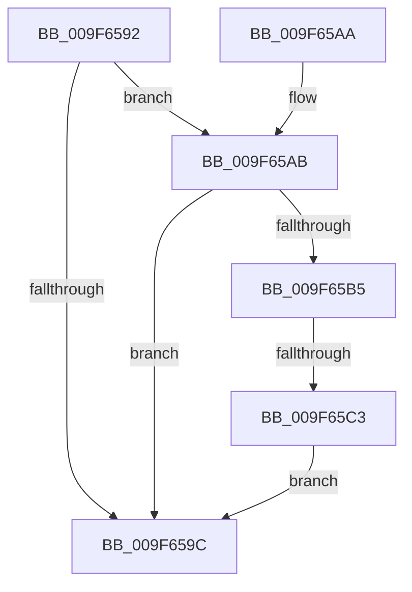

# sub_009F6592

- RVA: `0x009F6592`–`0x009F65C5` (길이 `51` bytes)
- VA: `0x00000001409F6592`
- 실행 섹션: `PAGE`
- PDB 이름 있음: `아니요`; PDB Function 태그: `아니요`
- unwind 정보 RVA: `0x000A6BD0`
- 디코드: `15`개 명령, `51/51` bytes 표시
- 미해석 바이트: `0` (있으면 어셈블리에 `.byte`로 보존)

> 이 문서는 커널 이미지의 기계어와 PDB 기호를 분석해 생성했습니다. 4번과 5번은 함수 원형과 자료형을 바이너리 사용 방식에서 추정한 C 해석이며 원본 소스 복구 결과는 아닙니다.

## 1. Dependencies

- 직접 호출 지점: **1**; 고유 호출 대상: **1**
- 직접 호출자로 확인된 함수: **0**
- RIP 상대 이미지 참조: **0**

### Outgoing calls
- `0x009F659F` → [PspRundownProcess](PspRundownProcess_function_009F65CC.md) (function, `0x009F65CC`)

### Direct callers
- 이 함수 시작 RVA로 연결되는 직접 call은 확인되지 않았습니다. 간접 호출은 완전히 역산할 수 없습니다.

### Static image references
- 디코드된 RIP-relative 메모리 참조가 없습니다.

## 2. Other-region calls and transfers

- 다른 실행 섹션으로 향하는 call: **0**
- call이 아닌 외부 분기/꼬리 이동: **1**
  - `0x009F65BD` → [PspProcessClose + 0x1B](PspProcessClose_function_009F64D0.md) (`tail-transfer`)

## 3. Assembly (complete function range)

```asm
009F6592  8B 83 FC 05 00 00               mov eax, dword ptr [rbx + 0x5fc]
009F6598  A8 01                           test al, 1
009F659A  75 0F                           jne 0x1409f65ab
009F659C  48 8B CB                        mov rcx, rbx
009F659F  E8 28 00 00 00                  call 0x1409f65cc
009F65A4  48 83 C4 20                     add rsp, 0x20
009F65A8  5B                              pop rbx
009F65A9  C3                              ret
009F65AA  CC                              int3
009F65AB  48 83 BB 40 06 00 00 00         cmp qword ptr [rbx + 0x640], 0
009F65B3  75 E7                           jne 0x1409f659c
009F65B5  8B 83 DC 07 00 00               mov eax, dword ptr [rbx + 0x7dc]
009F65BB  A8 01                           test al, 1
009F65BD  0F 85 28 FF FF FF               jne 0x1409f64eb
009F65C3  EB D7                           jmp 0x1409f659c
```

## 4. C-style interpretation (structured pseudocode)

```c
__int64 __fastcall sub_009F6592(void)
{
    __int64 result;
    __int64 v_rsp;

    if ((((unsigned __int8)((unsigned int)(*(unsigned int *)(v_rbx + 1532)))) & (1)) != 0) goto loc_009F65AB;
loc_009F659C:
    result = PspRundownProcess(v_rbx, a2, a3, a4);
    v_rsp = (v_rsp) + (32);
    return result;
loc_009F65AB:
    if ((*(unsigned __int64 *)(v_rbx + 1600)) != 0) goto loc_009F659C;
    goto loc_009F659C;
}
```

## 5. (Beta) C Style

```c
void sub_009F6592(void)
{
    int64_t result;
    int64_t local_rsp;

    if ((((uint8_t)((uint32_t)(*(uint32_t *)(local_rbx + 0x5FC)))) & (1)) != 0) goto loc_009F65AB;
loc_009F659C:
    result = PspRundownProcess(local_rbx, a2, a3, a4);
    local_rsp = (local_rsp) + (32);
    return result;
loc_009F65AB:
    if ((*(uint64_t *)(local_rbx + 0x640)) != 0) goto loc_009F659C;
    goto loc_009F659C;
}
```

## 6. Execution-region graph

[열기: 2D/3D 그래프와 함수 탐색 컨트롤 패널](../../../control-panel.html?section=page&rva=0x009F6592&view=graph)

- 2D 그래프는 위에서 아래로 흐르고, 3D 그래프는 빈 공간을 드래그해 회전합니다. Shift+드래그는 이동, 휠은 확대·축소, 함수 노드 선택은 대상 보고서 이동입니다.

### Static fallback


