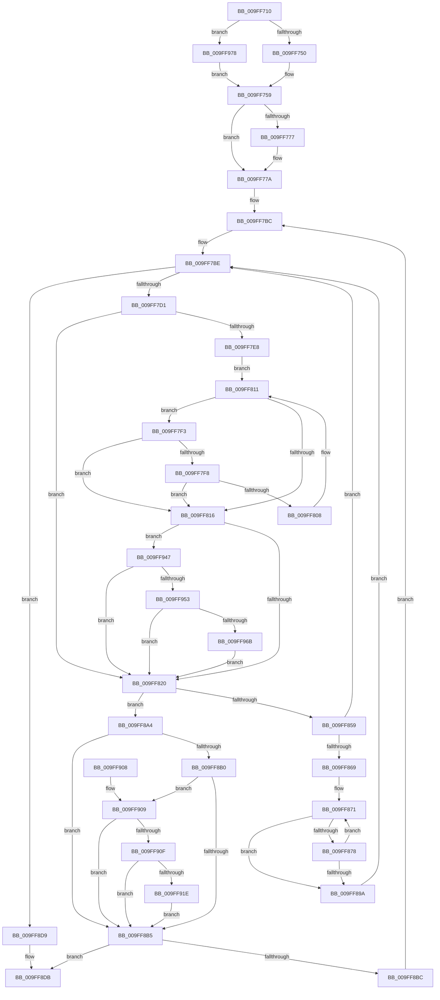

# VmpAccessFaultBatchResolve

- RVA: `0x009FF710`–`0x009FF984` (길이 `628` bytes)
- VA: `0x00000001409FF710`
- 실행 섹션: `PAGE`
- PDB 이름 있음: `예`; PDB Function 태그: `아니요`
- unwind 정보 RVA: `0x000A7920`
- 디코드: `170`개 명령, `628/628` bytes 표시
- 미해석 바이트: `0` (있으면 어셈블리에 `.byte`로 보존)

> 이 문서는 커널 이미지의 기계어와 PDB 기호를 분석해 생성했습니다. 4번과 5번은 함수 원형과 자료형을 바이너리 사용 방식에서 추정한 C 해석이며 원본 소스 복구 결과는 아닙니다.

## 1. Dependencies

- 직접 호출 지점: **7**; 고유 호출 대상: **7**
- 직접 호출자로 확인된 함수: **1**
- RIP 상대 이미지 참조: **2**

### Outgoing calls
- `0x009FF83C` → [memset](../../text/6C/memset_function_006C6C40.md) (function, `0x006C6C40`)
- `0x009FF84E` → [MmVirtualAccessFault](MmVirtualAccessFault_function_009FF98C.md) (function, `0x009FF98C`)
- `0x009FF886` → [VmpFillValidFaultInfo](VmpFillValidFaultInfo_function_009FFA88.md) (function, `0x009FFA88`)
- `0x009FF8E8` → [_security_check_cookie](../../text/6A/_security_check_cookie_function_006AC640.md) (function, `0x006AC640`)
- `0x009FF93D` → [VmpLogFaultResolveFailure](VmpLogFaultResolveFailure_function_009FFBCC.md) (function, `0x009FFBCC`)
- `0x009FF95D` → [MmGetNodeFastLargePageCounts](../../text/4D/MmGetNodeFastLargePageCounts_function_004DB24C.md) (function, `0x004DB24C`)
- `0x009FF96E` → [MmBuildLargePages](MmBuildLargePages_function_009FFB08.md) (function, `0x009FFB08`)

### Direct callers
- [VmpAccessFaultBatch](../../text/42/VmpAccessFaultBatch_function_00429398.md) at `0x00429405`

### Static image references
- `0x009FF727` → RVA `0x00E0A740` (`.data`; read)
- `0x009FF8A4` → RVA `0x00F02458` (`.data`; read)

## 2. Other-region calls and transfers

- 다른 실행 섹션으로 향하는 call: **3**
  - `0x009FF83C` → [memset](../../text/6C/memset_function_006C6C40.md) (`PAGE` → `.text`)
  - `0x009FF8E8` → [_security_check_cookie](../../text/6A/_security_check_cookie_function_006AC640.md) (`PAGE` → `.text`)
  - `0x009FF95D` → [MmGetNodeFastLargePageCounts](../../text/4D/MmGetNodeFastLargePageCounts_function_004DB24C.md) (`PAGE` → `.text`)
- 별도 외부 분기/꼬리 이동을 확인하지 못했습니다.

## 3. Assembly (complete function range)

```asm
009FF710  48 89 5C 24 08                  mov qword ptr [rsp + 8], rbx
009FF715  55                              push rbp
009FF716  56                              push rsi
009FF717  57                              push rdi
009FF718  41 54                           push r12
009FF71A  41 55                           push r13
009FF71C  41 56                           push r14
009FF71E  41 57                           push r15
009FF720  48 81 EC F0 00 00 00            sub rsp, 0xf0
009FF727  48 8B 05 12 B0 40 00            mov rax, qword ptr [rip + 0x40b012]
009FF72E  48 33 C4                        xor rax, rsp
009FF731  48 89 84 24 E0 00 00 00         mov qword ptr [rsp + 0xe0], rax
009FF739  48 83 64 24 40 00               and qword ptr [rsp + 0x40], 0
009FF73F  48 8B DA                        mov rbx, rdx
009FF742  48 89 4C 24 48                  mov qword ptr [rsp + 0x48], rcx
009FF747  4D 85 C9                        test r9, r9
009FF74A  0F 85 28 02 00 00               jne 0x1409ff978
009FF750  4C 8D 74 24 60                  lea r14, [rsp + 0x60]
009FF755  45 8D 79 10                     lea r15d, [r9 + 0x10]
009FF759  8B AC 24 50 01 00 00            mov ebp, dword ptr [rsp + 0x150]
009FF760  8B CD                           mov ecx, ebp
009FF762  83 E1 01                        and ecx, 1
009FF765  8B D1                           mov edx, ecx
009FF767  83 CA 02                        or edx, 2
009FF76A  40 F6 C5 02                     test bpl, 2
009FF76E  0F 44 D1                        cmove edx, ecx
009FF771  40 F6 C5 04                     test bpl, 4
009FF775  74 03                           je 0x1409ff77a
009FF777  83 CA 01                        or edx, 1
009FF77A  8B CA                           mov ecx, edx
009FF77C  83 C9 08                        or ecx, 8
009FF77F  40 F6 C5 08                     test bpl, 8
009FF783  0F 44 CA                        cmove ecx, edx
009FF786  8B D1                           mov edx, ecx
009FF788  83 CA 10                        or edx, 0x10
009FF78B  40 F6 C5 10                     test bpl, 0x10
009FF78F  0F 44 D1                        cmove edx, ecx
009FF792  8B CD                           mov ecx, ebp
009FF794  83 E1 20                        and ecx, 0x20
009FF797  8B C2                           mov eax, edx
009FF799  83 C8 20                        or eax, 0x20
009FF79C  89 4C 24 34                     mov dword ptr [rsp + 0x34], ecx
009FF7A0  85 C9                           test ecx, ecx
009FF7A2  0F 44 C2                        cmove eax, edx
009FF7A5  89 44 24 30                     mov dword ptr [rsp + 0x30], eax
009FF7A9  41 8B C0                        mov eax, r8d
009FF7AC  4C 8D 2C 40                     lea r13, [rax + rax*2]
009FF7B0  49 C1 E5 04                     shl r13, 4
009FF7B4  4C 03 EB                        add r13, rbx
009FF7B7  4C 89 6C 24 50                  mov qword ptr [rsp + 0x50], r13
009FF7BC  33 FF                           xor edi, edi
009FF7BE  49 B9 FF FF FF FF FF FF 0F 00   movabs r9, 0xfffffffffffff
009FF7C8  49 3B DD                        cmp rbx, r13
009FF7CB  0F 83 08 01 00 00               jae 0x1409ff8d9
009FF7D1  48 8B 53 18                     mov rdx, qword ptr [rbx + 0x18]
009FF7D5  49 23 D1                        and rdx, r9
009FF7D8  48 8B C2                        mov rax, rdx
009FF7DB  48 C1 E0 0C                     shl rax, 0xc
009FF7DF  48 89 44 24 38                  mov qword ptr [rsp + 0x38], rax
009FF7E4  85 FF                           test edi, edi
009FF7E6  75 38                           jne 0x1409ff820
009FF7E8  BF 01 00 00 00                  mov edi, 1
009FF7ED  48 8D 4B 30                     lea rcx, [rbx + 0x30]
009FF7F1  EB 1E                           jmp 0x1409ff811
009FF7F3  41 3B FF                        cmp edi, r15d
009FF7F6  73 1E                           jae 0x1409ff816
009FF7F8  4C 8B 41 18                     mov r8, qword ptr [rcx + 0x18]
009FF7FC  48 8D 42 01                     lea rax, [rdx + 1]
009FF800  4D 23 C1                        and r8, r9
009FF803  4C 3B C0                        cmp r8, rax
009FF806  75 0E                           jne 0x1409ff816
009FF808  48 83 C1 30                     add rcx, 0x30
009FF80C  49 8B D0                        mov rdx, r8
009FF80F  FF C7                           inc edi
009FF811  49 3B CD                        cmp rcx, r13
009FF814  72 DD                           jb 0x1409ff7f3
009FF816  40 F6 C5 40                     test bpl, 0x40
009FF81A  0F 85 27 01 00 00               jne 0x1409ff947
009FF820  8B C7                           mov eax, edi
009FF822  33 D2                           xor edx, edx
009FF824  C1 E0 0C                        shl eax, 0xc
009FF827  49 8B CE                        mov rcx, r14
009FF82A  48 89 44 24 40                  mov qword ptr [rsp + 0x40], rax
009FF82F  8B C7                           mov eax, edi
009FF831  4C 8D 24 C5 00 00 00 00         lea r12, [rax*8]
009FF839  4D 8B C4                        mov r8, r12
009FF83C  E8 FF 73 CC FF                  call 0x1406c6c40
009FF841  44 8B 44 24 30                  mov r8d, dword ptr [rsp + 0x30]
009FF846  48 8D 4C 24 38                  lea rcx, [rsp + 0x38]
009FF84B  49 8B D6                        mov rdx, r14
009FF84E  E8 39 01 00 00                  call 0x1409ff98c
009FF853  8B F0                           mov esi, eax
009FF855  85 C0                           test eax, eax
009FF857  78 4B                           js 0x1409ff8a4
009FF859  4F 8D 1C 34                     lea r11, [r12 + r14]
009FF85D  4D 8B D6                        mov r10, r14
009FF860  4D 3B F3                        cmp r14, r11
009FF863  0F 83 55 FF FF FF               jae 0x1409ff7be
009FF869  44 8B AC 24 58 01 00 00         mov r13d, dword ptr [rsp + 0x158]
009FF871  49 0F BA 22 34                  bt qword ptr [r10], 0x34
009FF876  73 22                           jae 0x1409ff89a
009FF878  44 8B CD                        mov r9d, ebp
009FF87B  44 89 6C 24 20                  mov dword ptr [rsp + 0x20], r13d
009FF880  49 8B D2                        mov rdx, r10
009FF883  48 8B CB                        mov rcx, rbx
009FF886  E8 FD 01 00 00                  call 0x1409ffa88
009FF88B  49 83 C2 08                     add r10, 8
009FF88F  48 83 C3 30                     add rbx, 0x30
009FF893  FF CF                           dec edi
009FF895  4D 3B D3                        cmp r10, r11
009FF898  72 D7                           jb 0x1409ff871
009FF89A  4C 8B 6C 24 50                  mov r13, qword ptr [rsp + 0x50]
009FF89F  E9 1A FF FF FF                  jmp 0x1409ff7be
009FF8A4  48 8B 15 AD 2B 50 00            mov rdx, qword ptr [rip + 0x502bad]
009FF8AB  48 85 D2                        test rdx, rdx
009FF8AE  74 05                           je 0x1409ff8b5
009FF8B0  83 3A 00                        cmp dword ptr [rdx], 0
009FF8B3  77 54                           ja 0x1409ff909
009FF8B5  83 7C 24 34 00                  cmp dword ptr [rsp + 0x34], 0
009FF8BA  74 1F                           je 0x1409ff8db
009FF8BC  48 B8 00 00 00 00 00 00 00 02   movabs rax, 0x200000000000000
009FF8C6  41 BF 01 00 00 00               mov r15d, 1
009FF8CC  48 09 43 20                     or qword ptr [rbx + 0x20], rax
009FF8D0  48 83 C3 30                     add rbx, 0x30
009FF8D4  E9 E3 FE FF FF                  jmp 0x1409ff7bc
009FF8D9  33 F6                           xor esi, esi
009FF8DB  8B C6                           mov eax, esi
009FF8DD  48 8B 8C 24 E0 00 00 00         mov rcx, qword ptr [rsp + 0xe0]
009FF8E5  48 33 CC                        xor rcx, rsp
009FF8E8  E8 53 CD CA FF                  call 0x1406ac640
009FF8ED  48 8B 9C 24 30 01 00 00         mov rbx, qword ptr [rsp + 0x130]
009FF8F5  48 81 C4 F0 00 00 00            add rsp, 0xf0
009FF8FC  41 5F                           pop r15
009FF8FE  41 5E                           pop r14
009FF900  41 5D                           pop r13
009FF902  41 5C                           pop r12
009FF904  5F                              pop rdi
009FF905  5E                              pop rsi
009FF906  5D                              pop rbp
009FF907  C3                              ret
009FF908  CC                              int3
009FF909  F6 42 10 40                     test byte ptr [rdx + 0x10], 0x40
009FF90D  74 A6                           je 0x1409ff8b5
009FF90F  48 8B 4A 18                     mov rcx, qword ptr [rdx + 0x18]
009FF913  48 8B C1                        mov rax, rcx
009FF916  83 E0 40                        and eax, 0x40
009FF919  48 3B C1                        cmp rax, rcx
009FF91C  75 97                           jne 0x1409ff8b5
009FF91E  48 8B 44 24 48                  mov rax, qword ptr [rsp + 0x48]
009FF923  48 8D 54 24 38                  lea rdx, [rsp + 0x38]
009FF928  44 8B 4C 24 30                  mov r9d, dword ptr [rsp + 0x30]
009FF92D  44 8B C5                        mov r8d, ebp
009FF930  89 74 24 28                     mov dword ptr [rsp + 0x28], esi
009FF934  48 8B 40 68                     mov rax, qword ptr [rax + 0x68]
009FF938  48 89 44 24 20                  mov qword ptr [rsp + 0x20], rax
009FF93D  E8 8A 02 00 00                  call 0x1409ffbcc
009FF942  E9 6E FF FF FF                  jmp 0x1409ff8b5
009FF947  81 FF 00 02 00 00               cmp edi, 0x200
009FF94D  0F 85 CD FE FF FF               jne 0x1409ff820
009FF953  8B B4 24 60 01 00 00            mov esi, dword ptr [rsp + 0x160]
009FF95A  8D 56 FF                        lea edx, [rsi - 1]
009FF95D  E8 EA B8 AD FF                  call 0x1404db24c
009FF962  48 85 C0                        test rax, rax
009FF965  0F 85 B5 FE FF FF               jne 0x1409ff820
009FF96B  8D 56 FF                        lea edx, [rsi - 1]
009FF96E  E8 95 01 00 00                  call 0x1409ffb08
009FF973  E9 A8 FE FF FF                  jmp 0x1409ff820
009FF978  4D 8B 71 10                     mov r14, qword ptr [r9 + 0x10]
009FF97C  45 8B 39                        mov r15d, dword ptr [r9]
009FF97F  E9 D5 FD FF FF                  jmp 0x1409ff759
```

## 4. C-style interpretation (structured pseudocode)

```c
__int64 __fastcall VmpAccessFaultBatchResolve(__int64 a1, __int64 a2, int a3, __int64 a4, unsigned int a5, unsigned int a6, unsigned int a7)
{
    __int64 result;
    __int64 v_r10;
    __int64 v_r13;
    __int64 v_rbx;
    __int64 v_rdi;
    __int64 v_rsi;
    __int64 v_rsp;
    unsigned int v_stack_m108;
    unsigned __int64 v_stack_m48;
    unsigned __int64 v_stack_mC8;
    unsigned __int64 v_stack_mD8;
    unsigned __int64 v_stack_mE0;
    unsigned __int64 v_stack_mE8;
    unsigned __int64 v_stack_mF0;
    unsigned int v_stack_mF4;
    unsigned int v_stack_mF8;
    unsigned __int64 v_stack_p20;
    unsigned int v_stack_p28;
    unsigned int v_stack_p30;
    unsigned __int64 v_stack_p38;
    unsigned __int64 v_stack_p48;
    unsigned __int64 v_stack_p8;

    v_stack_p8 = v_rbx;
    v_rsp = (v_rsp) - (240);
    result = (*(unsigned __int64 *)(v_rip + 4239378)) ^ (v_rsp);
    v_stack_m48 = result;
    v_stack_mE0 = a1;
    if (a4 != 0) goto loc_009FF978;
loc_009FF759:
    a1 = (unsigned int)(((unsigned int)((unsigned int)((unsigned int)(a5)))) & (1));
    a2 = (unsigned int)(((unsigned int)((unsigned int)(a1))) | (2));
    if ((((unsigned __int8)((unsigned int)(a5))) & (2)) == 0) { a2 = (unsigned int)(a1); }
    if ((((unsigned __int8)((unsigned int)(a5))) & (4)) != 0) {
        a2 = (unsigned int)((a2) | (1));
    }
    a1 = (unsigned int)(((unsigned int)((unsigned int)(a2))) | (8));
    if ((((unsigned __int8)((unsigned int)(a5))) & (8)) == 0) { a1 = (unsigned int)(a2); }
    a2 = (unsigned int)(((unsigned int)((unsigned int)(a1))) | (16));
    if ((((unsigned __int8)((unsigned int)(a5))) & (16)) == 0) { a2 = (unsigned int)(a1); }
    a1 = (unsigned int)(((unsigned int)((unsigned int)((unsigned int)(a5)))) & (32));
    result = (unsigned int)(((unsigned int)((unsigned int)(a2))) | (32));
    v_stack_mF4 = (unsigned int)(a1);
    if ((unsigned int)(a1) == 0) { result = (unsigned int)(a2); }
    v_stack_mF8 = (unsigned int)(result);
    v_r13 = ((unsigned int)(a3) + (unsigned int)(a3) * 2) << (4);
    v_r13 = (v_r13) + (a2);
    v_stack_mD8 = v_r13;
loc_009FF7BC:
    v_rdi = 0;
loc_009FF7BE:
    if (a2 >= v_r13) goto loc_009FF8D9;
    a2 = (*(unsigned __int64 *)(a2 + 24)) & (a4);
    result = (a2) << (12);
    v_stack_mF0 = result;
    if (0 != 0) goto loc_009FF820;
    goto loc_009FF811;
loc_009FF7F3:
    if (1 >= ((unsigned int)(a4 + 16))) goto loc_009FF816;
    a3 = (*(unsigned __int64 *)(a2 + 48 + 24)) & (a4);
    if (a3 != (a2 + 1)) goto loc_009FF816;
    a1 = (a2 + 48) + (48);
    v_rdi = (unsigned int)((1) + 1);
loc_009FF811:
    if (a1 < v_r13) goto loc_009FF7F3;
loc_009FF816:
    if ((((unsigned __int8)((unsigned int)(a5))) & (64)) != 0) goto loc_009FF947;
loc_009FF820:
    a2 = 0;
    result = (unsigned int)(((unsigned int)((unsigned int)(v_rdi))) << (12));
    v_stack_mE8 = result;
    result = memset(v_stack_mC8, a2, (unsigned int)((unsigned int)(v_rdi)) * 8, a4);
    result = MmVirtualAccessFault(v_stack_mF0, v_stack_mC8, (unsigned int)(v_stack_mF8), a4);
    if (sign_flag) goto loc_009FF8A4;
    if (v_stack_mC8 >= ((unsigned int)((unsigned int)(v_rdi)) * 8 + v_stack_mC8 * 1)) goto loc_009FF7BE;
loc_009FF871:
    if (v_stack_mC8 >= ((unsigned int)((unsigned int)(v_rdi)) * 8 + v_stack_mC8 * 1)) goto loc_009FF89A;
    v_stack_m108 = (unsigned int)((unsigned int)(a6));
    result = VmpFillValidFaultInfo(0, v_stack_mC8, (unsigned int)(v_stack_mF8), (unsigned int)((unsigned int)((unsigned int)(a5))));
    v_r10 = (v_stack_mC8) + (8);
    v_rbx = (a2) + (48);
    v_rdi = (unsigned int)((v_rdi) - 1);
    if (v_r10 < ((unsigned int)((unsigned int)(v_rdi)) * 8 + v_stack_mC8 * 1)) goto loc_009FF871;
loc_009FF89A:
    goto loc_009FF7BE;
loc_009FF8A4:
    if (*(unsigned __int64 *)(v_rip + 5254061) == 0) goto loc_009FF8B5;
    if ((*(unsigned int *)(*(unsigned __int64 *)(v_rip + 5254061))) > 0) goto loc_009FF909;
loc_009FF8B5:
    if (v_stack_mF4 == 0) goto loc_009FF8DB;
    v_rbx = (v_rbx) + (48);
    goto loc_009FF7BC;
loc_009FF8D9:
    v_rsi = 0;
loc_009FF8DB:
    a1 = (v_stack_m48) ^ (v_rsp);
    result = _security_check_cookie(a1, *(unsigned __int64 *)(v_rip + 5254061), (unsigned int)(v_stack_mF8), (unsigned int)((unsigned int)((unsigned int)(a5))));
    v_rsp = (v_rsp) + (240);
    return result;
loc_009FF909:
    if (((*(unsigned __int8 *)(*(unsigned __int64 *)(v_rip + 5254061) + 16)) & (64)) == 0) goto loc_009FF8B5;
    result = (unsigned int)((*(unsigned __int64 *)(*(unsigned __int64 *)(v_rip + 5254061) + 24)) & (64));
    if (result != (*(unsigned __int64 *)(*(unsigned __int64 *)(v_rip + 5254061) + 24))) goto loc_009FF8B5;
    v_stack_p28 = 0;
    v_stack_p20 = *(unsigned __int64 *)(v_stack_p48 + 104);
    result = VmpLogFaultResolveFailure(*(unsigned __int64 *)(*(unsigned __int64 *)(v_rip + 5254061) + 24), v_stack_p38, (unsigned int)((unsigned int)((unsigned int)(a5))), (unsigned int)(v_stack_p30));
    goto loc_009FF8B5;
loc_009FF947:
    if (((unsigned int)(v_rdi)) != 512) goto loc_009FF820;
    result = MmGetNodeFastLargePageCounts(*(unsigned __int64 *)(*(unsigned __int64 *)(v_rip + 5254061) + 24), (unsigned int)(a7) - 1, (unsigned int)((unsigned int)((unsigned int)(a5))), (unsigned int)(v_stack_p30));
    if (result != 0) goto loc_009FF820;
    result = MmBuildLargePages(*(unsigned __int64 *)(*(unsigned __int64 *)(v_rip + 5254061) + 24), (unsigned int)(a7) - 1, (unsigned int)((unsigned int)((unsigned int)(a5))), (unsigned int)(v_stack_p30));
    goto loc_009FF820;
loc_009FF978:
    goto loc_009FF759;
}
```

## 5. (Beta) C Style

```c
int64_t VmpAccessFaultBatchResolve(int64_t Arg1, int64_t Arg2, void *Arg3, int64_t Arg4, uint32_t Arg5, uint32_t Arg6, void *Arg7)
{
    uint8_t *arg3 = (uint8_t *)Arg3;
    uint8_t *arg7 = (uint8_t *)Arg7;

    int64_t result;
    int64_t local_r10;
    int64_t local_r13;
    int64_t local_rbx;
    int64_t local_rdi;
    int64_t local_rsi;
    int64_t local_rsp;
    uint32_t v_stack_m108;
    uint64_t v_stack_m48;
    uint64_t v_stack_mC8;
    uint64_t v_stack_mD8;
    uint64_t v_stack_mE0;
    uint64_t v_stack_mE8;
    uint64_t v_stack_mF0;
    uint32_t v_stack_mF4;
    uint32_t v_stack_mF8;
    uint64_t v_stack_p20;
    uint32_t v_stack_p28;
    uint32_t v_stack_p30;
    uint64_t v_stack_p38;
    uint64_t v_stack_p48;
    uint64_t v_stack_p8;

    v_stack_p8 = local_rbx;
    local_rsp = (local_rsp) - (240);
    result = (*(uint64_t *)(v_rip + 0x40B012)) ^ (local_rsp);
    v_stack_m48 = result;
    v_stack_mE0 = Arg1;
    if (Arg4 != 0) goto loc_009FF978;
loc_009FF759:
    Arg1 = (uint32_t)(((uint32_t)((uint32_t)((uint32_t)(Arg5)))) & (1));
    Arg2 = (uint32_t)(((uint32_t)((uint32_t)(Arg1))) | (2));
    if ((((uint8_t)((uint32_t)(Arg5))) & (2)) == 0) { Arg2 = (uint32_t)(Arg1); }
    if ((((uint8_t)((uint32_t)(Arg5))) & (4)) != 0) {
        Arg2 = (uint32_t)((Arg2) | (1));
    }
    Arg1 = (uint32_t)(((uint32_t)((uint32_t)(Arg2))) | (8));
    if ((((uint8_t)((uint32_t)(Arg5))) & (8)) == 0) { Arg1 = (uint32_t)(Arg2); }
    Arg2 = (uint32_t)(((uint32_t)((uint32_t)(Arg1))) | (16));
    if ((((uint8_t)((uint32_t)(Arg5))) & (16)) == 0) { Arg2 = (uint32_t)(Arg1); }
    Arg1 = (uint32_t)(((uint32_t)((uint32_t)((uint32_t)(Arg5)))) & (32));
    result = (uint32_t)(((uint32_t)((uint32_t)(Arg2))) | (32));
    v_stack_mF4 = (uint32_t)(Arg1);
    if ((uint32_t)(Arg1) == 0) { result = (uint32_t)(Arg2); }
    v_stack_mF8 = (uint32_t)(result);
    local_r13 = ((uint32_t)(Arg3) + (uint32_t)(Arg3) * 2) << (4);
    local_r13 = (local_r13) + (Arg2);
    v_stack_mD8 = local_r13;
loc_009FF7BC:
    local_rdi = 0;
loc_009FF7BE:
    if (Arg2 >= local_r13) goto loc_009FF8D9;
    Arg2 = (*(uint64_t *)(Arg2 + 0x18)) & (Arg4);
    result = (Arg2) << (12);
    v_stack_mF0 = result;
    if (0 != 0) goto loc_009FF820;
    goto loc_009FF811;
loc_009FF7F3:
    if (1 >= ((uint32_t)(Arg4 + 16))) goto loc_009FF816;
    Arg3 = (*(uint64_t *)(Arg2 + 0x30 + 0x18)) & (Arg4);
    if (Arg3 != (Arg2 + 1)) goto loc_009FF816;
    Arg1 = (Arg2 + 48) + (48);
    local_rdi = (uint32_t)((1) + 1);
loc_009FF811:
    if (Arg1 < local_r13) goto loc_009FF7F3;
loc_009FF816:
    if ((((uint8_t)((uint32_t)(Arg5))) & (64)) != 0) goto loc_009FF947;
loc_009FF820:
    Arg2 = 0;
    result = (uint32_t)(((uint32_t)((uint32_t)(local_rdi))) << (12));
    v_stack_mE8 = result;
    result = memset(v_stack_mC8, Arg2, (uint32_t)((uint32_t)(local_rdi)) * 8, Arg4);
    result = MmVirtualAccessFault(v_stack_mF0, v_stack_mC8, (uint32_t)(v_stack_mF8), Arg4);
    if (sign_flag) goto loc_009FF8A4;
    if (v_stack_mC8 >= ((uint32_t)((uint32_t)(local_rdi)) * 8 + v_stack_mC8 * 1)) goto loc_009FF7BE;
loc_009FF871:
    if (v_stack_mC8 >= ((uint32_t)((uint32_t)(local_rdi)) * 8 + v_stack_mC8 * 1)) goto loc_009FF89A;
    v_stack_m108 = (uint32_t)((uint32_t)(Arg6));
    result = VmpFillValidFaultInfo(0, v_stack_mC8, (uint32_t)(v_stack_mF8), (uint32_t)((uint32_t)((uint32_t)(Arg5))));
    local_r10 = (v_stack_mC8) + (8);
    local_rbx = (Arg2) + (48);
    local_rdi = (uint32_t)((local_rdi) - 1);
    if (local_r10 < ((uint32_t)((uint32_t)(local_rdi)) * 8 + v_stack_mC8 * 1)) goto loc_009FF871;
loc_009FF89A:
    goto loc_009FF7BE;
loc_009FF8A4:
    if (*(uint64_t *)(v_rip + 0x502BAD) == 0) goto loc_009FF8B5;
    if ((*(uint32_t *)(*(uint64_t *)(v_rip + 0x502BAD))) > 0) goto loc_009FF909;
loc_009FF8B5:
    if (v_stack_mF4 == 0) goto loc_009FF8DB;
    local_rbx = (local_rbx) + (48);
    goto loc_009FF7BC;
loc_009FF8D9:
    local_rsi = 0;
loc_009FF8DB:
    Arg1 = (v_stack_m48) ^ (local_rsp);
    result = _security_check_cookie(Arg1, *(uint64_t *)(v_rip + 0x502BAD), (uint32_t)(v_stack_mF8), (uint32_t)((uint32_t)((uint32_t)(Arg5))));
    local_rsp = (local_rsp) + (240);
    return result;
loc_009FF909:
    if (((*(uint8_t *)(*(uint64_t *)(v_rip + 0x502BAD) + 0x10)) & (64)) == 0) goto loc_009FF8B5;
    result = (uint32_t)((*(uint64_t *)(*(uint64_t *)(v_rip + 0x502BAD) + 0x18)) & (64));
    if (result != (*(uint64_t *)(*(uint64_t *)(v_rip + 0x502BAD) + 0x18))) goto loc_009FF8B5;
    v_stack_p28 = 0;
    v_stack_p20 = *(uint64_t *)(v_stack_p48 + 0x68);
    result = VmpLogFaultResolveFailure(*(uint64_t *)(*(uint64_t *)(v_rip + 0x502BAD) + 0x18), v_stack_p38, (uint32_t)((uint32_t)((uint32_t)(Arg5))), (uint32_t)(v_stack_p30));
    goto loc_009FF8B5;
loc_009FF947:
    if (((uint32_t)(local_rdi)) != 512) goto loc_009FF820;
    result = MmGetNodeFastLargePageCounts(*(uint64_t *)(*(uint64_t *)(v_rip + 0x502BAD) + 0x18), (uint32_t)(Arg7) - 1, (uint32_t)((uint32_t)((uint32_t)(Arg5))), (uint32_t)(v_stack_p30));
    if (result != 0) goto loc_009FF820;
    result = MmBuildLargePages(*(uint64_t *)(*(uint64_t *)(v_rip + 0x502BAD) + 0x18), (uint32_t)(Arg7) - 1, (uint32_t)((uint32_t)((uint32_t)(Arg5))), (uint32_t)(v_stack_p30));
    goto loc_009FF820;
loc_009FF978:
    goto loc_009FF759;
}
```

### 관측된 메모리 오프셋

구조체 형식이 확인되지 않은 접근은 인자 기준의 오프셋으로만 기록했습니다.

| 기준 인자 | 오프셋 표현 | 폭 (bit) | 접근 |
|---|---:|---:|---|
| `Arg3` | `+ 0x0 + rax*2` | `64` | `R` |
| `Arg7` | `- 0x1` | `32` | `R` |

## 6. Execution-region graph

[열기: 2D/3D 그래프와 함수 탐색 컨트롤 패널](../../../control-panel.html?section=page&rva=0x009FF710&view=graph)

- 2D 그래프는 위에서 아래로 흐르고, 3D 그래프는 빈 공간을 드래그해 회전합니다. Shift+드래그는 이동, 휠은 확대·축소, 함수 노드 선택은 대상 보고서 이동입니다.

### Static fallback


