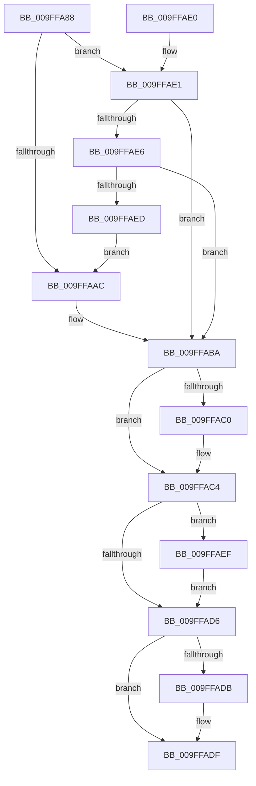

# VmpFillValidFaultInfo

- RVA: `0x009FFA88`–`0x009FFAFF` (길이 `119` bytes)
- VA: `0x00000001409FFA88`
- 실행 섹션: `PAGE`
- PDB 이름 있음: `예`; PDB Function 태그: `아니요`
- unwind 정보 RVA: `0x000DB714`
- 디코드: `29`개 명령, `119/119` bytes 표시
- 미해석 바이트: `0` (있으면 어셈블리에 `.byte`로 보존)

> 이 문서는 커널 이미지의 기계어와 PDB 기호를 분석해 생성했습니다. 4번과 5번은 함수 원형과 자료형을 바이너리 사용 방식에서 추정한 C 해석이며 원본 소스 복구 결과는 아닙니다.

## 1. Dependencies

- 직접 호출 지점: **0**; 고유 호출 대상: **0**
- 직접 호출자로 확인된 함수: **1**
- RIP 상대 이미지 참조: **0**

### Outgoing calls
- 직접 디코드된 call 명령이 없습니다.

### Direct callers
- [VmpAccessFaultBatchResolve](VmpAccessFaultBatchResolve_function_009FF710.md) at `0x009FF886`

### Static image references
- 디코드된 RIP-relative 메모리 참조가 없습니다.

## 2. Other-region calls and transfers

- 다른 실행 섹션으로 향하는 call: **0**
- 별도 외부 분기/꼬리 이동을 확인하지 못했습니다.

## 3. Assembly (complete function range)

```asm
009FFA88  48 8B 02                        mov rax, qword ptr [rdx]
009FFA8B  49 B8 FF FF FF FF FF FF 0F 00   movabs r8, 0xfffffffffffff
009FFA95  49 23 C0                        and rax, r8
009FFA98  49 B8 00 00 00 00 00 00 20 00   movabs r8, 0x20000000000000
009FFAA2  48 89 41 28                     mov qword ptr [rcx + 0x28], rax
009FFAA6  41 F6 C1 02                     test r9b, 2
009FFAAA  74 35                           je 0x1409ffae1
009FFAAC  48 B8 00 00 00 00 00 00 10 00   movabs rax, 0x10000000000000
009FFAB6  48 09 41 20                     or qword ptr [rcx + 0x20], rax
009FFABA  41 F6 C1 04                     test r9b, 4
009FFABE  74 04                           je 0x1409ffac4
009FFAC0  4C 09 41 20                     or qword ptr [rcx + 0x20], r8
009FFAC4  48 8B 02                        mov rax, qword ptr [rdx]
009FFAC7  48 BA 00 00 00 00 00 00 80 00   movabs rdx, 0x80000000000000
009FFAD1  48 85 C2                        test rdx, rax
009FFAD4  75 19                           jne 0x1409ffaef
009FFAD6  45 84 C9                        test r9b, r9b
009FFAD9  79 04                           jns 0x1409ffadf
009FFADB  48 09 51 20                     or qword ptr [rcx + 0x20], rdx
009FFADF  C3                              ret
009FFAE0  CC                              int3
009FFAE1  4C 85 02                        test qword ptr [rdx], r8
009FFAE4  74 D4                           je 0x1409ffaba
009FFAE6  F6 44 24 28 02                  test byte ptr [rsp + 0x28], 2
009FFAEB  74 CD                           je 0x1409ffaba
009FFAED  EB BD                           jmp 0x1409ffaac
009FFAEF  48 B8 00 00 00 00 00 00 40 00   movabs rax, 0x40000000000000
009FFAF9  48 09 41 20                     or qword ptr [rcx + 0x20], rax
009FFAFD  EB D7                           jmp 0x1409ffad6
```

## 4. C-style interpretation (structured pseudocode)

```c
__int64 __fastcall VmpFillValidFaultInfo(__int64 a1, __int64 a2, __int64 a3, unsigned __int8 a4, unsigned __int8 a5)
{
    __int64 result;

    result = (*(unsigned __int64 *)(a2)) & (a3);
    *(unsigned __int64 *)(a1 + 40) = result;
    if (((a4) & (2)) == 0) goto loc_009FFAE1;
loc_009FFAAC:
loc_009FFABA:
    if (((a4) & (4)) != 0) {
    }
    if (((a2) & (*(unsigned __int64 *)(a2))) != 0) goto loc_009FFAEF;
loc_009FFAD6:
    if (sign_flag) {
    }
    return *(unsigned __int64 *)(a2);
loc_009FFAE1:
    if (((*(unsigned __int64 *)(a2)) & (a3)) == 0) goto loc_009FFABA;
    if (((a5) & (2)) == 0) goto loc_009FFABA;
    goto loc_009FFAAC;
loc_009FFAEF:
    goto loc_009FFAD6;
}
```

## 5. (Beta) C Style

```c
int64_t VmpFillValidFaultInfo(void *Arg1, void *Arg2, int64_t Arg3, uint8_t Arg4, uint8_t Arg5)
{
    uint8_t *arg1 = (uint8_t *)Arg1;
    uint8_t *arg2 = (uint8_t *)Arg2;

    int64_t result;

    result = (*(uint64_t *)(arg2)) & (Arg3);
    *(uint64_t *)(arg1 + 0x28) = result;
    if (((Arg4) & (2)) == 0) goto loc_009FFAE1;
loc_009FFAAC:
loc_009FFABA:
    if (((Arg4) & (4)) != 0) {
    }
    if (((Arg2) & (*(uint64_t *)(arg2))) != 0) goto loc_009FFAEF;
loc_009FFAD6:
    if (sign_flag) {
    }
    return *(uint64_t *)(arg2);
loc_009FFAE1:
    if (((*(uint64_t *)(arg2)) & (Arg3)) == 0) goto loc_009FFABA;
    if (((Arg5) & (2)) == 0) goto loc_009FFABA;
    goto loc_009FFAAC;
loc_009FFAEF:
    goto loc_009FFAD6;
}
```

### 관측된 메모리 오프셋

구조체 형식이 확인되지 않은 접근은 인자 기준의 오프셋으로만 기록했습니다.

| 기준 인자 | 오프셋 표현 | 폭 (bit) | 접근 |
|---|---:|---:|---|
| `Arg1` | `+ 0x20` | `64` | `R/W` |
| `Arg1` | `+ 0x28` | `64` | `W` |
| `Arg2` | `+ 0x0` | `64` | `R` |

## 6. Execution-region graph

[열기: 2D/3D 그래프와 함수 탐색 컨트롤 패널](../../../control-panel.html?section=page&rva=0x009FFA88&view=graph)

- 2D 그래프는 위에서 아래로 흐르고, 3D 그래프는 빈 공간을 드래그해 회전합니다. Shift+드래그는 이동, 휠은 확대·축소, 함수 노드 선택은 대상 보고서 이동입니다.

### Static fallback


