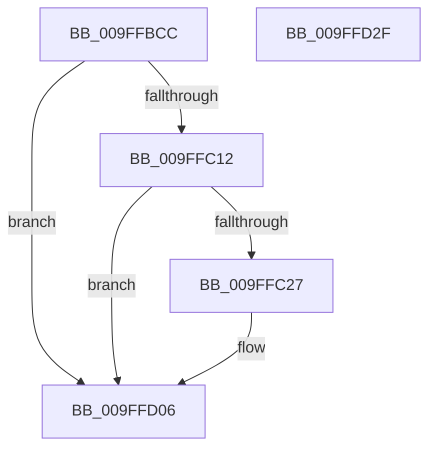

# VmpLogFaultResolveFailure

- RVA: `0x009FFBCC`–`0x009FFD30` (길이 `356` bytes)
- VA: `0x00000001409FFBCC`
- 실행 섹션: `PAGE`
- PDB 이름 있음: `예`; PDB Function 태그: `아니요`
- unwind 정보 RVA: `0x000A7978`
- 디코드: `85`개 명령, `356/356` bytes 표시
- 미해석 바이트: `0` (있으면 어셈블리에 `.byte`로 보존)

> 이 문서는 커널 이미지의 기계어와 PDB 기호를 분석해 생성했습니다. 4번과 5번은 함수 원형과 자료형을 바이너리 사용 방식에서 추정한 C 해석이며 원본 소스 복구 결과는 아닙니다.

## 1. Dependencies

- 직접 호출 지점: **4**; 고유 호출 대상: **4**
- 직접 호출자로 확인된 함수: **1**
- RIP 상대 이미지 참조: **3**

### Outgoing calls
- `0x009FFC1A` → [tlgKeywordOn](../../text/42/tlgKeywordOn_function_0042EAA0.md) (function, `0x0042EAA0`)
- `0x009FFC37` → [PsGetProcessId](../../text/43/PsGetProcessId_function_0043D910.md) (function, `0x0043D910`)
- `0x009FFD01` → [tlgWriteEx_EtwWriteEx](../../text/4A/tlgWriteEx_EtwWriteEx_function_004AA348.md) (function, `0x004AA348`)
- `0x009FFD0D` → [_security_check_cookie](../../text/6A/_security_check_cookie_function_006AC640.md) (function, `0x006AC640`)

### Direct callers
- [VmpAccessFaultBatchResolve](VmpAccessFaultBatchResolve_function_009FF710.md) at `0x009FF93D`

### Static image references
- `0x009FFBEB` → RVA `0x00E0A740` (`.data`; read)
- `0x009FFBF9` → RVA `0x00F02458` (`.data`; read)
- `0x009FFCDE` → RVA `0x00053AC9` (`.rdata`; read)

## 2. Other-region calls and transfers

- 다른 실행 섹션으로 향하는 call: **4**
  - `0x009FFC1A` → [tlgKeywordOn](../../text/42/tlgKeywordOn_function_0042EAA0.md) (`PAGE` → `.text`)
  - `0x009FFC37` → [PsGetProcessId](../../text/43/PsGetProcessId_function_0043D910.md) (`PAGE` → `.text`)
  - `0x009FFD01` → [tlgWriteEx_EtwWriteEx](../../text/4A/tlgWriteEx_EtwWriteEx_function_004AA348.md) (`PAGE` → `.text`)
  - `0x009FFD0D` → [_security_check_cookie](../../text/6A/_security_check_cookie_function_006AC640.md) (`PAGE` → `.text`)
- 별도 외부 분기/꼬리 이동을 확인하지 못했습니다.

## 3. Assembly (complete function range)

```asm
009FFBCC  48 8B C4                        mov rax, rsp
009FFBCF  48 89 58 08                     mov qword ptr [rax + 8], rbx
009FFBD3  48 89 70 10                     mov qword ptr [rax + 0x10], rsi
009FFBD7  48 89 78 18                     mov qword ptr [rax + 0x18], rdi
009FFBDB  4C 89 70 20                     mov qword ptr [rax + 0x20], r14
009FFBDF  55                              push rbp
009FFBE0  48 8D 68 E8                     lea rbp, [rax - 0x18]
009FFBE4  48 81 EC 10 01 00 00            sub rsp, 0x110
009FFBEB  48 8B 05 4E AB 40 00            mov rax, qword ptr [rip + 0x40ab4e]
009FFBF2  48 33 C4                        xor rax, rsp
009FFBF5  48 89 45 00                     mov qword ptr [rbp], rax
009FFBF9  48 8B 1D 58 28 50 00            mov rbx, qword ptr [rip + 0x502858]
009FFC00  41 8B F1                        mov esi, r9d
009FFC03  45 8B F0                        mov r14d, r8d
009FFC06  48 8B FA                        mov rdi, rdx
009FFC09  83 3B 05                        cmp dword ptr [rbx], 5
009FFC0C  0F 86 F4 00 00 00               jbe 0x1409ffd06
009FFC12  BA 40 00 00 00                  mov edx, 0x40
009FFC17  48 8B CB                        mov rcx, rbx
009FFC1A  E8 81 EE A2 FF                  call 0x14042eaa0
009FFC1F  84 C0                           test al, al
009FFC21  0F 84 DF 00 00 00               je 0x1409ffd06
009FFC27  65 48 8B 0C 25 88 01 00 00      mov rcx, qword ptr gs:[0x188]
009FFC30  48 8B 89 B8 00 00 00            mov rcx, qword ptr [rcx + 0xb8]
009FFC37  E8 D4 DC A3 FF                  call 0x14043d910
009FFC3C  83 65 9C 00                     and dword ptr [rbp - 0x64], 0
009FFC40  BA 04 00 00 00                  mov edx, 4
009FFC45  83 65 AC 00                     and dword ptr [rbp - 0x54], 0
009FFC49  45 33 C9                        xor r9d, r9d
009FFC4C  83 65 BC 00                     and dword ptr [rbp - 0x44], 0
009FFC50  83 65 CC 00                     and dword ptr [rbp - 0x34], 0
009FFC54  83 65 DC 00                     and dword ptr [rbp - 0x24], 0
009FFC58  8D 4A 04                        lea ecx, [rdx + 4]
009FFC5B  83 65 EC 00                     and dword ptr [rbp - 0x14], 0
009FFC5F  83 65 FC 00                     and dword ptr [rbp - 4], 0
009FFC63  89 44 24 40                     mov dword ptr [rsp + 0x40], eax
009FFC67  48 8D 44 24 40                  lea rax, [rsp + 0x40]
009FFC6C  48 89 45 90                     mov qword ptr [rbp - 0x70], rax
009FFC70  8B 45 48                        mov eax, dword ptr [rbp + 0x48]
009FFC73  89 44 24 44                     mov dword ptr [rsp + 0x44], eax
009FFC77  48 8D 44 24 44                  lea rax, [rsp + 0x44]
009FFC7C  48 89 45 A0                     mov qword ptr [rbp - 0x60], rax
009FFC80  48 8B 07                        mov rax, qword ptr [rdi]
009FFC83  48 89 44 24 50                  mov qword ptr [rsp + 0x50], rax
009FFC88  48 8D 44 24 50                  lea rax, [rsp + 0x50]
009FFC8D  48 89 45 B0                     mov qword ptr [rbp - 0x50], rax
009FFC91  48 8B 47 08                     mov rax, qword ptr [rdi + 8]
009FFC95  48 89 44 24 58                  mov qword ptr [rsp + 0x58], rax
009FFC9A  48 8D 44 24 58                  lea rax, [rsp + 0x58]
009FFC9F  48 89 45 C0                     mov qword ptr [rbp - 0x40], rax
009FFCA3  48 8D 44 24 48                  lea rax, [rsp + 0x48]
009FFCA8  48 89 45 D0                     mov qword ptr [rbp - 0x30], rax
009FFCAC  48 8D 44 24 4C                  lea rax, [rsp + 0x4c]
009FFCB1  48 89 45 E0                     mov qword ptr [rbp - 0x20], rax
009FFCB5  48 8B 45 40                     mov rax, qword ptr [rbp + 0x40]
009FFCB9  48 89 44 24 60                  mov qword ptr [rsp + 0x60], rax
009FFCBE  48 8D 44 24 60                  lea rax, [rsp + 0x60]
009FFCC3  48 89 45 F0                     mov qword ptr [rbp - 0x10], rax
009FFCC7  48 8D 44 24 70                  lea rax, [rsp + 0x70]
009FFCCC  89 55 98                        mov dword ptr [rbp - 0x68], edx
009FFCCF  89 55 A8                        mov dword ptr [rbp - 0x58], edx
009FFCD2  89 4D B8                        mov dword ptr [rbp - 0x48], ecx
009FFCD5  89 4D C8                        mov dword ptr [rbp - 0x38], ecx
009FFCD8  89 55 D8                        mov dword ptr [rbp - 0x28], edx
009FFCDB  89 55 E8                        mov dword ptr [rbp - 0x18], edx
009FFCDE  48 8D 15 E4 3D 65 FF            lea rdx, [rip - 0x9ac21c]
009FFCE5  89 4D F8                        mov dword ptr [rbp - 8], ecx
009FFCE8  48 8B CB                        mov rcx, rbx
009FFCEB  48 89 44 24 38                  mov qword ptr [rsp + 0x38], rax
009FFCF0  C7 44 24 30 09 00 00 00         mov dword ptr [rsp + 0x30], 9
009FFCF8  44 89 74 24 48                  mov dword ptr [rsp + 0x48], r14d
009FFCFD  89 74 24 4C                     mov dword ptr [rsp + 0x4c], esi
009FFD01  E8 42 A6 AA FF                  call 0x1404aa348
009FFD06  48 8B 4D 00                     mov rcx, qword ptr [rbp]
009FFD0A  48 33 CC                        xor rcx, rsp
009FFD0D  E8 2E C9 CA FF                  call 0x1406ac640
009FFD12  4C 8D 9C 24 10 01 00 00         lea r11, [rsp + 0x110]
009FFD1A  49 8B 5B 10                     mov rbx, qword ptr [r11 + 0x10]
009FFD1E  49 8B 73 18                     mov rsi, qword ptr [r11 + 0x18]
009FFD22  49 8B 7B 20                     mov rdi, qword ptr [r11 + 0x20]
009FFD26  4D 8B 73 28                     mov r14, qword ptr [r11 + 0x28]
009FFD2A  49 8B E3                        mov rsp, r11
009FFD2D  5D                              pop rbp
009FFD2E  C3                              ret
009FFD2F  CC                              int3
```

## 4. C-style interpretation (structured pseudocode)

```c
__int64 __fastcall VmpLogFaultResolveFailure(__int64 a1, __int64 a2, int a3, int a4)
{
    __int64 result;
    __int64 v_rsp;
    unsigned __int64 v_stack_m8;
    unsigned __int64 v_stack_mA8;
    unsigned __int64 v_stack_mB8;
    unsigned __int64 v_stack_mC0;
    unsigned __int64 v_stack_mC8;
    unsigned __int64 v_stack_mCC;
    unsigned __int64 v_stack_mD0;
    unsigned int v_stack_mD4;
    unsigned int v_stack_mD8;
    unsigned __int64 v_stack_mE0;
    unsigned int v_stack_mE8;

    *(unsigned __int64 *)(v_rsp + 8) = v_rbx;
    *(unsigned __int64 *)(v_rsp + 16) = v_rsi;
    *(unsigned __int64 *)(v_rsp + 24) = v_rdi;
    *(unsigned __int64 *)(v_rsp + 32) = v_r14;
    v_rsp = (v_rsp) - (272);
    result = (*(unsigned __int64 *)(v_rip + 4238158)) ^ (v_rsp);
    *(unsigned __int64 *)(v_rsp - 24) = result;
    if ((*(unsigned int *)(*(unsigned __int64 *)(v_rip + 5253208))) <= 5) goto loc_009FFD06;
    result = tlgKeywordOn(*(unsigned __int64 *)(v_rip + 5253208), 64, a3, a4);
    if ((unsigned __int8)(result) != 0) {
        a1 = *(unsigned __int64 *)(gs_base + (0 + 392));
        a1 = *(unsigned __int64 *)(a1 + 184);
        result = PsGetProcessId(a1, 64, a3, a4);
        a2 = 4;
        a4 = 0;
        a1 = a2 + 4;
        v_stack_mD8 = (unsigned int)(result);
        result = v_stack_mD8;
        *(unsigned __int64 *)(v_rsp - 24 - 112) = result;
        result = *(unsigned int *)(v_rsp - 24 + 72);
        v_stack_mD4 = (unsigned int)(result);
        result = v_stack_mD4;
        *(unsigned __int64 *)(v_rsp - 24 - 96) = result;
        result = *(unsigned __int64 *)(a2);
        v_stack_mC8 = result;
        result = v_stack_mC8;
        *(unsigned __int64 *)(v_rsp - 24 - 80) = result;
        result = *(unsigned __int64 *)(a2 + 8);
        v_stack_mC0 = result;
        result = v_stack_mC0;
        *(unsigned __int64 *)(v_rsp - 24 - 64) = result;
        result = v_stack_mD0;
        *(unsigned __int64 *)(v_rsp - 24 - 48) = result;
        result = v_stack_mCC;
        *(unsigned __int64 *)(v_rsp - 24 - 32) = result;
        result = *(unsigned __int64 *)(v_rsp - 24 + 64);
        v_stack_mB8 = result;
        result = v_stack_mB8;
        *(unsigned __int64 *)(v_rsp - 24 - 16) = result;
        result = v_stack_mA8;
        *(unsigned int *)(v_rsp - 24 - 104) = (unsigned int)(a2);
        *(unsigned int *)(v_rsp - 24 - 88) = (unsigned int)(a2);
        *(unsigned int *)(v_rsp - 24 - 72) = (unsigned int)(a1);
        *(unsigned int *)(v_rsp - 24 - 56) = (unsigned int)(a1);
        *(unsigned int *)(v_rsp - 24 - 40) = (unsigned int)(a2);
        *(unsigned int *)(v_rsp - 24 - 24) = (unsigned int)(a2);
        a2 = v_rip - 10142236;
        *(unsigned int *)(v_rsp - 24 - 8) = (unsigned int)(a1);
        a1 = *(unsigned __int64 *)(v_rip + 5253208);
        v_stack_mE0 = result;
        v_stack_mE8 = 9;
        v_stack_mD0 = (unsigned int)((unsigned int)(a3));
        v_stack_mCC = (unsigned int)((unsigned int)(a4));
        result = tlgWriteEx_EtwWriteEx(a1, a2, a3, a4);
    }
    a1 = (*(unsigned __int64 *)(v_rsp - 24)) ^ (v_rsp);
    result = _security_check_cookie(a1, a2, a3, a4);
    return result;
}
```

## 5. (Beta) C Style

```c
int64_t VmpLogFaultResolveFailure(int64_t Arg1, void *Arg2, int32_t Arg3, int32_t Arg4)
{
    uint8_t *arg2 = (uint8_t *)Arg2;

    int64_t result;
    int64_t local_rsp;
    uint64_t v_stack_m8;
    uint64_t v_stack_mA8;
    uint64_t v_stack_mB8;
    uint64_t v_stack_mC0;
    uint64_t v_stack_mC8;
    uint64_t v_stack_mCC;
    uint64_t v_stack_mD0;
    uint32_t v_stack_mD4;
    uint32_t v_stack_mD8;
    uint64_t v_stack_mE0;
    uint32_t v_stack_mE8;

    *(uint64_t *)(local_rsp + 0x8) = local_rbx;
    *(uint64_t *)(local_rsp + 0x10) = local_rsi;
    *(uint64_t *)(local_rsp + 0x18) = local_rdi;
    *(uint64_t *)(local_rsp + 0x20) = local_r14;
    local_rsp = (local_rsp) - (272);
    result = (*(uint64_t *)(v_rip + 0x40AB4E)) ^ (local_rsp);
    *(uint64_t *)(local_rsp - 0x18) = result;
    if ((*(uint32_t *)(*(uint64_t *)(v_rip + 0x502858))) <= 5) goto loc_009FFD06;
    result = tlgKeywordOn(*(uint64_t *)(v_rip + 0x502858), 64, Arg3, Arg4);
    if ((uint8_t)(result) != 0) {
        Arg1 = *(uint64_t *)(gs_base + (0 + 0x188));
        Arg1 = *(uint64_t *)(Arg1 + 0xB8);
        result = PsGetProcessId(Arg1, 64, Arg3, Arg4);
        Arg2 = 4;
        Arg4 = 0;
        Arg1 = Arg2 + 4;
        v_stack_mD8 = (uint32_t)(result);
        result = v_stack_mD8;
        *(uint64_t *)(local_rsp - 0x18 - 0x70) = result;
        result = *(uint32_t *)(local_rsp - 0x18 + 0x48);
        v_stack_mD4 = (uint32_t)(result);
        result = v_stack_mD4;
        *(uint64_t *)(local_rsp - 0x18 - 0x60) = result;
        result = *(uint64_t *)(arg2);
        v_stack_mC8 = result;
        result = v_stack_mC8;
        *(uint64_t *)(local_rsp - 0x18 - 0x50) = result;
        result = *(uint64_t *)(arg2 + 0x8);
        v_stack_mC0 = result;
        result = v_stack_mC0;
        *(uint64_t *)(local_rsp - 0x18 - 0x40) = result;
        result = v_stack_mD0;
        *(uint64_t *)(local_rsp - 0x18 - 0x30) = result;
        result = v_stack_mCC;
        *(uint64_t *)(local_rsp - 0x18 - 0x20) = result;
        result = *(uint64_t *)(local_rsp - 0x18 + 0x40);
        v_stack_mB8 = result;
        result = v_stack_mB8;
        *(uint64_t *)(local_rsp - 0x18 - 0x10) = result;
        result = v_stack_mA8;
        *(uint32_t *)(local_rsp - 0x18 - 0x68) = (uint32_t)(Arg2);
        *(uint32_t *)(local_rsp - 0x18 - 0x58) = (uint32_t)(Arg2);
        *(uint32_t *)(local_rsp - 0x18 - 0x48) = (uint32_t)(Arg1);
        *(uint32_t *)(local_rsp - 0x18 - 0x38) = (uint32_t)(Arg1);
        *(uint32_t *)(local_rsp - 0x18 - 0x28) = (uint32_t)(Arg2);
        *(uint32_t *)(local_rsp - 0x18 - 0x18) = (uint32_t)(Arg2);
        Arg2 = v_rip - 10142236;
        *(uint32_t *)(local_rsp - 0x18 - 0x8) = (uint32_t)(Arg1);
        Arg1 = *(uint64_t *)(v_rip + 0x502858);
        v_stack_mE0 = result;
        v_stack_mE8 = 9;
        v_stack_mD0 = (uint32_t)((uint32_t)(Arg3));
        v_stack_mCC = (uint32_t)((uint32_t)(Arg4));
        result = tlgWriteEx_EtwWriteEx(Arg1, Arg2, Arg3, Arg4);
    }
    Arg1 = (*(uint64_t *)(local_rsp - 0x18)) ^ (local_rsp);
    result = _security_check_cookie(Arg1, Arg2, Arg3, Arg4);
    return result;
}
```

### 관측된 메모리 오프셋

구조체 형식이 확인되지 않은 접근은 인자 기준의 오프셋으로만 기록했습니다.

| 기준 인자 | 오프셋 표현 | 폭 (bit) | 접근 |
|---|---:|---:|---|
| `Arg2` | `+ 0x0` | `64` | `R` |
| `Arg2` | `+ 0x8` | `64` | `R` |

## 6. Execution-region graph

[열기: 2D/3D 그래프와 함수 탐색 컨트롤 패널](../../../control-panel.html?section=page&rva=0x009FFBCC&view=graph)

- 2D 그래프는 위에서 아래로 흐르고, 3D 그래프는 빈 공간을 드래그해 회전합니다. Shift+드래그는 이동, 휠은 확대·축소, 함수 노드 선택은 대상 보고서 이동입니다.

### Static fallback


