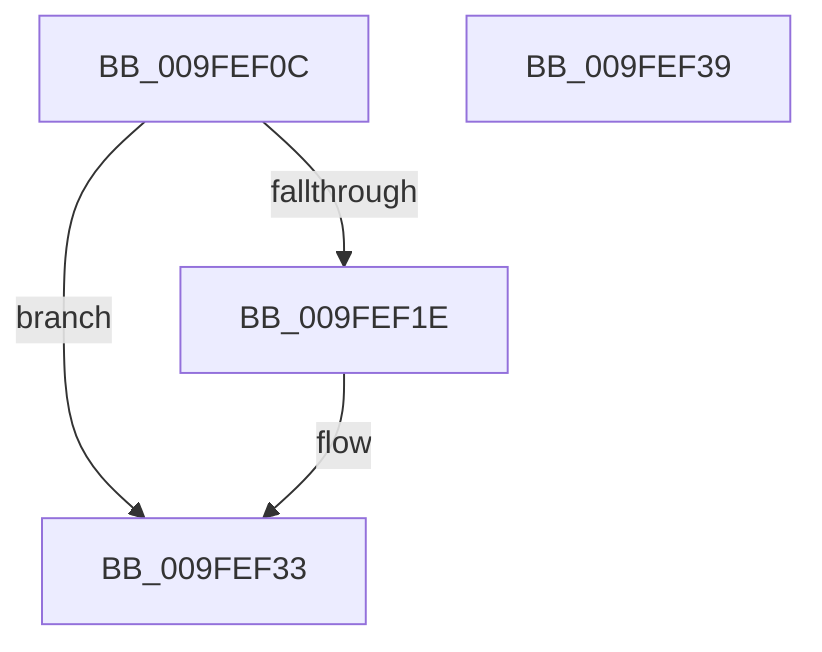

# VrpDecommissionKeyContext

- RVA: `0x009FEF0C`–`0x009FEF3A` (길이 `46` bytes)
- VA: `0x00000001409FEF0C`
- 실행 섹션: `PAGE`
- PDB 이름 있음: `예`; PDB Function 태그: `아니요`
- unwind 정보 RVA: `0x0005CF00`
- 디코드: `15`개 명령, `46/46` bytes 표시
- 미해석 바이트: `0` (있으면 어셈블리에 `.byte`로 보존)

> 이 문서는 커널 이미지의 기계어와 PDB 기호를 분석해 생성했습니다. 4번과 5번은 함수 원형과 자료형을 바이너리 사용 방식에서 추정한 C 해석이며 원본 소스 복구 결과는 아닙니다.

## 1. Dependencies

- 직접 호출 지점: **2**; 고유 호출 대상: **2**
- 직접 호출자로 확인된 함수: **2**
- RIP 상대 이미지 참조: **0**

### Outgoing calls
- `0x009FEF23` → [ExFreePoolWithTag](../../poolcode/B8/ExFreePoolWithTag_function_00B82870.md) (function, `0x00B82870`)
- `0x009FEF2E` → [RtlInitUnicodeString](../../text/42/RtlInitUnicodeString_function_0042A780.md) (function, `0x0042A780`)

### Direct callers
- [VrpRegistryCallback](../86/VrpRegistryCallback_function_00867450.md) at `0x00867577`
- [VrpFreeKeyContext](VrpFreeKeyContext_function_009FEED4.md) at `0x009FEEDD`

### Static image references
- 디코드된 RIP-relative 메모리 참조가 없습니다.

## 2. Other-region calls and transfers

- 다른 실행 섹션으로 향하는 call: **2**
  - `0x009FEF23` → [ExFreePoolWithTag](../../poolcode/B8/ExFreePoolWithTag_function_00B82870.md) (`PAGE` → `POOLCODE`)
  - `0x009FEF2E` → [RtlInitUnicodeString](../../text/42/RtlInitUnicodeString_function_0042A780.md) (`PAGE` → `.text`)
- 별도 외부 분기/꼬리 이동을 확인하지 못했습니다.

## 3. Assembly (complete function range)

```asm
009FEF0C  40 53                           push rbx
009FEF0E  48 83 EC 20                     sub rsp, 0x20
009FEF12  48 8B D9                        mov rbx, rcx
009FEF15  48 8B 49 18                     mov rcx, qword ptr [rcx + 0x18]
009FEF19  48 85 C9                        test rcx, rcx
009FEF1C  74 15                           je 0x1409fef33
009FEF1E  BA 56 52 65 67                  mov edx, 0x67655256
009FEF23  E8 48 39 18 00                  call 0x140b82870
009FEF28  48 8D 4B 10                     lea rcx, [rbx + 0x10]
009FEF2C  33 D2                           xor edx, edx
009FEF2E  E8 4D B8 A2 FF                  call 0x14042a780
009FEF33  48 83 C4 20                     add rsp, 0x20
009FEF37  5B                              pop rbx
009FEF38  C3                              ret
009FEF39  CC                              int3
```

## 4. C-style interpretation (structured pseudocode)

```c
__int64 __fastcall VrpDecommissionKeyContext(__int64 a1)
{
    __int64 result;
    __int64 v_rsp;

    v_rsp = (v_rsp) - (32);
    if (*(unsigned __int64 *)(a1 + 24) != 0) {
        a2 = 0x67655256ULL;
        result = ExFreePoolWithTag(*(unsigned __int64 *)(a1 + 24), a2, a3, a4);
        a1 = a1 + 16;
        a2 = 0;
        result = RtlInitUnicodeString(a1, a2, a3, a4);
    }
    v_rsp = (v_rsp) + (32);
    return result;
}
```

## 5. (Beta) C Style

```c
int64_t VrpDecommissionKeyContext(void *Arg1)
{
    uint8_t *arg1 = (uint8_t *)Arg1;

    int64_t result;
    int64_t local_rsp;

    local_rsp = (local_rsp) - (32);
    if (*(uint64_t *)(arg1 + 0x18) != 0) {
        a2 = 0x67655256ULL;
        result = ExFreePoolWithTag(*(uint64_t *)(arg1 + 0x18), a2, a3, a4);
        Arg1 = Arg1 + 16;
        a2 = 0;
        result = RtlInitUnicodeString(Arg1, a2, a3, a4);
    }
    local_rsp = (local_rsp) + (32);
    return result;
}
```

### 관측된 메모리 오프셋

구조체 형식이 확인되지 않은 접근은 인자 기준의 오프셋으로만 기록했습니다.

| 기준 인자 | 오프셋 표현 | 폭 (bit) | 접근 |
|---|---:|---:|---|
| `Arg1` | `+ 0x10` | `64` | `R` |
| `Arg1` | `+ 0x18` | `64` | `R` |

## 6. Execution-region graph

[열기: 2D/3D 그래프와 함수 탐색 컨트롤 패널](../../../control-panel.html?section=page&rva=0x009FEF0C&view=graph)

- 2D 그래프는 위에서 아래로 흐르고, 3D 그래프는 빈 공간을 드래그해 회전합니다. Shift+드래그는 이동, 휠은 확대·축소, 함수 노드 선택은 대상 보고서 이동입니다.

### Static fallback


