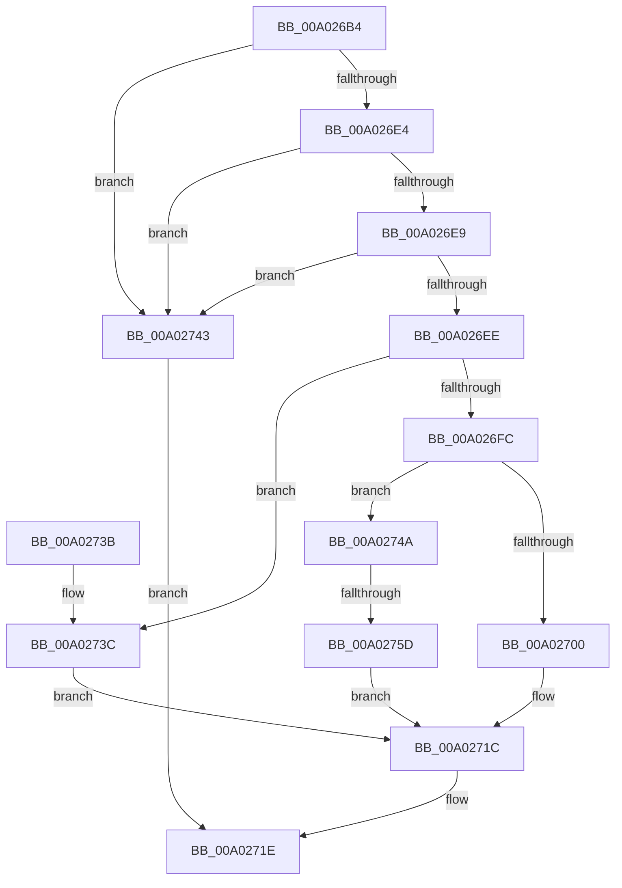

# AppendCondition

- RVA: `0x00A026B4`–`0x00A02762` (길이 `174` bytes)
- VA: `0x0000000140A026B4`
- 실행 섹션: `PAGE`
- PDB 이름 있음: `예`; PDB Function 태그: `예`
- unwind 정보 RVA: `0x000A7EF8`
- 디코드: `59`개 명령, `174/174` bytes 표시
- 미해석 바이트: `0` (있으면 어셈블리에 `.byte`로 보존)

> 이 문서는 커널 이미지의 기계어와 PDB 기호를 분석해 생성했습니다. 4번과 5번은 함수 원형과 자료형을 바이너리 사용 방식에서 추정한 C 해석이며 원본 소스 복구 결과는 아닙니다.

## 1. Dependencies

- 직접 호출 지점: **2**; 고유 호출 대상: **2**
- 직접 호출자로 확인된 함수: **1**
- RIP 상대 이미지 참조: **0**

### Outgoing calls
- `0x00A02711` → [memcpy](../../text/6C/memcpy_function_006C6840.md) (function, `0x006C6840`)
- `0x00A0274C` → [SddlpAlloc](../92/SddlpAlloc_function_00925F88.md) (function, `0x00925F88`)

### Direct callers
- [LocalGetConditionForString](LocalGetConditionForString_function_00A01C20.md) at `0x00A01EDB`
- [LocalGetConditionForString](LocalGetConditionForString_function_00A01C20.md) at `0x00A01F13`
- [LocalGetConditionForString](LocalGetConditionForString_function_00A01C20.md) at `0x00A01F42`
- [LocalGetConditionForString](LocalGetConditionForString_function_00A01C20.md) at `0x00A023F5`

### Static image references
- 디코드된 RIP-relative 메모리 참조가 없습니다.

## 2. Other-region calls and transfers

- 다른 실행 섹션으로 향하는 call: **1**
  - `0x00A02711` → [memcpy](../../text/6C/memcpy_function_006C6840.md) (`PAGE` → `.text`)
- call이 아닌 외부 분기/꼬리 이동: **1**
  - `0x00A02757` → [sub_00B3347A](../B3/Unknown_function_00B3347A.md) (`tail-transfer`)

## 3. Assembly (complete function range)

```asm
00A026B4  48 8B C4                        mov rax, rsp
00A026B7  48 89 58 08                     mov qword ptr [rax + 8], rbx
00A026BB  48 89 68 10                     mov qword ptr [rax + 0x10], rbp
00A026BF  48 89 70 18                     mov qword ptr [rax + 0x18], rsi
00A026C3  4C 89 48 20                     mov qword ptr [rax + 0x20], r9
00A026C7  57                              push rdi
00A026C8  41 54                           push r12
00A026CA  41 55                           push r13
00A026CC  41 56                           push r14
00A026CE  41 57                           push r15
00A026D0  48 83 EC 20                     sub rsp, 0x20
00A026D4  33 FF                           xor edi, edi
00A026D6  4D 8B F0                        mov r14, r8
00A026D9  4C 8B FA                        mov r15, rdx
00A026DC  4C 8B E1                        mov r12, rcx
00A026DF  48 85 C9                        test rcx, rcx
00A026E2  74 5F                           je 0x140a02743
00A026E4  48 85 D2                        test rdx, rdx
00A026E7  74 5A                           je 0x140a02743
00A026E9  4D 85 C0                        test r8, r8
00A026EC  74 55                           je 0x140a02743
00A026EE  41 8B 00                        mov eax, dword ptr [r8]
00A026F1  8B 6C 24 70                     mov ebp, dword ptr [rsp + 0x70]
00A026F5  8D 34 28                        lea esi, [rax + rbp]
00A026F8  3B F0                           cmp esi, eax
00A026FA  72 40                           jb 0x140a0273c
00A026FC  3B 32                           cmp esi, dword ptr [rdx]
00A026FE  77 4A                           ja 0x140a0274a
00A02700  41 8B 1E                        mov ebx, dword ptr [r14]
00A02703  4C 8B C5                        mov r8, rbp
00A02706  48 8B 54 24 68                  mov rdx, qword ptr [rsp + 0x68]
00A0270B  8B CB                           mov ecx, ebx
00A0270D  49 03 0C 24                     add rcx, qword ptr [r12]
00A02711  E8 2A 41 CC FF                  call 0x1406c6840
00A02716  8D 04 2B                        lea eax, [rbx + rbp]
00A02719  41 89 06                        mov dword ptr [r14], eax
00A0271C  8B C7                           mov eax, edi
00A0271E  48 8B 5C 24 50                  mov rbx, qword ptr [rsp + 0x50]
00A02723  48 8B 6C 24 58                  mov rbp, qword ptr [rsp + 0x58]
00A02728  48 8B 74 24 60                  mov rsi, qword ptr [rsp + 0x60]
00A0272D  48 83 C4 20                     add rsp, 0x20
00A02731  41 5F                           pop r15
00A02733  41 5E                           pop r14
00A02735  41 5D                           pop r13
00A02737  41 5C                           pop r12
00A02739  5F                              pop rdi
00A0273A  C3                              ret
00A0273B  CC                              int3
00A0273C  BF 16 02 00 00                  mov edi, 0x216
00A02741  EB D9                           jmp 0x140a0271c
00A02743  B8 57 00 00 00                  mov eax, 0x57
00A02748  EB D4                           jmp 0x140a0271e
00A0274A  8B CE                           mov ecx, esi
00A0274C  E8 37 38 F2 FF                  call 0x140925f88
00A02751  4C 8B E8                        mov r13, rax
00A02754  48 85 C0                        test rax, rax
00A02757  0F 85 1D 0D 13 00               jne 0x140b3347a
00A0275D  8D 78 08                        lea edi, [rax + 8]
00A02760  EB BA                           jmp 0x140a0271c
```

## 4. C-style interpretation (structured pseudocode)

```c
__int64 __fastcall AppendCondition(__int64 a1, __int64 a2, __int64 a3, __int64 a4, unsigned int a5)
{
    __int64 result;
    __int64 v_rdi;
    __int64 v_rsp;
    unsigned __int64 v_stack_p10;
    unsigned __int64 v_stack_p18;
    unsigned __int64 v_stack_p20;
    unsigned __int64 v_stack_p8;

    *(unsigned __int64 *)(v_rsp + 8) = v_rbx;
    *(unsigned __int64 *)(v_rsp + 16) = v_rbp;
    *(unsigned __int64 *)(v_rsp + 24) = v_rsi;
    *(unsigned __int64 *)(v_rsp + 32) = a4;
    v_rsp = (v_rsp) - (32);
    v_rdi = 0;
    if (a1 == 0) goto loc_00A02743;
    if (a2 == 0) goto loc_00A02743;
    if (a3 == 0) goto loc_00A02743;
    if (((unsigned int)((unsigned int)(*(unsigned int *)(a3)) + (unsigned int)(a5) * 1)) < ((unsigned int)((unsigned int)(*(unsigned int *)(a3))))) goto loc_00A0273C;
    if (((unsigned int)((unsigned int)(*(unsigned int *)(a3)) + (unsigned int)(a5) * 1)) > (*(unsigned int *)(a2))) goto loc_00A0274A;
    a1 = ((unsigned int)((unsigned int)((unsigned int)(*(unsigned int *)(a3))))) + (*(unsigned __int64 *)(a1));
    result = memcpy(a1, v_stack_p20, (unsigned int)(a5), a4);
    *(unsigned int *)(a3) = (unsigned int)((unsigned int)(*(unsigned int *)(a3)) + (unsigned int)(a5) * 1);
loc_00A0271C:
loc_00A0271E:
    v_rsp = (v_rsp) + (32);
    return 0;
loc_00A0273C:
    goto loc_00A0271C;
loc_00A02743:
    goto loc_00A0271E;
loc_00A0274A:
    result = SddlpAlloc((unsigned int)((unsigned int)(v_stack_p18)), v_stack_p20, (unsigned int)(a5), a4);
    goto loc_00A0271C;
}
```

## 5. (Beta) C Style

```c
int64_t AppendCondition(void *Arg1, int64_t Arg2, void *Arg3, int64_t Arg4, uint32_t Arg5)
{
    uint8_t *arg1 = (uint8_t *)Arg1;
    uint8_t *arg3 = (uint8_t *)Arg3;

    int64_t result;
    int64_t local_rdi;
    int64_t local_rsp;
    uint64_t v_stack_p10;
    uint64_t v_stack_p18;
    uint64_t v_stack_p20;
    uint64_t v_stack_p8;

    *(uint64_t *)(local_rsp + 0x8) = local_rbx;
    *(uint64_t *)(local_rsp + 0x10) = local_rbp;
    *(uint64_t *)(local_rsp + 0x18) = local_rsi;
    *(uint64_t *)(local_rsp + 0x20) = Arg4;
    local_rsp = (local_rsp) - (32);
    local_rdi = 0;
    if (Arg1 == NULL) goto loc_00A02743;
    if (Arg2 == 0) goto loc_00A02743;
    if (Arg3 == NULL) goto loc_00A02743;
    if (((uint32_t)((uint32_t)(*(uint32_t *)(arg3)) + (uint32_t)(Arg5) * 1)) < ((uint32_t)((uint32_t)(*(uint32_t *)(arg3))))) goto loc_00A0273C;
    if (((uint32_t)((uint32_t)(*(uint32_t *)(arg3)) + (uint32_t)(Arg5) * 1)) > (*(uint32_t *)(Arg2))) goto loc_00A0274A;
    Arg1 = ((uint32_t)((uint32_t)((uint32_t)(*(uint32_t *)(arg3))))) + (*(uint64_t *)(arg1));
    result = memcpy(Arg1, v_stack_p20, (uint32_t)(Arg5), Arg4);
    *(uint32_t *)(arg3) = (uint32_t)((uint32_t)(*(uint32_t *)(arg3)) + (uint32_t)(Arg5) * 1);
loc_00A0271C:
loc_00A0271E:
    local_rsp = (local_rsp) + (32);
    return 0;
loc_00A0273C:
    goto loc_00A0271C;
loc_00A02743:
    goto loc_00A0271E;
loc_00A0274A:
    result = SddlpAlloc((uint32_t)((uint32_t)(v_stack_p18)), v_stack_p20, (uint32_t)(Arg5), Arg4);
    goto loc_00A0271C;
}
```

### 관측된 메모리 오프셋

구조체 형식이 확인되지 않은 접근은 인자 기준의 오프셋으로만 기록했습니다.

| 기준 인자 | 오프셋 표현 | 폭 (bit) | 접근 |
|---|---:|---:|---|
| `Arg1` | `+ 0x0` | `64` | `R` |
| `Arg3` | `+ 0x0` | `32` | `R` |
| `Arg3` | `+ 0x0` | `32` | `W` |

## 6. Execution-region graph

[열기: 2D/3D 그래프와 함수 탐색 컨트롤 패널](../../../control-panel.html?section=page&rva=0x00A026B4&view=graph)

- 2D 그래프는 위에서 아래로 흐르고, 3D 그래프는 빈 공간을 드래그해 회전합니다. Shift+드래그는 이동, 휠은 확대·축소, 함수 노드 선택은 대상 보고서 이동입니다.

### Static fallback


