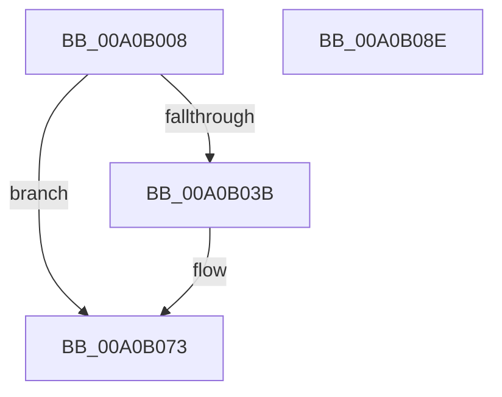

# CmBuildDevicePanelId

- RVA: `0x00A0B008`–`0x00A0B08F` (길이 `135` bytes)
- VA: `0x0000000140A0B008`
- 실행 섹션: `PAGE`
- PDB 이름 있음: `예`; PDB Function 태그: `아니요`
- unwind 정보 RVA: `0x000A8988`
- 디코드: `35`개 명령, `135/135` bytes 표시
- 미해석 바이트: `0` (있으면 어셈블리에 `.byte`로 보존)

> 이 문서는 커널 이미지의 기계어와 PDB 기호를 분석해 생성했습니다. 4번과 5번은 함수 원형과 자료형을 바이너리 사용 방식에서 추정한 C 해석이며 원본 소스 복구 결과는 아닙니다.

## 1. Dependencies

- 직접 호출 지점: **3**; 고유 호출 대상: **3**
- 직접 호출자로 확인된 함수: **3**
- RIP 상대 이미지 참조: **2**

### Outgoing calls
- `0x00A0B032` → [PnpStringFromGuid](../8F/PnpStringFromGuid_function_008F5A2C.md) (function, `0x008F5A2C`)
- `0x00A0B06E` → [RtlStringCchPrintfExW](../../text/42/RtlStringCchPrintfExW_function_0042B390.md) (function, `0x0042B390`)
- `0x00A0B07E` → [_security_check_cookie](../../text/6A/_security_check_cookie_function_006AC640.md) (function, `0x006AC640`)

### Direct callers
- [_CmUpdateDevicePanel](_CmUpdateDevicePanel_function_00A0A16C.md) at `0x00A0A533`
- [sub_00B34C12](../B3/Unknown_function_00B34C12.md) at `0x00B34CA1`
- [sub_00B34E9C](../B3/Unknown_function_00B34E9C.md) at `0x00B35702`
- [sub_00B34E9C](../B3/Unknown_function_00B34E9C.md) at `0x00B35AED`

### Static image references
- `0x00A0B013` → RVA `0x00E0A740` (`.data`; read)
- `0x00A0B053` → RVA `0x00B0D8B0` (` ?? ::NNGAKEGL::`string'`; read)

## 2. Other-region calls and transfers

- 다른 실행 섹션으로 향하는 call: **2**
  - `0x00A0B06E` → [RtlStringCchPrintfExW](../../text/42/RtlStringCchPrintfExW_function_0042B390.md) (`PAGE` → `.text`)
  - `0x00A0B07E` → [_security_check_cookie](../../text/6A/_security_check_cookie_function_006AC640.md) (`PAGE` → `.text`)
- 별도 외부 분기/꼬리 이동을 확인하지 못했습니다.

## 3. Assembly (complete function range)

```asm
00A0B008  40 53                           push rbx
00A0B00A  56                              push rsi
00A0B00B  57                              push rdi
00A0B00C  48 81 EC B0 00 00 00            sub rsp, 0xb0
00A0B013  48 8B 05 26 F7 3F 00            mov rax, qword ptr [rip + 0x3ff726]
00A0B01A  48 33 C4                        xor rax, rsp
00A0B01D  48 89 84 24 A0 00 00 00         mov qword ptr [rsp + 0xa0], rax
00A0B025  8B DA                           mov ebx, edx
00A0B027  49 8B F1                        mov rsi, r9
00A0B02A  48 8D 54 24 50                  lea rdx, [rsp + 0x50]
00A0B02F  41 8B F8                        mov edi, r8d
00A0B032  E8 F5 A9 EE FF                  call 0x1408f5a2c
00A0B037  85 C0                           test eax, eax
00A0B039  78 38                           js 0x140a0b073
00A0B03B  89 7C 24 40                     mov dword ptr [rsp + 0x40], edi
00A0B03F  48 8D 44 24 50                  lea rax, [rsp + 0x50]
00A0B044  89 5C 24 38                     mov dword ptr [rsp + 0x38], ebx
00A0B048  45 33 C9                        xor r9d, r9d
00A0B04B  48 89 44 24 30                  mov qword ptr [rsp + 0x30], rax
00A0B050  45 33 C0                        xor r8d, r8d
00A0B053  48 8D 05 56 28 10 00            lea rax, [rip + 0x102856]
00A0B05A  48 8B CE                        mov rcx, rsi
00A0B05D  48 89 44 24 28                  mov qword ptr [rsp + 0x28], rax
00A0B062  41 8D 51 39                     lea edx, [r9 + 0x39]
00A0B066  C7 44 24 20 00 08 00 00         mov dword ptr [rsp + 0x20], 0x800
00A0B06E  E8 1D 03 A2 FF                  call 0x14042b390
00A0B073  48 8B 8C 24 A0 00 00 00         mov rcx, qword ptr [rsp + 0xa0]
00A0B07B  48 33 CC                        xor rcx, rsp
00A0B07E  E8 BD 15 CA FF                  call 0x1406ac640
00A0B083  48 81 C4 B0 00 00 00            add rsp, 0xb0
00A0B08A  5F                              pop rdi
00A0B08B  5E                              pop rsi
00A0B08C  5B                              pop rbx
00A0B08D  C3                              ret
00A0B08E  CC                              int3
```

## 4. C-style interpretation (structured pseudocode)

```c
__int64 __fastcall CmBuildDevicePanelId(__int64 a1, int a2, int a3, __int64 a4)
{
    __int64 result;
    __int64 v_rsp;
    unsigned __int64 v_stack_m28;
    unsigned __int64 v_stack_m78;
    unsigned int v_stack_m88;
    unsigned int v_stack_m90;
    unsigned __int64 v_stack_m98;
    unsigned __int64 v_stack_mA0;
    unsigned int v_stack_mA8;

    v_rsp = (v_rsp) - (176);
    result = (*(unsigned __int64 *)(v_rip + 4192038)) ^ (v_rsp);
    v_stack_m28 = result;
    result = PnpStringFromGuid(a1, v_stack_m78, a3, a4);
    if (!(sign_flag)) {
        v_stack_m88 = (unsigned int)((unsigned int)(a3));
        result = v_stack_m78;
        v_stack_m90 = (unsigned int)((unsigned int)(a2));
        a4 = 0;
        v_stack_m98 = result;
        a3 = 0;
        result = v_rip + 1058902;
        a1 = 0;
        v_stack_mA0 = result;
        a2 = a4 + 57;
        v_stack_mA8 = 0x800ULL;
        result = RtlStringCchPrintfExW(a1, a2, a3, a4);
    }
    a1 = (v_stack_m28) ^ (v_rsp);
    result = _security_check_cookie(a1, a2, a3, a4);
    v_rsp = (v_rsp) + (176);
    return result;
}
```

## 5. (Beta) C Style

```c
int64_t CmBuildDevicePanelId(int64_t Arg1, int32_t Arg2, int32_t Arg3, int64_t Arg4)
{
    int64_t result;
    int64_t local_rsp;
    uint64_t v_stack_m28;
    uint64_t v_stack_m78;
    uint32_t v_stack_m88;
    uint32_t v_stack_m90;
    uint64_t v_stack_m98;
    uint64_t v_stack_mA0;
    uint32_t v_stack_mA8;

    local_rsp = (local_rsp) - (176);
    result = (*(uint64_t *)(v_rip + 0x3FF726)) ^ (local_rsp);
    v_stack_m28 = result;
    result = PnpStringFromGuid(Arg1, v_stack_m78, Arg3, Arg4);
    if (!(sign_flag)) {
        v_stack_m88 = (uint32_t)((uint32_t)(Arg3));
        result = v_stack_m78;
        v_stack_m90 = (uint32_t)((uint32_t)(Arg2));
        Arg4 = 0;
        v_stack_m98 = result;
        Arg3 = 0;
        result = v_rip + 1058902;
        Arg1 = 0;
        v_stack_mA0 = result;
        Arg2 = Arg4 + 57;
        v_stack_mA8 = 0x800ULL;
        result = RtlStringCchPrintfExW(Arg1, Arg2, Arg3, Arg4);
    }
    Arg1 = (v_stack_m28) ^ (local_rsp);
    result = _security_check_cookie(Arg1, Arg2, Arg3, Arg4);
    local_rsp = (local_rsp) + (176);
    return result;
}
```

## 6. Execution-region graph

[열기: 2D/3D 그래프와 함수 탐색 컨트롤 패널](../../../control-panel.html?section=page&rva=0x00A0B008&view=graph)

- 2D 그래프는 위에서 아래로 흐르고, 3D 그래프는 빈 공간을 드래그해 회전합니다. Shift+드래그는 이동, 휠은 확대·축소, 함수 노드 선택은 대상 보고서 이동입니다.

### Static fallback


