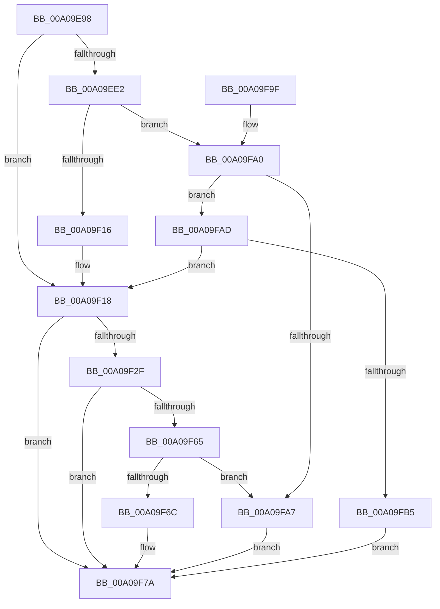

# CmDeleteDeviceInterface

- RVA: `0x00A09E98`–`0x00A09FBC` (길이 `292` bytes)
- VA: `0x0000000140A09E98`
- 실행 섹션: `PAGE`
- PDB 이름 있음: `예`; PDB Function 태그: `아니요`
- unwind 정보 RVA: `0x000A88C0`
- 디코드: `77`개 명령, `292/292` bytes 표시
- 미해석 바이트: `0` (있으면 어셈블리에 `.byte`로 보존)

> 이 문서는 커널 이미지의 기계어와 PDB 기호를 분석해 생성했습니다. 4번과 5번은 함수 원형과 자료형을 바이너리 사용 방식에서 추정한 C 해석이며 원본 소스 복구 결과는 아닙니다.

## 1. Dependencies

- 직접 호출 지점: **5**; 고유 호출 대상: **4**
- 직접 호출자로 확인된 함수: **5**
- RIP 상대 이미지 참조: **1**

### Outgoing calls
- `0x00A09ECD` → [memset](../../text/6C/memset_function_006C6C40.md) (function, `0x006C6C40`)
- `0x00A09F06` → [guard_dispatch_icall](../../text/6B/guard_dispatch_icall_function_006BAAD0.md) (function, `0x006BAAD0`)
- `0x00A09F23` → [CmDeleteDeviceInterfaceWorker](../82/CmDeleteDeviceInterfaceWorker_function_0082A0B8.md) (function, `0x0082A0B8`)
- `0x00A09F57` → [guard_dispatch_icall](../../text/6B/guard_dispatch_icall_function_006BAAD0.md) (function, `0x006BAAD0`)
- `0x00A09F87` → [_security_check_cookie](../../text/6A/_security_check_cookie_function_006AC640.md) (function, `0x006AC640`)

### Direct callers
- [_PnpDispatchDeviceInterface](../8E/_PnpDispatchDeviceInterface_function_008E0DB0.md) at `0x008E10C4`
- [IopRegisterDeviceInterface](../95/IopRegisterDeviceInterface_function_009501B0.md) at `0x0095070B`
- [PnpDeleteDeviceInterfaces](../97/PnpDeleteDeviceInterfaces_function_0097A08C.md) at `0x0097A29B`
- [_CmDeleteDeviceWorker](_CmDeleteDeviceWorker_function_00A08F48.md) at `0x00A09257`
- [PiCMUnregisterDeviceInterface](../AD/PiCMUnregisterDeviceInterface_function_00AD9758.md) at `0x00AD98B1`

### Static image references
- `0x00A09EA7` → RVA `0x00E0A740` (`.data`; read)

## 2. Other-region calls and transfers

- 다른 실행 섹션으로 향하는 call: **4**
  - `0x00A09ECD` → [memset](../../text/6C/memset_function_006C6C40.md) (`PAGE` → `.text`)
  - `0x00A09F06` → [guard_dispatch_icall](../../text/6B/guard_dispatch_icall_function_006BAAD0.md) (`PAGE` → `.text`)
  - `0x00A09F57` → [guard_dispatch_icall](../../text/6B/guard_dispatch_icall_function_006BAAD0.md) (`PAGE` → `.text`)
  - `0x00A09F87` → [_security_check_cookie](../../text/6A/_security_check_cookie_function_006AC640.md) (`PAGE` → `.text`)
- 별도 외부 분기/꼬리 이동을 확인하지 못했습니다.

## 3. Assembly (complete function range)

```asm
00A09E98  48 89 5C 24 20                  mov qword ptr [rsp + 0x20], rbx
00A09E9D  55                              push rbp
00A09E9E  56                              push rsi
00A09E9F  57                              push rdi
00A09EA0  48 81 EC B0 00 00 00            sub rsp, 0xb0
00A09EA7  48 8B 05 92 08 40 00            mov rax, qword ptr [rip + 0x400892]
00A09EAE  48 33 C4                        xor rax, rsp
00A09EB1  48 89 84 24 A0 00 00 00         mov qword ptr [rsp + 0xa0], rax
00A09EB9  48 8B EA                        mov rbp, rdx
00A09EBC  41 8B D8                        mov ebx, r8d
00A09EBF  33 D2                           xor edx, edx
00A09EC1  48 8B F1                        mov rsi, rcx
00A09EC4  48 8D 4C 24 40                  lea rcx, [rsp + 0x40]
00A09EC9  44 8D 42 58                     lea r8d, [rdx + 0x58]
00A09ECD  E8 6E CD CB FF                  call 0x1406c6c40
00A09ED2  48 8B BE F8 01 00 00            mov rdi, qword ptr [rsi + 0x1f8]
00A09ED9  89 5C 24 50                     mov dword ptr [rsp + 0x50], ebx
00A09EDD  48 85 FF                        test rdi, rdi
00A09EE0  74 36                           je 0x140a09f18
00A09EE2  48 8D 44 24 40                  lea rax, [rsp + 0x40]
00A09EE7  41 B9 03 00 00 00               mov r9d, 3
00A09EED  48 89 44 24 28                  mov qword ptr [rsp + 0x28], rax
00A09EF2  45 8B C1                        mov r8d, r9d
00A09EF5  48 8B C7                        mov rax, rdi
00A09EF8  C7 44 24 20 01 00 00 00         mov dword ptr [rsp + 0x20], 1
00A09F00  48 8B D5                        mov rdx, rbp
00A09F03  48 8B CE                        mov rcx, rsi
00A09F06  E8 C5 0B CB FF                  call 0x1406baad0
00A09F0B  3D 02 00 00 C0                  cmp eax, 0xc0000002
00A09F10  0F 85 8A 00 00 00               jne 0x140a09fa0
00A09F16  33 FF                           xor edi, edi
00A09F18  44 8B 44 24 50                  mov r8d, dword ptr [rsp + 0x50]
00A09F1D  48 8B D5                        mov rdx, rbp
00A09F20  48 8B CE                        mov rcx, rsi
00A09F23  E8 90 01 E2 FF                  call 0x14082a0b8
00A09F28  8B D8                           mov ebx, eax
00A09F2A  48 85 FF                        test rdi, rdi
00A09F2D  74 4B                           je 0x140a09f7a
00A09F2F  89 44 24 40                     mov dword ptr [rsp + 0x40], eax
00A09F33  41 B9 03 00 00 00               mov r9d, 3
00A09F39  48 8D 44 24 40                  lea rax, [rsp + 0x40]
00A09F3E  45 8B C1                        mov r8d, r9d
00A09F41  48 89 44 24 28                  mov qword ptr [rsp + 0x28], rax
00A09F46  48 8B D5                        mov rdx, rbp
00A09F49  48 8B C7                        mov rax, rdi
00A09F4C  C7 44 24 20 02 00 00 00         mov dword ptr [rsp + 0x20], 2
00A09F54  48 8B CE                        mov rcx, rsi
00A09F57  E8 74 0B CB FF                  call 0x1406baad0
00A09F5C  8B C8                           mov ecx, eax
00A09F5E  3D 02 00 00 C0                  cmp eax, 0xc0000002
00A09F63  74 15                           je 0x140a09f7a
00A09F65  3D 20 01 00 C0                  cmp eax, 0xc0000120
00A09F6A  74 3B                           je 0x140a09fa7
00A09F6C  8B C3                           mov eax, ebx
00A09F6E  85 C9                           test ecx, ecx
00A09F70  BB E5 00 00 C0                  mov ebx, 0xc00000e5
00A09F75  0F 45 C3                        cmovne eax, ebx
00A09F78  8B D8                           mov ebx, eax
00A09F7A  8B C3                           mov eax, ebx
00A09F7C  48 8B 8C 24 A0 00 00 00         mov rcx, qword ptr [rsp + 0xa0]
00A09F84  48 33 CC                        xor rcx, rsp
00A09F87  E8 B4 26 CA FF                  call 0x1406ac640
00A09F8C  48 8B 9C 24 E8 00 00 00         mov rbx, qword ptr [rsp + 0xe8]
00A09F94  48 81 C4 B0 00 00 00            add rsp, 0xb0
00A09F9B  5F                              pop rdi
00A09F9C  5E                              pop rsi
00A09F9D  5D                              pop rbp
00A09F9E  C3                              ret
00A09F9F  CC                              int3
00A09FA0  3D 20 01 00 C0                  cmp eax, 0xc0000120
00A09FA5  75 06                           jne 0x140a09fad
00A09FA7  8B 5C 24 40                     mov ebx, dword ptr [rsp + 0x40]
00A09FAB  EB CD                           jmp 0x140a09f7a
00A09FAD  85 C0                           test eax, eax
00A09FAF  0F 84 63 FF FF FF               je 0x140a09f18
00A09FB5  BB E5 00 00 C0                  mov ebx, 0xc00000e5
00A09FBA  EB BE                           jmp 0x140a09f7a
```

## 4. C-style interpretation (structured pseudocode)

```c
__int64 __fastcall CmDeleteDeviceInterface(__int64 a1, __int64 a2, int a3)
{
    __int64 result;
    __int64 v_rdi;
    __int64 v_rsp;
    unsigned __int64 v_stack_m28;
    unsigned int v_stack_m78;
    unsigned __int64 v_stack_m88;
    unsigned __int64 v_stack_mA0;
    unsigned int v_stack_mA8;
    unsigned __int64 v_stack_p20;
    unsigned int v_stack_p40;

    v_stack_p20 = v_rbx;
    v_rsp = (v_rsp) - (176);
    result = (*(unsigned __int64 *)(v_rip + 4196498)) ^ (v_rsp);
    v_stack_m28 = result;
    a2 = 0;
    result = memset(v_stack_m88, a2, a2 + 88, a4);
    v_stack_m78 = (unsigned int)((unsigned int)(a3));
    if (*(unsigned __int64 *)(a1 + 504) == 0) goto loc_00A09F18;
    v_stack_mA0 = v_stack_m88;
    v_stack_mA8 = 1;
    result = guard_dispatch_icall(a1, 0, 3, 3);
    if (((unsigned int)(result)) != 0xC0000002ULL) goto loc_00A09FA0;
    v_rdi = 0;
loc_00A09F18:
    result = CmDeleteDeviceInterfaceWorker(a1, 0, (unsigned int)(v_stack_m78), 3);
    if (0 == 0) goto loc_00A09F7A;
    v_stack_m88 = (unsigned int)(result);
    v_stack_mA0 = v_stack_m88;
    v_stack_mA8 = 2;
    result = guard_dispatch_icall(a1, 0, 3, 3);
    if (((unsigned int)(result)) == 0xC0000002ULL) goto loc_00A09F7A;
    if (((unsigned int)(result)) == 0xC0000120ULL) goto loc_00A09FA7;
    result = (unsigned int)((unsigned int)((unsigned int)((unsigned int)(result))));
    if ((unsigned int)((unsigned int)((unsigned int)(result))) != 0) { result = (unsigned int)((unsigned int)(0xC00000E5ULL)); }
loc_00A09F7A:
    a1 = (v_stack_m28) ^ (v_rsp);
    result = _security_check_cookie(a1, 0, 3, 3);
    v_rsp = (v_rsp) + (176);
    return result;
loc_00A09FA0:
    if (((unsigned int)(result)) != 0xC0000120ULL) goto loc_00A09FAD;
loc_00A09FA7:
    goto loc_00A09F7A;
loc_00A09FAD:
    if ((unsigned int)(result) == 0) goto loc_00A09F18;
    goto loc_00A09F7A;
}
```

## 5. (Beta) C Style

```c
int64_t CmDeleteDeviceInterface(void *Arg1, int64_t Arg2, int32_t Arg3)
{
    uint8_t *arg1 = (uint8_t *)Arg1;

    int64_t result;
    int64_t local_rdi;
    int64_t local_rsp;
    uint64_t v_stack_m28;
    uint32_t v_stack_m78;
    uint64_t v_stack_m88;
    uint64_t v_stack_mA0;
    uint32_t v_stack_mA8;
    uint64_t v_stack_p20;
    uint32_t v_stack_p40;

    v_stack_p20 = local_rbx;
    local_rsp = (local_rsp) - (176);
    result = (*(uint64_t *)(v_rip + 0x400892)) ^ (local_rsp);
    v_stack_m28 = result;
    Arg2 = 0;
    result = memset(v_stack_m88, Arg2, Arg2 + 88, a4);
    v_stack_m78 = (uint32_t)((uint32_t)(Arg3));
    if (*(uint64_t *)(arg1 + 0x1F8) == 0) goto loc_00A09F18;
    v_stack_mA0 = v_stack_m88;
    v_stack_mA8 = 1;
    result = guard_dispatch_icall(Arg1, 0, 3, 3);
    if (((uint32_t)(result)) != 0xC0000002ULL) goto loc_00A09FA0;
    local_rdi = 0;
loc_00A09F18:
    result = CmDeleteDeviceInterfaceWorker(Arg1, 0, (uint32_t)(v_stack_m78), 3);
    if (0 == 0) goto loc_00A09F7A;
    v_stack_m88 = (uint32_t)(result);
    v_stack_mA0 = v_stack_m88;
    v_stack_mA8 = 2;
    result = guard_dispatch_icall(Arg1, 0, 3, 3);
    if (((uint32_t)(result)) == 0xC0000002ULL) goto loc_00A09F7A;
    if (((uint32_t)(result)) == 0xC0000120ULL) goto loc_00A09FA7;
    result = (uint32_t)((uint32_t)((uint32_t)((uint32_t)(result))));
    if ((uint32_t)((uint32_t)((uint32_t)(result))) != 0) { result = (uint32_t)((uint32_t)(0xC00000E5ULL)); }
loc_00A09F7A:
    Arg1 = (v_stack_m28) ^ (local_rsp);
    result = _security_check_cookie(Arg1, 0, 3, 3);
    local_rsp = (local_rsp) + (176);
    return result;
loc_00A09FA0:
    if (((uint32_t)(result)) != 0xC0000120ULL) goto loc_00A09FAD;
loc_00A09FA7:
    goto loc_00A09F7A;
loc_00A09FAD:
    if ((uint32_t)(result) == 0) goto loc_00A09F18;
    goto loc_00A09F7A;
}
```

### 관측된 메모리 오프셋

구조체 형식이 확인되지 않은 접근은 인자 기준의 오프셋으로만 기록했습니다.

| 기준 인자 | 오프셋 표현 | 폭 (bit) | 접근 |
|---|---:|---:|---|
| `Arg1` | `+ 0x1F8` | `64` | `R` |

## 6. Execution-region graph

[열기: 2D/3D 그래프와 함수 탐색 컨트롤 패널](../../../control-panel.html?section=page&rva=0x00A09E98&view=graph)

- 2D 그래프는 위에서 아래로 흐르고, 3D 그래프는 빈 공간을 드래그해 회전합니다. Shift+드래그는 이동, 휠은 확대·축소, 함수 노드 선택은 대상 보고서 이동입니다.

### Static fallback


