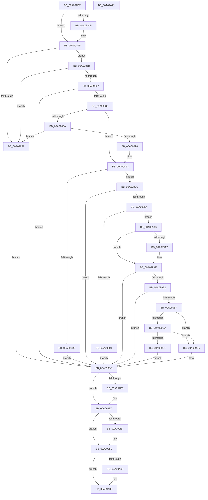

# CmGetMatchingFilteredDeviceInterfaceListWorker

- RVA: `0x00A097EC`–`0x00A09A23` (길이 `567` bytes)
- VA: `0x0000000140A097EC`
- 실행 섹션: `PAGE`
- PDB 이름 있음: `예`; PDB Function 태그: `아니요`
- unwind 정보 RVA: `0x000A8820`
- 디코드: `144`개 명령, `567/567` bytes 표시
- 미해석 바이트: `0` (있으면 어셈블리에 `.byte`로 보존)

> 이 문서는 커널 이미지의 기계어와 PDB 기호를 분석해 생성했습니다. 4번과 5번은 함수 원형과 자료형을 바이너리 사용 방식에서 추정한 C 해석이며 원본 소스 복구 결과는 아닙니다.

## 1. Dependencies

- 직접 호출 지점: **10**; 고유 호출 대상: **9**
- 직접 호출자로 확인된 함수: **2**
- RIP 상대 이미지 참조: **1**

### Outgoing calls
- `0x00A09876` → [_PnpCtxGetCachedContextBaseKey](../8E/_PnpCtxGetCachedContextBaseKey_function_008EFB2C.md) (function, `0x008EFB2C`)
- `0x00A0988D` → [PnpIsValidGuidString](../8F/PnpIsValidGuidString_function_008F37F8.md) (function, `0x008F37F8`)
- `0x00A098C4` → [PnpCtxRegOpenKey](../8E/PnpCtxRegOpenKey_function_008EF7B8.md) (function, `0x008EF7B8`)
- `0x00A098F4` → [ExAllocatePool2](../../poolcode/B8/ExAllocatePool2_function_00B820F0.md) (function, `0x00B820F0`)
- `0x00A09935` → [RtlStringCchCopyExW](../../text/41/RtlStringCchCopyExW_function_0041E1C0.md) (function, `0x0041E1C0`)
- `0x00A09994` → [PnpCtxRegEnumKeyWithCallback](../AA/PnpCtxRegEnumKeyWithCallback_function_00AA146C.md) (function, `0x00AA146C`)
- `0x00A099A9` → [ExFreePoolWithTag](../../poolcode/B8/ExFreePoolWithTag_function_00B82870.md) (function, `0x00B82870`)
- `0x00A099E5` → [ExFreePool](../../poolcode/B8/ExFreePool_function_00B82850.md) (function, `0x00B82850`)
- `0x00A099F4` → [ExFreePoolWithTag](../../poolcode/B8/ExFreePoolWithTag_function_00B82870.md) (function, `0x00B82870`)
- `0x00A09A03` → [ZwClose](../../text/6A/ZwClose_function_006AD2B0.md) (function, `0x006AD2B0`)

### Direct callers
- [IopGetDeviceInterfaces](../8F/IopGetDeviceInterfaces_function_008F0120.md) at `0x008F081D`
- [_CmGetMatchingFilteredDeviceInterfaceList](_CmGetMatchingFilteredDeviceInterfaceList_function_00A09610.md) at `0x00A09765`

### Static image references
- `0x00A09942` → RVA `0x0082C940` (`CmDeviceClassesSubkeyCallback`; read)

## 2. Other-region calls and transfers

- 다른 실행 섹션으로 향하는 call: **6**
  - `0x00A098F4` → [ExAllocatePool2](../../poolcode/B8/ExAllocatePool2_function_00B820F0.md) (`PAGE` → `POOLCODE`)
  - `0x00A09935` → [RtlStringCchCopyExW](../../text/41/RtlStringCchCopyExW_function_0041E1C0.md) (`PAGE` → `.text`)
  - `0x00A099A9` → [ExFreePoolWithTag](../../poolcode/B8/ExFreePoolWithTag_function_00B82870.md) (`PAGE` → `POOLCODE`)
  - `0x00A099E5` → [ExFreePool](../../poolcode/B8/ExFreePool_function_00B82850.md) (`PAGE` → `POOLCODE`)
  - `0x00A099F4` → [ExFreePoolWithTag](../../poolcode/B8/ExFreePoolWithTag_function_00B82870.md) (`PAGE` → `POOLCODE`)
  - `0x00A09A03` → [ZwClose](../../text/6A/ZwClose_function_006AD2B0.md) (`PAGE` → `.text`)
- 별도 외부 분기/꼬리 이동을 확인하지 못했습니다.

## 3. Assembly (complete function range)

```asm
00A097EC  48 8B C4                        mov rax, rsp
00A097EF  48 89 58 10                     mov qword ptr [rax + 0x10], rbx
00A097F3  4C 89 40 18                     mov qword ptr [rax + 0x18], r8
00A097F7  48 89 48 08                     mov qword ptr [rax + 8], rcx
00A097FB  55                              push rbp
00A097FC  56                              push rsi
00A097FD  57                              push rdi
00A097FE  41 54                           push r12
00A09800  41 55                           push r13
00A09802  41 56                           push r14
00A09804  41 57                           push r15
00A09806  48 83 EC 50                     sub rsp, 0x50
00A0980A  4C 8B BC 24 D0 00 00 00         mov r15, qword ptr [rsp + 0xd0]
00A09812  45 33 E4                        xor r12d, r12d
00A09815  44 8B AC 24 C8 00 00 00         mov r13d, dword ptr [rsp + 0xc8]
00A0981D  0F 57 C0                        xorps xmm0, xmm0
00A09820  4C 8B B4 24 C0 00 00 00         mov r14, qword ptr [rsp + 0xc0]
00A09828  41 8B E9                        mov ebp, r9d
00A0982B  4C 89 60 B0                     mov qword ptr [rax - 0x50], r12
00A0982F  48 8B F2                        mov rsi, rdx
00A09832  45 89 27                        mov dword ptr [r15], r12d
00A09835  41 8B FC                        mov edi, r12d
00A09838  4C 89 60 A8                     mov qword ptr [rax - 0x58], r12
00A0983C  0F 11 40 B8                     movups xmmword ptr [rax - 0x48], xmm0
00A09840  45 85 ED                        test r13d, r13d
00A09843  74 04                           je 0x140a09849
00A09845  66 45 89 26                     mov word ptr [r14], r12w
00A09849  F7 C5 FE FF FF FF               test ebp, 0xfffffffe
00A0984F  74 0A                           je 0x140a0985b
00A09851  BB 0D 00 00 C0                  mov ebx, 0xc000000d
00A09856  E9 80 01 00 00                  jmp 0x140a099db
00A0985B  0F B7 84 24 D8 00 00 00         movzx eax, word ptr [rsp + 0xd8]
00A09863  85 C0                           test eax, eax
00A09865  75 EA                           jne 0x140a09851
00A09867  44 8D 60 01                     lea r12d, [rax + 1]
00A0986B  4C 8D 44 24 38                  lea r8, [rsp + 0x38]
00A09870  41 23 EC                        and ebp, r12d
00A09873  8D 50 09                        lea edx, [rax + 9]
00A09876  E8 B1 62 EE FF                  call 0x1408efb2c
00A0987B  8B D8                           mov ebx, eax
00A0987D  85 C0                           test eax, eax
00A0987F  0F 88 56 01 00 00               js 0x140a099db
00A09885  48 85 F6                        test rsi, rsi
00A09888  74 12                           je 0x140a0989c
00A0988A  48 8B CE                        mov rcx, rsi
00A0988D  E8 66 9F EE FF                  call 0x1408f37f8
00A09892  84 C0                           test al, al
00A09894  74 BB                           je 0x140a09851
00A09896  41 BC 02 00 00 00               mov r12d, 2
00A0989C  48 8B 54 24 38                  mov rdx, qword ptr [rsp + 0x38]
00A098A1  48 8D 44 24 30                  lea rax, [rsp + 0x30]
00A098A6  4C 8B C6                        mov r8, rsi
00A098A9  48 89 44 24 28                  mov qword ptr [rsp + 0x28], rax
00A098AE  48 8B B4 24 90 00 00 00         mov rsi, qword ptr [rsp + 0x90]
00A098B6  45 33 C9                        xor r9d, r9d
00A098B9  48 8B CE                        mov rcx, rsi
00A098BC  C7 44 24 20 08 00 00 00         mov dword ptr [rsp + 0x20], 8
00A098C4  E8 EF 5E EE FF                  call 0x1408ef7b8
00A098C9  8B D8                           mov ebx, eax
00A098CB  3D 7C 01 00 C0                  cmp eax, 0xc000017c
00A098D0  75 0A                           jne 0x140a098dc
00A098D2  BB E5 00 00 C0                  mov ebx, 0xc00000e5
00A098D7  E9 FF 00 00 00                  jmp 0x140a099db
00A098DC  85 C0                           test eax, eax
00A098DE  0F 88 F7 00 00 00               js 0x140a099db
00A098E4  BA B8 05 00 00                  mov edx, 0x5b8
00A098E9  B9 00 01 00 00                  mov ecx, 0x100
00A098EE  41 B8 50 4E 50 52               mov r8d, 0x52504e50
00A098F4  E8 F7 87 17 00                  call 0x140b820f0
00A098F9  48 8B F8                        mov rdi, rax
00A098FC  48 85 C0                        test rax, rax
00A098FF  75 0A                           jne 0x140a0990b
00A09901  BB 17 00 00 C0                  mov ebx, 0xc0000017
00A09906  E9 D0 00 00 00                  jmp 0x140a099db
00A0990B  4C 8B 84 24 A0 00 00 00         mov r8, qword ptr [rsp + 0xa0]
00A09913  48 8D 88 F4 03 00 00            lea rcx, [rax + 0x3f4]
00A0991A  44 89 20                        mov dword ptr [rax], r12d
00A0991D  45 33 C9                        xor r9d, r9d
00A09920  45 33 E4                        xor r12d, r12d
00A09923  C7 44 24 28 00 09 00 00         mov dword ptr [rsp + 0x28], 0x900
00A0992B  BA C8 00 00 00                  mov edx, 0xc8
00A09930  4C 89 64 24 20                  mov qword ptr [rsp + 0x20], r12
00A09935  E8 86 48 A1 FF                  call 0x14041e1c0
00A0993A  48 8B 84 24 B0 00 00 00         mov rax, qword ptr [rsp + 0xb0]
00A09942  4C 8D 05 F7 2F E2 FF            lea r8, [rip - 0x1dd009]
00A09949  48 89 87 98 05 00 00            mov qword ptr [rdi + 0x598], rax
00A09950  4C 8B CF                        mov r9, rdi
00A09953  48 8B 84 24 B8 00 00 00         mov rax, qword ptr [rsp + 0xb8]
00A0995B  48 8B CE                        mov rcx, rsi
00A0995E  48 89 87 A0 05 00 00            mov qword ptr [rdi + 0x5a0], rax
00A09965  4C 89 A7 88 05 00 00            mov qword ptr [rdi + 0x588], r12
00A0996C  44 89 A7 90 05 00 00            mov dword ptr [rdi + 0x590], r12d
00A09973  40 88 AF 94 05 00 00            mov byte ptr [rdi + 0x594], bpl
00A0997A  4C 89 B7 A8 05 00 00            mov qword ptr [rdi + 0x5a8], r14
00A09981  44 89 AF B0 05 00 00            mov dword ptr [rdi + 0x5b0], r13d
00A09988  44 89 A7 B4 05 00 00            mov dword ptr [rdi + 0x5b4], r12d
00A0998F  48 8B 54 24 30                  mov rdx, qword ptr [rsp + 0x30]
00A09994  E8 D3 7A 09 00                  call 0x140aa146c
00A09999  48 8B 8F 88 05 00 00            mov rcx, qword ptr [rdi + 0x588]
00A099A0  8B D8                           mov ebx, eax
00A099A2  48 85 C9                        test rcx, rcx
00A099A5  74 07                           je 0x140a099ae
00A099A7  33 D2                           xor edx, edx
00A099A9  E8 C2 8E 17 00                  call 0x140b82870
00A099AE  85 DB                           test ebx, ebx
00A099B0  78 29                           js 0x140a099db
00A099B2  8B 87 B4 05 00 00               mov eax, dword ptr [rdi + 0x5b4]
00A099B8  41 89 07                        mov dword ptr [r15], eax
00A099BB  85 C0                           test eax, eax
00A099BD  74 1C                           je 0x140a099db
00A099BF  8D 48 01                        lea ecx, [rax + 1]
00A099C2  41 89 0F                        mov dword ptr [r15], ecx
00A099C5  4D 85 F6                        test r14, r14
00A099C8  74 0C                           je 0x140a099d6
00A099CA  44 3B E9                        cmp r13d, ecx
00A099CD  72 07                           jb 0x140a099d6
00A099CF  66 45 89 24 46                  mov word ptr [r14 + rax*2], r12w
00A099D4  EB 05                           jmp 0x140a099db
00A099D6  BB 23 00 00 C0                  mov ebx, 0xc0000023
00A099DB  48 8B 4C 24 48                  mov rcx, qword ptr [rsp + 0x48]
00A099E0  48 85 C9                        test rcx, rcx
00A099E3  74 05                           je 0x140a099ea
00A099E5  E8 66 8E 17 00                  call 0x140b82850
00A099EA  48 85 FF                        test rdi, rdi
00A099ED  74 0A                           je 0x140a099f9
00A099EF  33 D2                           xor edx, edx
00A099F1  48 8B CF                        mov rcx, rdi
00A099F4  E8 77 8E 17 00                  call 0x140b82870
00A099F9  48 8B 4C 24 30                  mov rcx, qword ptr [rsp + 0x30]
00A099FE  48 85 C9                        test rcx, rcx
00A09A01  74 05                           je 0x140a09a08
00A09A03  E8 A8 38 CA FF                  call 0x1406ad2b0
00A09A08  8B C3                           mov eax, ebx
00A09A0A  48 8B 9C 24 98 00 00 00         mov rbx, qword ptr [rsp + 0x98]
00A09A12  48 83 C4 50                     add rsp, 0x50
00A09A16  41 5F                           pop r15
00A09A18  41 5E                           pop r14
00A09A1A  41 5D                           pop r13
00A09A1C  41 5C                           pop r12
00A09A1E  5F                              pop rdi
00A09A1F  5E                              pop rsi
00A09A20  5D                              pop rbp
00A09A21  C3                              ret
00A09A22  CC                              int3
```

## 4. C-style interpretation (structured pseudocode)

```c
__int64 __fastcall CmGetMatchingFilteredDeviceInterfaceListWorker(__int64 a1, __int64 a2, __int64 a3, int a4, __int64 a5, __int64 a6, __int64 a7, unsigned int a8, __int64 a9, unsigned __int16 a10)
{
    __int64 result;
    __int64 v_r12;
    __int64 v_rbp;
    __int64 v_rsp;
    unsigned __int64 v_stack_m40;
    unsigned __int64 v_stack_m50;
    unsigned __int64 v_stack_m58;
    unsigned __int64 v_stack_m60;
    unsigned int v_stack_m68;
    unsigned __int64 v_stack_p10;
    unsigned __int64 v_stack_p18;
    unsigned __int64 v_stack_p8;

    *(unsigned __int64 *)(v_rsp + 16) = v_rbx;
    *(unsigned __int64 *)(v_rsp + 24) = a3;
    *(unsigned __int64 *)(v_rsp + 8) = a1;
    v_rsp = (v_rsp) - (80);
    v_r12 = 0;
    *(unsigned __int64 *)(v_rsp - 80) = 0;
    *(unsigned int *)(a9) = 0;
    *(unsigned __int64 *)(v_rsp - 88) = 0;
    *(unsigned __int64 *)(v_rsp - 72) = v_xmm0;
    if ((unsigned int)((unsigned int)(a8)) != 0) {
        *(unsigned __int16 *)(a7) = 0;
    }
    if ((((unsigned int)((unsigned int)(a4))) & (0xFFFFFFFEULL)) == 0) goto loc_00A0985B;
loc_00A09851:
    goto loc_00A099DB;
loc_00A0985B:
    if (a10 != 0) goto loc_00A09851;
    v_rbp = (unsigned int)(((unsigned int)(a4)) & ((unsigned int)(a10 + 1)));
    result = _PnpCtxGetCachedContextBaseKey(a1, a10 + 9, v_stack_m50, a4);
    if (sign_flag) goto loc_00A099DB;
    if (a2 == 0) goto loc_00A0989C;
    result = PnpIsValidGuidString(a2, a10 + 9, v_stack_m50, a4);
    if ((unsigned __int8)(result) == 0) goto loc_00A09851;
loc_00A0989C:
    v_stack_m60 = v_stack_m58;
    a4 = 0;
    v_stack_m68 = 8;
    result = PnpCtxRegOpenKey(v_stack_p8, v_stack_m50, a2, a4);
    if (((unsigned int)(result)) != 0xC000017CULL) goto loc_00A098DC;
    goto loc_00A099DB;
loc_00A098DC:
    if (sign_flag) goto loc_00A099DB;
    result = ExAllocatePool2(256, (unsigned int)(0x5B8ULL), (unsigned int)(0x52504E50ULL), a4);
    if (result != 0) goto loc_00A0990B;
    goto loc_00A099DB;
loc_00A0990B:
    *(unsigned int *)(result) = 2;
    a4 = 0;
    v_r12 = 0;
    v_stack_m60 = 0x900ULL;
    v_stack_m68 = 0;
    result = RtlStringCchCopyExW(result + 1012, 200, v_stack_p18, a4);
    *(unsigned __int64 *)(result + 1432) = a5;
    *(unsigned __int64 *)(result + 1440) = a6;
    *(unsigned __int64 *)(result + 1416) = 0;
    *(unsigned int *)(result + 1424) = 0;
    *(unsigned __int8 *)(result + 1428) = (unsigned __int8)(v_rbp);
    *(unsigned __int64 *)(result + 1448) = a7;
    *(unsigned int *)(result + 1456) = (unsigned int)((unsigned int)(a8));
    *(unsigned int *)(result + 1460) = 0;
    result = PnpCtxRegEnumKeyWithCallback(v_stack_p8, v_stack_m58, v_rip - 1953801, result);
    if (*(unsigned __int64 *)(result + 1416) != 0) {
        a2 = 0;
        result = ExFreePoolWithTag(*(unsigned __int64 *)(result + 1416), a2, v_rip - 1953801, result);
    }
    if (sign_flag) goto loc_00A099DB;
    *(unsigned int *)(a9) = (unsigned int)((unsigned int)(*(unsigned int *)(result + 1460)));
    if ((unsigned int)((unsigned int)(*(unsigned int *)(result + 1460))) == 0) goto loc_00A099DB;
    *(unsigned int *)(a9) = (unsigned int)((unsigned int)(*(unsigned int *)(result + 1460)) + 1);
    if (a7 == 0) goto loc_00A099D6;
    if (((unsigned int)((unsigned int)(a8))) < ((unsigned int)((unsigned int)(*(unsigned int *)(result + 1460)) + 1))) goto loc_00A099D6;
    *(unsigned __int16 *)(a7 + (unsigned int)(*(unsigned int *)(result + 1460)) * 2) = 0;
    goto loc_00A099DB;
loc_00A099D6:
loc_00A099DB:
    result = (unsigned int)(*(unsigned int *)(result + 1460));
    if (v_stack_m40 != 0) {
        result = ExFreePool(v_stack_m40, a2, v_rip - 1953801, result);
    }
    if (result != 0) {
        a2 = 0;
        a1 = result;
        result = ExFreePoolWithTag(a1, a2, v_rip - 1953801, result);
    }
    if (v_stack_m58 != 0) {
        result = ZwClose(v_stack_m58, a2, v_rip - 1953801, result);
    }
    v_rsp = (v_rsp) + (80);
    return (unsigned int)((unsigned int)((unsigned int)(0xC0000023ULL)));
}
```

## 5. (Beta) C Style

```c
int64_t CmGetMatchingFilteredDeviceInterfaceListWorker(int64_t Arg1, int64_t Arg2, int64_t Arg3, int32_t Arg4, int64_t Arg5, int64_t Arg6, void *Arg7, uint32_t Arg8, void *Arg9, uint16_t Arg10)
{
    uint8_t *arg7 = (uint8_t *)Arg7;
    uint8_t *arg9 = (uint8_t *)Arg9;

    int64_t result;
    int64_t local_r12;
    int64_t local_rbp;
    int64_t local_rsp;
    uint64_t v_stack_m40;
    uint64_t v_stack_m50;
    uint64_t v_stack_m58;
    uint64_t v_stack_m60;
    uint32_t v_stack_m68;
    uint64_t v_stack_p10;
    uint64_t v_stack_p18;
    uint64_t v_stack_p8;

    *(uint64_t *)(local_rsp + 0x10) = local_rbx;
    *(uint64_t *)(local_rsp + 0x18) = Arg3;
    *(uint64_t *)(local_rsp + 0x8) = Arg1;
    local_rsp = (local_rsp) - (80);
    local_r12 = 0;
    *(uint64_t *)(local_rsp - 0x50) = 0;
    *(uint32_t *)(arg9) = 0;
    *(uint64_t *)(local_rsp - 0x58) = 0;
    *(uint64_t *)(local_rsp - 0x48) = v_xmm0;
    if ((uint32_t)((uint32_t)(Arg8)) != 0) {
        *(uint16_t *)(arg7) = 0;
    }
    if ((((uint32_t)((uint32_t)(Arg4))) & (0xFFFFFFFEULL)) == 0) goto loc_00A0985B;
loc_00A09851:
    goto loc_00A099DB;
loc_00A0985B:
    if (Arg10 != 0) goto loc_00A09851;
    local_rbp = (uint32_t)(((uint32_t)(Arg4)) & ((uint32_t)(Arg10 + 1)));
    result = _PnpCtxGetCachedContextBaseKey(Arg1, Arg10 + 9, v_stack_m50, Arg4);
    if (sign_flag) goto loc_00A099DB;
    if (Arg2 == 0) goto loc_00A0989C;
    result = PnpIsValidGuidString(Arg2, Arg10 + 9, v_stack_m50, Arg4);
    if ((uint8_t)(result) == 0) goto loc_00A09851;
loc_00A0989C:
    v_stack_m60 = v_stack_m58;
    Arg4 = 0;
    v_stack_m68 = 8;
    result = PnpCtxRegOpenKey(v_stack_p8, v_stack_m50, Arg2, Arg4);
    if (((uint32_t)(result)) != 0xC000017CULL) goto loc_00A098DC;
    goto loc_00A099DB;
loc_00A098DC:
    if (sign_flag) goto loc_00A099DB;
    result = ExAllocatePool2(256, (uint32_t)(0x5B8ULL), (uint32_t)(0x52504E50ULL), Arg4);
    if (result != 0) goto loc_00A0990B;
    goto loc_00A099DB;
loc_00A0990B:
    *(uint32_t *)(result) = 2;
    Arg4 = 0;
    local_r12 = 0;
    v_stack_m60 = 0x900ULL;
    v_stack_m68 = 0;
    result = RtlStringCchCopyExW(result + 1012, 200, v_stack_p18, Arg4);
    *(uint64_t *)(result + 0x598) = Arg5;
    *(uint64_t *)(result + 0x5A0) = Arg6;
    *(uint64_t *)(result + 0x588) = 0;
    *(uint32_t *)(result + 0x590) = 0;
    *(uint8_t *)(result + 0x594) = (uint8_t)(local_rbp);
    *(void **)(result + 0x5A8) = Arg7;
    *(uint32_t *)(result + 0x5B0) = (uint32_t)((uint32_t)(Arg8));
    *(uint32_t *)(result + 0x5B4) = 0;
    result = PnpCtxRegEnumKeyWithCallback(v_stack_p8, v_stack_m58, v_rip - 1953801, result);
    if (*(uint64_t *)(result + 0x588) != 0) {
        Arg2 = 0;
        result = ExFreePoolWithTag(*(uint64_t *)(result + 0x588), Arg2, v_rip - 1953801, result);
    }
    if (sign_flag) goto loc_00A099DB;
    *(uint32_t *)(arg9) = (uint32_t)((uint32_t)(*(uint32_t *)(result + 0x5B4)));
    if ((uint32_t)((uint32_t)(*(uint32_t *)(result + 0x5B4))) == 0) goto loc_00A099DB;
    *(uint32_t *)(arg9) = (uint32_t)((uint32_t)(*(uint32_t *)(result + 0x5B4)) + 1);
    if (Arg7 == NULL) goto loc_00A099D6;
    if (((uint32_t)((uint32_t)(Arg8))) < ((uint32_t)((uint32_t)(*(uint32_t *)(result + 0x5B4)) + 1))) goto loc_00A099D6;
    *(uint16_t *)(arg7 + (uint32_t)(*(uint32_t *)(result + 0x5B4)) * 2) = 0;
    goto loc_00A099DB;
loc_00A099D6:
loc_00A099DB:
    result = (uint32_t)(*(uint32_t *)(result + 0x5B4));
    if (v_stack_m40 != 0) {
        result = ExFreePool(v_stack_m40, Arg2, v_rip - 1953801, result);
    }
    if (result != 0) {
        Arg2 = 0;
        Arg1 = result;
        result = ExFreePoolWithTag(Arg1, Arg2, v_rip - 1953801, result);
    }
    if (v_stack_m58 != 0) {
        result = ZwClose(v_stack_m58, Arg2, v_rip - 1953801, result);
    }
    local_rsp = (local_rsp) + (80);
    return (uint32_t)((uint32_t)((uint32_t)(0xC0000023ULL)));
}
```

### 관측된 메모리 오프셋

구조체 형식이 확인되지 않은 접근은 인자 기준의 오프셋으로만 기록했습니다.

| 기준 인자 | 오프셋 표현 | 폭 (bit) | 접근 |
|---|---:|---:|---|
| `Arg7` | `+ 0x0` | `16` | `W` |
| `Arg9` | `+ 0x0` | `32` | `W` |

## 6. Execution-region graph

[열기: 2D/3D 그래프와 함수 탐색 컨트롤 패널](../../../control-panel.html?section=page&rva=0x00A097EC&view=graph)

- 2D 그래프는 위에서 아래로 흐르고, 3D 그래프는 빈 공간을 드래그해 회전합니다. Shift+드래그는 이동, 휠은 확대·축소, 함수 노드 선택은 대상 보고서 이동입니다.

### Static fallback


